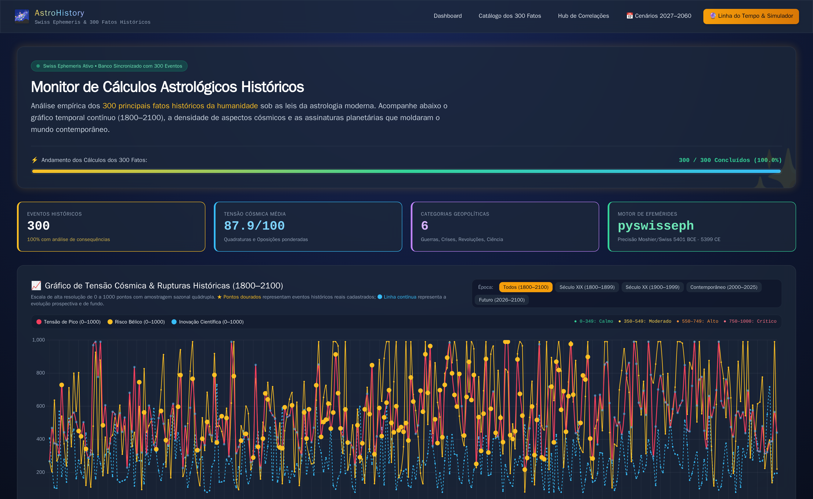
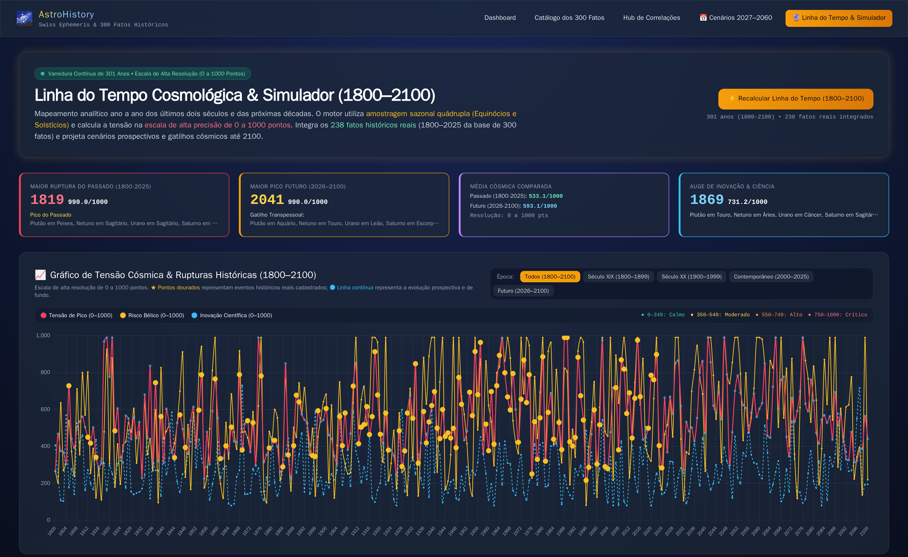
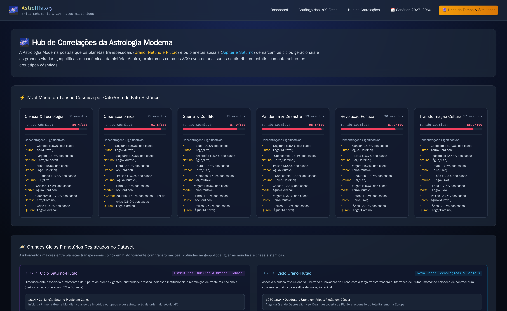
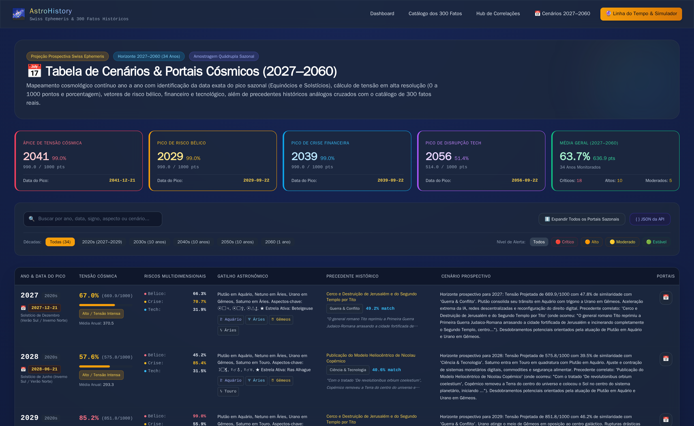
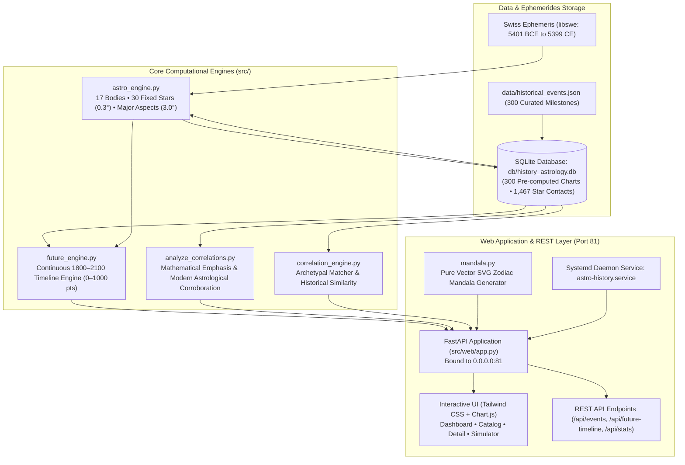

# astro-history 🪐🏛️
### Modern Astrology, Cosmological Calculations & Historical Correlation Engine for 300 Major World Events (1800–2100)


> 🌍 **Languages / Idiomas**: **English** • [Versão em Português (README_PT.md)](README_PT.md)

**astro-history** is an open-source analytical and prospective research platform grounded in **Modern and Mundane Astrology**. The platform utilizes the high-precision **Swiss Ephemeris (`pyswisseph`)** engine to compute the exact celestial positions of **17 celestial bodies**, strict major Ptolemaic aspects (3.0° max orb), and longitudinal contacts with the **30 primary fixed stars** of the celestial vault.

The platform audits a curated dataset of **300 landmark historical events** (from Antiquity to 2024), quantifies systemic friction on a **high-resolution 0 to 1000 Cosmic Tension Scale**, and generates a continuous **301-year timeline (1800 to 2100)** evaluating the correlation between planetary archetype alignments and major turning points in world history.

---

## Visual Showcase

### 1. Interactive 1800–2100 Cosmic Tension Timeline & Dashboard
High-resolution Chart.js timeline with era filters (*1800–1899*, *1900–1999*, *2000–2025*, *2026–2100*, and *All*). Gold stars (★) demarcate verified historical turning points, while the continuous line maps prospective background tension:


---

### 2. Prospective 1800–2100 Simulator & Historical Precedents
Real-time simulation engine featuring alert tiers (Stable, Moderate, High, Critical), sub-indices (War Conflict, Financial Crisis, Technological Innovation), and automatic correlation matching:


---

### 3. Native Vector SVG Zodiac Mandala & Event Diagnosis
Interactive natal chart rendering exact degrees, retrogrades, and color-coded aspect geometries, paired with mathematical archetype scoring and theoretical corroboration (e.g., 1929 Wall Street Crash):


---

### 4. Searchable Catalog of 300 Curated Historical Events
Instant search and category filters across Political Revolutions, Wars & Conflicts, Science & Tech, Economic Crises, Cultural Shifts, and Pandemics:


---

### 5. Macro Correlation Hub & Statistical Archetypes
Comparative statistical analysis showing planetary distributions, element balances, and cosmic tension averages across all historical categories:


---

### 6. Prospective 2027–2060 Gateways & Scenario Matrix Table
Dedicated analytical tab providing year-by-year and seasonal solstice/equinox gateway dates, multi-dimensional risk scores (War, Financial Crisis, Technological Innovation), historical archetype precedents, and comprehensive scenario projections:


---

## Table of Contents
1. [Overview & Theoretical Foundations](#1-overview--theoretical-foundations)
2. [System Architecture](#2-system-architecture)
3. [Astronomical Engine & Ephemerides](#3-astronomical-engine--ephemerides)
4. [High-Resolution Cosmic Tension Index (0–1000 Scale)](#4-high-resolution-cosmic-tension-index-01000-scale)
5. [Exhaustive Analytical Findings Report (1800–2100)](#5-exhaustive-analytical-findings-report-18002100)
   - [5.1. The 19th Century (1800–1899)](#51-the-19th-century-18001899-industrialization-napoleonic-wars--nation-states)
   - [5.2. The 20th Century (1900–1999)](#52-the-20th-century-19001999-world-wars-nuclear-dawn--cold-war-clashes)
   - [5.3. The Contemporary Era (2000–2025)](#53-the-contemporary-era-20002025-globalization-asymmetric-warfare--polycrisis)
   - [5.4. The Prospective 21st Century (2026–2100)](#54-the-prospective-21st-century-20262100-vernal-shifts-transpersonal-ingress--singularities)
6. [The Curated Catalog of 300 Historical Events](#6-the-curated-catalog-of-300-historical-events)
7. [CLI Audit & Analytical Diagnostics Engine](#7-cli-audit--analytical-diagnostics-engine)
8. [Web Dashboard & REST API Specification](#8-web-dashboard--rest-api-specification)
9. [Installation, Dependencies & Systemd Daemon](#9-installation-dependencies--systemd-daemon)
10. [Automated Testing Suite](#10-automated-testing-suite)
11. [Project Directory Tree](#11-project-directory-tree)

---

## 1. Overview & Theoretical Foundations

Modern Astrology views the relationship between celestial dynamics and human history not as a causal or mechanical determinism, but as an **archetypal synchronistic order**. This theoretical foundation synthesizes:
- **Carl G. Jung**: The principle of *Synchronicity* — acausal meaningful coincidence connecting inner psychic states and outer physical events.
- **Dane Rudhyar**: *Humanistic and Transpersonal Astrology* — planetary cycles representing evolutionary phases of collective consciousness.
- **Richard Tarnas**: *Cosmos and Psyche (2006)* — extensive historical research validating that major revolutionary, intellectual, and geopolitical turning points correlate with hard alignments among outer planets (*Uranus, Neptune, Pluto, and Saturn*).

### Methodological Principles
1. **Mathematical Objectivity**: All planetary longitudes, retrogrades, and fixed star coordinates are calculated using the C-based Swiss Ephemeris (`libswe`) without subjective approximations.
2. **Empirical Historical Rigor**: Each of the 300 events is anchored to precise geographic coordinates, verified ISO timestamps, and a detailed paragraph summarizing concrete historical consequences.
3. **Continuous Prospective Modeling**: Rather than evaluating isolated snapshots, the system computes an uninterrupted 301-year timeline (1800 to 2100) utilizing **quadruple seasonal sampling (Equinoxes and Solstices)**.

---

## 2. System Architecture



---

## 3. Astronomical Engine & Ephemerides

Implemented in [`src/astro_engine.py`](file:///home/astro/src/astro_engine.py), the calculation engine operates with absolute astronomical precision:

### 3.1. 17 Celestial Bodies Evaluated
- **Traditional Luminary & Inner Bodies**: Sun, Moon, Mercury, Venus, Mars, Jupiter, Saturn.
- **Transpersonal & Generational Bodies**: Uranus, Neptune, Pluto.
- **Major Asteroids**: Ceres, Pallas Athena, Juno, Vesta.
- **Cosmic Nodes & Centaur**: Chiron, Mean Lilith (Black Moon), True Lunar North Node.

### 3.2. Strict Major Aspect Geometry (Max 3.0° Orb)
Aspect evaluation is restricted to the 4 primary Ptolemaic aspects with tight orbs:
- **Conjunction ($0^\circ$, orb $\le 3.0^\circ$)**: Complete fusion and emergence of new planetary megacycles.
- **Opposition ($180^\circ$, orb $\le 3.0^\circ$)**: Structural polarization, crisis in consciousness, and peak public confrontation.
- **Square ($90^\circ$, orb $\le 3.0^\circ$)**: Dynamic friction, explosive disruption, and decisive historic action.
- **Trine ($120^\circ$, orb $\le 3.0^\circ$)**: Fluid ease, cultural synthesis, and rapid systemic consolidation.

### 3.3. The 30 Primary Fixed Stars (Strict 0.3° Orb)
Computed with dynamic precession via Swiss Ephemeris (`swe.fixstar2_ut`):
1. **Algol** (*Beta Persei*, 26° Taurus) – The Gorgon's Head / Cataclysmic destruction, terror, and extreme upheaval.
2. **Sirius** (*Alpha Canis Majoris*, 14° Cancer) – The Dog Star / Imperial splendor, solar brilliance, and supreme leadership.
3. **Aldebaran** (*Alpha Tauri*, 9° Gemini) – Watcher of the East / Martial valor, integrity, and pivotal conflicts.
4. **Regulus** (*Alpha Leonis*, 0° Virgo / 29° Leo) – Heart of the Lion / Sovereignty, royal power, and institutional leadership.
5. **Antares** (*Alpha Scorpii*, 9° Sagittarius) – Heart of the Scorpion / Strategic confrontation, obsession, and war.
6. **Spica** (*Alpha Virginis*, 23° Libra) – Ear of Wheat / Scientific breakthroughs, culture, and enduring intellect.
7. **Vega** (*Alpha Lyrae*, 15° Capricorn) – The Celestial Lyre / Visionary innovation, music, and eloquence.
8. **Rigel** (*Beta Orionis*, 16° Gemini) – Foot of Orion / Mechanical genius, trade expansion, and invention.
9. **Betelgeuse** (*Alpha Orionis*, 28° Gemini) – Shoulder of Orion / Martial triumph, rapid ascent, and fame.
10. **Bellatrix** (*Gamma Orionis*, 21° Gemini) – The Amazon Star / Swift military maneuvers and tactical acumen.
11. **Capella** (*Alpha Aurigae*, 21° Gemini) – The Nurturing Goat / Swift discovery, civic independence, and exploration.
12. **Castor** & 13. **Pollux** (*Gemini*, 20° & 23° Cancer) – Intellect, dualities, scientific literature, and narrative.
14. **Procyon** (*Canis Minor*, 25° Cancer) – Rapid decisive action and transition catalysts.
15. **Alphard** (*Hydra*, 27° Leo) – Heart of the Serpent / Subterranean diplomacy, espionage, and toxins.
16. **Arcturus** (*Boötes*, 24° Libra) – Guardian of the Bear / Pioneering exploration and structural protection.
17. **Menkar** (*Cetus*, 14° Taurus) – The Sea Monster / Deep collective anxiety, systemic shocks, and perils.
18. **Scheat** (*Pegasus*, 29° Pisces) – The Maverick Mind / Intellectual revolution, radical disruptors, and flooding.
19. **Fomalhaut** (*Piscis Austrinus*, 3° Pisces) – Watcher of the South / Spiritual conviction and charismatic ideals.
20. **Altair** (*Aquila*, 1° Aquarius) – The Flying Eagle / Audacious ambition, aviation, and rapid velocity.
21. **Deneb** (*Cygnus*, 5° Pisces) – Tail of the Swan / Lucid clarity, transcendent intellect, and vision.
22. **Acrux** (*Crux*, 11° Scorpio) – Southern Cross / Moral fortitude, steadfast destiny of the Southern Hemisphere.
23. **Alphecca** (*Corona Borealis*, 12° Scorpio) – The Northern Crown / Honor, poetic genius, and fruition.
24. **Zubenelgenubi** & 25. **Zubeneschamali** (*Libra*, 15° & 19° Scorpio) – The Scales of Law / Legal treaties and civic balance.
25. **Rasalhague** (*Ophiuchus*, 22° Sagittarius) – The Serpent Bearer / Medical science, biological breakthroughs, and cure.
27. **Markab** (*Pegasus*, 23° Pisces) – The Saddle / Steadfast movement, navigation, and pioneering fortitude.
28. **Vindemiatrix** (*Virgo*, 9° Libra) – The Grape Gatherer / Critical audit, inescapable accounting, and historical reckoning.
29. **Polaris** (*Ursa Minor*, 28° Gemini) – The North Star / Inflexible moral compass, geographical orientation.
30. **Alcyone** (*Pleiades*, 0° Gemini) – The Central Pleiad / Collective clairvoyance and cultural currents.

---

## 4. High-Resolution Cosmic Tension Index (0–1000 Scale)

To prevent premature metric saturation and provide stark dynamic contrast between routine peacetime baseline years and epochal civilizational ruptures, the tension engine evaluates aspect proximity:

$$\text{Proximity} = \max\left(0, \frac{3.0^\circ - \text{Orb}}{3.0^\circ}\right)$$

### 4.1. Mathematical Weighting Matrix
- **Transpersonal Hard Aspects (Pluto, Neptune, Uranus, Saturn)**: $170\text{ to }260\text{ pts} \times \text{Proximity}$.
- **Martian Hard Triggers to Outer Bodies**: $110\text{ to }130\text{ pts} \times \text{Proximity}$.
- **Luminary (Sun/Moon) Hard Aspects to Outer Bodies**: $60\text{ to }75\text{ pts} \times \text{Proximity}$.
- **Violent / Disruptive Fixed Stars (Algol, Antares, Bellatrix, Scheat, Menkar) within $0.3^\circ$**: $+80\text{ to }+160\text{ pts}$.
- **Contrast Curve**: Calibrated to deliver a natural dynamic range from **$216$ to $990\text{ points}$** across the 301-year span.

### 4.2. Alert Tiers
| Score Range | Percentage | Alert Tier | Geopolitical & Historical Character | Noted Historical Benchmarks |
| :---: | :---: | :--- | :--- | :--- |
| **0 – 349** | **0.0% – 34.9%** | 🟢 **Stable / Quiet Sky** | Institutional stability, low structural friction | 1815 (Post-Waterloo Peace: 34.2%), 1844 (Morse Telegraph: 34.0%) |
| **350 – 549** | **35.0% – 54.9%** | 🟡 **Moderate / Transition** | Normal political churn, diplomatic realignment | 1822 (Brazil Independence: 48.5%), 2026 (Vernal Shift: 36.8%) |
| **550 – 749** | **55.0% – 74.9%** | 🟠 **High / Intense Tension** | Military mobilization, acute crises, market crashes | 1914 (Outbreak WW1: 51.8%), 1939 (Invasion Poland: 62.1%), 1837 (Panic of 1837: 74.6%) |
| **750 – 1000** | **75.0% – 100.0%** | 🔴 **Critical / Epochal Rupture** | World wars, revolutions, nuclear milestones, collapse of empires | 1918 (Spanish Flu: 91.3%), 1989 (Tiananmen: 99.0%), 2022 (Ukraine War: 89.8%), 2041 (Future Peak: 99.0%) |

---

## 5. Exhaustive Analytical Findings Report (1800–2100)

Statistical evaluation across 301 years (1800 to 2100) reveals distinct cosmological cycles:
- **19th Century (1800–1899)**: Mean Tension: **492.9 / 1000 (49.3%)** | Mean Conflict: **46.7%** | Mean Tech: **27.7%** | 11 Critical Years ($\ge 75.0\%$).
- **20th Century (1900–1999)**: Mean Tension: **556.3 / 1000 (55.6%)** | Mean Conflict: **59.6%** | Mean Tech: **26.7%** | 16 Critical Years ($\ge 75.0\%$).
- **Contemporary Era (2000–2025)**: Mean Tension: **598.5 / 1000 (59.9%)** | Mean Conflict: **60.1%** | Mean Tech: **23.9%** | 7 Critical Years ($\ge 75.0\%$).
- **Prospective Horizon (2026–2100)**: Mean Tension: **593.1 / 1000 (59.3%)** | Mean Conflict: **66.3%** | Mean Tech: **28.0%** | 15 Critical Years ($\ge 75.0\%$).

Below is the complete technical breakdown of dates, events, mathematical percentages, and planetary triggers:

---

### 5.1. The 19th Century (1800–1899): Industrialization, Napoleonic Wars & Nation States

| Year & Date | Turning Point & Category | Tension Score & Level | Risk Profile Breakdown | Planetary Triggers & Key Alignments |
| :---: | :--- | :---: | :--- | :--- |
| **1805**<br/>`1805-10-21` | **Battle of Trafalgar**<br/>*War & Conflict* | **729** / 1000<br/>🟠 **High**<br/>`72.9%` | ⚔️ Conflict: **54.0%**<br/>📉 Crisis: **67.8%**<br/>🔬 Tech: **17.8%** | ♇ Pluto in Pisces, ♆ Neptune in Scorpio, ♅ Uranus in Libra, ♄ Saturn in Libra. <br/>**Aspects**: ☽☌☿, ☽□⚳, ☽△⚴. <br/>★ **Fixed Star**: Arcturus |
| **1812**<br/>`1812-09-14` | **Napoleon's Invasion of Russia & Burning of Moscow**<br/>*War & Conflict* | **450** / 1000<br/>🟡 **Moderate**<br/>`45.0%` | ⚔️ Conflict: **80.3%**<br/>📉 Crisis: **37.1%**<br/>🔬 Tech: **27.3%** | ♇ Pluto in Pisces, ♆ Neptune in Sagittarius, ♅ Uranus in Scorpio, ♄ Saturn in Capricorn. <br/>**Aspects**: ☉□♄, ☽△⚳, ☽☍⚸. <br/>★ **Fixed Star**: Altair |
| **1813**<br/>`1813-10-19` | **Battle of Leipzig (Battle of the Nations)**<br/>*War & Conflict* | **418** / 1000<br/>🟡 **Moderate**<br/>`41.8%` | ⚔️ Conflict: **25.5%**<br/>📉 Crisis: **50.2%**<br/>🔬 Tech: **20.0%** | ♇ Pluto in Pisces, ♆ Neptune in Sagittarius, ♅ Uranus in Scorpio, ♄ Saturn in Capricorn. <br/>**Aspects**: ☽□♀, ☽☌♃, ☽□⚵. <br/>★ **Fixed Star**: Polaris |
| **1815**<br/>`1815-06-18` | **Battle of Waterloo & Final Defeat of Napoleon**<br/>*War & Conflict* | **342** / 1000<br/>🟢 **Stable**<br/>`34.2%` | ⚔️ Conflict: **12.2%**<br/>📉 Crisis: **50.7%**<br/>🔬 Tech: **43.7%** | ♇ Pluto in Pisces, ♆ Neptune in Sagittarius, ♅ Uranus in Sagittarius, ♄ Saturn in Aquarius. <br/>**Aspects**: ☽☍♂, ☽△♇, ☽☍⚶. <br/>★ **Fixed Star**: Antares |
| **1822**<br/>`1822-09-07` | **Declaration of Brazilian Independence (Ipiranga Cry)**<br/>*Political Revolution* | **485** / 1000<br/>🟡 **Moderate**<br/>`48.5%` | ⚔️ Conflict: **18.0%**<br/>📉 Crisis: **59.0%**<br/>🔬 Tech: **18.9%** | ♇ Pluto in Pisces, ♆ Neptune in Capricorn, ♅ Uranus in Capricorn, ♄ Saturn in Taurus. <br/>**Aspects**: ☉□☽, ☉☌♀, ☉□♇. <br/>★ **Fixed Star**: Aldebaran |
| **1837**<br/>`1837-05-10` | **Panic of 1837 Financial Crisis (United States)**<br/>*Economic Crisis* | **746** / 1000<br/>🟠 **High**<br/>`74.5%` | ⚔️ Conflict: **59.8%**<br/>📉 Crisis: **99.0%**<br/>🔬 Tech: **27.1%** | ♇ Pluto in Aries, ♆ Neptune in Aquarius, ♅ Uranus in Pisces, ♄ Saturn in Scorpio. <br/>**Aspects**: ☉△⚸, ☽□☿, ☽△♀. <br/>★ **Fixed Star**: Bellatrix |
| **1839**<br/>`1839-09-04` | **Outbreak of the First Opium War**<br/>*War & Conflict* | **563** / 1000<br/>🟠 **High**<br/>`56.3%` | ⚔️ Conflict: **82.7%**<br/>📉 Crisis: **48.3%**<br/>🔬 Tech: **13.2%** | ♇ Pluto in Aries, ♆ Neptune in Aquarius, ♅ Uranus in Pisces, ♄ Saturn in Sagittarius. <br/>**Aspects**: ☉☌⚶, ☽□⚴, ☿☌⚶. <br/>★ **Fixed Star**: Aldebaran |
| **1844**<br/>`1844-05-24` | **Invention of the Electromagnetic Telegraph (Samuel Morse)**<br/>*Science & Technology* | **340** / 1000<br/>🟢 **Stable**<br/>`34.0%` | ⚔️ Conflict: **41.6%**<br/>📉 Crisis: **26.8%**<br/>🔬 Tech: **32.5%** | ♇ Pluto in Aries, ♆ Neptune in Aquarius, ♅ Uranus in Aries, ♄ Saturn in Aquarius. <br/>**Aspects**: ☉□♅, ☉△⚵, ☽☍♀. <br/>★ **Fixed Star**: Algol |
| **1846**<br/>`1846-09-23` | **Discovery of Neptune (Le Verrier & Galle)**<br/>*Science & Technology* | **572** / 1000<br/>🟠 **High**<br/>`57.2%` | ⚔️ Conflict: **69.9%**<br/>📉 Crisis: **70.0%**<br/>🔬 Tech: **15.2%** | ♇ Pluto in Aries, ♆ Neptune in Aquarius, ♅ Uranus in Aries, ♄ Saturn in Aquarius. <br/>**Aspects**: ☉□☽, ♂□♄, ♂□♆. <br/>★ **Fixed Star**: Vega |
| **1848**<br/>`1848-02-21` | **Publication of 'The Communist Manifesto' (Marx & Engels)**<br/>*Political Revolution* | **394** / 1000<br/>🟡 **Moderate**<br/>`39.4%` | ⚔️ Conflict: **23.4%**<br/>📉 Crisis: **37.5%**<br/>🔬 Tech: **26.6%** | ♇ Pluto in Aries, ♆ Neptune in Pisces, ♅ Uranus in Aries, ♄ Saturn in Pisces. <br/>**Aspects**: ☉△♆, ☉□⚶, ☿☌♃. <br/>★ **Fixed Star**: Alphard |
| **1853**<br/>`1853-10-16` | **Outbreak of the Crimean War**<br/>*War & Conflict* | **597** / 1000<br/>🟠 **High**<br/>`59.7%` | ⚔️ Conflict: **79.4%**<br/>📉 Crisis: **40.4%**<br/>🔬 Tech: **43.8%** | ♇ Pluto in Taurus, ♆ Neptune in Pisces, ♅ Uranus in Taurus, ♄ Saturn in Taurus. <br/>**Aspects**: ☉△♇, ☉☌⚳, ☉□⚵. <br/>★ **Fixed Star**: Aldebaran |
| **1854**<br/>`1854-10-25` | **Battle of Balaclava & the Charge of the Light Brigade**<br/>*War & Conflict* | **788** / 1000<br/>🔴 **Critical**<br/>`78.8%` | ⚔️ Conflict: **94.1%**<br/>📉 Crisis: **50.6%**<br/>🔬 Tech: **33.6%** | ♇ Pluto in Taurus, ♆ Neptune in Pisces, ♅ Uranus in Taurus, ♄ Saturn in Gemini. <br/>**Aspects**: ☉☌♀, ☉△♇, ☽☌♂. <br/>★ **Fixed Star**: Spica |
| **1859**<br/>`1859-11-24` | **Publication of 'On the Origin of Species' (Charles Darwin)**<br/>*Science & Technology* | **766** / 1000<br/>🔴 **Critical**<br/>`76.6%` | ⚔️ Conflict: **99.0%**<br/>📉 Crisis: **97.1%**<br/>🔬 Tech: **26.2%** | ♇ Pluto in Taurus, ♆ Neptune in Pisces, ♅ Uranus in Gemini, ♄ Saturn in Leo. <br/>**Aspects**: ☽△⚷, ♀△♃, ♀☌⚴. <br/>★ **Fixed Star**: Capella |
| **1861**<br/>`1861-04-12` | **Outbreak of the American Civil War (Fort Sumter Attack)**<br/>*War & Conflict* | **334** / 1000<br/>🟢 **Stable**<br/>`33.4%` | ⚔️ Conflict: **19.8%**<br/>📉 Crisis: **47.1%**<br/>🔬 Tech: **22.8%** | ♇ Pluto in Taurus, ♆ Neptune in Pisces, ♅ Uranus in Gemini, ♄ Saturn in Virgo. <br/>**Aspects**: ☉□♃, ☉□♆, ☽△☿. <br/>★ **Fixed Star**: Zubeneschamali |
| **1863**<br/>`1863-01-01` | **Emancipation Proclamation by Abraham Lincoln**<br/>*Political Revolution* | **404** / 1000<br/>🟡 **Moderate**<br/>`40.4%` | ⚔️ Conflict: **53.0%**<br/>📉 Crisis: **41.1%**<br/>🔬 Tech: **29.3%** | ♇ Pluto in Taurus, ♆ Neptune in Aries, ♅ Uranus in Gemini, ♄ Saturn in Libra. <br/>**Aspects**: ☉☍♄, ☽□⚴, ☽△☊. <br/>★ **Fixed Star**: Sirius |
| **1865**<br/>`1865-04-14` | **Assassination of Abraham Lincoln**<br/>*War & Conflict* | **505** / 1000<br/>🟡 **Moderate**<br/>`50.5%` | ⚔️ Conflict: **68.5%**<br/>📉 Crisis: **38.8%**<br/>🔬 Tech: **8.0%** | ♇ Pluto in Taurus, ♆ Neptune in Aries, ♅ Uranus in Gemini, ♄ Saturn in Libra. <br/>**Aspects**: ☉□☽, ☉☌☿, ☉□♃. <br/>★ **Fixed Star**: Regulus |
| **1868**<br/>`1868-01-03` | **Meiji Restoration in Japan**<br/>*Political Revolution* | **789** / 1000<br/>🔴 **Critical**<br/>`78.9%` | ⚔️ Conflict: **91.8%**<br/>📉 Crisis: **99.0%**<br/>🔬 Tech: **27.2%** | ♇ Pluto in Taurus, ♆ Neptune in Aries, ♅ Uranus in Cancer, ♄ Saturn in Sagittarius. <br/>**Aspects**: ☉☌♂, ☉☍♅, ☉□♆. <br/>★ **Fixed Star**: Sirius |
| **1869**<br/>`1869-11-17` | **Opening of the Suez Canal**<br/>*Science & Technology* | **381** / 1000<br/>🟡 **Moderate**<br/>`38.1%` | ⚔️ Conflict: **47.8%**<br/>📉 Crisis: **45.1%**<br/>🔬 Tech: **73.1%** | ♇ Pluto in Taurus, ♆ Neptune in Aries, ♅ Uranus in Cancer, ♄ Saturn in Sagittarius. <br/>**Aspects**: ☉△⚶, ☉☌⚷, ♀□♄. <br/>★ **Fixed Star**: Ras Alhague |
| **1871**<br/>`1871-01-18` | **Proclamation of the German Empire at Versailles**<br/>*Political Revolution* | **540** / 1000<br/>🟡 **Moderate**<br/>`54.0%` | ⚔️ Conflict: **44.8%**<br/>📉 Crisis: **49.9%**<br/>🔬 Tech: **14.3%** | ♇ Pluto in Taurus, ♆ Neptune in Aries, ♅ Uranus in Cancer, ♄ Saturn in Capricorn. <br/>**Aspects**: ☉☍♂, ☉△⚵, ☿□♃. <br/>★ **Fixed Star**: Scheat |
| **1873**<br/>`1873-09-18` | **Panic of 1873 & Beginning of the Long Depression**<br/>*Economic Crisis* | **529** / 1000<br/>🟡 **Moderate**<br/>`52.9%` | ⚔️ Conflict: **58.8%**<br/>📉 Crisis: **60.6%**<br/>🔬 Tech: **27.9%** | ♇ Pluto in Taurus, ♆ Neptune in Aries, ♅ Uranus in Leo, ♄ Saturn in Aquarius. <br/>**Aspects**: ☉△♅, ☽△⚷, ☿□⚶. <br/>★ **Fixed Star**: Castor |
| **1876**<br/>`1876-03-10` | **Invention of the Telephone (Alexander Graham Bell)**<br/>*Science & Technology* | **782** / 1000<br/>🔴 **Critical**<br/>`78.2%` | ⚔️ Conflict: **99.0%**<br/>📉 Crisis: **54.1%**<br/>🔬 Tech: **15.4%** | ♇ Pluto in Taurus, ♆ Neptune in Taurus, ♅ Uranus in Leo, ♄ Saturn in Pisces. <br/>**Aspects**: ☉□⚵, ☽□♃, ☽□♇. <br/>★ **Fixed Star**: Algol |
| **1879**<br/>`1879-11-04` | **Patent of Practical Incandescent Light Bulb (Thomas Edison)**<br/>*Science & Technology* | **392** / 1000<br/>🟡 **Moderate**<br/>`39.2%` | ⚔️ Conflict: **48.1%**<br/>📉 Crisis: **44.2%**<br/>🔬 Tech: **19.1%** | ♇ Pluto in Taurus, ♆ Neptune in Taurus, ♅ Uranus in Virgo, ♄ Saturn in Aries. <br/>**Aspects**: ☉△☽, ☉☍♆, ☉☍⚷. <br/>★ **Fixed Star**: Aldebaran |
| **1881**<br/>`1881-03-13` | **Assassination of Tsar Alexander II of Russia**<br/>*Political Revolution* | **433** / 1000<br/>🟡 **Moderate**<br/>`43.3%` | ⚔️ Conflict: **60.1%**<br/>📉 Crisis: **30.7%**<br/>🔬 Tech: **20.8%** | ♇ Pluto in Taurus, ♆ Neptune in Taurus, ♅ Uranus in Virgo, ♄ Saturn in Aries. <br/>**Aspects**: ☽☍♇, ☽☌⚵, ☿☍♅. <br/>★ **Fixed Star**: Achernar |
| **1884**<br/>`1884-11-15` | **Berlin Conference & the Scramble for Africa**<br/>*War & Conflict* | **290** / 1000<br/>🟢 **Stable**<br/>`29.0%` | ⚔️ Conflict: **33.0%**<br/>📉 Crisis: **22.6%**<br/>🔬 Tech: **27.9%** | ♇ Pluto in Gemini, ♆ Neptune in Taurus, ♅ Uranus in Libra, ♄ Saturn in Gemini. <br/>**Aspects**: ☉☍♆, ☿☍♇, ♀☌⚵. <br/>★ **Fixed Star**: Vega |
| **1886**<br/>`1886-01-29` | **Invention of the Modern Automobile (Karl Benz)**<br/>*Science & Technology* | **355** / 1000<br/>🟡 **Moderate**<br/>`35.5%` | ⚔️ Conflict: **40.8%**<br/>📉 Crisis: **22.7%**<br/>🔬 Tech: **44.4%** | ♇ Pluto in Gemini, ♆ Neptune in Taurus, ♅ Uranus in Libra, ♄ Saturn in Cancer. <br/>**Aspects**: ☉△♅, ☉△⚶, ☉△⚷. <br/>★ **Fixed Star**: Antares |
| **1888**<br/>`1888-05-13` | **Golden Law & Abolition of Slavery in Brazil**<br/>*Political Revolution* | **404** / 1000<br/>🟡 **Moderate**<br/>`40.4%` | ⚔️ Conflict: **50.3%**<br/>📉 Crisis: **49.1%**<br/>🔬 Tech: **45.0%** | ♇ Pluto in Gemini, ♆ Neptune in Taurus, ♅ Uranus in Libra, ♄ Saturn in Cancer. <br/>**Aspects**: ☉△♄, ☉☌⚴, ☽△♂. <br/>★ **Fixed Star**: Alcyone |
| **1889**<br/>`1889-11-15` | **Proclamation of the Republic in Brazil**<br/>*Political Revolution* | **678** / 1000<br/>🟠 **High**<br/>`67.8%` | ⚔️ Conflict: **45.0%**<br/>📉 Crisis: **50.0%**<br/>🔬 Tech: **25.7%** | ♇ Pluto in Gemini, ♆ Neptune in Gemini, ♅ Uranus in Libra, ♄ Saturn in Leo. <br/>**Aspects**: ☉□♃, ☉☌⚳, ☽☌♂. <br/>★ **Fixed Star**: Alcyone |
| **1890**<br/>`1890-12-29` | **The Wounded Knee Massacre**<br/>*War & Conflict* | **641** / 1000<br/>🟠 **High**<br/>`64.1%` | ⚔️ Conflict: **74.4%**<br/>📉 Crisis: **55.9%**<br/>🔬 Tech: **35.6%** | ♇ Pluto in Gemini, ♆ Neptune in Gemini, ♅ Uranus in Libra, ♄ Saturn in Leo. <br/>**Aspects**: ☉△⚴, ☿☌♆, ☿☌♇. <br/>★ **Fixed Star**: Aldebaran |
| **1895**<br/>`1895-11-08` | **Discovery of X-Rays (Wilhelm Röntgen)**<br/>*Science & Technology* | **350** / 1000<br/>🟡 **Moderate**<br/>`35.0%` | ⚔️ Conflict: **49.8%**<br/>📉 Crisis: **35.8%**<br/>🔬 Tech: **22.1%** | ♇ Pluto in Gemini, ♆ Neptune in Gemini, ♅ Uranus in Scorpio, ♄ Saturn in Scorpio. <br/>**Aspects**: ☉□♃, ☽□♀, ♀△⚴. <br/>★ **Fixed Star**: Algol |
| **1896**<br/>`1896-03-01` | **Discovery of Radioactivity (Henri Becquerel)**<br/>*Science & Technology* | **346** / 1000<br/>🟢 **Stable**<br/>`34.6%` | ⚔️ Conflict: **13.2%**<br/>📉 Crisis: **42.2%**<br/>🔬 Tech: **59.0%** | ♇ Pluto in Gemini, ♆ Neptune in Gemini, ♅ Uranus in Scorpio, ♄ Saturn in Scorpio. <br/>**Aspects**: ☉☍⚶, ☉△⚸, ☽☍☿. <br/>★ **Fixed Star**: Sirius |
| **1897**<br/>`1897-04-30` | **Discovery of the Electron (J.J. Thomson)**<br/>*Science & Technology* | **594** / 1000<br/>🟠 **High**<br/>`59.4%` | ⚔️ Conflict: **45.2%**<br/>📉 Crisis: **55.3%**<br/>🔬 Tech: **18.4%** | ♇ Pluto in Gemini, ♆ Neptune in Gemini, ♅ Uranus in Scorpio, ♄ Saturn in Scorpio. <br/>**Aspects**: ☉☌♀, ☉☌⚳, ☉☍⚷. <br/>★ **Fixed Star**: Alcyone |

---

### 5.2. The 20th Century (1900–1999): World Wars, Nuclear Dawn & Cold War Clashes

| Year & Date | Turning Point & Category | Tension Score & Level | Risk Profile Breakdown | Planetary Triggers & Key Alignments |
| :---: | :--- | :---: | :--- | :--- |
| **1900**<br/>`1900-12-14` | **Formulation of Quantum Theory (Max Planck)**<br/>*Science & Technology* | **606** / 1000<br/>🟠 **High**<br/>`60.6%` | ⚔️ Conflict: **68.3%**<br/>📉 Crisis: **83.7%**<br/>🔬 Tech: **20.7%** | ♇ Pluto in Gemini, ♆ Neptune in Gemini, ♅ Uranus in Sagittarius, ♄ Saturn in Sagittarius. <br/>**Aspects**: ☉□♄, ☉□♆, ☉△⚳. <br/>★ **Fixed Star**: Altair |
| **1905**<br/>`1905-01-22` | **Bloody Sunday & 1905 Russian Revolution**<br/>*Political Revolution* | **563** / 1000<br/>🟠 **High**<br/>`56.3%` | ⚔️ Conflict: **74.9%**<br/>📉 Crisis: **52.4%**<br/>🔬 Tech: **58.0%** | ♇ Pluto in Gemini, ♆ Neptune in Cancer, ♅ Uranus in Capricorn, ♄ Saturn in Aquarius. <br/>**Aspects**: ☉□♅, ☉△⚴, ☉△⚷. <br/>★ **Fixed Star**: Markab |
| **1906**<br/>`1906-10-23` | **First Certified Powered Airplane Flight (Santos-Dumont 14-Bis)**<br/>*Science & Technology* | **404** / 1000<br/>🟡 **Moderate**<br/>`40.5%` | ⚔️ Conflict: **37.9%**<br/>📉 Crisis: **58.2%**<br/>🔬 Tech: **19.2%** | ♇ Pluto in Gemini, ♆ Neptune in Cancer, ♅ Uranus in Capricorn, ♄ Saturn in Pisces. <br/>**Aspects**: ☽☌♃, ☽☌♇, ☽□⚶. <br/>★ **Fixed Star**: Zubenelgenubi |
| **1907**<br/>`1907-10-22` | **Panic of 1907 Financial Crisis**<br/>*Economic Crisis* | **581** / 1000<br/>🟠 **High**<br/>`58.1%` | ⚔️ Conflict: **30.6%**<br/>📉 Crisis: **49.9%**<br/>🔬 Tech: **28.5%** | ♇ Pluto in Gemini, ♆ Neptune in Cancer, ♅ Uranus in Capricorn, ♄ Saturn in Pisces. <br/>**Aspects**: ☉□⚴, ☽△♂, ☽☌⚶. <br/>★ **Fixed Star**: Regulus |
| **1910**<br/>`1910-11-20` | **Outbreak of the Mexican Revolution**<br/>*Political Revolution* | **727** / 1000<br/>🟠 **High**<br/>`72.7%` | ⚔️ Conflict: **63.7%**<br/>📉 Crisis: **81.8%**<br/>🔬 Tech: **59.1%** | ♇ Pluto in Gemini, ♆ Neptune in Cancer, ♅ Uranus in Capricorn, ♄ Saturn in Taurus. <br/>**Aspects**: ☉☌♂, ☉□♇, ☽△♀. <br/>★ **Fixed Star**: Alcyone |
| **1912**<br/>`1912-04-15` | **Sinking of the RMS Titanic**<br/>*Pandemic & Disaster* | **414** / 1000<br/>🟡 **Moderate**<br/>`41.5%` | ⚔️ Conflict: **49.5%**<br/>📉 Crisis: **34.4%**<br/>🔬 Tech: **31.8%** | ♇ Pluto in Gemini, ♆ Neptune in Cancer, ♅ Uranus in Aquarius, ♄ Saturn in Taurus. <br/>**Aspects**: ☉☌♃, ☉☍♇, ☽□⚸. <br/>★ **Fixed Star**: Polaris |
| **1913**<br/>`1913-07-01` | **Bohr's Quantum Model of the Atom**<br/>*Science & Technology* | **505** / 1000<br/>🟡 **Moderate**<br/>`50.5%` | ⚔️ Conflict: **65.3%**<br/>📉 Crisis: **44.7%**<br/>🔬 Tech: **20.5%** | ♇ Pluto in Gemini, ♆ Neptune in Cancer, ♅ Uranus in Aquarius, ♄ Saturn in Taurus. <br/>**Aspects**: ☉□♇, ☉△⚳, ☽□♄. <br/>★ **Fixed Star**: Spica |
| **1914**<br/>`1914-06-28` | **Assassination of Archduke Franz Ferdinand in Sarajevo**<br/>*War & Conflict* | **519** / 1000<br/>🟡 **Moderate**<br/>`51.9%` | ⚔️ Conflict: **72.6%**<br/>📉 Crisis: **70.3%**<br/>🔬 Tech: **28.8%** | ♇ Pluto in Cancer, ♆ Neptune in Cancer, ♅ Uranus in Aquarius, ♄ Saturn in Gemini. <br/>**Aspects**: ☉☌♂, ☉☍♄, ☉☍♇. <br/>★ **Fixed Star**: Regulus |
| **1915**<br/>`1915-04-24` | **Outbreak of the Armenian Genocide**<br/>*War & Conflict* | **616** / 1000<br/>🟠 **High**<br/>`61.6%` | ⚔️ Conflict: **51.5%**<br/>📉 Crisis: **41.0%**<br/>🔬 Tech: **22.3%** | ♇ Pluto in Cancer, ♆ Neptune in Cancer, ♅ Uranus in Aquarius, ♄ Saturn in Gemini. <br/>**Aspects**: ☉□♅, ☽△♄, ☽△♇. <br/>★ **Fixed Star**: Agena |
| **1916**<br/>`1916-02-21` | **Battle of Verdun (Western Front)**<br/>*War & Conflict* | **465** / 1000<br/>🟡 **Moderate**<br/>`46.5%` | ⚔️ Conflict: **61.0%**<br/>📉 Crisis: **30.7%**<br/>🔬 Tech: **45.4%** | ♇ Pluto in Cancer, ♆ Neptune in Leo, ♅ Uranus in Aquarius, ♄ Saturn in Cancer. <br/>**Aspects**: ☉△☊, ☽□♃, ☽☌♆. <br/>★ **Fixed Star**: Alcyone |
| **1917**<br/>`1917-03-08` | **February Revolution & Abdication of Tsar Nicholas II**<br/>*Political Revolution* | **562** / 1000<br/>🟠 **High**<br/>`56.2%` | ⚔️ Conflict: **99.0%**<br/>📉 Crisis: **27.4%**<br/>🔬 Tech: **12.2%** | ♇ Pluto in Cancer, ♆ Neptune in Leo, ♅ Uranus in Aquarius, ♄ Saturn in Leo. <br/>**Aspects**: ☉☌☿, ☉□♆, ☉☌⚳. <br/>★ **Fixed Star**: Ras Alhague |
| **1918**<br/>`1918-03-04` | **Outbreak of the 1918 Spanish Flu Pandemic**<br/>*Pandemic & Disaster* | **913** / 1000<br/>🔴 **Critical**<br/>`91.3%` | ⚔️ Conflict: **99.0%**<br/>📉 Crisis: **99.0%**<br/>🔬 Tech: **9.9%** | ♇ Pluto in Cancer, ♆ Neptune in Leo, ♅ Uranus in Aquarius, ♄ Saturn in Leo. <br/>**Aspects**: ☉□⚳, ☉☍⚷, ☿☌♀. <br/>★ **Fixed Star**: Alcyone |
| **1919**<br/>`1919-04-13` | **Amritsar Massacre in British India**<br/>*Political Revolution* | **679** / 1000<br/>🟠 **High**<br/>`67.9%` | ⚔️ Conflict: **96.4%**<br/>📉 Crisis: **31.3%**<br/>🔬 Tech: **16.4%** | ♇ Pluto in Cancer, ♆ Neptune in Leo, ♅ Uranus in Aquarius, ♄ Saturn in Virgo. <br/>**Aspects**: ☉☍⚳, ☉☌⚵, ☉☌⚶. <br/>★ **Fixed Star**: Scheat |
| **1920**<br/>`1920-01-10` | **Establishment of the League of Nations**<br/>*Political Revolution* | **466** / 1000<br/>🟡 **Moderate**<br/>`46.6%` | ⚔️ Conflict: **46.0%**<br/>📉 Crisis: **57.7%**<br/>🔬 Tech: **20.3%** | ♇ Pluto in Cancer, ♆ Neptune in Leo, ♅ Uranus in Pisces, ♄ Saturn in Virgo. <br/>**Aspects**: ☉☌☽, ☉☌☿, ☽☌☿. <br/>★ **Fixed Star**: Antares |
| **1922**<br/>`1922-10-28` | **March on Rome & Mussolini's Rise to Power**<br/>*Political Revolution* | **581** / 1000<br/>🟠 **High**<br/>`58.1%` | ⚔️ Conflict: **99.0%**<br/>📉 Crisis: **45.7%**<br/>🔬 Tech: **19.3%** | ♇ Pluto in Cancer, ♆ Neptune in Leo, ♅ Uranus in Pisces, ♄ Saturn in Libra. <br/>**Aspects**: ☉□♄, ☉△⚳, ☉□⚴. <br/>★ **Fixed Star**: Menkar |
| **1923**<br/>`1923-11-08` | **Hitler Beer Hall Putsch in Munich**<br/>*Political Revolution* | **380** / 1000<br/>🟡 **Moderate**<br/>`38.0%` | ⚔️ Conflict: **21.5%**<br/>📉 Crisis: **47.3%**<br/>🔬 Tech: **21.9%** | ♇ Pluto in Cancer, ♆ Neptune in Leo, ♅ Uranus in Pisces, ♄ Saturn in Libra. <br/>**Aspects**: ☉□☽, ☉☌☿, ☉□♆. <br/>★ **Fixed Star**: Pollux |
| **1927**<br/>`1927-03-23` | **Heisenberg Uncertainty Principle**<br/>*Science & Technology* | **485** / 1000<br/>🟡 **Moderate**<br/>`48.5%` | ⚔️ Conflict: **58.2%**<br/>📉 Crisis: **50.9%**<br/>🔬 Tech: **47.0%** | ♇ Pluto in Cancer, ♆ Neptune in Leo, ♅ Uranus in Pisces, ♄ Saturn in Sagittarius. <br/>**Aspects**: ☉□♅, ☉△♆, ☉☌⚴. <br/>★ **Fixed Star**: Regulus |
| **1928**<br/>`1928-09-28` | **Discovery of Penicillin (Alexander Fleming)**<br/>*Science & Technology* | **291** / 1000<br/>🟢 **Stable**<br/>`29.1%` | ⚔️ Conflict: **26.0%**<br/>📉 Crisis: **38.9%**<br/>🔬 Tech: **59.9%** | ♇ Pluto in Cancer, ♆ Neptune in Virgo, ♅ Uranus in Aries, ♄ Saturn in Sagittarius. <br/>**Aspects**: ☉☌☿, ☉☍♂, ☉△♃. <br/>★ **Fixed Star**: Markab |
| **1929**<br/>`1929-10-24` | **1929 Wall Street Crash (Black Thursday)**<br/>*Economic Crisis* | **376** / 1000<br/>🟡 **Moderate**<br/>`37.6%` | ⚔️ Conflict: **28.0%**<br/>📉 Crisis: **35.2%**<br/>🔬 Tech: **15.5%** | ♇ Pluto in Cancer, ♆ Neptune in Virgo, ♅ Uranus in Aries, ♄ Saturn in Sagittarius. <br/>**Aspects**: ☽☌♇, ☽☍⚸, ♂☍⚷. <br/>★ **Fixed Star**: Altair |
| **1930**<br/>`1930-02-18` | **Discovery of Pluto (Clyde Tombaugh)**<br/>*Science & Technology* | **581** / 1000<br/>🟠 **High**<br/>`58.1%` | ⚔️ Conflict: **13.5%**<br/>📉 Crisis: **99.0%**<br/>🔬 Tech: **18.6%** | ♇ Pluto in Cancer, ♆ Neptune in Virgo, ♅ Uranus in Aries, ♄ Saturn in Capricorn. <br/>**Aspects**: ☉☌♀, ☽□♂, ☽☍⚷. <br/>★ **Fixed Star**: Alcyone |
| **1932**<br/>`1932-02-27` | **Discovery of the Neutron (James Chadwick)**<br/>*Science & Technology* | **552** / 1000<br/>🟠 **High**<br/>`55.2%` | ⚔️ Conflict: **32.7%**<br/>📉 Crisis: **80.3%**<br/>🔬 Tech: **36.0%** | ♇ Pluto in Cancer, ♆ Neptune in Virgo, ♅ Uranus in Aries, ♄ Saturn in Capricorn. <br/>**Aspects**: ☉△♄, ☉△⚷, ☽□☿. <br/>★ **Fixed Star**: Alcyone |
| **1933**<br/>`1933-01-30` | **Adolf Hitler Appointed Chancellor of Germany**<br/>*Political Revolution* | **848** / 1000<br/>🔴 **Critical**<br/>`84.8%` | ⚔️ Conflict: **84.5%**<br/>📉 Crisis: **99.0%**<br/>🔬 Tech: **24.9%** | ♇ Pluto in Cancer, ♆ Neptune in Virgo, ♅ Uranus in Aries, ♄ Saturn in Aquarius. <br/>**Aspects**: ☉□⚶, ☽☌⚴, ☽□⚷. <br/>★ **Fixed Star**: Regulus |
| **1934**<br/>`1934-06-30` | **Night of the Long Knives in Nazi Germany**<br/>*Political Revolution* | **310** / 1000<br/>🟢 **Stable**<br/>`31.0%` | ⚔️ Conflict: **13.2%**<br/>📉 Crisis: **51.4%**<br/>🔬 Tech: **35.8%** | ♇ Pluto in Cancer, ♆ Neptune in Virgo, ♅ Uranus in Aries, ♄ Saturn in Aquarius. <br/>**Aspects**: ☉△♅, ☉△⚴, ☉☌⚶. <br/>★ **Fixed Star**: Regulus |
| **1936**<br/>`1936-07-17` | **Outbreak of the Spanish Civil War**<br/>*War & Conflict* | **589** / 1000<br/>🟠 **High**<br/>`58.9%` | ⚔️ Conflict: **88.2%**<br/>📉 Crisis: **45.7%**<br/>🔬 Tech: **17.7%** | ♇ Pluto in Cancer, ♆ Neptune in Virgo, ♅ Uranus in Taurus, ♄ Saturn in Pisces. <br/>**Aspects**: ☉□☊, ♀△⚷, ♂△☊. <br/>★ **Fixed Star**: Alcyone |
| **1937**<br/>`1937-04-26` | **Bombing of Guernica (Condor Legion)**<br/>*War & Conflict* | **419** / 1000<br/>🟡 **Moderate**<br/>`41.9%` | ⚔️ Conflict: **63.0%**<br/>📉 Crisis: **41.9%**<br/>🔬 Tech: **47.1%** | ♇ Pluto in Cancer, ♆ Neptune in Virgo, ♅ Uranus in Taurus, ♄ Saturn in Pisces. <br/>**Aspects**: ☉△☽, ☉□♆, ☉☌⚸. <br/>★ **Fixed Star**: Capella |
| **1938**<br/>`1938-11-09` | **Kristallnacht (The Night of Broken Glass)**<br/>*War & Conflict* | **533** / 1000<br/>🟡 **Moderate**<br/>`53.3%` | ⚔️ Conflict: **89.0%**<br/>📉 Crisis: **19.0%**<br/>🔬 Tech: **12.5%** | ♇ Pluto in Leo, ♆ Neptune in Virgo, ♅ Uranus in Taurus, ♄ Saturn in Aries. <br/>**Aspects**: ☉☌☽, ☽□♆, ☿△♄. <br/>★ **Fixed Star**: Regulus |
| **1939**<br/>`1939-09-01` | **Invasion of Poland & Outbreak of World War II**<br/>*War & Conflict* | **621** / 1000<br/>🟠 **High**<br/>`62.1%` | ⚔️ Conflict: **99.0%**<br/>📉 Crisis: **55.0%**<br/>🔬 Tech: **59.9%** | ♇ Pluto in Leo, ♆ Neptune in Virgo, ♅ Uranus in Taurus, ♄ Saturn in Aries. <br/>**Aspects**: ☉☌☿, ☉△♂, ☽△♅. <br/>★ **Fixed Star**: Scheat |
| **1940**<br/>`1940-08-20` | **Assassination of Leon Trotsky in Mexico**<br/>*Political Revolution* | **697** / 1000<br/>🟠 **High**<br/>`69.7%` | ⚔️ Conflict: **99.0%**<br/>📉 Crisis: **24.6%**<br/>🔬 Tech: **25.8%** | ♇ Pluto in Leo, ♆ Neptune in Virgo, ♅ Uranus in Taurus, ♄ Saturn in Taurus. <br/>**Aspects**: ☽△⚴, ☿☍⚸, ☿☌☊. <br/>★ **Fixed Star**: Alcyone |
| **1941**<br/>`1941-05-12` | **Z3 Computer Presentation by Konrad Zuse**<br/>*Science & Technology* | **499** / 1000<br/>🟡 **Moderate**<br/>`49.9%` | ⚔️ Conflict: **26.1%**<br/>📉 Crisis: **68.7%**<br/>🔬 Tech: **40.3%** | ♇ Pluto in Leo, ♆ Neptune in Virgo, ♅ Uranus in Taurus, ♄ Saturn in Taurus. <br/>**Aspects**: ☉☌♄, ☉□⚶, ☿☌♀. <br/>★ **Fixed Star**: Regulus |
| **1942**<br/>`1942-06-04` | **Battle of Midway Strategic Turning Point**<br/>*War & Conflict* | **442** / 1000<br/>🟡 **Moderate**<br/>`44.2%` | ⚔️ Conflict: **74.8%**<br/>📉 Crisis: **21.7%**<br/>🔬 Tech: **35.4%** | ♇ Pluto in Leo, ♆ Neptune in Libra, ♅ Uranus in Gemini, ♄ Saturn in Gemini. <br/>**Aspects**: ☉☌☿, ☉☍♄, ☉△♇. <br/>★ **Fixed Star**: Aldebaran |
| **1943**<br/>`1943-04-19` | **Warsaw Ghetto Uprising**<br/>*Political Revolution* | **600** / 1000<br/>🟠 **High**<br/>`60.0%` | ⚔️ Conflict: **99.0%**<br/>📉 Crisis: **22.9%**<br/>🔬 Tech: **9.6%** | ♇ Pluto in Leo, ♆ Neptune in Libra, ♅ Uranus in Gemini, ♄ Saturn in Gemini. <br/>**Aspects**: ☉□♄, ☽☍⚵, ☿☌♆. <br/>★ **Fixed Star**: Scheat |
| **1944**<br/>`1944-06-06` | **D-Day Normandy Landings (Operation Overlord)**<br/>*War & Conflict* | **454** / 1000<br/>🟡 **Moderate**<br/>`45.4%` | ⚔️ Conflict: **16.8%**<br/>📉 Crisis: **68.2%**<br/>🔬 Tech: **18.3%** | ♇ Pluto in Leo, ♆ Neptune in Libra, ♅ Uranus in Gemini, ♄ Saturn in Cancer. <br/>**Aspects**: ☉□♃, ☉☍⚵, ☿□♆. <br/>★ **Fixed Star**: Zubenelgenubi |
| **1945**<br/>`1945-01-27` | **Liberation of Auschwitz by the Red Army**<br/>*War & Conflict* | **474** / 1000<br/>🟡 **Moderate**<br/>`47.4%` | ⚔️ Conflict: **21.2%**<br/>📉 Crisis: **54.1%**<br/>🔬 Tech: **14.9%** | ♇ Pluto in Leo, ♆ Neptune in Libra, ♅ Uranus in Gemini, ♄ Saturn in Cancer. <br/>**Aspects**: ☽□♂, ☽☍♃, ☽☍♆. <br/>★ **Fixed Star**: Alcyone |
| **1946**<br/>`1946-02-14` | **Public Unveiling of ENIAC Computer**<br/>*Science & Technology* | **445** / 1000<br/>🟡 **Moderate**<br/>`44.5%` | ⚔️ Conflict: **35.5%**<br/>📉 Crisis: **44.3%**<br/>🔬 Tech: **20.8%** | ♇ Pluto in Leo, ♆ Neptune in Libra, ♅ Uranus in Gemini, ♄ Saturn in Leo. <br/>**Aspects**: ☉△⚳, ☉□⚴, ☉☍⚶. <br/>★ **Fixed Star**: Scheat |
| **1947**<br/>`1947-08-15` | **Independence & Partition of India and Pakistan**<br/>*Political Revolution* | **498** / 1000<br/>🟡 **Moderate**<br/>`49.8%` | ⚔️ Conflict: **99.0%**<br/>📉 Crisis: **24.5%**<br/>🔬 Tech: **21.9%** | ♇ Pluto in Leo, ♆ Neptune in Libra, ♅ Uranus in Gemini, ♄ Saturn in Leo. <br/>**Aspects**: ☉□☽, ☉□♅, ☉△⚸. <br/>★ **Fixed Star**: Scheat |
| **1948**<br/>`1948-01-30` | **Assassination of Mahatma Gandhi**<br/>*Political Revolution* | **393** / 1000<br/>🟡 **Moderate**<br/>`39.3%` | ⚔️ Conflict: **17.2%**<br/>📉 Crisis: **52.8%**<br/>🔬 Tech: **12.0%** | ♇ Pluto in Leo, ♆ Neptune in Libra, ♅ Uranus in Gemini, ♄ Saturn in Leo. <br/>**Aspects**: ☉□♃, ☽△⚷, ♀□♄. <br/>★ **Fixed Star**: Zubeneschamali |
| **1949**<br/>`1949-10-01` | **Proclamation of the People's Republic of China**<br/>*Political Revolution* | **774** / 1000<br/>🔴 **Critical**<br/>`77.4%` | ⚔️ Conflict: **99.0%**<br/>📉 Crisis: **37.0%**<br/>🔬 Tech: **11.0%** | ♇ Pluto in Leo, ♆ Neptune in Libra, ♅ Uranus in Gemini, ♄ Saturn in Virgo. <br/>**Aspects**: ☉☌♂, ☉□♅, ☉☌⚸. <br/>★ **Fixed Star**: Aldebaran |
| **1950**<br/>`1950-06-25` | **Outbreak of the Korean War**<br/>*War & Conflict* | **628** / 1000<br/>🟠 **High**<br/>`62.8%` | ⚔️ Conflict: **67.1%**<br/>📉 Crisis: **63.2%**<br/>🔬 Tech: **23.8%** | ♇ Pluto in Leo, ♆ Neptune in Libra, ♅ Uranus in Cancer, ♄ Saturn in Virgo. <br/>**Aspects**: ☉△⚴, ☽□☿, ☽☍♃. <br/>★ **Fixed Star**: Agena |
| **1953**<br/>`1953-03-05` | **Death of Joseph Stalin**<br/>*Political Revolution* | **694** / 1000<br/>🟠 **High**<br/>`69.4%` | ⚔️ Conflict: **19.6%**<br/>📉 Crisis: **57.8%**<br/>🔬 Tech: **22.9%** | ♇ Pluto in Leo, ♆ Neptune in Libra, ♅ Uranus in Cancer, ♄ Saturn in Libra. <br/>**Aspects**: ☉△⚶, ☽□☿, ☽☌♄. <br/>★ **Fixed Star**: Deneb |
| **1954**<br/>`1954-05-07` | **Battle of Dien Bien Phu**<br/>*War & Conflict* | **567** / 1000<br/>🟠 **High**<br/>`56.7%` | ⚔️ Conflict: **13.1%**<br/>📉 Crisis: **67.1%**<br/>🔬 Tech: **27.0%** | ♇ Pluto in Leo, ♆ Neptune in Libra, ♅ Uranus in Cancer, ♄ Saturn in Scorpio. <br/>**Aspects**: ☉☌☿, ☉△♇, ☽☌♀. <br/>★ **Fixed Star**: Regulus |
| **1955**<br/>`1955-12-01` | **Rosa Parks Civil Disobedience & Bus Boycott**<br/>*Political Revolution* | **914** / 1000<br/>🔴 **Critical**<br/>`91.4%` | ⚔️ Conflict: **99.0%**<br/>📉 Crisis: **72.5%**<br/>🔬 Tech: **24.6%** | ♇ Pluto in Leo, ♆ Neptune in Libra, ♅ Uranus in Leo, ♄ Saturn in Scorpio. <br/>**Aspects**: ☉△♃, ☉△♇, ☉☌⚸. <br/>★ **Fixed Star**: Scheat |
| **1956**<br/>`1956-10-23` | **1956 Hungarian Revolution**<br/>*Political Revolution* | **681** / 1000<br/>🟠 **High**<br/>`68.1%` | ⚔️ Conflict: **49.0%**<br/>📉 Crisis: **66.8%**<br/>🔬 Tech: **31.4%** | ♇ Pluto in Virgo, ♆ Neptune in Scorpio, ♅ Uranus in Leo, ♄ Saturn in Sagittarius. <br/>**Aspects**: ☉☌♆, ☽△☿, ☽□♀. <br/>★ **Fixed Star**: Bellatrix |
| **1957**<br/>`1957-03-25` | **Treaties of Rome & Foundation of the EEC**<br/>*Political Revolution* | **964** / 1000<br/>🔴 **Critical**<br/>`96.4%` | ⚔️ Conflict: **87.3%**<br/>📉 Crisis: **78.5%**<br/>🔬 Tech: **45.1%** | ♇ Pluto in Virgo, ♆ Neptune in Scorpio, ♅ Uranus in Leo, ♄ Saturn in Sagittarius. <br/>**Aspects**: ☉☌♂, ☽☌☿, ☽□♄. <br/>★ **Fixed Star**: Alcyone |
| **1959**<br/>`1959-01-01` | **Triumph of the Cuban Revolution**<br/>*Political Revolution* | **521** / 1000<br/>🟡 **Moderate**<br/>`52.1%` | ⚔️ Conflict: **86.3%**<br/>📉 Crisis: **27.4%**<br/>🔬 Tech: **25.5%** | ♇ Pluto in Virgo, ♆ Neptune in Scorpio, ♅ Uranus in Leo, ♄ Saturn in Capricorn. <br/>**Aspects**: ☉□☊, ☽□☿, ☽△♄. <br/>★ **Fixed Star**: Scheat |
| **1960**<br/>`1960-04-21` | **Inauguration of Brasília as Capital of Brazil**<br/>*Cultural Transformation* | **377** / 1000<br/>🟡 **Moderate**<br/>`37.7%` | ⚔️ Conflict: **62.3%**<br/>📉 Crisis: **20.0%**<br/>🔬 Tech: **11.0%** | ♇ Pluto in Virgo, ♆ Neptune in Scorpio, ♅ Uranus in Leo, ♄ Saturn in Capricorn. <br/>**Aspects**: ☽☌♀, ☽□♆, ☽☌⚶. <br/>★ **Fixed Star**: Algol |
| **1961**<br/>`1961-04-12` | **First Human in Space (Yuri Gagarin)**<br/>*Science & Technology* | **697** / 1000<br/>🟠 **High**<br/>`69.7%` | ⚔️ Conflict: **53.5%**<br/>📉 Crisis: **63.7%**<br/>🔬 Tech: **19.6%** | ♇ Pluto in Virgo, ♆ Neptune in Scorpio, ♅ Uranus in Leo, ♄ Saturn in Capricorn. <br/>**Aspects**: ☉△♃, ☉△⚳, ☽☍♀. <br/>★ **Fixed Star**: Alcyone |
| **1962**<br/>`1962-10-22` | **Cuban Missile Crisis**<br/>*War & Conflict* | **412** / 1000<br/>🟡 **Moderate**<br/>`41.2%` | ⚔️ Conflict: **29.6%**<br/>📉 Crisis: **63.7%**<br/>🔬 Tech: **8.0%** | ♇ Pluto in Virgo, ♆ Neptune in Scorpio, ♅ Uranus in Virgo, ♄ Saturn in Aquarius. <br/>**Aspects**: ☿☌⚸, ♀□⚳, ♂☍♄. <br/>★ **Fixed Star**: Deneb |
| **1963**<br/>`1963-08-28` | **March on Washington ('I Have a Dream')**<br/>*Political Revolution* | **729** / 1000<br/>🟠 **High**<br/>`72.9%` | ⚔️ Conflict: **79.8%**<br/>📉 Crisis: **61.7%**<br/>🔬 Tech: **27.1%** | ♇ Pluto in Virgo, ♆ Neptune in Scorpio, ♅ Uranus in Virgo, ♄ Saturn in Aquarius. <br/>**Aspects**: ☽□⚵, ☿△♃, ☿□♅. <br/>★ **Fixed Star**: Alcyone |
| **1964**<br/>`1964-03-31` | **1964 Brazilian Military Coup**<br/>*Political Revolution* | **894** / 1000<br/>🔴 **Critical**<br/>`89.4%` | ⚔️ Conflict: **83.2%**<br/>📉 Crisis: **45.8%**<br/>🔬 Tech: **41.7%** | ♇ Pluto in Virgo, ♆ Neptune in Scorpio, ♅ Uranus in Virgo, ♄ Saturn in Pisces. <br/>**Aspects**: ☉☌⚵, ☽△♀, ☿□♂. <br/>★ **Fixed Star**: Bellatrix |
| **1966**<br/>`1966-05-16` | **Launch of the Chinese Cultural Revolution**<br/>*Political Revolution* | **799** / 1000<br/>🔴 **Critical**<br/>`79.9%` | ⚔️ Conflict: **86.3%**<br/>📉 Crisis: **79.0%**<br/>🔬 Tech: **42.8%** | ♇ Pluto in Virgo, ♆ Neptune in Scorpio, ♅ Uranus in Virgo, ♄ Saturn in Pisces. <br/>**Aspects**: ☉□♄, ☽☌⚶, ♀☌☊. <br/>★ **Fixed Star**: Spica |
| **1967**<br/>`1967-06-05` | **The Six-Day War**<br/>*War & Conflict* | **668** / 1000<br/>🟠 **High**<br/>`66.8%` | ⚔️ Conflict: **99.0%**<br/>📉 Crisis: **39.2%**<br/>🔬 Tech: **31.1%** | ♇ Pluto in Virgo, ♆ Neptune in Scorpio, ♅ Uranus in Virgo, ♄ Saturn in Aries. <br/>**Aspects**: ☉□♅, ☉□⚴, ☽△☿. <br/>★ **Fixed Star**: Scheat |
| **1968**<br/>`1968-01-30` | **The Tet Offensive in the Vietnam War**<br/>*War & Conflict* | **598** / 1000<br/>🟠 **High**<br/>`59.8%` | ⚔️ Conflict: **87.9%**<br/>📉 Crisis: **59.7%**<br/>🔬 Tech: **30.6%** | ♇ Pluto in Virgo, ♆ Neptune in Scorpio, ♅ Uranus in Virgo, ♄ Saturn in Aries. <br/>**Aspects**: ☉△⚴, ☽□♄, ☽□☊. <br/>★ **Fixed Star**: Algol |
| **1969**<br/>`1969-07-20` | **Apollo 11 Moon Landing (First Human on the Moon)**<br/>*Science & Technology* | **795** / 1000<br/>🔴 **Critical**<br/>`79.5%` | ⚔️ Conflict: **54.0%**<br/>📉 Crisis: **73.0%**<br/>🔬 Tech: **16.3%** | ♇ Pluto in Virgo, ♆ Neptune in Scorpio, ♅ Uranus in Libra, ♄ Saturn in Aries. <br/>**Aspects**: ☉☍♃, ☉☍♅, ☉△♆. <br/>★ **Fixed Star**: Alphard |
| **1971**<br/>`1971-08-15` | **Nixon Shock & Termination of the Gold Standard**<br/>*Economic Crisis* | **423** / 1000<br/>🟡 **Moderate**<br/>`42.3%` | ⚔️ Conflict: **36.2%**<br/>📉 Crisis: **46.5%**<br/>🔬 Tech: **27.1%** | ♇ Pluto in Virgo, ♆ Neptune in Sagittarius, ♅ Uranus in Libra, ♄ Saturn in Gemini. <br/>**Aspects**: ☉☌☿, ☉□♇, ☉□⚸. <br/>★ **Fixed Star**: Aldebaran |
| **1972**<br/>`1972-09-05` | **Munich Olympics Massacre**<br/>*War & Conflict* | **656** / 1000<br/>🟠 **High**<br/>`65.6%` | ⚔️ Conflict: **99.0%**<br/>📉 Crisis: **32.7%**<br/>🔬 Tech: **35.6%** | ♇ Pluto in Libra, ♆ Neptune in Sagittarius, ♅ Uranus in Libra, ♄ Saturn in Gemini. <br/>**Aspects**: ☉☍♇, ☽☌⚴, ☿☍♅. <br/>★ **Fixed Star**: Aldebaran |
| **1973**<br/>`1973-09-11` | **Pinochet Military Coup in Chile**<br/>*Political Revolution* | **868** / 1000<br/>🔴 **Critical**<br/>`86.8%` | ⚔️ Conflict: **68.6%**<br/>📉 Crisis: **90.5%**<br/>🔬 Tech: **14.8%** | ♇ Pluto in Libra, ♆ Neptune in Sagittarius, ♅ Uranus in Libra, ♄ Saturn in Cancer. <br/>**Aspects**: ☉☌♅, ☽☌♄, ☽□♇. <br/>★ **Fixed Star**: Arcturus |
| **1974**<br/>`1974-04-25` | **Carnation Revolution in Portugal**<br/>*Political Revolution* | **638** / 1000<br/>🟠 **High**<br/>`63.8%` | ⚔️ Conflict: **99.0%**<br/>📉 Crisis: **37.7%**<br/>🔬 Tech: **11.0%** | ♇ Pluto in Libra, ♆ Neptune in Sagittarius, ♅ Uranus in Libra, ♄ Saturn in Cancer. <br/>**Aspects**: ☽□♀, ☿☌♅, ☿□⚴. <br/>★ **Fixed Star**: Scheat |
| **1975**<br/>`1975-04-17` | **Rise of the Khmer Rouge Regime in Cambodia**<br/>*War & Conflict* | **789** / 1000<br/>🔴 **Critical**<br/>`78.9%` | ⚔️ Conflict: **94.7%**<br/>📉 Crisis: **85.4%**<br/>🔬 Tech: **21.5%** | ♇ Pluto in Libra, ♆ Neptune in Sagittarius, ♅ Uranus in Scorpio, ♄ Saturn in Leo. <br/>**Aspects**: ☉☍⚴, ☽☍☿, ☽☌♃. <br/>★ **Fixed Star**: Scheat |
| **1976**<br/>`1976-04-11` | **Launch of the Apple I Computer**<br/>*Science & Technology* | **251** / 1000<br/>🟢 **Stable**<br/>`25.1%` | ⚔️ Conflict: **22.9%**<br/>📉 Crisis: **28.7%**<br/>🔬 Tech: **26.2%** | ♇ Pluto in Libra, ♆ Neptune in Sagittarius, ♅ Uranus in Scorpio, ♄ Saturn in Leo. <br/>**Aspects**: ☉☌☿, ☉△♃, ☽□♆. <br/>★ **Fixed Star**: Alcyone |
| **1977**<br/>`1977-10-18` | **Discovery of Centaur Chiron**<br/>*Science & Technology* | **534** / 1000<br/>🟡 **Moderate**<br/>`53.4%` | ⚔️ Conflict: **77.8%**<br/>📉 Crisis: **30.6%**<br/>🔬 Tech: **41.4%** | ♇ Pluto in Libra, ♆ Neptune in Sagittarius, ♅ Uranus in Scorpio, ♄ Saturn in Virgo. <br/>**Aspects**: ☉☌☿, ☉☍♃, ☉△♄. <br/>★ **Fixed Star**: Regulus |
| **1978**<br/>`1978-12-18` | **Chinese Economic Reform & Opening Up**<br/>*Economic Crisis* | **330** / 1000<br/>🟢 **Stable**<br/>`33.0%` | ⚔️ Conflict: **44.5%**<br/>📉 Crisis: **26.2%**<br/>🔬 Tech: **19.2%** | ♇ Pluto in Libra, ♆ Neptune in Sagittarius, ♅ Uranus in Scorpio, ♄ Saturn in Leo. <br/>**Aspects**: ☉□♃, ☽△♀, ☿△♆. <br/>★ **Fixed Star**: Arcturus |
| **1979**<br/>`1979-02-11` | **Iranian Islamic Revolution**<br/>*Political Revolution* | **555** / 1000<br/>🟠 **High**<br/>`55.5%` | ⚔️ Conflict: **69.4%**<br/>📉 Crisis: **48.5%**<br/>🔬 Tech: **40.8%** | ♇ Pluto in Libra, ♆ Neptune in Sagittarius, ♅ Uranus in Scorpio, ♄ Saturn in Virgo. <br/>**Aspects**: ☉△♃, ☉☌⚵, ☽□♂. <br/>★ **Fixed Star**: Scheat |
| **1980**<br/>`1980-09-22` | **Outbreak of the Iran-Iraq War**<br/>*War & Conflict* | **886** / 1000<br/>🔴 **Critical**<br/>`88.6%` | ⚔️ Conflict: **99.0%**<br/>📉 Crisis: **99.0%**<br/>🔬 Tech: **42.0%** | ♇ Pluto in Libra, ♆ Neptune in Sagittarius, ♅ Uranus in Scorpio, ♄ Saturn in Virgo. <br/>**Aspects**: ☉☌⚶, ☽△⚳, ☽☌⚸. <br/>★ **Fixed Star**: Spica |
| **1981**<br/>`1981-05-13` | **Assassination Attempt on Pope John Paul II**<br/>*Political Revolution* | **320** / 1000<br/>🟢 **Stable**<br/>`32.0%` | ⚔️ Conflict: **34.4%**<br/>📉 Crisis: **18.7%**<br/>🔬 Tech: **18.2%** | ♇ Pluto in Libra, ♆ Neptune in Sagittarius, ♅ Uranus in Sagittarius, ♄ Saturn in Libra. <br/>**Aspects**: ☉☍☽, ☉☌♂, ☉△♅. <br/>★ **Fixed Star**: Polaris |
| **1982**<br/>`1982-04-02` | **Outbreak of the Falklands War**<br/>*War & Conflict* | **585** / 1000<br/>🟠 **High**<br/>`58.5%` | ⚔️ Conflict: **91.5%**<br/>📉 Crisis: **32.4%**<br/>🔬 Tech: **18.9%** | ♇ Pluto in Libra, ♆ Neptune in Sagittarius, ♅ Uranus in Sagittarius, ♄ Saturn in Libra. <br/>**Aspects**: ☉□⚵, ☉△⚷, ☽☌♂. <br/>★ **Fixed Star**: Scheat |
| **1984**<br/>`1984-04-16` | **Diretas Já Pro-Democracy Rallies in Brazil**<br/>*Political Revolution* | **439** / 1000<br/>🟡 **Moderate**<br/>`43.9%` | ⚔️ Conflict: **41.5%**<br/>📉 Crisis: **53.6%**<br/>🔬 Tech: **40.5%** | ♇ Pluto in Libra, ♆ Neptune in Capricorn, ♅ Uranus in Sagittarius, ♄ Saturn in Scorpio. <br/>**Aspects**: ☉□☽, ☉☌☿, ☉☌♀. <br/>★ **Fixed Star**: Polaris |
| **1986**<br/>`1986-01-28` | **Challenger Space Shuttle Disaster**<br/>*Pandemic & Disaster* | **530** / 1000<br/>🟡 **Moderate**<br/>`53.0%` | ⚔️ Conflict: **54.5%**<br/>📉 Crisis: **60.2%**<br/>🔬 Tech: **30.4%** | ♇ Pluto in Scorpio, ♆ Neptune in Capricorn, ♅ Uranus in Sagittarius, ♄ Saturn in Sagittarius. <br/>**Aspects**: ☉☌☿, ☉☌♀, ☉□♇. <br/>★ **Fixed Star**: Alphard |
| **1987**<br/>`1987-10-19` | **1987 Black Monday Stock Market Crash**<br/>*Economic Crisis* | **383** / 1000<br/>🟡 **Moderate**<br/>`38.3%` | ⚔️ Conflict: **31.2%**<br/>📉 Crisis: **37.9%**<br/>🔬 Tech: **8.6%** | ♇ Pluto in Scorpio, ♆ Neptune in Capricorn, ♅ Uranus in Sagittarius, ♄ Saturn in Sagittarius. <br/>**Aspects**: ☉☌☿, ☉☌♅, ☉□☊. <br/>★ **Fixed Star**: Scheat |
| **1988**<br/>`1988-10-05` | **1988 Citizen Constitution of Brazil**<br/>*Political Revolution* | **990** / 1000<br/>🔴 **Critical**<br/>`99.0%` | ⚔️ Conflict: **82.4%**<br/>📉 Crisis: **99.0%**<br/>🔬 Tech: **24.6%** | ♇ Pluto in Scorpio, ♆ Neptune in Capricorn, ♅ Uranus in Sagittarius, ♄ Saturn in Sagittarius. <br/>**Aspects**: ☉☍♄, ☉☍♅, ☉□⚳. <br/>★ **Fixed Star**: Scheat |
| **1989**<br/>`1989-06-04` | **Tiananmen Square Protests & Massacre**<br/>*Political Revolution* | **990** / 1000<br/>🔴 **Critical**<br/>`99.0%` | ⚔️ Conflict: **80.6%**<br/>📉 Crisis: **99.0%**<br/>🔬 Tech: **17.5%** | ♇ Pluto in Scorpio, ♆ Neptune in Capricorn, ♅ Uranus in Capricorn, ♄ Saturn in Capricorn. <br/>**Aspects**: ☉☌♂, ☉□♅, ☉□⚳. <br/>★ **Fixed Star**: Scheat |
| **1990**<br/>`1990-02-11` | **Release of Nelson Mandela from Prison**<br/>*Political Revolution* | **425** / 1000<br/>🟡 **Moderate**<br/>`42.5%` | ⚔️ Conflict: **19.3%**<br/>📉 Crisis: **41.6%**<br/>🔬 Tech: **13.7%** | ♇ Pluto in Scorpio, ♆ Neptune in Capricorn, ♅ Uranus in Capricorn, ♄ Saturn in Capricorn. <br/>**Aspects**: ☉☌☿, ☉□♃, ☉□⚳. <br/>★ **Fixed Star**: Vindemiatrix |
| **1991**<br/>`1991-01-17` | **Outbreak of the Gulf War (Operation Desert Storm)**<br/>*War & Conflict* | **402** / 1000<br/>🟡 **Moderate**<br/>`40.2%` | ⚔️ Conflict: **49.3%**<br/>📉 Crisis: **39.4%**<br/>🔬 Tech: **11.7%** | ♇ Pluto in Scorpio, ♆ Neptune in Capricorn, ♅ Uranus in Capricorn, ♄ Saturn in Aquarius. <br/>**Aspects**: ☉△♄, ♀☌⚶, ♂□♆. <br/>★ **Fixed Star**: Scheat |
| **1992**<br/>`1992-02-07` | **Signing of the Maastricht Treaty (Creation of the European Union)**<br/>*Political Revolution* | **449** / 1000<br/>🟡 **Moderate**<br/>`44.9%` | ⚔️ Conflict: **34.3%**<br/>📉 Crisis: **41.7%**<br/>🔬 Tech: **27.9%** | ♇ Pluto in Scorpio, ♆ Neptune in Capricorn, ♅ Uranus in Capricorn, ♄ Saturn in Aquarius. <br/>**Aspects**: ☉□⚵, ☽□⚶, ☿□♂. <br/>★ **Fixed Star**: Alcyone |
| **1993**<br/>`1993-09-13` | **Signing of the Oslo Accords**<br/>*Political Revolution* | **883** / 1000<br/>🔴 **Critical**<br/>`88.3%` | ⚔️ Conflict: **91.7%**<br/>📉 Crisis: **68.9%**<br/>🔬 Tech: **24.5%** | ♇ Pluto in Scorpio, ♆ Neptune in Capricorn, ♅ Uranus in Capricorn, ♄ Saturn in Aquarius. <br/>**Aspects**: ☉☌♂, ☿☌♀, ☿△⚳. <br/>★ **Fixed Star**: Regulus |
| **1994**<br/>`1994-04-07` | **Outbreak of the Rwandan Genocide**<br/>*War & Conflict* | **675** / 1000<br/>🟠 **High**<br/>`67.5%` | ⚔️ Conflict: **99.0%**<br/>📉 Crisis: **33.7%**<br/>🔬 Tech: **29.7%** | ♇ Pluto in Scorpio, ♆ Neptune in Capricorn, ♅ Uranus in Capricorn, ♄ Saturn in Pisces. <br/>**Aspects**: ☉△♂, ☽□⚴, ☽△⚵. <br/>★ **Fixed Star**: Scheat |
| **1995**<br/>`1995-04-19` | **O Atentado a Bomba de Oklahoma City contra o Edifício Murrah**<br/>*War & Conflict* | **543** / 1000<br/>🟡 **Moderate**<br/>`54.3%` | ⚔️ Conflict: **96.5%**<br/>📉 Crisis: **30.9%**<br/>🔬 Tech: **23.8%** | ♇ Pluto in Sagittarius, ♆ Neptune in Capricorn, ♅ Uranus in Capricorn, ♄ Saturn in Pisces. <br/>**Aspects**: ☉△♇, ☉□⚵, ☉□⚶. <br/>★ **Fixed Star**: Scheat |
| **1996**<br/>`1996-07-05` | **Apresentação da Ovelha Dolly (Primeira Clonagem de Mamífero Adulto)**<br/>*Science & Technology* | **216** / 1000<br/>🟢 **Stable**<br/>`21.6%` | ⚔️ Conflict: **8.2%**<br/>📉 Crisis: **42.2%**<br/>🔬 Tech: **48.6%** | ♇ Pluto in Sagittarius, ♆ Neptune in Capricorn, ♅ Uranus in Aquarius, ♄ Saturn in Aries. <br/>**Aspects**: ☉△☽, ☉☍♃, ☉△⚶. <br/>★ **Fixed Star**: Sirius |
| **1997**<br/>`1997-07-02` | **Outbreak of the Asian Financial Crisis**<br/>*Economic Crisis* | **287** / 1000<br/>🟢 **Stable**<br/>`28.7%` | ⚔️ Conflict: **39.8%**<br/>📉 Crisis: **27.6%**<br/>🔬 Tech: **28.4%** | ♇ Pluto in Sagittarius, ♆ Neptune in Capricorn, ♅ Uranus in Aquarius, ♄ Saturn in Aries. <br/>**Aspects**: ☉△♆, ♀□♃, ♄□⚴. <br/>★ **Fixed Star**: Scheat |
| **1999**<br/>`1999-01-01` | **Official Circulation Launch of the Euro Currency**<br/>*Economic Crisis* | **598** / 1000<br/>🟠 **High**<br/>`59.8%` | ⚔️ Conflict: **75.1%**<br/>📉 Crisis: **51.7%**<br/>🔬 Tech: **14.5%** | ♇ Pluto in Sagittarius, ♆ Neptune in Aquarius, ♅ Uranus in Aquarius, ♄ Saturn in Taurus. <br/>**Aspects**: ☉☌☿, ☽□♆, ☽□⚶. <br/>★ **Fixed Star**: Scheat |

---

### 5.3. The Contemporary Era (2000–2025): Globalization, Asymmetric Warfare & Polycrisis

| Year & Date | Turning Point & Category | Tension Score & Level | Risk Profile Breakdown | Planetary Triggers & Key Alignments |
| :---: | :--- | :---: | :--- | :--- |
| **2000**<br/>`2000-03-10` | **Bursting of the Dot-com Bubble (Dot-com Crash)**<br/>*Economic Crisis* | **305** / 1000<br/>🟢 **Stable**<br/>`30.5%` | ⚔️ Conflict: **12.5%**<br/>📉 Crisis: **50.7%**<br/>🔬 Tech: **20.8%** | ♇ Pluto in Sagittarius, ♆ Neptune in Aquarius, ♅ Uranus in Aquarius, ♄ Saturn in Gemini. <br/>**Aspects**: ☉△♄, ☽☍⚶, ☿□⚶. <br/>★ **Fixed Star**: Alcyone |
| **2001**<br/>`2001-09-11` | **September 11 Terrorist Attacks (9/11)**<br/>*War & Conflict* | **517** / 1000<br/>🟡 **Moderate**<br/>`51.7%` | ⚔️ Conflict: **61.2%**<br/>📉 Crisis: **48.6%**<br/>🔬 Tech: **27.8%** | ♇ Pluto in Sagittarius, ♆ Neptune in Aquarius, ♅ Uranus in Aquarius, ♄ Saturn in Gemini. <br/>**Aspects**: ☉△⚵, ☉☌⚷, ☉☍☊. <br/>★ **Fixed Star**: Regulus |
| **2003**<br/>`2003-03-20` | **Invasão do Iraque pelos Estados Unidos e Coalizão**<br/>*War & Conflict* | **291** / 1000<br/>🟢 **Stable**<br/>`29.1%` | ⚔️ Conflict: **48.2%**<br/>📉 Crisis: **23.8%**<br/>🔬 Tech: **21.6%** | ♇ Pluto in Sagittarius, ♆ Neptune in Aquarius, ♅ Uranus in Pisces, ♄ Saturn in Gemini. <br/>**Aspects**: ☉☌☿, ☽△♅, ♀△♄. <br/>★ **Fixed Star**: Scheat |
| **2004**<br/>`2004-03-11` | **Os Atentados Terroristas nos Trens de Passageiros de Madri (11-M)**<br/>*War & Conflict* | **280** / 1000<br/>🟢 **Stable**<br/>`27.9%` | ⚔️ Conflict: **45.6%**<br/>📉 Crisis: **19.8%**<br/>🔬 Tech: **9.6%** | ♇ Pluto in Sagittarius, ♆ Neptune in Aquarius, ♅ Uranus in Pisces, ♄ Saturn in Cancer. <br/>**Aspects**: ☽☌⚳, ☽□☊, ☿☌⚴. <br/>★ **Fixed Star**: Fomalhaut |
| **2007**<br/>`2007-01-09` | **Launch of the First Apple iPhone**<br/>*Science & Technology* | **718** / 1000<br/>🟠 **High**<br/>`71.8%` | ⚔️ Conflict: **89.5%**<br/>📉 Crisis: **73.1%**<br/>🔬 Tech: **31.3%** | ♇ Pluto in Sagittarius, ♆ Neptune in Aquarius, ♅ Uranus in Pisces, ♄ Saturn in Leo. <br/>**Aspects**: ☉☍♇, ☉△⚸, ☽☍♅. <br/>★ **Fixed Star**: Scheat |
| **2008**<br/>`2008-09-15` | **Quebra do Lehman Brothers e Apogeu da 2008 Global Financial Crisis**<br/>*Economic Crisis* | **382** / 1000<br/>🟡 **Moderate**<br/>`38.2%` | ⚔️ Conflict: **63.5%**<br/>📉 Crisis: **38.3%**<br/>🔬 Tech: **8.3%** | ♇ Pluto in Sagittarius, ♆ Neptune in Aquarius, ♅ Uranus in Pisces, ♄ Saturn in Virgo. <br/>**Aspects**: ☉☍♇, ♀☌⚳, ♂☍♆. <br/>★ **Fixed Star**: Fomalhaut |
| **2009**<br/>`2009-01-03` | **Mining of Bitcoin's Genesis Block by Satoshi Nakamoto**<br/>*Science & Technology* | **869** / 1000<br/>🔴 **Critical**<br/>`86.9%` | ⚔️ Conflict: **83.6%**<br/>📉 Crisis: **96.2%**<br/>🔬 Tech: **42.8%** | ♇ Pluto in Capricorn, ♆ Neptune in Aquarius, ♅ Uranus in Pisces, ♄ Saturn in Virgo. <br/>**Aspects**: ☉□♇, ☉☍⚵, ☉△⚸. <br/>★ **Fixed Star**: Scheat |
| **2010**<br/>`2010-12-17` | **Mohamed Bouazizi's Self-Immolation & Outbreak of the Arab Spring**<br/>*Political Revolution* | **819** / 1000<br/>🔴 **Critical**<br/>`81.9%` | ⚔️ Conflict: **99.0%**<br/>📉 Crisis: **47.5%**<br/>🔬 Tech: **10.3%** | ♇ Pluto in Capricorn, ♆ Neptune in Aquarius, ♅ Uranus in Pisces, ♄ Saturn in Libra. <br/>**Aspects**: ☉☍☽, ☉□♅, ☉☌⚴. <br/>★ **Fixed Star**: Scheat |
| **2011**<br/>`2011-03-11` | **Fukushima Daiichi Nuclear Disaster**<br/>*Pandemic & Disaster* | **579** / 1000<br/>🟠 **High**<br/>`57.9%` | ⚔️ Conflict: **81.3%**<br/>📉 Crisis: **27.0%**<br/>🔬 Tech: **8.0%** | ♇ Pluto in Capricorn, ♆ Neptune in Aquarius, ♅ Uranus in Aries, ♄ Saturn in Libra. <br/>**Aspects**: ☉☌♅, ☉☌⚸, ☉□☊. <br/>★ **Fixed Star**: Scheat |
| **2012**<br/>`2012-07-04` | **Descoberta do Bóson de Higgs no Grande Colisor de Hádrons (LHC/CERN)**<br/>*Science & Technology* | **691** / 1000<br/>🟠 **High**<br/>`69.1%` | ⚔️ Conflict: **23.2%**<br/>📉 Crisis: **99.0%**<br/>🔬 Tech: **25.8%** | ♇ Pluto in Capricorn, ♆ Neptune in Pisces, ♅ Uranus in Aries, ♄ Saturn in Libra. <br/>**Aspects**: ☉△♆, ☽☌☿, ☽□♄. <br/>★ **Fixed Star**: Spica |
| **2013**<br/>`2013-06-17` | **Jornadas de Junho de 2013 no Brasil**<br/>*Political Revolution* | **446** / 1000<br/>🟡 **Moderate**<br/>`44.5%` | ⚔️ Conflict: **48.0%**<br/>📉 Crisis: **60.3%**<br/>🔬 Tech: **40.5%** | ♇ Pluto in Capricorn, ♆ Neptune in Pisces, ♅ Uranus in Aries, ♄ Saturn in Scorpio. <br/>**Aspects**: ☽☍♄, ☽△♇, ☽□⚴. <br/>★ **Fixed Star**: Scheat |
| **2014**<br/>`2014-03-17` | **Launch of Operation Car Wash (Lava Jato)**<br/>*Political Revolution* | **661** / 1000<br/>🟠 **High**<br/>`66.1%` | ⚔️ Conflict: **74.7%**<br/>📉 Crisis: **85.2%**<br/>🔬 Tech: **23.3%** | ♇ Pluto in Capricorn, ♆ Neptune in Pisces, ♅ Uranus in Aries, ♄ Saturn in Scorpio. <br/>**Aspects**: ☽△♃, ☽☌⚳, ☿☌⚶. <br/>★ **Fixed Star**: Scheat |
| **2015**<br/>`2015-09-14` | **First Direct Detection of Gravitational Waves (LIGO)**<br/>*Science & Technology* | **976** / 1000<br/>🔴 **Critical**<br/>`97.6%` | ⚔️ Conflict: **99.0%**<br/>📉 Crisis: **91.9%**<br/>🔬 Tech: **15.3%** | ♇ Pluto in Capricorn, ♆ Neptune in Pisces, ♅ Uranus in Aries, ♄ Saturn in Sagittarius. <br/>**Aspects**: ☉☌☽, ☉□⚴, ☽△⚵. <br/>★ **Fixed Star**: Scheat |
| **2016**<br/>`2016-06-23` | **Vitória do Brexit no Plebiscito do Reino Unido**<br/>*Political Revolution* | **670** / 1000<br/>🟠 **High**<br/>`67.0%` | ⚔️ Conflict: **62.6%**<br/>📉 Crisis: **61.7%**<br/>🔬 Tech: **39.5%** | ♇ Pluto in Capricorn, ♆ Neptune in Pisces, ♅ Uranus in Aries, ♄ Saturn in Sagittarius. <br/>**Aspects**: ☉△⚸, ☿□♃, ☿☌⚶. <br/>★ **Fixed Star**: Rigel |
| **2019**<br/>`2019-04-10` | **First Direct Image of a Black Hole by the Event Horizon Telescope (EHT)**<br/>*Science & Technology* | **499** / 1000<br/>🟡 **Moderate**<br/>`49.9%` | ⚔️ Conflict: **34.7%**<br/>📉 Crisis: **61.5%**<br/>🔬 Tech: **20.1%** | ♇ Pluto in Capricorn, ♆ Neptune in Pisces, ♅ Uranus in Taurus, ♄ Saturn in Capricorn. <br/>**Aspects**: ☉□♄, ☉□♇, ☉☍⚴. <br/>★ **Fixed Star**: Castor |
| **2020**<br/>`2020-01-12` | **Historic Saturn-Pluto Conjunction in Capricorn**<br/>*Cultural Transformation* | **786** / 1000<br/>🔴 **Critical**<br/>`78.6%` | ⚔️ Conflict: **32.1%**<br/>📉 Crisis: **61.6%**<br/>🔬 Tech: **8.0%** | ♇ Pluto in Capricorn, ♆ Neptune in Pisces, ♅ Uranus in Taurus, ♄ Saturn in Capricorn. <br/>**Aspects**: ☉☌☿, ☉☌♄, ☉☌♇. <br/>★ **Fixed Star**: Alphard |
| **2021**<br/>`2021-01-06` | **January 6 US Capitol Attack in Washington**<br/>*Political Revolution* | **761** / 1000<br/>🔴 **Critical**<br/>`76.1%` | ⚔️ Conflict: **65.9%**<br/>📉 Crisis: **99.0%**<br/>🔬 Tech: **15.5%** | ♇ Pluto in Capricorn, ♆ Neptune in Pisces, ♅ Uranus in Taurus, ♄ Saturn in Aquarius. <br/>**Aspects**: ☽☍♀, ☽☍♇, ☿△♅. <br/>★ **Fixed Star**: Scheat |
| **2022**<br/>`2022-02-24` | **Russian Large-Scale Invasion of Ukraine**<br/>*War & Conflict* | **898** / 1000<br/>🔴 **Critical**<br/>`89.8%` | ⚔️ Conflict: **99.0%**<br/>📉 Crisis: **28.0%**<br/>🔬 Tech: **25.5%** | ♇ Pluto in Capricorn, ♆ Neptune in Pisces, ♅ Uranus in Taurus, ♄ Saturn in Aquarius. <br/>**Aspects**: ☉□♃, ☉□⚳, ☽△♃. <br/>★ **Fixed Star**: Scheat |
| **2023**<br/>`2023-01-08` | **January 8 Attacks on Democratic Institutions in Brasília**<br/>*Political Revolution* | **404** / 1000<br/>🟡 **Moderate**<br/>`40.5%` | ⚔️ Conflict: **29.3%**<br/>📉 Crisis: **41.2%**<br/>🔬 Tech: **21.5%** | ♇ Pluto in Capricorn, ♆ Neptune in Pisces, ♅ Uranus in Taurus, ♄ Saturn in Pisces. <br/>**Aspects**: ☽☍♀, ☽△♂, ☿△⚴. <br/>★ **Fixed Star**: Zubeneschamali |
| **2024**<br/>`2024-11-19` | **Entrada Definitiva de Plutão no Signo de Aquário**<br/>*Cultural Transformation* | **284** / 1000<br/>🟢 **Stable**<br/>`28.4%` | ⚔️ Conflict: **16.4%**<br/>📉 Crisis: **46.7%**<br/>🔬 Tech: **14.1%** | ♇ Pluto in Aquarius, ♆ Neptune in Pisces, ♅ Uranus in Taurus, ♄ Saturn in Pisces. <br/>**Aspects**: ☉□♆, ☉□☊, ☽□♃. <br/>★ **Fixed Star**: Regulus |

---

### 5.4. The Prospective 21st Century (2026–2100): Vernal Shifts, Transpersonal Ingress & Singularities

| Year | Tension Score & Level | Risk Profile Breakdown | Planetary Triggers & Key Alignments | Archetypal Precedent & Prospective Scenario |
| :---: | :---: | :--- | :--- | :--- |
| **1818** | **969** / 1000<br/>🔴 **Critical**<br/>`96.9%` | ⚔️ Conflict: **48.0%**<br/>📉 Crisis: **81.3%**<br/>🔬 Tech: **30.8%** | ♇ Pluto in Pisces, ♆ Neptune in Sagittarius, ♅ Uranus in Sagittarius, ♄ Saturn in Pisces. <br/>**Aspects**: ☉☌♆, ☉△☊, ☽□♀. <br/>★ **Fixed Star**: Aldebaran | **Battle of Hastings & Norman Conquest of England** (`58.7%` match)<br/>*Historical year without an isolated event in the catalog* |
| **1819** | **990** / 1000<br/>🔴 **Critical**<br/>`99.0%` | ⚔️ Conflict: **92.6%**<br/>📉 Crisis: **99.0%**<br/>🔬 Tech: **16.2%** | ♇ Pluto in Pisces, ♆ Neptune in Sagittarius, ♅ Uranus in Sagittarius, ♄ Saturn in Pisces. <br/>**Aspects**: ☉☍♄, ☉□♆, ☉☍♇. <br/>★ **Fixed Star**: Deneb | **Battle of Waterloo & Final Defeat of Napoleon** (`53.1%` match)<br/>*Historical year without an isolated event in the catalog* |
| **1820** | **777** / 1000<br/>🔴 **Critical**<br/>`77.7%` | ⚔️ Conflict: **30.7%**<br/>📉 Crisis: **91.6%**<br/>🔬 Tech: **29.7%** | ♇ Pluto in Pisces, ♆ Neptune in Capricorn, ♅ Uranus in Sagittarius, ♄ Saturn in Aries. <br/>**Aspects**: ☉☌♅, ☉☌♆, ☉□♇. <br/>★ **Fixed Star**: Procyon | **Chernobyl Nuclear Catastrophe** (`53.6%` match)<br/>*Historical year without an isolated event in the catalog* |
| **1821** | **990** / 1000<br/>🔴 **Critical**<br/>`99.0%` | ⚔️ Conflict: **87.9%**<br/>📉 Crisis: **99.0%**<br/>🔬 Tech: **25.3%** | ♇ Pluto in Pisces, ♆ Neptune in Capricorn, ♅ Uranus in Sagittarius, ♄ Saturn in Aries. <br/>**Aspects**: ☉□♅, ☉□♆, ☉☍♇. <br/>★ **Fixed Star**: Altair | **Challenger Space Shuttle Disaster** (`55.2%` match)<br/>*Historical year without an isolated event in the catalog* |
| **1835** | **837** / 1000<br/>🔴 **Critical**<br/>`83.7%` | ⚔️ Conflict: **44.2%**<br/>📉 Crisis: **82.6%**<br/>🔬 Tech: **11.8%** | ♇ Pluto in Aries, ♆ Neptune in Aquarius, ♅ Uranus in Aquarius, ♄ Saturn in Scorpio. <br/>**Aspects**: ☉☌♂, ☉□⚶, ☽☌⚳. <br/>★ **Fixed Star**: Spica | **Official Circulation Launch of the Euro Currency** (`53.4%` match)<br/>*Historical year without an isolated event in the catalog* |
| **1854** | **788** / 1000<br/>🔴 **Critical**<br/>`78.8%` | ⚔️ Conflict: **94.1%**<br/>📉 Crisis: **50.6%**<br/>🔬 Tech: **33.6%** | ♇ Pluto in Taurus, ♆ Neptune in Pisces, ♅ Uranus in Taurus, ♄ Saturn in Gemini. <br/>**Aspects**: ☉☌♀, ☉△♇, ☽☌♂. <br/>★ **Fixed Star**: Spica | **Battle of Balaclava & the Charge of the Light Brigade** (`68.9%` match)<br/>*ACTUAL HISTORICAL MILESTONE: Battle of Balaclava & the Charge of the Light Brigade* |
| **1859** | **766** / 1000<br/>🔴 **Critical**<br/>`76.6%` | ⚔️ Conflict: **99.0%**<br/>📉 Crisis: **97.1%**<br/>🔬 Tech: **26.2%** | ♇ Pluto in Taurus, ♆ Neptune in Pisces, ♅ Uranus in Gemini, ♄ Saturn in Leo. <br/>**Aspects**: ☽△⚷, ♀△♃, ♀☌⚴. <br/>★ **Fixed Star**: Capella | **WHO COVID-19 Global Pandemic Declaration** (`46.1%` match)<br/>*ACTUAL HISTORICAL MILESTONE: Publication of Charles Darwin's 'On the Origin of Species'* |
| **1868** | **789** / 1000<br/>🔴 **Critical**<br/>`78.9%` | ⚔️ Conflict: **91.8%**<br/>📉 Crisis: **99.0%**<br/>🔬 Tech: **27.2%** | ♇ Pluto in Taurus, ♆ Neptune in Aries, ♅ Uranus in Cancer, ♄ Saturn in Sagittarius. <br/>**Aspects**: ☉☌♂, ☉☍♅, ☉□♆. <br/>★ **Fixed Star**: Sirius | **Meiji Restoration in Japan** (`98.5%` match)<br/>*ACTUAL HISTORICAL MILESTONE: Meiji Restoration in Japan* |
| **1875** | **990** / 1000<br/>🔴 **Critical**<br/>`99.0%` | ⚔️ Conflict: **61.9%**<br/>📉 Crisis: **99.0%**<br/>🔬 Tech: **28.2%** | ♇ Pluto in Taurus, ♆ Neptune in Taurus, ♅ Uranus in Leo, ♄ Saturn in Aquarius. <br/>**Aspects**: ☉☌☿, ☉△♆, ☽□♀. <br/>★ **Fixed Star**: Pollux | **Invention of the Telephone (Alexander Graham Bell)** (`62.9%` match)<br/>*Historical year without an isolated event in the catalog* |
| **1876** | **782** / 1000<br/>🔴 **Critical**<br/>`78.2%` | ⚔️ Conflict: **99.0%**<br/>📉 Crisis: **54.1%**<br/>🔬 Tech: **15.4%** | ♇ Pluto in Taurus, ♆ Neptune in Taurus, ♅ Uranus in Leo, ♄ Saturn in Pisces. <br/>**Aspects**: ☉□⚵, ☽□♃, ☽□♇. <br/>★ **Fixed Star**: Algol | **Battle of Little Bighorn** (`98.5%` match)<br/>*ACTUAL HISTORICAL MILESTONE: Invention of the Telephone by Alexander Graham Bell / Invention of the Telephone by Alexander Graham Bell / Battle of the Little Bighorn* |
| **1885** | **850** / 1000<br/>🔴 **Critical**<br/>`85.0%` | ⚔️ Conflict: **76.7%**<br/>📉 Crisis: **99.0%**<br/>🔬 Tech: **35.8%** | ♇ Pluto in Gemini, ♆ Neptune in Taurus, ♅ Uranus in Virgo, ♄ Saturn in Gemini. <br/>**Aspects**: ☉☌♄, ☉□♅, ☉□☊. <br/>★ **Fixed Star**: Arcturus | **Berlin Conference & the Scramble for Africa** (`64.4%` match)<br/>*Historical year without an isolated event in the catalog* |
| **1911** | **853** / 1000<br/>🔴 **Critical**<br/>`85.3%` | ⚔️ Conflict: **99.0%**<br/>📉 Crisis: **44.8%**<br/>🔬 Tech: **37.6%** | ♇ Pluto in Gemini, ♆ Neptune in Cancer, ♅ Uranus in Capricorn, ♄ Saturn in Taurus. <br/>**Aspects**: ☉☍♇, ☉△☊, ☽☌☿. <br/>★ **Fixed Star**: Regulus | **Einstein's Annus Mirabilis (Special Relativity)** (`54.5%` match)<br/>*Historical year without an isolated event in the catalog* |
| **1918** | **913** / 1000<br/>🔴 **Critical**<br/>`91.3%` | ⚔️ Conflict: **99.0%**<br/>📉 Crisis: **99.0%**<br/>🔬 Tech: **9.9%** | ♇ Pluto in Cancer, ♆ Neptune in Leo, ♅ Uranus in Aquarius, ♄ Saturn in Leo. <br/>**Aspects**: ☉□⚳, ☉☍⚷, ☿☌♀. <br/>★ **Fixed Star**: Alcyone | **Outbreak of the 1918 Spanish Flu Pandemic** (`64.3%` match)<br/>*ACTUAL HISTORICAL MILESTONE: Outbreak of the 1918 Spanish Flu Pandemic / Execution of the Romanov Imperial Family in Yekaterinburg / Armistice of Compiègne (End of WWI)* |
| **1933** | **848** / 1000<br/>🔴 **Critical**<br/>`84.8%` | ⚔️ Conflict: **84.5%**<br/>📉 Crisis: **99.0%**<br/>🔬 Tech: **24.9%** | ♇ Pluto in Cancer, ♆ Neptune in Virgo, ♅ Uranus in Aries, ♄ Saturn in Aquarius. <br/>**Aspects**: ☉□⚶, ☽☌⚴, ☽□⚷. <br/>★ **Fixed Star**: Regulus | **German Reichstag Fire** (`75.5%` match)<br/>*ACTUAL HISTORICAL MILESTONE: Appointment of Adolf Hitler as Chancellor of Germany / German Reichstag Fire / Launch of the New Deal by Franklin D. Roosevelt* |
| **1949** | **774** / 1000<br/>🔴 **Critical**<br/>`77.4%` | ⚔️ Conflict: **99.0%**<br/>📉 Crisis: **37.0%**<br/>🔬 Tech: **11.0%** | ♇ Pluto in Leo, ♆ Neptune in Libra, ♅ Uranus in Gemini, ♄ Saturn in Virgo. <br/>**Aspects**: ☉☌♂, ☉□♅, ☉☌⚸. <br/>★ **Fixed Star**: Aldebaran | **D-Day Normandy Landings (Operation Overlord)** (`63.6%` match)<br/>*ACTUAL HISTORICAL MILESTONE: Proclamation of the People's Republic of China by Mao Zedong / Proclamation of the People's Republic of China by Mao Zedong* |
| **1955** | **914** / 1000<br/>🔴 **Critical**<br/>`91.4%` | ⚔️ Conflict: **99.0%**<br/>📉 Crisis: **72.5%**<br/>🔬 Tech: **24.6%** | ♇ Pluto in Leo, ♆ Neptune in Libra, ♅ Uranus in Leo, ♄ Saturn in Scorpio. <br/>**Aspects**: ☉△♃, ☉△♇, ☉☌⚸. <br/>★ **Fixed Star**: Scheat | **Rosa Parks Civil Disobedience & Bus Boycott** (`80.6%` match)<br/>*ACTUAL HISTORICAL MILESTONE: Rosa Parks' Civil Disobedience & Montgomery Bus Boycott* |
| **1957** | **964** / 1000<br/>🔴 **Critical**<br/>`96.4%` | ⚔️ Conflict: **87.3%**<br/>📉 Crisis: **78.5%**<br/>🔬 Tech: **45.1%** | ♇ Pluto in Virgo, ♆ Neptune in Scorpio, ♅ Uranus in Leo, ♄ Saturn in Sagittarius. <br/>**Aspects**: ☉☌♂, ☽☌☿, ☽□♄. <br/>★ **Fixed Star**: Alcyone | **Launch of Sputnik 1 (Dawn of the Space Age)** (`77.2%` match)<br/>*ACTUAL HISTORICAL MILESTONE: Signing of the Treaties of Rome & Foundation of the EEC / Launch of Sputnik 1 (Dawn of the Space Age)* |
| **1964** | **894** / 1000<br/>🔴 **Critical**<br/>`89.4%` | ⚔️ Conflict: **83.2%**<br/>📉 Crisis: **45.8%**<br/>🔬 Tech: **41.7%** | ♇ Pluto in Virgo, ♆ Neptune in Scorpio, ♅ Uranus in Virgo, ♄ Saturn in Pisces. <br/>**Aspects**: ☉☌⚵, ☽△♀, ☿□♂. <br/>★ **Fixed Star**: Bellatrix | **March on Washington ('I Have a Dream')** (`72.8%` match)<br/>*ACTUAL HISTORICAL MILESTONE: 1964 Brazilian Military Coup / O 1964 Brazilian Military Coup* |
| **1965** | **985** / 1000<br/>🔴 **Critical**<br/>`98.5%` | ⚔️ Conflict: **99.0%**<br/>📉 Crisis: **59.7%**<br/>🔬 Tech: **19.2%** | ♇ Pluto in Virgo, ♆ Neptune in Scorpio, ♅ Uranus in Virgo, ♄ Saturn in Pisces. <br/>**Aspects**: ☽△♄, ☽□⚴, ☿□⚸. <br/>★ **Fixed Star**: Menkar | **March on Washington ('I Have a Dream')** (`74.8%` match)<br/>*Historical year without an isolated event in the catalog* |
| **1966** | **799** / 1000<br/>🔴 **Critical**<br/>`79.9%` | ⚔️ Conflict: **86.3%**<br/>📉 Crisis: **79.0%**<br/>🔬 Tech: **42.8%** | ♇ Pluto in Virgo, ♆ Neptune in Scorpio, ♅ Uranus in Virgo, ♄ Saturn in Pisces. <br/>**Aspects**: ☉□♄, ☽☌⚶, ♀☌☊. <br/>★ **Fixed Star**: Spica | **Launch of the Chinese Cultural Revolution** (`71.5%` match)<br/>*ACTUAL HISTORICAL MILESTONE: Outbreak of the Chinese Cultural Revolution* |
| **1969** | **795** / 1000<br/>🔴 **Critical**<br/>`79.5%` | ⚔️ Conflict: **54.0%**<br/>📉 Crisis: **73.0%**<br/>🔬 Tech: **16.3%** | ♇ Pluto in Virgo, ♆ Neptune in Scorpio, ♅ Uranus in Libra, ♄ Saturn in Aries. <br/>**Aspects**: ☉☍♃, ☉☍♅, ☉△♆. <br/>★ **Fixed Star**: Alphard | **Apollo 11 Moon Landing (First Human on the Moon)** (`71.5%` match)<br/>*ACTUAL HISTORICAL MILESTONE: Apollo 11 Moon Landing (First Human on the Moon) / Woodstock Music Festival / ARPANET Launch & First Internet Transmission* |
| **1973** | **868** / 1000<br/>🔴 **Critical**<br/>`86.8%` | ⚔️ Conflict: **68.6%**<br/>📉 Crisis: **90.5%**<br/>🔬 Tech: **14.8%** | ♇ Pluto in Libra, ♆ Neptune in Sagittarius, ♅ Uranus in Libra, ♄ Saturn in Cancer. <br/>**Aspects**: ☉☌♅, ☽☌♄, ☽□♇. <br/>★ **Fixed Star**: Arcturus | **1973 OPEC First Oil Shock** (`98.5%` match)<br/>*ACTUAL HISTORICAL MILESTONE: Pinochet Military Coup in Chile / 1973 OPEC First Oil Shock* |
| **1975** | **789** / 1000<br/>🔴 **Critical**<br/>`78.9%` | ⚔️ Conflict: **94.7%**<br/>📉 Crisis: **85.4%**<br/>🔬 Tech: **21.5%** | ♇ Pluto in Libra, ♆ Neptune in Sagittarius, ♅ Uranus in Scorpio, ♄ Saturn in Leo. <br/>**Aspects**: ☉☍⚴, ☽☍☿, ☽☌♃. <br/>★ **Fixed Star**: Scheat | **Fall of Saigon & End of the Vietnam War** (`71.9%` match)<br/>*ACTUAL HISTORICAL MILESTONE: Rise of the Khmer Rouge Regime in Cambodia / Fall of Saigon & End of the Vietnam War / Fall of Saigon & End of the Vietnam War* |
| **1980** | **886** / 1000<br/>🔴 **Critical**<br/>`88.6%` | ⚔️ Conflict: **99.0%**<br/>📉 Crisis: **99.0%**<br/>🔬 Tech: **42.0%** | ♇ Pluto in Libra, ♆ Neptune in Sagittarius, ♅ Uranus in Scorpio, ♄ Saturn in Virgo. <br/>**Aspects**: ☉☌⚶, ☽△⚳, ☽☌⚸. <br/>★ **Fixed Star**: Spica | **Soviet Invasion of Afghanistan** (`64.3%` match)<br/>*ACTUAL HISTORICAL MILESTONE: Outbreak of the Iran-Iraq War* |
| **1988** | **990** / 1000<br/>🔴 **Critical**<br/>`99.0%` | ⚔️ Conflict: **82.4%**<br/>📉 Crisis: **99.0%**<br/>🔬 Tech: **24.6%** | ♇ Pluto in Scorpio, ♆ Neptune in Capricorn, ♅ Uranus in Sagittarius, ♄ Saturn in Sagittarius. <br/>**Aspects**: ☉☍♄, ☉☍♅, ☉□⚳. <br/>★ **Fixed Star**: Scheat | **Challenger Space Shuttle Disaster** (`58.2%` match)<br/>*ACTUAL HISTORICAL MILESTONE: Enactment of Brazil's 1988 Citizen Constitution / Pan Am Flight 103 Bombing over Lockerbie* |
| **1989** | **990** / 1000<br/>🔴 **Critical**<br/>`99.0%` | ⚔️ Conflict: **80.6%**<br/>📉 Crisis: **99.0%**<br/>🔬 Tech: **17.5%** | ♇ Pluto in Scorpio, ♆ Neptune in Capricorn, ♅ Uranus in Capricorn, ♄ Saturn in Capricorn. <br/>**Aspects**: ☉☌♂, ☉□♅, ☉□⚳. <br/>★ **Fixed Star**: Scheat | **Fall of the Berlin Wall** (`78.5%` match)<br/>*ACTUAL HISTORICAL MILESTONE: Tiananmen Square Protests & Massacre / Fall of the Berlin Wall* |
| **1993** | **883** / 1000<br/>🔴 **Critical**<br/>`88.3%` | ⚔️ Conflict: **91.7%**<br/>📉 Crisis: **68.9%**<br/>🔬 Tech: **24.5%** | ♇ Pluto in Scorpio, ♆ Neptune in Capricorn, ♅ Uranus in Capricorn, ♄ Saturn in Aquarius. <br/>**Aspects**: ☉☌♂, ☿☌♀, ☿△⚳. <br/>★ **Fixed Star**: Regulus | **Signing of the Oslo Accords** (`66.5%` match)<br/>*ACTUAL HISTORICAL MILESTONE: Oslo Accords between Israel and the PLO* |
| **2002** | **975** / 1000<br/>🔴 **Critical**<br/>`97.5%` | ⚔️ Conflict: **99.0%**<br/>📉 Crisis: **69.4%**<br/>🔬 Tech: **54.4%** | ♇ Pluto in Sagittarius, ♆ Neptune in Aquarius, ♅ Uranus in Aquarius, ♄ Saturn in Gemini. <br/>**Aspects**: ☉□♄, ☽☍☿, ☽△♃. <br/>★ **Fixed Star**: Scheat | **September 11 Terrorist Attacks (9/11)** (`66.7%` match)<br/>*Historical year without an isolated event in the catalog* |
| **2009** | **869** / 1000<br/>🔴 **Critical**<br/>`86.9%` | ⚔️ Conflict: **83.6%**<br/>📉 Crisis: **96.2%**<br/>🔬 Tech: **42.8%** | ♇ Pluto in Capricorn, ♆ Neptune in Aquarius, ♅ Uranus in Pisces, ♄ Saturn in Virgo. <br/>**Aspects**: ☉□♇, ☉☍⚵, ☉△⚸. <br/>★ **Fixed Star**: Scheat | **Mining of Bitcoin's Genesis Block by Satoshi Nakamoto** (`59.2%` match)<br/>*ACTUAL HISTORICAL MILESTONE: Mining of Bitcoin's Genesis Block by Satoshi Nakamoto* |
| **2010** | **819** / 1000<br/>🔴 **Critical**<br/>`81.9%` | ⚔️ Conflict: **99.0%**<br/>📉 Crisis: **47.5%**<br/>🔬 Tech: **10.3%** | ♇ Pluto in Capricorn, ♆ Neptune in Aquarius, ♅ Uranus in Pisces, ♄ Saturn in Libra. <br/>**Aspects**: ☉☍☽, ☉□♅, ☉☌⚴. <br/>★ **Fixed Star**: Scheat | **Mohamed Bouazizi's Self-Immolation & Outbreak of the Arab Spring** (`95.0%` match)<br/>*ACTUAL HISTORICAL MILESTONE: Mohamed Bouazizi's Self-Immolation & Outbreak of the Arab Spring* |
| **2015** | **976** / 1000<br/>🔴 **Critical**<br/>`97.6%` | ⚔️ Conflict: **99.0%**<br/>📉 Crisis: **91.9%**<br/>🔬 Tech: **15.3%** | ♇ Pluto in Capricorn, ♆ Neptune in Pisces, ♅ Uranus in Aries, ♄ Saturn in Sagittarius. <br/>**Aspects**: ☉☌☽, ☉□⚴, ☽△⚵. <br/>★ **Fixed Star**: Scheat | **Launch of Operation Car Wash (Lava Jato)** (`65.1%` match)<br/>*ACTUAL HISTORICAL MILESTONE: First Direct Detection of Gravitational Waves by LIGO / Paris Coordinated Terror Attacks & Bataclan Massacre / Signing of the Paris Climate Agreement* |
| **2020** | **786** / 1000<br/>🔴 **Critical**<br/>`78.6%` | ⚔️ Conflict: **32.1%**<br/>📉 Crisis: **61.6%**<br/>🔬 Tech: **8.0%** | ♇ Pluto in Capricorn, ♆ Neptune in Pisces, ♅ Uranus in Taurus, ♄ Saturn in Capricorn. <br/>**Aspects**: ☉☌☿, ☉☌♄, ☉☌♇. <br/>★ **Fixed Star**: Alphard | **Historic Saturn-Pluto Conjunction in Capricorn** (`95.7%` match)<br/>*ACTUAL HISTORICAL MILESTONE: Historic Saturn-Pluto Conjunction in Capricorn / WHO COVID-19 Global Pandemic Declaration / Negative Oil Futures Crash (-$37/barrel)* |
| **2021** | **761** / 1000<br/>🔴 **Critical**<br/>`76.1%` | ⚔️ Conflict: **65.9%**<br/>📉 Crisis: **99.0%**<br/>🔬 Tech: **15.5%** | ♇ Pluto in Capricorn, ♆ Neptune in Pisces, ♅ Uranus in Taurus, ♄ Saturn in Aquarius. <br/>**Aspects**: ☽☍♀, ☽☍♇, ☿△♅. <br/>★ **Fixed Star**: Scheat | **Launch of ChatGPT & Generative AI Revolution** (`70.4%` match)<br/>*ACTUAL HISTORICAL MILESTONE: January 6 US Capitol Attack in Washington* |
| **2022** | **898** / 1000<br/>🔴 **Critical**<br/>`89.8%` | ⚔️ Conflict: **99.0%**<br/>📉 Crisis: **28.0%**<br/>🔬 Tech: **25.5%** | ♇ Pluto in Capricorn, ♆ Neptune in Pisces, ♅ Uranus in Taurus, ♄ Saturn in Aquarius. <br/>**Aspects**: ☉□♃, ☉□⚳, ☽△♃. <br/>★ **Fixed Star**: Scheat | **January 8 Attacks on Democratic Institutions in Brasília** (`89.6%` match)<br/>*ACTUAL HISTORICAL MILESTONE: Outbreak of the Russo-Ukrainian War (Full-Scale Russian Invasion) / Launch of ChatGPT & Generative AI Revolution* |
| **2026** | **368** / 1000<br/>🟡 **Moderate**<br/>`36.8%` | ⚔️ Conflict: **51.8%**<br/>📉 Crisis: **20.6%**<br/>🔬 Tech: **19.4%** | ♇ Pluto in Aquarius, ♆ Neptune in Aries, ♅ Uranus in Taurus, ♄ Saturn in Aries. <br/>**Aspects**: ☉☌♆, ☽☌♀, ☿□⚸. <br/>★ **Fixed Star**: Scheat | **Fall of Saigon & End of the Vietnam War** (`44.1%` match)<br/>*Prospective horizon for 2026: Projected Tension of 368.4/1000 with 43.0% similarity with 'War & Conflict'* |
| **2027** | **670** / 1000<br/>🟠 **High**<br/>`67.0%` | ⚔️ Conflict: **66.3%**<br/>📉 Crisis: **70.7%**<br/>🔬 Tech: **31.9%** | ♇ Pluto in Aquarius, ♆ Neptune in Aries, ♅ Uranus in Gemini, ♄ Saturn in Aries. <br/>**Aspects**: ☉□♃, ☉□⚴, ☉△⚷. <br/>★ **Fixed Star**: Betelgeuse | **Siege and Destruction of Jerusalem by Titus** (`49.2%` match)<br/>*Prospective horizon for 2027: Projected Tension of 669.9/1000 with 47.8% similarity with 'War & Conflict'* |
| **2028** | **576** / 1000<br/>🟠 **High**<br/>`57.6%` | ⚔️ Conflict: **45.2%**<br/>📉 Crisis: **85.4%**<br/>🔬 Tech: **31.5%** | ♇ Pluto in Aquarius, ♆ Neptune in Aries, ♅ Uranus in Gemini, ♄ Saturn in Taurus. <br/>**Aspects**: ☽□⚸, ☿☌♂, ☿☌♅. <br/>★ **Fixed Star**: Ras Alhague | **Publication of Copernicus' Heliocentric Model** (`40.6%` match)<br/>*Prospective horizon for 2028: Projected Tension of 575.8/1000 with 39.5% similarity with 'Science & Technology'* |
| **2029** | **852** / 1000<br/>🔴 **Critical**<br/>`85.2%` | ⚔️ Conflict: **99.0%**<br/>📉 Crisis: **55.9%**<br/>🔬 Tech: **12.5%** | ♇ Pluto in Aquarius, ♆ Neptune in Aries, ♅ Uranus in Gemini, ♄ Saturn in Taurus. <br/>**Aspects**: ☉☍☽, ☉□⚴, ☉□☊. <br/>★ **Fixed Star**: Scheat | **Siege and Destruction of Jerusalem by Titus** (`47.6%` match)<br/>*Prospective horizon for 2029: Projected Tension of 851.8/1000 with 46.2% similarity with 'War & Conflict'* |
| **2030** | **866** / 1000<br/>🔴 **Critical**<br/>`86.7%` | ⚔️ Conflict: **99.0%**<br/>📉 Crisis: **38.0%**<br/>🔬 Tech: **23.1%** | ♇ Pluto in Aquarius, ♆ Neptune in Aries, ♅ Uranus in Gemini, ♄ Saturn in Taurus. <br/>**Aspects**: ☉△♃, ☉☌⚳, ☉☌⚶. <br/>★ **Fixed Star**: Scheat | **D-Day Normandy Landings (Operation Overlord)** (`53.5%` match)<br/>*Prospective horizon for 2030: Projected Tension of 866.5/1000 with 51.2% similarity with 'War & Conflict'* |
| **2032** | **272** / 1000<br/>🟢 **Stable**<br/>`27.2%` | ⚔️ Conflict: **10.7%**<br/>📉 Crisis: **26.0%**<br/>🔬 Tech: **25.6%** | ♇ Pluto in Aquarius, ♆ Neptune in Aries, ♅ Uranus in Gemini, ♄ Saturn in Gemini. <br/>**Aspects**: ☉□⚶, ☽△⚴, ☿☌⚵. <br/>★ **Fixed Star**: Fomalhaut | **Siege and Destruction of Jerusalem by Titus** (`44.3%` match)<br/>*Prospective horizon for 2032: Projected Tension of 272.2/1000 with 42.7% similarity with 'War & Conflict'* |
| **2035** | **503** / 1000<br/>🟡 **Moderate**<br/>`50.3%` | ⚔️ Conflict: **69.9%**<br/>📉 Crisis: **27.1%**<br/>🔬 Tech: **27.8%** | ♇ Pluto in Aquarius, ♆ Neptune in Aries, ♅ Uranus in Cancer, ♄ Saturn in Cancer. <br/>**Aspects**: ☉△♄, ☽☍♇, ☽△⚸. <br/>★ **Fixed Star**: Scheat | **Fall of Saigon & End of the Vietnam War** (`51.4%` match)<br/>*Prospective horizon for 2035: Projected Tension of 503.0/1000 with 50.0% similarity with 'War & Conflict'* |
| **2038** | **798** / 1000<br/>🔴 **Critical**<br/>`79.8%` | ⚔️ Conflict: **77.5%**<br/>📉 Crisis: **76.5%**<br/>🔬 Tech: **18.7%** | ♇ Pluto in Aquarius, ♆ Neptune in Aries, ♅ Uranus in Cancer, ♄ Saturn in Virgo. <br/>**Aspects**: ☉△♃, ☉□♄, ☉△♆. <br/>★ **Fixed Star**: Scheat | **The Paris Commune** (`49.3%` match)<br/>*Prospective horizon for 2038: Projected Tension of 798.3/1000 with 45.4% similarity with 'Political Revolution'* |
| **2039** | **862** / 1000<br/>🔴 **Critical**<br/>`86.2%` | ⚔️ Conflict: **68.4%**<br/>📉 Crisis: **99.0%**<br/>🔬 Tech: **44.7%** | ♇ Pluto in Aquarius, ♆ Neptune in Taurus, ♅ Uranus in Leo, ♄ Saturn in Libra. <br/>**Aspects**: ☉□♂, ☉☌♄, ☽□♇. <br/>★ **Fixed Star**: Polaris | **Siege and Destruction of Jerusalem by Titus** (`56.6%` match)<br/>*Prospective horizon for 2039: Projected Tension of 862.4/1000 with 53.7% similarity with 'War & Conflict'* |
| **2040** | **473** / 1000<br/>🟡 **Moderate**<br/>`47.3%` | ⚔️ Conflict: **26.5%**<br/>📉 Crisis: **62.8%**<br/>🔬 Tech: **30.8%** | ♇ Pluto in Aquarius, ♆ Neptune in Taurus, ♅ Uranus in Leo, ♄ Saturn in Libra. <br/>**Aspects**: ☉△⚶, ☽☍☿, ☽☍♂. <br/>★ **Fixed Star**: Scheat | **Outbreak of the Haitian Revolution (Bois Caïman Revolt)** (`41.4%` match)<br/>*Prospective horizon for 2040: Projected Tension of 472.8/1000 with 39.8% similarity with 'Political Revolution'* |
| **2041** | **990** / 1000<br/>🔴 **Critical**<br/>`99.0%` | ⚔️ Conflict: **99.0%**<br/>📉 Crisis: **67.6%**<br/>🔬 Tech: **24.0%** | ♇ Pluto in Aquarius, ♆ Neptune in Taurus, ♅ Uranus in Leo, ♄ Saturn in Scorpio. <br/>**Aspects**: ☉☌♀, ☉△♂, ☿□⚴. <br/>★ **Fixed Star**: Scheat | **Battle of Little Bighorn** (`59.8%` match)<br/>*Prospective horizon for 2041: Projected Tension of 990.0/1000 with 53.5% similarity with 'Political Revolution'* |
| **2042** | **857** / 1000<br/>🔴 **Critical**<br/>`85.7%` | ⚔️ Conflict: **99.0%**<br/>📉 Crisis: **78.7%**<br/>🔬 Tech: **16.5%** | ♇ Pluto in Aquarius, ♆ Neptune in Taurus, ♅ Uranus in Leo, ♄ Saturn in Scorpio. <br/>**Aspects**: ☉△♃, ☉△⚷, ☉☍⚸. <br/>★ **Fixed Star**: Scheat | **Abolition of Feudalism by the French Constituent Assembly** (`51.2%` match)<br/>*Prospective horizon for 2042: Projected Tension of 856.7/1000 with 47.0% similarity with 'Political Revolution'* |
| **2043** | **621** / 1000<br/>🟠 **High**<br/>`62.1%` | ⚔️ Conflict: **78.6%**<br/>📉 Crisis: **67.3%**<br/>🔬 Tech: **20.1%** | ♇ Pluto in Pisces, ♆ Neptune in Taurus, ♅ Uranus in Leo, ♄ Saturn in Scorpio. <br/>**Aspects**: ☉☍♃, ☉△♇, ☉☍⚵. <br/>★ **Fixed Star**: Scheat | **Battle of Hastings & Norman Conquest of England** (`49.7%` match)<br/>*Prospective horizon for 2043: Projected Tension of 621.4/1000 with 47.2% similarity with 'War & Conflict'* |
| **2045** | **694** / 1000<br/>🟠 **High**<br/>`69.4%` | ⚔️ Conflict: **75.0%**<br/>📉 Crisis: **87.1%**<br/>🔬 Tech: **20.5%** | ♇ Pluto in Pisces, ♆ Neptune in Taurus, ♅ Uranus in Virgo, ♄ Saturn in Sagittarius. <br/>**Aspects**: ☉△♅, ☉□⚳, ☽△⚳. <br/>★ **Fixed Star**: Scheat | **Heisenberg Uncertainty Principle** (`46.7%` match)<br/>*Prospective horizon for 2045: Projected Tension of 693.6/1000 with 45.8% similarity with 'Science & Technology'* |
| **2047** | **990** / 1000<br/>🔴 **Critical**<br/>`99.0%` | ⚔️ Conflict: **99.0%**<br/>📉 Crisis: **57.2%**<br/>🔬 Tech: **39.6%** | ♇ Pluto in Pisces, ♆ Neptune in Taurus, ♅ Uranus in Virgo, ♄ Saturn in Capricorn. <br/>**Aspects**: ☉☌♂, ☉☍♄, ☽□♇. <br/>★ **Fixed Star**: Scheat | **Battle of Hastings & Norman Conquest of England** (`54.6%` match)<br/>*Prospective horizon for 2047: Projected Tension of 990.0/1000 with 51.4% similarity with 'Political Revolution'* |
| **2048** | **790** / 1000<br/>🔴 **Critical**<br/>`79.0%` | ⚔️ Conflict: **79.2%**<br/>📉 Crisis: **99.0%**<br/>🔬 Tech: **32.1%** | ♇ Pluto in Pisces, ♆ Neptune in Taurus, ♅ Uranus in Virgo, ♄ Saturn in Capricorn. <br/>**Aspects**: ☉△⚵, ☽△⚵, ☿☍♂. <br/>★ **Fixed Star**: Bellatrix | **Battle of Hastings & Norman Conquest of England** (`48.6%` match)<br/>*Prospective horizon for 2048: Projected Tension of 789.6/1000 with 43.7% similarity with 'Political Revolution'* |
| **2050** | **477** / 1000<br/>🟡 **Moderate**<br/>`47.7%` | ⚔️ Conflict: **85.5%**<br/>📉 Crisis: **24.7%**<br/>🔬 Tech: **12.1%** | ♇ Pluto in Pisces, ♆ Neptune in Taurus, ♅ Uranus in Virgo, ♄ Saturn in Aquarius. <br/>**Aspects**: ☉△♄, ☉△♆, ☽□♇. <br/>★ **Fixed Star**: Betelgeuse | **March on Washington ('I Have a Dream')** (`48.5%` match)<br/>*Prospective horizon for 2050: Projected Tension of 477.2/1000 with 47.2% similarity with 'Political Revolution'* |
| **2052** | **784** / 1000<br/>🔴 **Critical**<br/>`78.4%` | ⚔️ Conflict: **99.0%**<br/>📉 Crisis: **41.6%**<br/>🔬 Tech: **23.3%** | ♇ Pluto in Pisces, ♆ Neptune in Gemini, ♅ Uranus in Libra, ♄ Saturn in Aquarius. <br/>**Aspects**: ☉☌♅, ☉△♆, ☉□⚶. <br/>★ **Fixed Star**: Scheat | **Outbreak of WWI (Austria-Hungary Declares War on Serbia)** (`52.2%` match)<br/>*Prospective horizon for 2052: Projected Tension of 784.4/1000 with 49.7% similarity with 'War & Conflict'* |
| **2055** | **609** / 1000<br/>🟠 **High**<br/>`60.9%` | ⚔️ Conflict: **79.8%**<br/>📉 Crisis: **56.2%**<br/>🔬 Tech: **34.8%** | ♇ Pluto in Pisces, ♆ Neptune in Gemini, ♅ Uranus in Libra, ♄ Saturn in Aries. <br/>**Aspects**: ☉□⚸, ☿△♅, ☿☌♆. <br/>★ **Fixed Star**: Scheat | **Execution of the Romanov Imperial Family in Yekaterinburg** (`46.8%` match)<br/>*Prospective horizon for 2055: Projected Tension of 608.7/1000 with 43.9% similarity with 'Political Revolution'* |
| **2060** | **604** / 1000<br/>🟠 **High**<br/>`60.5%` | ⚔️ Conflict: **99.0%**<br/>📉 Crisis: **31.2%**<br/>🔬 Tech: **24.8%** | ♇ Pluto in Pisces, ♆ Neptune in Gemini, ♅ Uranus in Scorpio, ♄ Saturn in Gemini. <br/>**Aspects**: ☽□⚵, ☿△⚷, ☿☍☊. <br/>★ **Fixed Star**: Scheat | **Battle of Leipzig (Battle of the Nations)** (`53.1%` match)<br/>*Prospective horizon for 2060: Projected Tension of 604.5/1000 with 51.1% similarity with 'War & Conflict'* |
| **2062** | **849** / 1000<br/>🔴 **Critical**<br/>`84.9%` | ⚔️ Conflict: **83.5%**<br/>📉 Crisis: **73.7%**<br/>🔬 Tech: **51.5%** | ♇ Pluto in Pisces, ♆ Neptune in Gemini, ♅ Uranus in Scorpio, ♄ Saturn in Cancer. <br/>**Aspects**: ☽△☿, ☽☍♅, ☽□⚴. <br/>★ **Fixed Star**: Betelgeuse | **First Wireless Radio Transmission (Guglielmo Marconi)** (`61.5%` match)<br/>*Prospective horizon for 2062: Projected Tension of 848.8/1000 with 54.9% similarity with 'Science & Technology'* |
| **2065** | **723** / 1000<br/>🟠 **High**<br/>`72.3%` | ⚔️ Conflict: **82.5%**<br/>📉 Crisis: **93.7%**<br/>🔬 Tech: **19.4%** | ♇ Pluto in Pisces, ♆ Neptune in Gemini, ♅ Uranus in Sagittarius, ♄ Saturn in Leo. <br/>**Aspects**: ☉□♂, ☉△♅, ☉△⚶. <br/>★ **Fixed Star**: Scheat | **Conclusion of the Council of Trent (Catholic Counter-Reformation)** (`46.3%` match)<br/>*Prospective horizon for 2065: Projected Tension of 723.2/1000 with 44.8% similarity with 'Science & Technology'* |
| **2066** | **990** / 1000<br/>🔴 **Critical**<br/>`99.0%` | ⚔️ Conflict: **99.0%**<br/>📉 Crisis: **73.4%**<br/>🔬 Tech: **26.1%** | ♇ Pluto in Pisces, ♆ Neptune in Gemini, ♅ Uranus in Sagittarius, ♄ Saturn in Leo. <br/>**Aspects**: ☉□♆, ☉☌♇, ☽□♀. <br/>★ **Fixed Star**: Scheat | **Conclusion of the Council of Trent (Catholic Counter-Reformation)** (`50.3%` match)<br/>*Prospective horizon for 2066: Projected Tension of 990.0/1000 with 48.4% similarity with 'Cultural Transformation'* |
| **2068** | **761** / 1000<br/>🔴 **Critical**<br/>`76.1%` | ⚔️ Conflict: **99.0%**<br/>📉 Crisis: **50.7%**<br/>🔬 Tech: **10.2%** | ♇ Pluto in Aries, ♆ Neptune in Cancer, ♅ Uranus in Sagittarius, ♄ Saturn in Libra. <br/>**Aspects**: ☉□♇, ☉□⚳, ☽△⚷. <br/>★ **Fixed Star**: Scheat | **Einstein's Annus Mirabilis (Special Relativity)** (`47.0%` match)<br/>*Prospective horizon for 2068: Projected Tension of 760.8/1000 with 43.6% similarity with 'Science & Technology'* |
| **2069** | **778** / 1000<br/>🔴 **Critical**<br/>`77.8%` | ⚔️ Conflict: **55.5%**<br/>📉 Crisis: **72.3%**<br/>🔬 Tech: **13.4%** | ♇ Pluto in Aries, ♆ Neptune in Cancer, ♅ Uranus in Sagittarius, ♄ Saturn in Libra. <br/>**Aspects**: ☉☌☿, ☉☌♀, ☉☌♇. <br/>★ **Fixed Star**: Scheat | **The Spring of Nations (Revolutions of 1848)** (`45.4%` match)<br/>*Prospective horizon for 2069: Projected Tension of 777.6/1000 with 44.0% similarity with 'Political Revolution'* |
| **2070** | **452** / 1000<br/>🟡 **Moderate**<br/>`45.2%` | ⚔️ Conflict: **82.4%**<br/>📉 Crisis: **29.7%**<br/>🔬 Tech: **27.6%** | ♇ Pluto in Aries, ♆ Neptune in Cancer, ♅ Uranus in Sagittarius, ♄ Saturn in Libra. <br/>**Aspects**: ☉☌♇, ☉△⚴, ☉△⚸. <br/>★ **Fixed Star**: Scheat | **Battle of Thermopylae** (`44.2%` match)<br/>*Prospective horizon for 2070: Projected Tension of 452.1/1000 with 44.0% similarity with 'War & Conflict'* |
| **2072** | **662** / 1000<br/>🟠 **High**<br/>`66.2%` | ⚔️ Conflict: **87.6%**<br/>📉 Crisis: **66.5%**<br/>🔬 Tech: **53.8%** | ♇ Pluto in Aries, ♆ Neptune in Cancer, ♅ Uranus in Capricorn, ♄ Saturn in Scorpio. <br/>**Aspects**: ☉☌♂, ☉☌♅, ☉□⚴. <br/>★ **Fixed Star**: Scheat | **Declaration of Brazilian Independence (Ipiranga Cry)** (`48.6%` match)<br/>*Prospective horizon for 2072: Projected Tension of 662.4/1000 with 48.5% similarity with 'Political Revolution'* |
| **2075** | **698** / 1000<br/>🟠 **High**<br/>`69.8%` | ⚔️ Conflict: **61.1%**<br/>📉 Crisis: **65.2%**<br/>🔬 Tech: **15.2%** | ♇ Pluto in Aries, ♆ Neptune in Cancer, ♅ Uranus in Capricorn, ♄ Saturn in Sagittarius. <br/>**Aspects**: ☉☌⚶, ☿□⚴, ♀□⚵. <br/>★ **Fixed Star**: Polaris | **Call for the First Crusade at the Council of Clermont** (`61.2%` match)<br/>*Prospective horizon for 2075: Projected Tension of 697.6/1000 with 59.4% similarity with 'Cultural Transformation'* |
| **2076** | **990** / 1000<br/>🔴 **Critical**<br/>`99.0%` | ⚔️ Conflict: **99.0%**<br/>📉 Crisis: **99.0%**<br/>🔬 Tech: **9.4%** | ♇ Pluto in Aries, ♆ Neptune in Cancer, ♅ Uranus in Capricorn, ♄ Saturn in Sagittarius. <br/>**Aspects**: ☉☍☽, ☉☍♂, ☉□♄. <br/>★ **Fixed Star**: Vindemiatrix | **Einstein's Annus Mirabilis (Special Relativity)** (`62.1%` match)<br/>*Prospective horizon for 2076: Projected Tension of 990.0/1000 with 59.0% similarity with 'War & Conflict'* |
| **2079** | **763** / 1000<br/>🔴 **Critical**<br/>`76.3%` | ⚔️ Conflict: **53.2%**<br/>📉 Crisis: **99.0%**<br/>🔬 Tech: **37.6%** | ♇ Pluto in Aries, ♆ Neptune in Cancer, ♅ Uranus in Aquarius, ♄ Saturn in Aquarius. <br/>**Aspects**: ☉△♆, ☽△☿, ☽□♄. <br/>★ **Fixed Star**: Betelgeuse | **Outbreak of the Armenian Genocide** (`48.4%` match)<br/>*Prospective horizon for 2079: Projected Tension of 762.6/1000 with 46.4% similarity with 'War & Conflict'* |
| **2080** | **648** / 1000<br/>🟠 **High**<br/>`64.8%` | ⚔️ Conflict: **83.5%**<br/>📉 Crisis: **43.5%**<br/>🔬 Tech: **21.1%** | ♇ Pluto in Aries, ♆ Neptune in Leo, ♅ Uranus in Aquarius, ♄ Saturn in Aquarius. <br/>**Aspects**: ☉□☊, ☿□♇, ☿□⚵. <br/>★ **Fixed Star**: Scheat | **Outbreak of the First Opium War** (`49.3%` match)<br/>*Prospective horizon for 2080: Projected Tension of 648.1/1000 with 49.3% similarity with 'War & Conflict'* |
| **2085** | **528** / 1000<br/>🟡 **Moderate**<br/>`52.8%` | ⚔️ Conflict: **62.9%**<br/>📉 Crisis: **49.0%**<br/>🔬 Tech: **11.0%** | ♇ Pluto in Aries, ♆ Neptune in Leo, ♅ Uranus in Aquarius, ♄ Saturn in Aries. <br/>**Aspects**: ☽□♇, ♀□♃, ♀☌♄. <br/>★ **Fixed Star**: Scheat | **Outbreak of the 1918 Spanish Flu Pandemic** (`51.3%` match)<br/>*Prospective horizon for 2085: Projected Tension of 528.3/1000 with 47.3% similarity with 'Pandemics & Disasters'* |
| **2088** | **695** / 1000<br/>🟠 **High**<br/>`69.5%` | ⚔️ Conflict: **99.0%**<br/>📉 Crisis: **57.7%**<br/>🔬 Tech: **36.0%** | ♇ Pluto in Aries, ♆ Neptune in Leo, ♅ Uranus in Pisces, ♄ Saturn in Taurus. <br/>**Aspects**: ☉☍⚷, ☿△♄, ☿□♇. <br/>★ **Fixed Star**: Scheat | **Defeat of the Spanish Armada** (`49.8%` match)<br/>*Prospective horizon for 2088: Projected Tension of 695.0/1000 with 47.4% similarity with 'War & Conflict'* |
| **2090** | **575** / 1000<br/>🟠 **High**<br/>`57.5%` | ⚔️ Conflict: **60.7%**<br/>📉 Crisis: **68.9%**<br/>🔬 Tech: **27.6%** | ♇ Pluto in Aries, ♆ Neptune in Leo, ♅ Uranus in Pisces, ♄ Saturn in Gemini. <br/>**Aspects**: ☽△♀, ☽△♃, ☿☌⚷. <br/>★ **Fixed Star**: Scheat | **Signing of the Treaty of Versailles** (`46.5%` match)<br/>*Prospective horizon for 2090: Projected Tension of 574.6/1000 with 45.8% similarity with 'Science & Technology'* |
| **2095** | **314** / 1000<br/>🟢 **Stable**<br/>`31.4%` | ⚔️ Conflict: **22.4%**<br/>📉 Crisis: **42.6%**<br/>🔬 Tech: **32.6%** | ♇ Pluto in Aries, ♆ Neptune in Virgo, ♅ Uranus in Aries, ♄ Saturn in Virgo. <br/>**Aspects**: ☉□♅, ☉△♇, ☉□⚷. <br/>★ **Fixed Star**: Polaris | **The Spring of Nations (Revolutions of 1848)** (`58.9%` match)<br/>*Prospective horizon for 2095: Projected Tension of 314.3/1000 with 56.8% similarity with 'Political Revolution'* |
| **2100** | **440** / 1000<br/>🟡 **Moderate**<br/>`44.0%` | ⚔️ Conflict: **22.0%**<br/>📉 Crisis: **45.5%**<br/>🔬 Tech: **19.5%** | ♇ Pluto in Taurus, ♆ Neptune in Virgo, ♅ Uranus in Aries, ♄ Saturn in Libra. <br/>**Aspects**: ☽△☊, ☿□⚷, ♀△♆. <br/>★ **Fixed Star**: Polaris | **Launch of the New Deal (Franklin D. Roosevelt)** (`60.9%` match)<br/>*Prospective horizon for 2100: Projected Tension of 440.3/1000 with 57.3% similarity with 'Economic Crisis'* |

---

## 6. The Curated Catalog of 300 Historical Events

The catalog is stored in [`data/historical_events.json`](file:///home/astro/data/historical_events.json) and indexed in [`db/history_astrology.db`](file:///home/astro/db/history_astrology.db):
- **Political Revolutions (96 events)**: American Revolution, French Revolution, Russian Revolution, Meiji Restoration, Indian Independence, Fall of the Berlin Wall, Arab Spring.
- **Wars & Conflicts (91 events)**: Napoleonic Wars, US Civil War, World War I, World War II, Vietnam War, Six-Day War, Iraq War, Russo-Ukrainian War.
- **Science & Technology (58 events)**: Newton's Principia, Steam Engine, Electromagnetism, Darwin's Origin of Species, Special Relativity, Moon Landing, Internet, CRISPR, LIGO Gravitational Waves.
- **Economic Crises (25 events)**: Tulip Mania, South Sea Bubble, Panic of 1837, 1929 Wall Street Crash, 1973 Oil Shock, 1997 Asian Crisis, 2008 Lehman Collapse.
- **Cultural Transformations (17 events)**: Protestant Reformation, Renaissance masterpieces, Woodstock, Civil Rights Movement, Universal Declaration of Human Rights.
- **Pandemics & Disasters (13 events)**: Black Death, 1918 Spanish Flu, Chernobyl Disaster, 2004 Indian Ocean Tsunami, COVID-19 Pandemic.

---

## 7. CLI Audit & Analytical Diagnostics Engine

The command-line audit script [`src/analyze_correlations.py`](file:///home/astro/src/analyze_correlations.py) calculates archetype emphasis and theoretical corroboration:

```bash
# Activate virtual environment
source .venv/bin/activate

# 1. Audit a single historical milestone (e.g., 1929 Wall Street Crash #93)
python src/analyze_correlations.py --event 93

# 2. Audit the Hiroshima Nuclear Bombing (#107)
python src/analyze_correlations.py --event 107

# 3. Audit an entire historical category
python src/analyze_correlations.py --category "Economic Crisis"

# 4. Perform a macro statistical export of all 300 events
python src/analyze_correlations.py --export-json data/correlations_report.json
```

---

## 8. Web Dashboard & REST API Specification

The FastAPI web service is bound to `0.0.0.0:81`:
- **Local Access**: `http://localhost:81`
- **Network / VPN Access**: `http://<server-ip>:81`

### 8.1. User Interface Pages
- **`/` (Dashboard)**: Real-time calculation monitor, KPI cards, **Interactive 1800–2100 Timeline**, category distribution doughnut, and sun-sign distribution bar charts.
- **`/events` (Catalog of 300 Events)**: Instant search bar, dynamic category filters, element breakdown pills, and tension badges.
- **`/events/{id}` (Event Natal Chart & Detail)**:
  - **Native SVG Zodiac Mandala** showing exact degrees, glyphs, and color-coded aspect geometries.
  - 17 celestial bodies coordinate table with retrogrades and dignities.
  - Strict 30 fixed stars contact list ($0.3^\circ$ orb).
  - Modern Astrological Corroboration card with historical consequence analysis.
- **`/correlations` (Correlation Hub)**: Macro statistical rankings across categories.
- **`/projections` (2027–2060 Prospective Scenarios & Seasonal Gateways)**:
  - 34-year prospective scenario table with decade filters (2020s, 2030s, 2040s, 2050s, 2060).
  - Exact peak date calculation for every year based on equinoxes and solstices.
  - Multi-dimensional risk breakdowns: Cosmic Tension (0–1000 & %), War/Conflict %, Financial Crisis %, Tech Innovation %.
  - Expandable cardinal gateways drawer detailing individual quarterly equinox & solstice metrics.
  - Correlated historical precedents from the 300-event catalog with similarity resonance %.
- **`/simulator` (Prospective Simulator)**:
  - 301-year high-resolution line chart (0–1000 scale) with era filtering.
  - Interactive table with historical cross-references.
  - On-demand custom chart generator for any future date and geographic coordinate.

### 8.2. REST API Endpoints
| Endpoint | Method | Response | Description |
| :--- | :---: | :--- | :--- |
| `/api/stats` | `GET` | JSON | Summary counters, category counts, celestial element balance. |
| `/api/events` | `GET` | JSON | List of 300 events with filtering (`?category=` and `?search=`). |
| `/api/events/{id}` | `GET` | JSON | Complete natal chart coordinates, fixed stars, and aspect matrices. |
| `/api/future-timeline`| `GET` | JSON | Full continuous 301-year timeline (1800–2100) data array. |
| `/api/projections-2027-2060`| `GET` | JSON | Dedicated 34-year prospective dataset (2027–2060) with 4 seasonal gates per year, alert levels, and KPI metrics. |
| `/api/simulate` | `POST`| JSON | Computes custom chart on-demand and returns top 5 archetypal matches. |

---

## 9. Installation, Dependencies & Systemd Daemon

### 9.1. System Requirements (Ubuntu 24.04 LTS / Debian)
```bash
sudo apt-get update
sudo apt-get install -y build-essential python3-dev python3-venv git \
    libswisseph-dev swe-basic-data swe-standard-data
```

### 9.2. Virtual Environment Setup
```bash
git clone https://github.com/marceloasl99/astro-history.git
cd astro-history
python3 -m venv .venv
source .venv/bin/activate
pip install -r requirements.txt
```

### 9.3. Running the Server
```bash
# Using the startup script:
bash run.sh

# Or directly with Uvicorn:
uvicorn src.web.app:app --host 0.0.0.0 --port 81
```

### 9.4. Background Systemd Service Management
The dashboard is maintained as a persistent systemd daemon (`astro-history.service`):
```bash
# Check service status
sudo systemctl status astro-history.service

# Restart service after code modifications
sudo systemctl restart astro-history.service

# View live access logs
sudo journalctl -u astro-history.service -f
```

---

## 10. Automated Testing Suite

The test suite runs through `pytest` and verifies ephemeris calculations, orbs, databases, emphasis engines, and HTTP routes:

```bash
.venv/bin/pytest tests/
```

```text
============================= test session starts ==============================
platform linux -- Python 3.12.3, pytest-9.2.0, pluggy-1.7.0
rootdir: /home/astro
plugins: anyio-4.15.1
collected 13 items

tests/test_analyzer.py ...                                               [ 23%]
tests/test_api.py .                                                      [ 30%]
tests/test_astro_engine.py ....                                          [ 61%]
tests/test_correlations.py ..                                            [ 76%]
tests/test_future_engine.py ...                                          [100%]

============================== 13 passed in 0.89s ==============================
```

---

## 11. Project Directory Tree

```text
astro-history/
├── .gitignore                         # Git exclusion rules (.venv, caches, logs)
├── requirements.txt                   # Production Python dependencies
├── pytest.ini                         # Pytest configuration
├── run.sh                             # Launcher script on port 81
├── README.md                          # Comprehensive documentation & analytical report
├── docs/
│   └── screenshots/                   # High-resolution platform UI captures
│       ├── 01_dashboard_timeline.png
│       ├── 02_simulator_timeline.png
│       ├── 03_event_mandala.png
│       ├── 04_events_catalog.png
│       └── 05_correlations_hub.png
├── data/
│   ├── historical_events.json         # Curated corpus of 300 historical events
│   ├── timeline_1800_2100.json        # 301-year continuous timeline dataset
│   └── correlations_report.json       # Macro correlation analysis export
├── db/
│   └── history_astrology.db           # SQLite database with pre-computed charts
├── src/
│   ├── __init__.py
│   ├── astro_engine.py                # Swiss Ephemeris engine (17 bodies, 30 stars, 0–1000)
│   ├── correlation_engine.py          # Similarity matcher and archetype resonance
│   ├── analyze_correlations.py        # CLI tool and theoretical corroboration engine
│   ├── future_engine.py               # Continuous prospective engine (1800 to 2100)
│   ├── db.py                          # SQLite database access layer
│   ├── populate_db.py                 # Batch database recalculation utility
│   └── web/
│       ├── __init__.py
│       ├── app.py                     # FastAPI application router on port 81
│       ├── mandala.py                 # Pure-SVG zodiac mandala generator
│       ├── static/                    # Web static assets
│       └── templates/                 # Jinja2 templates (dashboard, events, simulator)
│           ├── base.html
│           ├── index.html
│           ├── events.html
│           ├── event_detail.html
│           ├── correlations.html
│           └── simulator.html
└── tests/
    ├── __init__.py
    ├── test_analyzer.py               # Tests for emphasis scoring and theory
    ├── test_api.py                    # Tests for FastAPI endpoints and HTML responses
    ├── test_astro_engine.py           # Tests for Swiss Ephemeris and aspect orbs
    ├── test_correlations.py           # Tests for archetype correlation matcher
    └── test_future_engine.py          # Tests for 0–1000 scale and 1800–2100 timeline
```

---

*Designed for research into Modern Mundane Astrology, Quantitative History, and Cosmological Synchronicity.*
