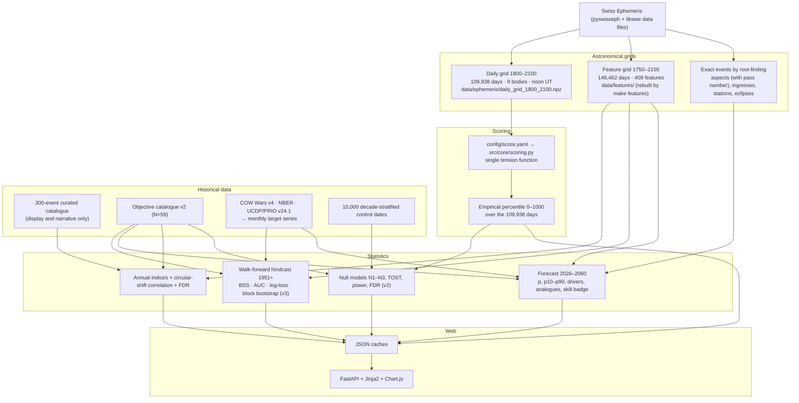
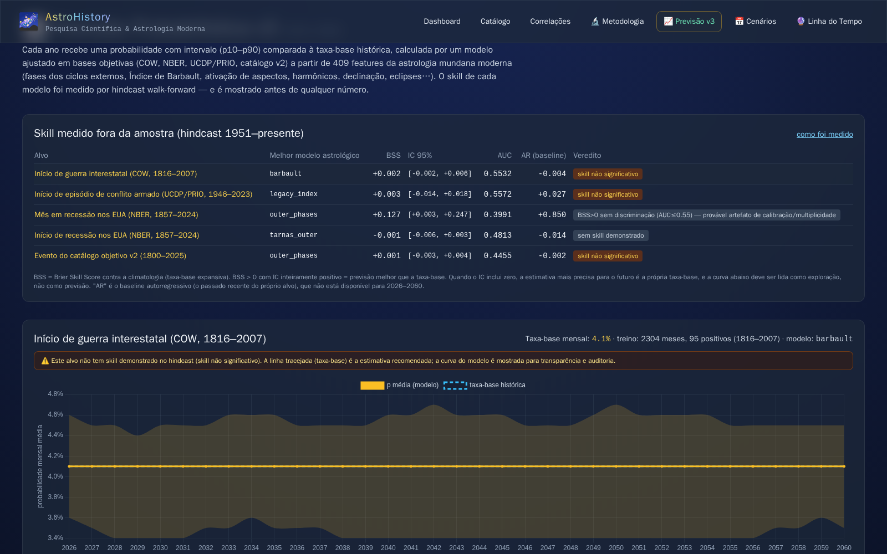
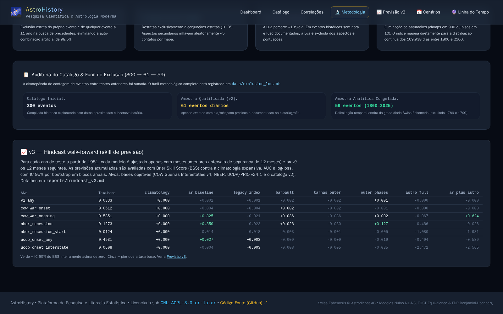

# astro-history 🪐🏛️
### An Empirical, Reproducible, and Open Statistical Research Platform on Astrological Alignments and Historical Events


> 🌍 **Languages / Idiomas**: **English** • [Versão em Português (README_PT.md)](README_PT.md)

---

## Table of contents

1. [What this project is](#1-what-this-project-is)
2. [The research question and the honest answer](#2-the-research-question-and-the-honest-answer)
3. [How the site works, page by page](#3-how-the-site-works-page-by-page)
4. [The computational pipeline](#4-the-computational-pipeline)
5. [Astronomical layer: what is calculated and how](#5-astronomical-layer-what-is-calculated-and-how)
6. [The tension score and the 0–1000 percentile scale](#6-the-tension-score-and-the-01000-percentile-scale)
7. [Dashboard annual indices and their correlation with history](#7-dashboard-annual-indices-and-their-correlation-with-history)
8. [v3 feature matrix: operationalising modern mundane astrology](#8-v3-feature-matrix-operationalising-modern-mundane-astrology)
9. [Historical targets and data sources](#9-historical-targets-and-data-sources)
10. [Validation I — pre-registered null-model tests (v2)](#10-validation-i--pre-registered-null-model-tests-v2)
11. [Validation II — walk-forward hindcast and forecast skill (v3)](#11-validation-ii--walk-forward-hindcast-and-forecast-skill-v3)
12. [Forecast 2026–2060: what the numbers mean](#12-forecast-20262060-what-the-numbers-mean)
13. [Design decisions and their rationale](#13-design-decisions-and-their-rationale)
14. [Screenshots](#14-screenshots)
15. [Quickstart, reproduction and deployment](#15-quickstart-reproduction-and-deployment)
16. [HTTP API](#16-http-api)
17. [Repository structure](#17-repository-structure)
18. [Known limitations and roadmap](#18-known-limitations-and-roadmap)
19. [Citation, licensing and attribution](#19-citation-licensing-and-attribution)

---

## 1. What this project is

**astro-history** is an open-source scientific testbed that puts a popular claim under controlled measurement: that the geometry of the sky (planetary aspects, cycles of the outer planets, fixed stars, eclipses) is systematically different at the moments when major historical events happen, and that this geometry can therefore be used to anticipate future turning points.

The project does three things at once:

- **It computes the sky precisely.** Every chart, index and feature is derived from the Swiss Ephemeris (arc-second precision), with real historical time zones, correct calendar handling and explicit treatment of unknown event times.
- **It tests the claim with the tools of forecasting science.** Pre-registered hypotheses, permutation null models that preserve temporal clustering, false-discovery-rate control, equivalence testing, power analysis, and — since v3 — a walk-forward hindcast that measures out-of-sample forecast skill against climatology and autoregressive baselines.
- **It publishes everything as an interactive web platform** where any visitor can inspect the chart of any of 300 historical events, compare it with 10,000 random control dates, simulate any date, and read a probabilistic forecast for 2026–2060 that is labelled with the skill it actually achieved in backtesting.

The platform is deliberately built as a **data-literacy tool**: it shows how a well-known retrospective pattern can look convincing and then explains, with numbers, why it does not survive controlled testing.

---

## 2. The research question and the honest answer

> **"Do planetary aspect geometries and astronomical alignments distinguish major world historical events from random dates better than chance — and can they forecast future events with measurable skill?"**

**Answer after v2 and v3 (October 2026): no, not with any construct tested so far.**

| Line of evidence | Method | Result |
| :--- | :--- | :--- |
| Pre-registered test, N = 59 objective events (v2) | Circular-shift null (10,000 permutations), stratified-decade null, uniform null, FDR | z = −0.51, p = 0.69, q = 0.88 — null not rejected |
| Equivalence test (v2) | TOST with Δ = ±0.30 SD | p = 0.041 — observed effect is *statistically equivalent to zero* |
| Out-of-sample 1951–2025 with thresholds fixed on 1800–1950 (v2) | Walk-forward | z = −0.85, p = 0.80 — no predictive signal |
| Tarnas outer-planet thesis (v2) | Hard aspects between Saturn, Uranus, Neptune, Pluto | z = −0.06, p = 0.98 |
| Walk-forward hindcast on monthly objective series, 1951–2024 (v3) | Brier Skill Score vs climatology, AUC, log-loss, 7 targets × 8 models | No astrological model beats the base rate with a positive CI **and** real discrimination (AUC > 0.55) |
| Annual indices vs 300-event catalogue and v2 sample (v3) | Circular-shift null on annual means, Benjamini-Hochberg | No correlation survives FDR; none on the objective sample |

What this means for the website: the forecast pages show every curve **together with its measured skill**, and when skill is absent they say so and recommend the historical base rate as the most precise estimate available. Nothing on the site is presented as a prediction of risk.

---

## 3. How the site works, page by page

| Page | URL | What it shows | Where the numbers come from |
| :--- | :--- | :--- | :--- |
| **Dashboard** | `/` | The 1800–2100 chart with five selectable series (peak tension, null band P5–P95, war risk, innovation, Barbault concentration), a panel correlating each series with history, a forecast-skill card, category and Sun-sign distributions, featured events | `data/timeline_1800_2100.json`, `data/annual_indices.json`, `data/forecast_v3.json` |
| **Catalogue** | `/events` | 300 historical events with category filters, text search and a "✓ N=59" filter for the events that belong to the validated objective sample | SQLite `events` and `events_v2` |
| **Event detail** | `/events/{id}` | Full chart (17 bodies, strict aspects, fixed-star contacts, houses when the time is known), SVG mandala, archetypal emphasis, "compare with a random control date" button, chronological previous/next | `chart_json` stored per event; `/api/random-control-comparison` |
| **Correlations hub** | `/correlations` | Frequency of signs, aspects and fixed stars per historical category | SQL aggregation over `planet_positions`, `event_aspects`, `event_star_aspects` |
| **Methodology** | `/methodology` | The v2 null-model results, the exclusion funnel 300 → 61 → 59, and the v3 hindcast table | `data/results.json`, `reports/hindcast_v3.json` |
| **Forecast v3** | `/forecast` | Per target: skill badge, probability per year with p10–p90 band vs base rate, monthly profile, model drivers, exact astronomical calendar (aspects, ingresses, eclipses) and historical analogues with lift | `data/forecast_v3.json` |
| **Scenarios 2027–2060** | `/projections` | Year-by-year table of the legacy index (percentile tiers), seasonal gates, outer-planet signs and closest geometric precedent — with a notice that tiers describe geometry, not risk | `data/projections_2027_2060.json` |
| **Timeline & simulator** | `/simulator` | The full 1800–2100 table and a form to compute the chart of any date/time/place; results live at a shareable GET URL | Swiss Ephemeris in real time + leave-one-out matcher |

The server is a FastAPI application rendering Jinja2 templates with Tailwind and Chart.js. It **reads precomputed JSON caches**; the only on-request ephemeris computation is the simulator.

---

## 4. The computational pipeline



`make v3` runs the whole chain: `features → hindcast → forecast → timeline`.

---

## 5. Astronomical layer: what is calculated and how

| Item | Implementation | Why it matters |
| :--- | :--- | :--- |
| **Ephemeris** | `pyswisseph` with the `seas/sepl/semo` data files; the returned flag is checked to be `SWIEPH`, not the approximate Moshier mode | Positions are good to arc-seconds across 1750–2150 |
| **Event instant** | `resolve_event_instant()`: for years ≥ 1883 the IANA zone of the event's latitude/longitude is resolved with `timezonefinder` and applied with `zoneinfo` (historical DST included); before 1883, exact Local Mean Time (longitude / 15, not rounded). The civil date is shifted when the conversion crosses midnight | Until v2 the offset was `round(longitude / 15)`, wrong by up to 3 h and never crossing the day boundary — enough to move the Moon 1.5° and change the Ascendant |
| **Calendar** | Gregorian from 1582-10-15 by default; `calendar_region` (britain = 1752, russia = 1918, greece = 1923, japan = 1873, …) or an explicit `calendar` override | Dates recorded in Old Style would otherwise be shifted by 10–13 days |
| **Unknown time** | 82 of the 300 catalogue events have no documented time. They are computed at 12:00 UT and the **Moon is excluded** from aspects and scoring | The Moon moves ~13°/day; with a 3° orb a guessed noon would cover 22 % of the zodiac by chance |
| **Bodies** | Sun, Moon, Mercury–Pluto, Ceres, Pallas, Juno, Vesta, Chiron, Mean Lilith, True Node (17) | Classical modern-astrology set; only the 9 core bodies enter the score |
| **Aspects** | Conjunction 0°, square 90°, trine 120°, opposition 180°, orb 3.0°, linear decay with orb; definitions read from `config/score.yaml` | Strict orbs minimise random hits; wider "Tarnas" orbs are tested separately in v3 via continuous features |
| **Fixed stars** | 30 stars via `swe_fixstar2_ut`; only **conjunctions** within 0.3° count, and only if the star's ecliptic latitude is ≤ 30° | Checking 4 aspects × 17 bodies × 30 stars produced ~5 spurious hits per chart; stars such as Vega (62°) or Polaris (66°) are never actually "on" a planet |
| **Houses** | Placidus; above the polar circle falls back to Porphyry, then Whole Sign | Placidus is undefined above ~66° latitude |
| **Exact dates** | `src/features/astro_events.py` brackets sign changes on a daily scan and refines with Brent's method on the ephemeris; outputs date and time UT, pass number within the retrograde loop, applying/separating, eclipse type and point of maximum | Checked against published ephemerides: Saturn ☌ Neptune 2026-02-20 16:54 UT, Saturn ☌ Pluto 2020-01-12, total solar eclipse 2024-04-08 |

---

## 6. The tension score and the 0–1000 percentile scale

The red line of the dashboard and every "tension" number on the site come from one function, `raw_tension_from_longitudes()` in `src/core/scoring.py`, whose parameters live in `config/score.yaml`:

- **Pair classes** encode the archetypal hierarchy of modern astrology: Saturn–Pluto (hard 260 / conjunction 250), Uranus–Pluto (220 / 200), Saturn–Uranus (220 / 160), Saturn–Neptune (200 / 220), any other outer–outer pair (170 / 160), Mars with an outer planet (130 / 110), a luminary with an outer planet (75 / 60), everything else (40 / 30).
- Hard aspects (90°, 180°) and conjunctions add their class weight times a linear orb factor `(3 − orb) / 3`; trines subtract 20 % of a harmony weight (35 outer–outer, 15 otherwise). Base score 60.
- The **daily grid** (1800–2100, noon UT, 9 bodies) and every **event chart** call the same function. A parity test guarantees that the same date gives the same score through both paths (max difference 0.002, float32 noise). Until v3 the chart path summed aspects of 17 bodies and then looked the result up in a 9-body percentile table, inflating the displayed percentile.
- The raw score is converted to an **empirical percentile** over the 109,938 days: a score of 850 means "more intense than 85 % of all days between 1800 and 2100". There is no artificial floor or ceiling (v1 saturated at 990).
- The **annual peak** shown on the chart is the day of maximum score within the year, taken from the grid — not the maximum of four seasonal dates as in v2.

**Important:** these weights are a *codification of a hypothesis*, not values fitted to data. That is why the index is tested rather than trusted, and why v3 replaces it with learned models for forecasting.

---

## 7. Dashboard annual indices and their correlation with history

Three additional series are derived from the feature grid (`src/analysis/annual_indices.py`) as the percentile (0–1000) of the annual mean over 1800–2100:

| Series | Colour | Definition |
| :--- | :--- | :--- |
| **War risk** | amber | Mean Gaussian activation of squares and oppositions among Jupiter, Saturn, Uranus, Neptune and Pluto |
| **Scientific innovation** | blue | Mean activation of trines and sextiles among the 9 bodies |
| **Planetary concentration (Barbault)** | purple | 1800° minus Barbault's Cyclic Index (sum of the 10 angular separations among the outer planets). High = outer planets clustered. Barbault associated the index minima with 1914–18, 1939–45 and 1982–83 |

Each series is correlated with history by **circular shift of the years** (10,000 permutations): the mean index over event years is compared with its null distribution, preserving both the temporal clustering of events and the autocorrelation of the slow planets. The panel reports z, two-sided p, Benjamini-Hochberg q and the lift of the top quartile, for each of the six catalogue categories, the whole catalogue and the objective v2 sample.

Current result: a few nominal p < 0.05 on the *curated* catalogue (e.g. event years have *lower* war-risk, z = −2.2) that do not survive FDR, and **nothing on the objective sample** (|z| < 0.9). The panel marks nominal results in amber and FDR-significant ones in green, and explains the selection bias of the curated catalogue.

---

## 8. v3 feature matrix: operationalising modern mundane astrology

`src/features/astro_features.py` computes **409 daily features** from 1750 to 2150 (146,462 days, ~20 s), aggregated monthly (mean; plus the monthly maximum for activations):

| Family | Content | Rationale |
| :--- | :--- | :--- |
| Synodic cycle phases | sine/cosine (1st and 2nd harmonic) of the angle of each of the 10 outer-planet pairs, geocentric **and** heliocentric | A continuous variable removes the orb choice entirely and allows circular statistics; heliocentric phases have no retrograde loop |
| Barbault index | geocentric and heliocentric | The canonical predictive index of 20th-century mundane astrology |
| Aspect activations | Gaussian kernel for 36 pairs × 5 angles (0, 60, 90, 120, 180); σ = 5° outer–outer, 4° with Jupiter, 2° otherwise | Replaces the binary "inside/outside orb" cut and covers the wide orbs Tarnas actually uses |
| Harmonics | resultant-vector length at harmonics 4 and 8 (outer planets; all bodies) | Addey's harmonic concentration |
| Declination | declination of 8 bodies; out-of-bounds flags for Mercury, Venus, Mars | A whole dimension ignored by longitude-only analysis |
| Motion | retrograde flags, stations, ingresses, cardinal-sign flags, zodiac position (sin/cos) of the outer planets | Standard mundane markers |
| Midpoints | Mars/Saturn, Saturn/Pluto, Uranus/Pluto, Saturn/Neptune, Saturn/Uranus activated by Sun, Mars and Jupiter on the 90° axis | Ebertin's cosmobiology |
| Eclipses | days to the nearest solar/lunar eclipse; ±15-day windows | Exact, localisable astronomical events |
| Legacy | the `score.yaml` index | So the v2 index can be compared with the rest on equal terms |

---

## 9. Historical targets and data sources

| Source | Coverage | Monthly series derived | File |
| :--- | :--- | :--- | :--- |
| **Objective catalogue v2** (UCDP, COW, NBER, Powell & Thyne, Polity5) | 1800–2025, 61 day-precise events, 59 inside the analytic window | any event; per class (interstate war, armed conflict, recession, pandemic, coup, regime change) | `data/events_v2.csv`, SQLite `events_v2` |
| **COW Inter-State War Data v4.0** | 1816–2007, 95 wars | war onset (binary and count), war ongoing, log battle deaths | `data/external/Inter-StateWarData_v4.0.csv` |
| **NBER business-cycle dates** | 1857–2024 | month in recession (578 months), recession start (34) | `data/external/business_cycle_dates.json` |
| **UCDP/PRIO Armed Conflict Dataset v24.1** | 1946–2023 | conflict-episode onset (414 months), interstate onset, conflicts with ≥ 1,000 deaths | `data/external/UcdpPrioConflict_v24_1.csv` |
| 300-event curated catalogue | 44 BCE–2024 | **not used for training** — display, narrative and the correlation panel only (flagged as selection-biased) | `data/historical_events.json`, SQLite `events` |
| 10,000 control dates | 1800–2025, stratified by decade | random-control comparisons and the N2 null | SQLite `control_dates` |

Why monthly series: with 59 events the minimum detectable effect at 80 % power was 0.33 SD; thousands of months give the statistical power that a null result needs to be meaningful. Why the curated catalogue is excluded from training: it was assembled in hindsight and its category mix (96 revolutions, 91 wars of 300) would be learned as a prior.

---

## 10. Validation I — pre-registered null-model tests (v2)

Hypotheses were fixed in advance in [`docs/hipoteses.md`](docs/hipoteses.md); the decision tree and its outcome are in [`docs/decisao_M2.md`](docs/decisao_M2.md).

| Test Hypothesis | N | Observed Score | Null Distribution (Mean ± SD) | Effect ($z$) | $p$ (two-sided) | $q$ (FDR) | Significant? |
| :--- | :---: | :---: | :---: | :---: | :---: | :---: | :---: |
| **H1 Overall vs N3 Circular Shift** | 59 | 481.1 | 500.6 ± 38.5 | −0.506 | 0.6117 | 0.8834 | ❌ |
| **H1 Overall vs N2 Stratified Control** | 59 | 481.1 | 493.9 ± 36.6 | −0.350 | 0.7163 | 0.8834 | ❌ |
| **H1 Overall vs N1 Uniform Random** | 59 | 481.1 | 499.7 ± 37.7 | −0.493 | 0.6299 | 0.8834 | ❌ |
| **H1 Class: Interstate War** | 15 | 462.1 | 499.4 ± 73.3 | −0.509 | 0.6163 | 0.8834 | ❌ |
| **H1 Class: Economic Crisis** | 10 | 547.6 | 501.9 ± 93.8 | +0.487 | 0.6223 | 0.8834 | ❌ |
| **H1 Class: Coup d'Etat** | 11 | 538.4 | 501.6 ± 84.9 | +0.434 | 0.6653 | 0.8834 | ❌ |
| **H2 Walk-Forward (1800–1950 Train)** | 26 | 512.4 | 499.4 ± 56.8 | +0.229 | 0.8165 | 0.8834 | ❌ |
| **H2 Out-of-Sample Test (1951–2025)** | 33 | 456.5 | 501.6 ± 53.0 | −0.851 | 0.4008 | 0.9329 | ❌ |
| **H4 Tarnas Outer-Planet Thesis** | 59 | 33.4 | 34.0 ± 8.7 | −0.063 | 0.9794 | 0.8834 | ❌ |

Supporting analyses: **TOST equivalence** (Δ = ±0.30 SD, p = 0.041: the effect is statistically equivalent to zero); **power** (MDE 95.7 points = 0.332 SD at 80 %); **synthetic negative controls** (1,000 pure-noise catalogues → 3.7 % false-positive rate at α = 5 %); **orb stability** (1°, 2°, 3°). Null models: N1 uniform random dates, N2 decade-stratified control dates, N3 circular shift of the whole event vector (preserves inter-event spacing and the autocorrelation of the slow planets).

Methodological corrections that made these tests valid are documented in [`reports/phase1_before_after.md`](reports/phase1_before_after.md): leave-one-out matcher (no self-matches), conjunction-only fixed stars, continuous percentile instead of a 990 cap, Moon excluded without a time, homogeneous daily sampling.

---

## 11. Validation II — walk-forward hindcast and forecast skill (v3)

Pre-registration: [`docs/hipoteses_v3.md`](docs/hipoteses_v3.md). Full tables: [`reports/hindcast_v3.md`](reports/hindcast_v3.md).

**Protocol** (`src/analysis/hindcast.py`): for each target and each test year *t* from 1951 to the end of the target's coverage, every model is fitted only on months of years ≤ *t* − 1 with a 12-month safety gap, then predicts the 12 months of *t*. Pooled predictions are scored with the **Brier Skill Score** against the expanding climatology (95 % CI by annual-block bootstrap), **AUC**, log-loss and reliability curves. Models are L2 logistic regressions on standardised features, with the regularisation strength chosen by an inner temporal validation on the last 20 % of each training window.

| Target (base rate) | climatology | **AR baseline** | legacy index | Barbault | Tarnas outer | outer phases | all 409 | AR + astro |
| :--- | ---: | ---: | ---: | ---: | ---: | ---: | ---: | ---: |
| v2 any event (3.3 %) | 0 | −0.002 | −0.001 | −0.002 | −0.002 | +0.001 | −0.000 | −0.000 |
| COW war onset (5.1 %) | 0 | −0.004 | −0.004 | +0.002 | −0.002 | −0.001 | −0.000 | −0.000 |
| COW war ongoing (53.5 %) | 0 | **+0.825** | −0.021 | +0.036 | −0.036 | +0.002 | −0.067 | +0.624 |
| NBER recession (12.7 %) | 0 | **+0.850** | −0.023 | +0.028 | −0.030 | +0.127* | −0.486 | −0.026 |
| NBER recession start (1.2 %) | 0 | −0.014 | −0.018 | −0.003 | −0.001 | −0.005 | −1.080 | −1.981 |
| UCDP onset any (49.3 %) | 0 | +0.027 | +0.003 | −0.009 | −0.009 | −0.019 | −0.494 | −0.589 |
| UCDP interstate onset (6.1 %) | 0 | −0.004 | +0.003 | −0.008 | −0.005 | −0.035 | −2.472 | −2.565 |

Values are BSS (higher is better; 0 = same as the base rate). \* CI [+0.003, +0.247] but AUC = 0.40: the Brier gain comes from calibration/variance, not discrimination, and with 35 comparisons one marginal CI is expected by chance — treated as **not confirmed**.

**Verdict rule used by the site:** "positive skill" requires the BSS confidence interval entirely above zero **and** AUC > 0.55. No astrological model meets it on any target. The autoregressive baseline (the target's own recent past) dominates persistent targets and the astrological features add nothing to it.

---

## 12. Forecast 2026–2060: what the numbers mean

`src/analysis/forecast_v3.py` produces, for each target, the best astrological model from the hindcast fitted on the whole coverage, then for every year 2026–2060:

- **p mean** — the mean monthly probability of the event; **p10–p90** — a bootstrap interval over annual blocks (60 refits); **× base rate** — how far the model departs from climatology.
- **Drivers** — the features with the largest positive linear contribution in the peak month, with readable labels ("Phase of the Saturn–Pluto cycle", "Barbault Cyclic Index", "Saturn □ Neptune activation").
- **Exact calendar** — every exact aspect between slow planets (with pass number in the retrograde loop), every ingress and every eclipse of that year, with date and time UT.
- **Analogues** — the historical months closest in the standardised space of the 10 outer-cycle phases, at most one per decade (this removes the "epoch confusion" of sign-based matching, where Pluto sitting 12–30 years in one sign made all analogues the same generation), with the catalogue events around them and a lift against the base rate.
- **Skill badge** — the hindcast BSS, its CI, AUC and the verdict, displayed *before* the chart. When the verdict is not "positive skill", a notice states that the dashed base-rate line is the recommended estimate and the model curve is shown for transparency.

---

## 13. Design decisions and their rationale

| Decision | Rationale |
| :--- | :--- |
| One scoring function read from YAML, with a grid ↔ chart parity test | Two divergent formulas in v2 inflated displayed percentiles; a single source of truth makes every number on the site traceable to a config file |
| Real time zones instead of `round(longitude/15)` | Hour errors of 1–3 h move the Moon and all house cusps; the day boundary was never crossed |
| Exclude the Moon without a documented time rather than guess noon | Honest treatment of uncertainty beats a 22 % random hit rate |
| Objective monthly targets instead of 59 events | Statistical power; removal of hindsight selection |
| Walk-forward with a gap, climatology **and** AR baselines | Events cluster (wars cause wars); a model must beat the target's own past, not only random dates |
| Circular shift as the primary null | It is the only null that preserves both event spacing and the slow drift of the outer planets that makes any epoch "look special" |
| FDR on every family of tests, and a verdict rule combining CI and AUC | 35 comparisons guarantee a few nominal hits; the rule keeps a calibration artefact from being sold as skill |
| Skill badge before any curve; base rate recommended when skill is absent | "Precision of a forecast" is a property that must be measured, and the user is told the measurement first |
| Curated catalogue kept for display only | It is what makes the site readable, but it is selection-biased and must not train or validate anything |
| Caches committed, feature grid ignored | The site starts without recomputation; the 18 MB grid rebuilds in 20 s |

A longer narrative of the mechanism and of each consideration is in [`docs/mecanismo_site.md`](docs/mecanismo_site.md) (Portuguese).

---

## 14. Screenshots

| | |
|:---:|:---:|
| <br>**Dashboard** — 1800–2100 chart with selectable series and interactive legend | <br>**Forecast v3** — skill badge first, then p(event) with p10–p90 band vs base rate |
| <br>**Methodology** — walk-forward hindcast table | <br>**Timeline & simulator** — shareable GET URLs |
| <br>**Event detail** — validated-sample badge, chronological navigation | <br>**Catalogue** — "✓ N=59" filter |
| <br>**Correlations hub** | <br>**2027–2060 table** — geometry tiers with skill notice |

---

## 15. Quickstart, reproduction and deployment

### Prerequisites
- Linux / macOS, Python 3.12+
- Swiss Ephemeris C library and data files (`libswe-dev`, `libswe0`, `swisseph-data-all` on Debian/Ubuntu); the code looks for them in `/usr/share/libswe/ephe`, `/usr/share/swisseph` or `/usr/local/share/swisseph`

### Install and test
```bash
git clone https://github.com/marceloasl99/astro-history.git
cd astro-history
make setup          # venv + locked dependencies (numpy, scipy, scikit-learn, timezonefinder, PyYAML, FastAPI…)
make test           # 45 tests: golden regression, grid↔chart parity, time zones, exact dates, targets, API
```

### Reproduce the statistics
```bash
make validate       # v2: null models N1–N3 with 10,000 permutations, TOST, power → data/results.json, reports/validacao_v2.md
make features       # v3: 409-feature daily grid 1750–2150 (~20 s)
make hindcast       # v3: walk-forward hindcast, all targets (~15 min) → reports/hindcast_v3.{json,md}
make forecast       # v3: forecast 2026–2060 → data/forecast_v3.json (+ exact calendar cache)
make timeline       # UI caches: timeline, projections (true daily peak, annual indices)
make v3             # all of the above v3 steps in order
```

### Run the site
```bash
make run            # http://127.0.0.1:8000
# or
docker compose up -d --build   # app + Caddy reverse proxy on 80/443
```

Everything is deterministic (seeds fixed in `config/analysis.yaml` and in the scripts); re-running the chain reproduces the committed JSON caches.

---

## 16. HTTP API

| Endpoint | Method | Description |
| :--- | :---: | :--- |
| `/api/stats` | GET | Catalogue statistics |
| `/api/events?category=&search=` | GET | Event list with filters |
| `/api/events/{id}` | GET | Full event with chart JSON |
| `/api/simulate` | POST | Chart + similar events for a JSON body `{title, date, time, city, country, latitude, longitude}` (validated; 422 on bad input) |
| `/api/random-control-comparison/{id}` | GET | Random control dates with geometric intensity ≥ the event's |
| `/api/future-timeline` | GET | 1800–2100 annual timeline |
| `/api/projections-2027-2060` | GET | Year-by-year projection table |
| `/api/forecast` | GET | Forecast summary (all targets, without calendar/analogues) |
| `/api/forecast?target=cow_war_onset` | GET | One target: skill, base rate, per-year probabilities, drivers |
| `/api/forecast/year/{year}` | GET | Exact calendar, analogues and every target's row for one year (2026–2060) |

---

## 17. Repository structure

```
astro-history/
├── config/
│   ├── score.yaml                 # Orbs and pair weights — the single source of the tension score
│   ├── stars.yaml                 # 30 fixed stars
│   └── analysis.yaml              # Permutations, seeds, train/test windows
├── data/
│   ├── events_v2.csv              # Objective catalogue (COW, UCDP, NBER, Powell & Thyne, Polity5)
│   ├── historical_events.json     # 300-event curated catalogue (display only)
│   ├── external/                  # COW Wars v4, NBER cycle dates, UCDP/PRIO v24.1 (+ README with sources)
│   ├── ephemeris/                 # Daily grid 1800–2100 (.npz)
│   ├── features/                  # 409-feature grid 1750–2150 (git-ignored; make features)
│   ├── results.json               # v2 null-model results
│   ├── annual_indices.json        # Dashboard series + correlation with history
│   ├── forecast_v3.json           # Forecast 2026–2060
│   ├── astro_calendar_2026_2060.json  # Exact aspects, ingresses, eclipses
│   ├── timeline_1800_2100.json / projections_2027_2060.json   # UI caches
│   ├── DATASET_CARD.md / exclusion_log.md
├── db/history_astrology.db        # SQLite: events, planet_positions, event_aspects, event_star_aspects, events_v2, control_dates
├── docs/
│   ├── hipoteses.md / hipoteses_v3.md     # Pre-registrations
│   ├── decisao_M2.md              # Milestone decision record
│   ├── mecanismo_site.md          # Mechanism and design considerations (PT)
│   └── screenshots/
├── reports/                       # validacao_v2.md, phase3_validation.md, hindcast_v3.md, final_report_v2.md, …
├── src/
│   ├── astro_engine.py            # Charts: bodies, aspects, fixed stars, houses, time resolution
│   ├── correlation_engine.py      # Category correlations and leave-one-out matcher
│   ├── future_engine.py           # Annual timeline and projections
│   ├── core/
│   │   ├── scoring.py             # Single tension function (reads score.yaml)
│   │   ├── timezones.py           # IANA / LMT conversion with day rollover
│   │   └── ephemeris_grid.py      # Daily grid and empirical percentiles
│   ├── features/
│   │   ├── astro_features.py      # 409 daily features, monthly aggregation
│   │   ├── astro_events.py        # Exact aspects, ingresses, stations, eclipses
│   │   └── targets.py             # Monthly target series from the historical sources
│   ├── analysis/
│   │   ├── null_models.py / multiplicity.py / run_phase3_validation.py   # v2
│   │   ├── hindcast.py            # Walk-forward skill measurement
│   │   ├── forecast_v3.py         # Forecast, drivers, analogues, skill badge
│   │   └── annual_indices.py      # Dashboard series and history correlation
│   ├── data/ingest_historical.py  # v2 ingestion and control dates
│   └── web/                       # FastAPI app, SVG mandala, Jinja2 templates
├── tests/                         # regression/, unit/, statistical/, test_api.py …
├── Makefile · Dockerfile · docker-compose.yml · Caddyfile · ci/ci.yml
└── CITATION.cff · LICENSE · requirements.txt · requirements.lock
```

---

## 18. Known limitations and roadmap

**Limitations**
- Features are daily at noon UT; the Moon is excluded from the feature matrix and from charts without a documented time (82 of 300).
- COW Militarized Interstate Disputes (~2,400 disputes) and the Powell & Thyne coup list are not integrated (no direct download URL); the loaders accept them once the files are placed in `data/external/`.
- No national charts or country-level forecasts yet.
- The autoregressive baseline captures part of temporal clustering; a Hawkes/point-process baseline is not implemented.
- Tailwind is loaded from a CDN.

**Roadmap**
1. Integrate COW MID and coup data; add financial volatility series.
2. National charts (Aries-ingress charts at capitals, transits to national natal charts) with a per-country hindcast — the one remaining line that could change the skill verdict.
3. Hourly grid for Moon and Mercury; uncertainty intervals for events without a time.
4. Hawkes baseline and phase-randomised (IAAFT) surrogates.

---

## 19. Citation, licensing and attribution

If you use this platform, its datasets or its null-model code, please cite it (see [`CITATION.cff`](CITATION.cff)):

> AstroHistory Research Group (2026). *AstroHistory: An Empirical, Reproducible, and Open Statistical Investigation into Astrological Alignments and Historical Events*, version 3.0.0. https://github.com/marceloasl99/astro-history

- **Source code**: [GNU Affero General Public License v3 or later](LICENSE).
- **Swiss Ephemeris**: © Astrodienst AG. In compliance with Astrodienst terms, this project is licensed under AGPL; commercial users must obtain a professional licence from Astrodienst AG.
- **Datasets**: Correlates of War (Sarkees & Wayman, 2010), UCDP/PRIO Armed Conflict Dataset (Davies, Pettersson & Öberg, 2024; Gleditsch et al., 2002), NBER Business Cycle Dating Committee, Powell & Thyne coup data, Polity5. Redistributed unchanged for reproducibility under each source's academic terms — see [`data/external/README.md`](data/external/README.md).
- **Astrological references** operationalised in the feature set: André Barbault (cyclic index), Richard Tarnas (outer-planet cycles), Reinhold Ebertin (midpoints), John Addey (harmonics).
