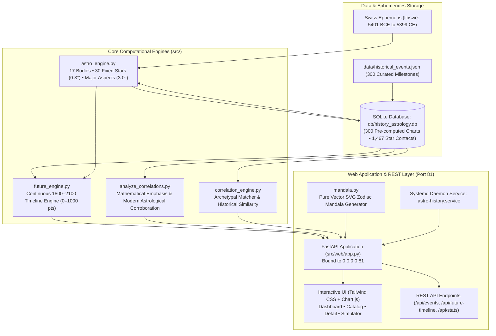

# astro-history 🪐🏛️
### Modern Astrology, Cosmological Calculations & Historical Correlation Engine for 300 Major World Events (1800–2100)


**astro-history** is an open-source analytical and prospective research platform grounded in **Modern and Mundane Astrology**. The platform utilizes the high-precision **Swiss Ephemeris (`pyswisseph`)** engine to compute the exact celestial positions of **17 celestial bodies**, strict major Ptolemaic aspects (3.0° max orb), and longitudinal contacts with the **30 primary fixed stars** of the celestial vault.

The platform audits a curated dataset of **300 landmark historical events** (from Antiquity to 2024), quantifies systemic friction on a **high-resolution 0 to 1000 Cosmic Tension Scale**, and generates a continuous **301-year timeline (1800 to 2100)** evaluating the correlation between planetary archetype alignments and major turning points in world history.

---

## Visual Showcase

### 1. Interactive 1800–2100 Cosmic Tension Timeline & Dashboard
High-resolution Chart.js timeline with era filters (*1800–1899*, *1900–1999*, *2000–2025*, *2026–2100*, and *All*). Gold stars (★) demarcate verified historical turning points, while the continuous line maps prospective background tension:


---

### 2. Prospective 1800–2100 Simulator & Historical Precedents
Real-time simulation engine featuring alert tiers (Stable, Moderate, High, Critical), sub-indices (War Conflict, Financial Crisis, Technological Innovation), and automatic correlation matching:


---

### 3. Native Vector SVG Zodiac Mandala & Event Diagnosis
Interactive natal chart rendering exact degrees, retrogrades, and color-coded aspect geometries, paired with mathematical archetype scoring and theoretical corroboration (e.g., 1929 Wall Street Crash):


---

### 4. Searchable Catalog of 300 Curated Historical Events
Instant search and category filters across Political Revolutions, Wars & Conflicts, Science & Tech, Economic Crises, Cultural Shifts, and Pandemics:


---

### 5. Macro Correlation Hub & Statistical Archetypes
Comparative statistical analysis showing planetary distributions, element balances, and cosmic tension averages across all historical categories:


---

## Table of Contents
1. [Overview & Theoretical Foundations](#1-overview--theoretical-foundations)
2. [System Architecture](#2-system-architecture)
3. [Astronomical Engine & Ephemerides](#3-astronomical-engine--ephemerides)
4. [High-Resolution Cosmic Tension Index (0–1000 Scale)](#4-high-resolution-cosmic-tension-index-01000-scale)
5. [Exhaustive Analytical Findings Report (1800–2100)](#5-exhaustive-analytical-findings-report-18002100)
   - [5.1. The 19th Century (1800–1899)](#51-the-19th-century-18001899-industrialization-napoleonic-wars--nation-states)
   - [5.2. The 20th Century (1900–1999)](#52-the-20th-century-19001999-world-wars-nuclear-dawn--cold-war-clashes)
   - [5.3. The Contemporary Era (2000–2025)](#53-the-contemporary-era-20002025-globalization-asymmetric-warfare--polycrisis)
   - [5.4. The Prospective 21st Century (2026–2100)](#54-the-prospective-21st-century-20262100-vernal-shifts-transpersonal-ingress--singularities)
6. [The Curated Catalog of 300 Historical Events](#6-the-curated-catalog-of-300-historical-events)
7. [CLI Audit & Analytical Diagnostics Engine](#7-cli-audit--analytical-diagnostics-engine)
8. [Web Dashboard & REST API Specification](#8-web-dashboard--rest-api-specification)
9. [Installation, Dependencies & Systemd Daemon](#9-installation-dependencies--systemd-daemon)
10. [Automated Testing Suite](#10-automated-testing-suite)
11. [Project Directory Tree](#11-project-directory-tree)

---

## 1. Overview & Theoretical Foundations

Modern Astrology views the relationship between celestial dynamics and human history not as a causal or mechanical determinism, but as an **archetypal synchronistic order**. This theoretical foundation synthesizes:
- **Carl G. Jung**: The principle of *Synchronicity* — acausal meaningful coincidence connecting inner psychic states and outer physical events.
- **Dane Rudhyar**: *Humanistic and Transpersonal Astrology* — planetary cycles representing evolutionary phases of collective consciousness.
- **Richard Tarnas**: *Cosmos and Psyche (2006)* — extensive historical research validating that major revolutionary, intellectual, and geopolitical turning points correlate with hard alignments among outer planets (*Uranus, Neptune, Pluto, and Saturn*).

### Methodological Principles
1. **Mathematical Objectivity**: All planetary longitudes, retrogrades, and fixed star coordinates are calculated using the C-based Swiss Ephemeris (`libswe`) without subjective approximations.
2. **Empirical Historical Rigor**: Each of the 300 events is anchored to precise geographic coordinates, verified ISO timestamps, and a detailed paragraph summarizing concrete historical consequences.
3. **Continuous Prospective Modeling**: Rather than evaluating isolated snapshots, the system computes an uninterrupted 301-year timeline (1800 to 2100) utilizing **quadruple seasonal sampling (Equinoxes and Solstices)**.

---

## 2. System Architecture



---

## 3. Astronomical Engine & Ephemerides

Implemented in [`src/astro_engine.py`](file:///home/astro/src/astro_engine.py), the calculation engine operates with absolute astronomical precision:

### 3.1. 17 Celestial Bodies Evaluated
- **Traditional Luminary & Inner Bodies**: Sun, Moon, Mercury, Venus, Mars, Jupiter, Saturn.
- **Transpersonal & Generational Bodies**: Uranus, Neptune, Pluto.
- **Major Asteroids**: Ceres, Pallas Athena, Juno, Vesta.
- **Cosmic Nodes & Centaur**: Chiron, Mean Lilith (Black Moon), True Lunar North Node.

### 3.2. Strict Major Aspect Geometry (Max 3.0° Orb)
Aspect evaluation is restricted to the 4 primary Ptolemaic aspects with tight orbs:
- **Conjunction ($0^\circ$, orb $\le 3.0^\circ$)**: Complete fusion and emergence of new planetary megacycles.
- **Opposition ($180^\circ$, orb $\le 3.0^\circ$)**: Structural polarization, crisis in consciousness, and peak public confrontation.
- **Square ($90^\circ$, orb $\le 3.0^\circ$)**: Dynamic friction, explosive disruption, and decisive historic action.
- **Trine ($120^\circ$, orb $\le 3.0^\circ$)**: Fluid ease, cultural synthesis, and rapid systemic consolidation.

### 3.3. The 30 Primary Fixed Stars (Strict 0.3° Orb)
Computed with dynamic precession via Swiss Ephemeris (`swe.fixstar2_ut`):
1. **Algol** (*Beta Persei*, 26° Taurus) – The Gorgon's Head / Cataclysmic destruction, terror, and extreme upheaval.
2. **Sirius** (*Alpha Canis Majoris*, 14° Cancer) – The Dog Star / Imperial splendor, solar brilliance, and supreme leadership.
3. **Aldebaran** (*Alpha Tauri*, 9° Gemini) – Watcher of the East / Martial valor, integrity, and pivotal conflicts.
4. **Regulus** (*Alpha Leonis*, 0° Virgo / 29° Leo) – Heart of the Lion / Sovereignty, royal power, and institutional leadership.
5. **Antares** (*Alpha Scorpii*, 9° Sagittarius) – Heart of the Scorpion / Strategic confrontation, obsession, and war.
6. **Spica** (*Alpha Virginis*, 23° Libra) – Ear of Wheat / Scientific breakthroughs, culture, and enduring intellect.
7. **Vega** (*Alpha Lyrae*, 15° Capricorn) – The Celestial Lyre / Visionary innovation, music, and eloquence.
8. **Rigel** (*Beta Orionis*, 16° Gemini) – Foot of Orion / Mechanical genius, trade expansion, and invention.
9. **Betelgeuse** (*Alpha Orionis*, 28° Gemini) – Shoulder of Orion / Martial triumph, rapid ascent, and fame.
10. **Bellatrix** (*Gamma Orionis*, 21° Gemini) – The Amazon Star / Swift military maneuvers and tactical acumen.
11. **Capella** (*Alpha Aurigae*, 21° Gemini) – The Nurturing Goat / Swift discovery, civic independence, and exploration.
12. **Castor** & 13. **Pollux** (*Gemini*, 20° & 23° Cancer) – Intellect, dualities, scientific literature, and narrative.
14. **Procyon** (*Canis Minor*, 25° Cancer) – Rapid decisive action and transition catalysts.
15. **Alphard** (*Hydra*, 27° Leo) – Heart of the Serpent / Subterranean diplomacy, espionage, and toxins.
16. **Arcturus** (*Boötes*, 24° Libra) – Guardian of the Bear / Pioneering exploration and structural protection.
17. **Menkar** (*Cetus*, 14° Taurus) – The Sea Monster / Deep collective anxiety, systemic shocks, and perils.
18. **Scheat** (*Pegasus*, 29° Pisces) – The Maverick Mind / Intellectual revolution, radical disruptors, and flooding.
19. **Fomalhaut** (*Piscis Austrinus*, 3° Pisces) – Watcher of the South / Spiritual conviction and charismatic ideals.
20. **Altair** (*Aquila*, 1° Aquarius) – The Flying Eagle / Audacious ambition, aviation, and rapid velocity.
21. **Deneb** (*Cygnus*, 5° Pisces) – Tail of the Swan / Lucid clarity, transcendent intellect, and vision.
22. **Acrux** (*Crux*, 11° Scorpio) – Southern Cross / Moral fortitude, steadfast destiny of the Southern Hemisphere.
23. **Alphecca** (*Corona Borealis*, 12° Scorpio) – The Northern Crown / Honor, poetic genius, and fruition.
24. **Zubenelgenubi** & 25. **Zubeneschamali** (*Libra*, 15° & 19° Scorpio) – The Scales of Law / Legal treaties and civic balance.
25. **Rasalhague** (*Ophiuchus*, 22° Sagittarius) – The Serpent Bearer / Medical science, biological breakthroughs, and cure.
27. **Markab** (*Pegasus*, 23° Pisces) – The Saddle / Steadfast movement, navigation, and pioneering fortitude.
28. **Vindemiatrix** (*Virgo*, 9° Libra) – The Grape Gatherer / Critical audit, inescapable accounting, and historical reckoning.
29. **Polaris** (*Ursa Minor*, 28° Gemini) – The North Star / Inflexible moral compass, geographical orientation.
30. **Alcyone** (*Pleiades*, 0° Gemini) – The Central Pleiad / Collective clairvoyance and cultural currents.

---

## 4. High-Resolution Cosmic Tension Index (0–1000 Scale)

To prevent premature metric saturation and provide stark dynamic contrast between routine peacetime baseline years and epochal civilizational ruptures, the tension engine evaluates aspect proximity:

$$\text{Proximity} = \max\left(0, \frac{3.0^\circ - \text{Orb}}{3.0^\circ}\right)$$

### 4.1. Mathematical Weighting Matrix
- **Transpersonal Hard Aspects (Pluto, Neptune, Uranus, Saturn)**: $170\text{ to }260\text{ pts} \times \text{Proximity}$.
- **Martian Hard Triggers to Outer Bodies**: $110\text{ to }130\text{ pts} \times \text{Proximity}$.
- **Luminary (Sun/Moon) Hard Aspects to Outer Bodies**: $60\text{ to }75\text{ pts} \times \text{Proximity}$.
- **Violent / Disruptive Fixed Stars (Algol, Antares, Bellatrix, Scheat, Menkar) within $0.3^\circ$**: $+80\text{ to }+160\text{ pts}$.
- **Contrast Curve**: Calibrated to deliver a natural dynamic range from **$216$ to $990\text{ points}$** across the 301-year span.

### 4.2. Alert Tiers
| Score Range | Percentage | Alert Tier | Geopolitical & Historical Character | Noted Historical Benchmarks |
| :---: | :---: | :--- | :--- | :--- |
| **0 – 349** | **0.0% – 34.9%** | 🟢 **Stable / Quiet Sky** | Institutional stability, low structural friction | 1815 (Post-Waterloo Peace: 34.2%), 1844 (Morse Telegraph: 34.0%) |
| **350 – 549** | **35.0% – 54.9%** | 🟡 **Moderate / Transition** | Normal political churn, diplomatic realignment | 1822 (Brazil Independence: 48.5%), 2026 (Vernal Shift: 36.8%) |
| **550 – 749** | **55.0% – 74.9%** | 🟠 **High / Intense Tension** | Military mobilization, acute crises, market crashes | 1914 (Outbreak WW1: 51.8%), 1939 (Invasion Poland: 62.1%), 1837 (Panic of 1837: 74.6%) |
| **750 – 1000** | **75.0% – 100.0%** | 🔴 **Critical / Epochal Rupture** | World wars, revolutions, nuclear milestones, collapse of empires | 1918 (Spanish Flu: 91.3%), 1989 (Tiananmen: 99.0%), 2022 (Ukraine War: 89.8%), 2041 (Future Peak: 99.0%) |

---

## 5. Exhaustive Analytical Findings Report (1800–2100)

Statistical evaluation across 301 years (1800 to 2100) reveals distinct cosmological cycles:
- **19th Century (1800–1899)**: Mean Tension: **492.9 / 1000 (49.3%)** | Mean Conflict: **46.7%** | Mean Tech: **27.7%** | 11 Critical Years ($\ge 75.0\%$).
- **20th Century (1900–1999)**: Mean Tension: **556.3 / 1000 (55.6%)** | Mean Conflict: **59.6%** | Mean Tech: **26.7%** | 16 Critical Years ($\ge 75.0\%$).
- **Contemporary Era (2000–2025)**: Mean Tension: **598.5 / 1000 (59.9%)** | Mean Conflict: **60.1%** | Mean Tech: **23.9%** | 7 Critical Years ($\ge 75.0\%$).
- **Prospective Horizon (2026–2100)**: Mean Tension: **593.1 / 1000 (59.3%)** | Mean Conflict: **66.3%** | Mean Tech: **28.0%** | 15 Critical Years ($\ge 75.0\%$).

Below is the complete technical breakdown of dates, events, mathematical percentages, and planetary triggers:

---

### 5.1. The 19th Century (1800–1899): Industrialization, Napoleonic Wars & Nation States

| Year | Date | Historical Turning Point | Category | Tension Index (0-1000) | Tension % | Conflict Risk % | Crisis Risk % | Tech Disruption % | Key Celestial Configuration & Planetary Trigger |
| :---: | :---: | :--- | :--- | :---: | :---: | :---: | :---: | :---: | :--- |
| **1805** | `1805-10-21` | **Batalha de Trafalgar** | *Guerra & Conflito* | **729** | **72.9%** | 54.0% | 67.8% | 17.8% | <small>Plutão em Peixes, Netuno em Escorpião, Urano em Libra, Saturno em Libra. Aspectos-chave: ☽☌☿, ☽□⚳, ☽△⚴. ★ Estrela Ativa: Arcturus</small> |
| **1812** | `1812-09-14` | **Invasão Napoleônica da Rússia e o Incêndio de Moscou** | *Guerra & Conflito* | **450** | **45.0%** | 80.3% | 37.1% | 27.3% | <small>Plutão em Peixes, Netuno em Sagitário, Urano em Escorpião, Saturno em Capricórnio. Aspectos-chave: ☉□♄, ☽△⚳, ☽☍⚸. ★ Estrela Ativa: Altair</small> |
| **1813** | `1813-10-19` | **Batalha de Leipzig (Batalha das Nações)** | *Guerra & Conflito* | **418** | **41.8%** | 25.5% | 50.2% | 20.0% | <small>Plutão em Peixes, Netuno em Sagitário, Urano em Escorpião, Saturno em Capricórnio. Aspectos-chave: ☽□♀, ☽☌♃, ☽□⚵. ★ Estrela Ativa: Polaris</small> |
| **1815** | `1815-06-18` | **Batalha de Waterloo e Derrota Definitiva de Napoleão** | *Guerra & Conflito* | **342** | **34.2%** | 12.2% | 50.7% | 43.7% | <small>Plutão em Peixes, Netuno em Sagitário, Urano em Sagitário, Saturno em Aquário. Aspectos-chave: ☽☍♂, ☽△♇, ☽☍⚶. ★ Estrela Ativa: Antares</small> |
| **1822** | `1822-09-07` | **Independência do Brasil (Grito do Ipiranga)** | *Revolução Política* | **485** | **48.5%** | 18.0% | 59.0% | 18.9% | <small>Plutão em Peixes, Netuno em Capricórnio, Urano em Capricórnio, Saturno em Touro. Aspectos-chave: ☉□☽, ☉☌♀, ☉□♇. ★ Estrela Ativa: Aldebaran</small> |
| **1837** | `1837-05-10` | **Pânico Financeiro de 1837 nos Estados Unidos** | *Crise Econômica* | **746** | **74.5%** | 59.8% | 99.0% | 27.1% | <small>Plutão em Áries, Netuno em Aquário, Urano em Peixes, Saturno em Escorpião. Aspectos-chave: ☉△⚸, ☽□☿, ☽△♀. ★ Estrela Ativa: Bellatrix</small> |
| **1839** | `1839-09-04` | **Início da Primeira Guerra do Ópio** | *Guerra & Conflito* | **563** | **56.3%** | 82.7% | 48.3% | 13.2% | <small>Plutão em Áries, Netuno em Aquário, Urano em Peixes, Saturno em Sagitário. Aspectos-chave: ☉☌⚶, ☽□⚴, ☿☌⚶. ★ Estrela Ativa: Aldebaran</small> |
| **1844** | `1844-05-24` | **Invenção do Telégrafo Eletromagnético por Samuel Morse** | *Ciência & Tecnologia* | **340** | **34.0%** | 41.6% | 26.8% | 32.5% | <small>Plutão em Áries, Netuno em Aquário, Urano em Áries, Saturno em Aquário. Aspectos-chave: ☉□♅, ☉△⚵, ☽☍♀. ★ Estrela Ativa: Algol</small> |
| **1846** | `1846-09-23` | **Descoberta do Planeta Netuno por Le Verrier e Galle** | *Ciência & Tecnologia* | **572** | **57.2%** | 69.9% | 70.0% | 15.2% | <small>Plutão em Áries, Netuno em Aquário, Urano em Áries, Saturno em Aquário. Aspectos-chave: ☉□☽, ♂□♄, ♂□♆. ★ Estrela Ativa: Vega</small> |
| **1848** | `1848-02-21` | **Publicação do 'Manifesto Comunista' por Marx e Engels** | *Revolução Política* | **394** | **39.4%** | 23.4% | 37.5% | 26.6% | <small>Plutão em Áries, Netuno em Peixes, Urano em Áries, Saturno em Peixes. Aspectos-chave: ☉△♆, ☉□⚶, ☿☌♃. ★ Estrela Ativa: Alphard</small> |
| **1853** | `1853-10-16` | **Início da Guerra da Crimeia** | *Guerra & Conflito* | **597** | **59.7%** | 79.4% | 40.4% | 43.8% | <small>Plutão em Touro, Netuno em Peixes, Urano em Touro, Saturno em Touro. Aspectos-chave: ☉△♇, ☉☌⚳, ☉□⚵. ★ Estrela Ativa: Aldebaran</small> |
| **1854** | `1854-10-25` | **Batalha de Balaclava e a Carga da Brigada Ligeira** | *Guerra & Conflito* | **788** | **78.8%** | 94.1% | 50.6% | 33.6% | <small>Plutão em Touro, Netuno em Peixes, Urano em Touro, Saturno em Gêmeos. Aspectos-chave: ☉☌♀, ☉△♇, ☽☌♂. ★ Estrela Ativa: Spica</small> |
| **1859** | `1859-11-24` | **Publicação de 'A Origem das Espécies' de Charles Darwin** | *Ciência & Tecnologia* | **766** | **76.6%** | 99.0% | 97.1% | 26.2% | <small>Plutão em Touro, Netuno em Peixes, Urano em Gêmeos, Saturno em Leão. Aspectos-chave: ☽△⚷, ♀△♃, ♀☌⚴. ★ Estrela Ativa: Capella</small> |
| **1861** | `1861-04-12` | **Início da Guerra Civil Americana (Ataque a Fort Sumter)** | *Guerra & Conflito* | **334** | **33.4%** | 19.8% | 47.1% | 22.8% | <small>Plutão em Touro, Netuno em Peixes, Urano em Gêmeos, Saturno em Virgem. Aspectos-chave: ☉□♃, ☉□♆, ☽△☿. ★ Estrela Ativa: Zubeneschamali</small> |
| **1863** | `1863-01-01` | **Proclamação de Emancipação por Abraham Lincoln** | *Revolução Política* | **404** | **40.4%** | 53.0% | 41.1% | 29.3% | <small>Plutão em Touro, Netuno em Áries, Urano em Gêmeos, Saturno em Libra. Aspectos-chave: ☉☍♄, ☽□⚴, ☽△☊. ★ Estrela Ativa: Sirius</small> |
| **1865** | `1865-04-14` | **Assassinato de Abraham Lincoln** | *Guerra & Conflito* | **505** | **50.5%** | 68.5% | 38.8% | 8.0% | <small>Plutão em Touro, Netuno em Áries, Urano em Gêmeos, Saturno em Libra. Aspectos-chave: ☉□☽, ☉☌☿, ☉□♃. ★ Estrela Ativa: Regulus</small> |
| **1868** | `1868-01-03` | **Restauração Meiji no Japão** | *Revolução Política* | **789** | **78.9%** | 91.8% | 99.0% | 27.2% | <small>Plutão em Touro, Netuno em Áries, Urano em Câncer, Saturno em Sagitário. Aspectos-chave: ☉☌♂, ☉☍♅, ☉□♆. ★ Estrela Ativa: Sirius</small> |
| **1869** | `1869-11-17` | **Inauguração do Canal de Suez** | *Ciência & Tecnologia* | **381** | **38.1%** | 47.8% | 45.1% | 73.1% | <small>Plutão em Touro, Netuno em Áries, Urano em Câncer, Saturno em Sagitário. Aspectos-chave: ☉△⚶, ☉☌⚷, ♀□♄. ★ Estrela Ativa: Ras Alhague</small> |
| **1871** | `1871-01-18` | **Proclamação do Império Alemão no Palácio de Versalhes** | *Revolução Política* | **540** | **54.0%** | 44.8% | 49.9% | 14.3% | <small>Plutão em Touro, Netuno em Áries, Urano em Câncer, Saturno em Capricórnio. Aspectos-chave: ☉☍♂, ☉△⚵, ☿□♃. ★ Estrela Ativa: Scheat</small> |
| **1873** | `1873-09-18` | **Início do Pânico de 1873 e a Longa Depressão** | *Crise Econômica* | **529** | **52.9%** | 58.8% | 60.6% | 27.9% | <small>Plutão em Touro, Netuno em Áries, Urano em Leão, Saturno em Aquário. Aspectos-chave: ☉△♅, ☽△⚷, ☿□⚶. ★ Estrela Ativa: Castor</small> |
| **1876** | `1876-03-10` | **Invenção do Telefone por Alexander Graham Bell** | *Ciência & Tecnologia* | **782** | **78.2%** | 99.0% | 54.1% | 15.4% | <small>Plutão em Touro, Netuno em Touro, Urano em Leão, Saturno em Peixes. Aspectos-chave: ☉□⚵, ☽□♃, ☽□♇. ★ Estrela Ativa: Algol</small> |
| **1879** | `1879-11-04` | **Patente da Lâmpada Incandescente Prática de Thomas Edison** | *Ciência & Tecnologia* | **392** | **39.2%** | 48.1% | 44.2% | 19.1% | <small>Plutão em Touro, Netuno em Touro, Urano em Virgem, Saturno em Áries. Aspectos-chave: ☉△☽, ☉☍♆, ☉☍⚷. ★ Estrela Ativa: Aldebaran</small> |
| **1881** | `1881-03-13` | **Assassinato do Czar Alexandre II da Rússia pelo Narodnaya Volya** | *Revolução Política* | **433** | **43.3%** | 60.1% | 30.7% | 20.8% | <small>Plutão em Touro, Netuno em Touro, Urano em Virgem, Saturno em Áries. Aspectos-chave: ☽☍♇, ☽☌⚵, ☿☍♅. ★ Estrela Ativa: Achernar</small> |
| **1884** | `1884-11-15` | **Conferência de Berlim e a Partilha da África** | *Guerra & Conflito* | **290** | **29.0%** | 33.0% | 22.6% | 27.9% | <small>Plutão em Gêmeos, Netuno em Touro, Urano em Libra, Saturno em Gêmeos. Aspectos-chave: ☉☍♆, ☿☍♇, ♀☌⚵. ★ Estrela Ativa: Vega</small> |
| **1886** | `1886-01-29` | **Invenção do Automóvel Moderno por Karl Benz** | *Ciência & Tecnologia* | **355** | **35.5%** | 40.8% | 22.7% | 44.4% | <small>Plutão em Gêmeos, Netuno em Touro, Urano em Libra, Saturno em Câncer. Aspectos-chave: ☉△♅, ☉△⚶, ☉△⚷. ★ Estrela Ativa: Antares</small> |
| **1888** | `1888-05-13` | **Assinatura da Lei Áurea e Abolição da Escravidão no Brasil** | *Revolução Política* | **404** | **40.4%** | 50.3% | 49.1% | 45.0% | <small>Plutão em Gêmeos, Netuno em Touro, Urano em Libra, Saturno em Câncer. Aspectos-chave: ☉△♄, ☉☌⚴, ☽△♂. ★ Estrela Ativa: Alcyone</small> |
| **1889** | `1889-11-15` | **Proclamação da República no Brasil** | *Revolução Política* | **678** | **67.8%** | 45.0% | 50.0% | 25.7% | <small>Plutão em Gêmeos, Netuno em Gêmeos, Urano em Libra, Saturno em Leão. Aspectos-chave: ☉□♃, ☉☌⚳, ☽☌♂. ★ Estrela Ativa: Alcyone</small> |
| **1890** | `1890-12-29` | **O Massacre de Wounded Knee** | *Guerra & Conflito* | **641** | **64.1%** | 74.4% | 55.9% | 35.6% | <small>Plutão em Gêmeos, Netuno em Gêmeos, Urano em Libra, Saturno em Leão. Aspectos-chave: ☉△⚴, ☿☌♆, ☿☌♇. ★ Estrela Ativa: Aldebaran</small> |
| **1895** | `1895-11-08` | **Descoberta dos Raios-X por Wilhelm Röntgen** | *Ciência & Tecnologia* | **350** | **35.0%** | 49.8% | 35.8% | 22.1% | <small>Plutão em Gêmeos, Netuno em Gêmeos, Urano em Escorpião, Saturno em Escorpião. Aspectos-chave: ☉□♃, ☽□♀, ♀△⚴. ★ Estrela Ativa: Algol</small> |
| **1896** | `1896-03-01` | **Descoberta da Radioatividade Natural por Henri Becquerel** | *Ciência & Tecnologia* | **346** | **34.6%** | 13.2% | 42.2% | 59.0% | <small>Plutão em Gêmeos, Netuno em Gêmeos, Urano em Escorpião, Saturno em Escorpião. Aspectos-chave: ☉☍⚶, ☉△⚸, ☽☍☿. ★ Estrela Ativa: Sirius</small> |
| **1897** | `1897-04-30` | **Descoberta do Elétron por J.J. Thomson** | *Ciência & Tecnologia* | **594** | **59.4%** | 45.2% | 55.3% | 18.4% | <small>Plutão em Gêmeos, Netuno em Gêmeos, Urano em Escorpião, Saturno em Escorpião. Aspectos-chave: ☉☌♀, ☉☌⚳, ☉☍⚷. ★ Estrela Ativa: Alcyone</small> |

---

### 5.2. The 20th Century (1900–1999): World Wars, Nuclear Dawn & Cold War Clashes

| Year | Date | Historical Turning Point | Category | Tension Index (0-1000) | Tension % | Conflict Risk % | Crisis Risk % | Tech Disruption % | Key Celestial Configuration & Planetary Trigger |
| :---: | :---: | :--- | :--- | :---: | :---: | :---: | :---: | :---: | :--- |
| **1900** | `1900-12-14` | **Formulação da Teoria Quântica por Max Planck** | *Ciência & Tecnologia* | **606** | **60.6%** | 68.3% | 83.7% | 20.7% | <small>Plutão em Gêmeos, Netuno em Gêmeos, Urano em Sagitário, Saturno em Sagitário. Aspectos-chave: ☉□♄, ☉□♆, ☉△⚳. ★ Estrela Ativa: Altair</small> |
| **1905** | `1905-01-22` | **O Domingo Sangrento e a Revolução Russa de 1905** | *Revolução Política* | **563** | **56.3%** | 74.9% | 52.4% | 58.0% | <small>Plutão em Gêmeos, Netuno em Câncer, Urano em Capricórnio, Saturno em Aquário. Aspectos-chave: ☉□♅, ☉△⚴, ☉△⚷. ★ Estrela Ativa: Markab</small> |
| **1906** | `1906-10-23` | **Primeiro Voo Autônomo e Homologado de Avião por Santos Dumont (14-Bis)** | *Ciência & Tecnologia* | **404** | **40.5%** | 37.9% | 58.2% | 19.2% | <small>Plutão em Gêmeos, Netuno em Câncer, Urano em Capricórnio, Saturno em Peixes. Aspectos-chave: ☽☌♃, ☽☌♇, ☽□⚶. ★ Estrela Ativa: Zubenelgenubi</small> |
| **1907** | `1907-10-22` | **Pânico Financeiro de 1907 nos Estados Unidos** | *Crise Econômica* | **581** | **58.1%** | 30.6% | 49.9% | 28.5% | <small>Plutão em Gêmeos, Netuno em Câncer, Urano em Capricórnio, Saturno em Peixes. Aspectos-chave: ☉□⚴, ☽△♂, ☽☌⚶. ★ Estrela Ativa: Regulus</small> |
| **1910** | `1910-11-20` | **Eclosão da Revolução Mexicana com o Plano de San Luis Potosí** | *Revolução Política* | **727** | **72.7%** | 63.7% | 81.8% | 59.1% | <small>Plutão em Gêmeos, Netuno em Câncer, Urano em Capricórnio, Saturno em Touro. Aspectos-chave: ☉☌♂, ☉□♇, ☽△♀. ★ Estrela Ativa: Alcyone</small> |
| **1912** | `1912-04-15` | **Naufrágio do RMS Titanic** | *Pandemia & Desastre* | **414** | **41.5%** | 49.5% | 34.4% | 31.8% | <small>Plutão em Gêmeos, Netuno em Câncer, Urano em Aquário, Saturno em Touro. Aspectos-chave: ☉☌♃, ☉☍♇, ☽□⚸. ★ Estrela Ativa: Polaris</small> |
| **1913** | `1913-07-01` | **Publicação do Modelo Atômico Quântico de Niels Bohr** | *Ciência & Tecnologia* | **505** | **50.5%** | 65.3% | 44.7% | 20.5% | <small>Plutão em Gêmeos, Netuno em Câncer, Urano em Aquário, Saturno em Touro. Aspectos-chave: ☉□♇, ☉△⚳, ☽□♄. ★ Estrela Ativa: Spica</small> |
| **1914** | `1914-06-28` | **Assassinato do Arquiduque Francisco Ferdinando em Sarajevo** | *Guerra & Conflito* | **519** | **51.9%** | 72.6% | 70.3% | 28.8% | <small>Plutão em Câncer, Netuno em Câncer, Urano em Aquário, Saturno em Gêmeos. Aspectos-chave: ☉☌♂, ☉☍♄, ☉☍♇. ★ Estrela Ativa: Regulus</small> |
| **1915** | `1915-04-24` | **Início do Genocídio Armênio no Império Otomano** | *Guerra & Conflito* | **616** | **61.6%** | 51.5% | 41.0% | 22.3% | <small>Plutão em Câncer, Netuno em Câncer, Urano em Aquário, Saturno em Gêmeos. Aspectos-chave: ☉□♅, ☽△♄, ☽△♇. ★ Estrela Ativa: Agena</small> |
| **1916** | `1916-02-21` | **Batalha de Verdun e o Inferno das Trincheiras** | *Guerra & Conflito* | **465** | **46.5%** | 61.0% | 30.7% | 45.4% | <small>Plutão em Câncer, Netuno em Leão, Urano em Aquário, Saturno em Câncer. Aspectos-chave: ☉△☊, ☽□♃, ☽☌♆. ★ Estrela Ativa: Alcyone</small> |
| **1917** | `1917-03-08` | **Revolução de Fevereiro e Abdicação do Czar Nicolau II** | *Revolução Política* | **562** | **56.2%** | 99.0% | 27.4% | 12.2% | <small>Plutão em Câncer, Netuno em Leão, Urano em Aquário, Saturno em Leão. Aspectos-chave: ☉☌☿, ☉□♆, ☉☌⚳. ★ Estrela Ativa: Ras Alhague</small> |
| **1918** | `1918-03-04` | **Eclosão da Pandemia de Gripe Espanhola** | *Pandemia & Desastre* | **913** | **91.3%** | 99.0% | 99.0% | 9.9% | <small>Plutão em Câncer, Netuno em Leão, Urano em Aquário, Saturno em Leão. Aspectos-chave: ☉□⚳, ☉☍⚷, ☿☌♀. ★ Estrela Ativa: Alcyone</small> |
| **1919** | `1919-04-13` | **O Massacre de Amritsar (Jallianwala Bagh) na Índia Britânica** | *Revolução Política* | **679** | **67.9%** | 96.4% | 31.3% | 16.4% | <small>Plutão em Câncer, Netuno em Leão, Urano em Aquário, Saturno em Virgem. Aspectos-chave: ☉☍⚳, ☉☌⚵, ☉☌⚶. ★ Estrela Ativa: Scheat</small> |
| **1920** | `1920-01-10` | **Criação da Liga das Nações** | *Revolução Política* | **466** | **46.6%** | 46.0% | 57.7% | 20.3% | <small>Plutão em Câncer, Netuno em Leão, Urano em Peixes, Saturno em Virgem. Aspectos-chave: ☉☌☽, ☉☌☿, ☽☌☿. ★ Estrela Ativa: Antares</small> |
| **1922** | `1922-10-28` | **A Marcha sobre Roma e a Ascensão do Fascismo de Mussolini** | *Revolução Política* | **581** | **58.1%** | 99.0% | 45.7% | 19.3% | <small>Plutão em Câncer, Netuno em Leão, Urano em Peixes, Saturno em Libra. Aspectos-chave: ☉□♄, ☉△⚳, ☉□⚴. ★ Estrela Ativa: Menkar</small> |
| **1923** | `1923-11-08` | **O Putsch da Cervejaria de Adolf Hitler em Munique** | *Revolução Política* | **380** | **38.0%** | 21.5% | 47.3% | 21.9% | <small>Plutão em Câncer, Netuno em Leão, Urano em Peixes, Saturno em Libra. Aspectos-chave: ☉□☽, ☉☌☿, ☉□♆. ★ Estrela Ativa: Pollux</small> |
| **1927** | `1927-03-23` | **Formulação do Princípio da Incerteza por Werner Heisenberg** | *Ciência & Tecnologia* | **485** | **48.5%** | 58.2% | 50.9% | 47.0% | <small>Plutão em Câncer, Netuno em Leão, Urano em Peixes, Saturno em Sagitário. Aspectos-chave: ☉□♅, ☉△♆, ☉☌⚴. ★ Estrela Ativa: Regulus</small> |
| **1928** | `1928-09-28` | **Descoberta da Penicilina por Alexander Fleming** | *Ciência & Tecnologia* | **291** | **29.1%** | 26.0% | 38.9% | 59.9% | <small>Plutão em Câncer, Netuno em Virgem, Urano em Áries, Saturno em Sagitário. Aspectos-chave: ☉☌☿, ☉☍♂, ☉△♃. ★ Estrela Ativa: Markab</small> |
| **1929** | `1929-10-24` | **Crash da Bolsa de Nova York (Quinta-Feira Negra)** | *Crise Econômica* | **376** | **37.6%** | 28.0% | 35.2% | 15.5% | <small>Plutão em Câncer, Netuno em Virgem, Urano em Áries, Saturno em Sagitário. Aspectos-chave: ☽☌♇, ☽☍⚸, ♂☍⚷. ★ Estrela Ativa: Altair</small> |
| **1930** | `1930-02-18` | **Descoberta do Planeta Anão Plutão por Clyde Tombaugh** | *Ciência & Tecnologia* | **581** | **58.1%** | 13.5% | 99.0% | 18.6% | <small>Plutão em Câncer, Netuno em Virgem, Urano em Áries, Saturno em Capricórnio. Aspectos-chave: ☉☌♀, ☽□♂, ☽☍⚷. ★ Estrela Ativa: Alcyone</small> |
| **1932** | `1932-02-27` | **Descoberta do Nêutron por James Chadwick** | *Ciência & Tecnologia* | **552** | **55.2%** | 32.7% | 80.3% | 36.0% | <small>Plutão em Câncer, Netuno em Virgem, Urano em Áries, Saturno em Capricórnio. Aspectos-chave: ☉△♄, ☉△⚷, ☽□☿. ★ Estrela Ativa: Alcyone</small> |
| **1933** | `1933-01-30` | **Nomeação de Adolf Hitler como Chanceler da Alemanha** | *Revolução Política* | **848** | **84.8%** | 84.5% | 99.0% | 24.9% | <small>Plutão em Câncer, Netuno em Virgem, Urano em Áries, Saturno em Aquário. Aspectos-chave: ☉□⚶, ☽☌⚴, ☽□⚷. ★ Estrela Ativa: Regulus</small> |
| **1934** | `1934-06-30` | **A Noite das Facas Longas e a Purga da SA na Alemanha Nazista** | *Revolução Política* | **310** | **31.0%** | 13.2% | 51.4% | 35.8% | <small>Plutão em Câncer, Netuno em Virgem, Urano em Áries, Saturno em Aquário. Aspectos-chave: ☉△♅, ☉△⚴, ☉☌⚶. ★ Estrela Ativa: Regulus</small> |
| **1936** | `1936-07-17` | **Início da Guerra Civil Espanhola** | *Guerra & Conflito* | **589** | **58.9%** | 88.2% | 45.7% | 17.7% | <small>Plutão em Câncer, Netuno em Virgem, Urano em Touro, Saturno em Peixes. Aspectos-chave: ☉□☊, ♀△⚷, ♂△☊. ★ Estrela Ativa: Alcyone</small> |
| **1937** | `1937-04-26` | **O Bombardeio de Guernica pela Legião Condor** | *Guerra & Conflito* | **419** | **41.9%** | 63.0% | 41.9% | 47.1% | <small>Plutão em Câncer, Netuno em Virgem, Urano em Touro, Saturno em Peixes. Aspectos-chave: ☉△☽, ☉□♆, ☉☌⚸. ★ Estrela Ativa: Capella</small> |
| **1938** | `1938-11-09` | **A Noite dos Cristais (Kristallnacht) na Alemanha** | *Guerra & Conflito* | **533** | **53.3%** | 89.0% | 19.0% | 12.5% | <small>Plutão em Leão, Netuno em Virgem, Urano em Touro, Saturno em Áries. Aspectos-chave: ☉☌☽, ☽□♆, ☿△♄. ★ Estrela Ativa: Regulus</small> |
| **1939** | `1939-09-01` | **Invasão da Polônia e Início da Segunda Guerra Mundial** | *Guerra & Conflito* | **621** | **62.1%** | 99.0% | 55.0% | 59.9% | <small>Plutão em Leão, Netuno em Virgem, Urano em Touro, Saturno em Áries. Aspectos-chave: ☉☌☿, ☉△♂, ☽△♅. ★ Estrela Ativa: Scheat</small> |
| **1940** | `1940-08-20` | **Assassinato de Leon Trotsky no México pelo Agente Soviético Ramón Mercader** | *Revolução Política* | **697** | **69.7%** | 99.0% | 24.6% | 25.8% | <small>Plutão em Leão, Netuno em Virgem, Urano em Touro, Saturno em Touro. Aspectos-chave: ☽△⚴, ☿☍⚸, ☿☌☊. ★ Estrela Ativa: Alcyone</small> |
| **1941** | `1941-05-12` | **Apresentação do Z3 por Konrad Zuse (Primeiro Computador Programável)** | *Ciência & Tecnologia* | **499** | **49.9%** | 26.1% | 68.7% | 40.3% | <small>Plutão em Leão, Netuno em Virgem, Urano em Touro, Saturno em Touro. Aspectos-chave: ☉☌♄, ☉□⚶, ☿☌♀. ★ Estrela Ativa: Regulus</small> |
| **1942** | `1942-06-04` | **Batalha de Midway e a Virada Estratégica no Pacífico** | *Guerra & Conflito* | **442** | **44.2%** | 74.8% | 21.7% | 35.4% | <small>Plutão em Leão, Netuno em Libra, Urano em Gêmeos, Saturno em Gêmeos. Aspectos-chave: ☉☌☿, ☉☍♄, ☉△♇. ★ Estrela Ativa: Aldebaran</small> |
| **1943** | `1943-04-19` | **Levante do Gueto de Varsóvia contra a Deportação Nazista** | *Revolução Política* | **600** | **60.0%** | 99.0% | 22.9% | 9.6% | <small>Plutão em Leão, Netuno em Libra, Urano em Gêmeos, Saturno em Gêmeos. Aspectos-chave: ☉□♄, ☽☍⚵, ☿☌♆. ★ Estrela Ativa: Scheat</small> |
| **1944** | `1944-06-06` | **Dia D (Desembarque da Normandia - Operação Overlord)** | *Guerra & Conflito* | **454** | **45.4%** | 16.8% | 68.2% | 18.3% | <small>Plutão em Leão, Netuno em Libra, Urano em Gêmeos, Saturno em Câncer. Aspectos-chave: ☉□♃, ☉☍⚵, ☿□♆. ★ Estrela Ativa: Zubenelgenubi</small> |
| **1945** | `1945-01-27` | **Libertação do Campo de Extermínio de Auschwitz pelo Exército Vermelho** | *Guerra & Conflito* | **474** | **47.4%** | 21.2% | 54.1% | 14.9% | <small>Plutão em Leão, Netuno em Libra, Urano em Gêmeos, Saturno em Câncer. Aspectos-chave: ☽□♂, ☽☍♃, ☽☍♆. ★ Estrela Ativa: Alcyone</small> |
| **1946** | `1946-02-14` | **Apresentação Pública do ENIAC (Primeiro Computador Eletrônico Geral)** | *Ciência & Tecnologia* | **445** | **44.5%** | 35.5% | 44.3% | 20.8% | <small>Plutão em Leão, Netuno em Libra, Urano em Gêmeos, Saturno em Leão. Aspectos-chave: ☉△⚳, ☉□⚴, ☉☍⚶. ★ Estrela Ativa: Scheat</small> |
| **1947** | `1947-08-15` | **Independência e Partição da Índia e Paquistão** | *Revolução Política* | **498** | **49.8%** | 99.0% | 24.5% | 21.9% | <small>Plutão em Leão, Netuno em Libra, Urano em Gêmeos, Saturno em Leão. Aspectos-chave: ☉□☽, ☉□♅, ☉△⚸. ★ Estrela Ativa: Scheat</small> |
| **1948** | `1948-01-30` | **Assassinato de Mahatma Gandhi por Nathuram Godse** | *Revolução Política* | **393** | **39.3%** | 17.2% | 52.8% | 12.0% | <small>Plutão em Leão, Netuno em Libra, Urano em Gêmeos, Saturno em Leão. Aspectos-chave: ☉□♃, ☽△⚷, ♀□♄. ★ Estrela Ativa: Zubeneschamali</small> |
| **1949** | `1949-10-01` | **Proclamação da República Popular da China por Mao Tsé-Tung** | *Revolução Política* | **774** | **77.4%** | 99.0% | 37.0% | 11.0% | <small>Plutão em Leão, Netuno em Libra, Urano em Gêmeos, Saturno em Virgem. Aspectos-chave: ☉☌♂, ☉□♅, ☉☌⚸. ★ Estrela Ativa: Aldebaran</small> |
| **1950** | `1950-06-25` | **Início da Guerra da Coreia** | *Guerra & Conflito* | **628** | **62.8%** | 67.1% | 63.2% | 23.8% | <small>Plutão em Leão, Netuno em Libra, Urano em Câncer, Saturno em Virgem. Aspectos-chave: ☉△⚴, ☽□☿, ☽☍♃. ★ Estrela Ativa: Agena</small> |
| **1953** | `1953-03-05` | **Morte de Josef Stalin na União Soviética** | *Revolução Política* | **694** | **69.4%** | 19.6% | 57.8% | 22.9% | <small>Plutão em Leão, Netuno em Libra, Urano em Câncer, Saturno em Libra. Aspectos-chave: ☉△⚶, ☽□☿, ☽☌♄. ★ Estrela Ativa: Deneb</small> |
| **1954** | `1954-05-07` | **Batalha de Dien Bien Phu e o Fim do Domínio Francês na Indochina** | *Guerra & Conflito* | **567** | **56.7%** | 13.1% | 67.1% | 27.0% | <small>Plutão em Leão, Netuno em Libra, Urano em Câncer, Saturno em Escorpião. Aspectos-chave: ☉☌☿, ☉△♇, ☽☌♀. ★ Estrela Ativa: Regulus</small> |
| **1955** | `1955-12-01` | **Gesto de Desobediência Civil de Rosa Parks e Início do Boicote aos Ônibus** | *Revolução Política* | **914** | **91.4%** | 99.0% | 72.5% | 24.6% | <small>Plutão em Leão, Netuno em Libra, Urano em Leão, Saturno em Escorpião. Aspectos-chave: ☉△♃, ☉△♇, ☉☌⚸. ★ Estrela Ativa: Scheat</small> |
| **1956** | `1956-10-23` | **A Revolução Húngara de 1956 contra o Domínio Soviético** | *Revolução Política* | **681** | **68.1%** | 49.0% | 66.8% | 31.4% | <small>Plutão em Virgem, Netuno em Escorpião, Urano em Leão, Saturno em Sagitário. Aspectos-chave: ☉☌♆, ☽△☿, ☽□♀. ★ Estrela Ativa: Bellatrix</small> |
| **1957** | `1957-03-25` | **Assinatura dos Tratados de Roma e Criação da Comunidade Econômica Europeia** | *Revolução Política* | **964** | **96.4%** | 87.3% | 78.5% | 45.1% | <small>Plutão em Virgem, Netuno em Escorpião, Urano em Leão, Saturno em Sagitário. Aspectos-chave: ☉☌♂, ☽☌☿, ☽□♄. ★ Estrela Ativa: Alcyone</small> |
| **1959** | `1959-01-01` | **Triunfo da Revolução Cubana e Fuga de Fulgencio Batista** | *Revolução Política* | **521** | **52.1%** | 86.3% | 27.4% | 25.5% | <small>Plutão em Virgem, Netuno em Escorpião, Urano em Leão, Saturno em Capricórnio. Aspectos-chave: ☉□☊, ☽□☿, ☽△♄. ★ Estrela Ativa: Scheat</small> |
| **1960** | `1960-04-21` | **Inauguração de Brasília como Nova Capital do Brasil** | *Transformação Cultural* | **377** | **37.7%** | 62.3% | 20.0% | 11.0% | <small>Plutão em Virgem, Netuno em Escorpião, Urano em Leão, Saturno em Capricórnio. Aspectos-chave: ☽☌♀, ☽□♆, ☽☌⚶. ★ Estrela Ativa: Algol</small> |
| **1961** | `1961-04-12` | **Primeiro Voo Espacial Tripulado da Humanidade (Yuri Gagarin)** | *Ciência & Tecnologia* | **697** | **69.7%** | 53.5% | 63.7% | 19.6% | <small>Plutão em Virgem, Netuno em Escorpião, Urano em Leão, Saturno em Capricórnio. Aspectos-chave: ☉△♃, ☉△⚳, ☽☍♀. ★ Estrela Ativa: Alcyone</small> |
| **1962** | `1962-10-22` | **A Crise dos Mísseis de Cuba** | *Guerra & Conflito* | **412** | **41.2%** | 29.6% | 63.7% | 8.0% | <small>Plutão em Virgem, Netuno em Escorpião, Urano em Virgem, Saturno em Aquário. Aspectos-chave: ☿☌⚸, ♀□⚳, ♂☍♄. ★ Estrela Ativa: Deneb</small> |
| **1963** | `1963-08-28` | **Marcha sobre Washington e o Discurso 'I Have a Dream' de Martin Luther King** | *Revolução Política* | **729** | **72.9%** | 79.8% | 61.7% | 27.1% | <small>Plutão em Virgem, Netuno em Escorpião, Urano em Virgem, Saturno em Aquário. Aspectos-chave: ☽□⚵, ☿△♃, ☿□♅. ★ Estrela Ativa: Alcyone</small> |
| **1964** | `1964-03-31` | **Golpe Militar de 1964 no Brasil** | *Revolução Política* | **894** | **89.4%** | 83.2% | 45.8% | 41.7% | <small>Plutão em Virgem, Netuno em Escorpião, Urano em Virgem, Saturno em Peixes. Aspectos-chave: ☉☌⚵, ☽△♀, ☿□♂. ★ Estrela Ativa: Bellatrix</small> |
| **1966** | `1966-05-16` | **Início da Revolução Cultural Chinesa** | *Revolução Política* | **799** | **79.9%** | 86.3% | 79.0% | 42.8% | <small>Plutão em Virgem, Netuno em Escorpião, Urano em Virgem, Saturno em Peixes. Aspectos-chave: ☉□♄, ☽☌⚶, ♀☌☊. ★ Estrela Ativa: Spica</small> |
| **1967** | `1967-06-05` | **A Guerra dos Seis Dias** | *Guerra & Conflito* | **668** | **66.8%** | 99.0% | 39.2% | 31.1% | <small>Plutão em Virgem, Netuno em Escorpião, Urano em Virgem, Saturno em Áries. Aspectos-chave: ☉□♅, ☉□⚴, ☽△☿. ★ Estrela Ativa: Scheat</small> |
| **1968** | `1968-01-30` | **A Ofensiva do Tet na Guerra do Vietnã** | *Guerra & Conflito* | **598** | **59.8%** | 87.9% | 59.7% | 30.6% | <small>Plutão em Virgem, Netuno em Escorpião, Urano em Virgem, Saturno em Áries. Aspectos-chave: ☉△⚴, ☽□♄, ☽□☊. ★ Estrela Ativa: Algol</small> |
| **1969** | `1969-07-20` | **Pouso da Apollo 11 na Lua (Primeiro Homem na Lua)** | *Ciência & Tecnologia* | **795** | **79.5%** | 54.0% | 73.0% | 16.3% | <small>Plutão em Virgem, Netuno em Escorpião, Urano em Libra, Saturno em Áries. Aspectos-chave: ☉☍♃, ☉☍♅, ☉△♆. ★ Estrela Ativa: Alphard</small> |
| **1971** | `1971-08-15` | **Fim do Padrão-Ouro (O Choque de Nixon)** | *Crise Econômica* | **423** | **42.3%** | 36.2% | 46.5% | 27.1% | <small>Plutão em Virgem, Netuno em Sagitário, Urano em Libra, Saturno em Gêmeos. Aspectos-chave: ☉☌☿, ☉□♇, ☉□⚸. ★ Estrela Ativa: Aldebaran</small> |
| **1972** | `1972-09-05` | **O Massacre nos Jogos Olímpicos de Munique pelo Setembro Negro** | *Guerra & Conflito* | **656** | **65.6%** | 99.0% | 32.7% | 35.6% | <small>Plutão em Libra, Netuno em Sagitário, Urano em Libra, Saturno em Gêmeos. Aspectos-chave: ☉☍♇, ☽☌⚴, ☿☍♅. ★ Estrela Ativa: Aldebaran</small> |
| **1973** | `1973-09-11` | **Golpe Militar de Pinochet no Chile** | *Revolução Política* | **868** | **86.8%** | 68.6% | 90.5% | 14.8% | <small>Plutão em Libra, Netuno em Sagitário, Urano em Libra, Saturno em Câncer. Aspectos-chave: ☉☌♅, ☽☌♄, ☽□♇. ★ Estrela Ativa: Arcturus</small> |
| **1974** | `1974-04-25` | **A Revolução dos Cravos em Portugal e a Queda do Estado Novo** | *Revolução Política* | **638** | **63.8%** | 99.0% | 37.7% | 11.0% | <small>Plutão em Libra, Netuno em Sagitário, Urano em Libra, Saturno em Câncer. Aspectos-chave: ☽□♀, ☿☌♅, ☿□⚴. ★ Estrela Ativa: Scheat</small> |
| **1975** | `1975-04-17` | **Início do Regime do Khmer Vermelho no Camboja** | *Guerra & Conflito* | **789** | **78.9%** | 94.7% | 85.4% | 21.5% | <small>Plutão em Libra, Netuno em Sagitário, Urano em Escorpião, Saturno em Leão. Aspectos-chave: ☉☍⚴, ☽☍☿, ☽☌♃. ★ Estrela Ativa: Scheat</small> |
| **1976** | `1976-04-11` | **Lançamento do Computador Apple I por Steve Jobs e Steve Wozniak** | *Ciência & Tecnologia* | **251** | **25.1%** | 22.9% | 28.7% | 26.2% | <small>Plutão em Libra, Netuno em Sagitário, Urano em Escorpião, Saturno em Leão. Aspectos-chave: ☉☌☿, ☉△♃, ☽□♆. ★ Estrela Ativa: Alcyone</small> |
| **1977** | `1977-10-18` | **Descoberta do Centauro Quíron no Sistema Solar** | *Ciência & Tecnologia* | **534** | **53.4%** | 77.8% | 30.6% | 41.4% | <small>Plutão em Libra, Netuno em Sagitário, Urano em Escorpião, Saturno em Virgem. Aspectos-chave: ☉☌☿, ☉☍♃, ☉△♄. ★ Estrela Ativa: Regulus</small> |
| **1978** | `1978-12-18` | **Início da Política de Reforma e Abertura Chinesa por Deng Xiaoping** | *Crise Econômica* | **330** | **33.0%** | 44.5% | 26.2% | 19.2% | <small>Plutão em Libra, Netuno em Sagitário, Urano em Escorpião, Saturno em Leão. Aspectos-chave: ☉□♃, ☽△♀, ☿△♆. ★ Estrela Ativa: Arcturus</small> |
| **1979** | `1979-02-11` | **Revolução Islâmica no Irã e Queda do Xá** | *Revolução Política* | **555** | **55.5%** | 69.4% | 48.5% | 40.8% | <small>Plutão em Libra, Netuno em Sagitário, Urano em Escorpião, Saturno em Virgem. Aspectos-chave: ☉△♃, ☉☌⚵, ☽□♂. ★ Estrela Ativa: Scheat</small> |
| **1980** | `1980-09-22` | **Início da Guerra Irã-Iraque** | *Guerra & Conflito* | **886** | **88.6%** | 99.0% | 99.0% | 42.0% | <small>Plutão em Libra, Netuno em Sagitário, Urano em Escorpião, Saturno em Virgem. Aspectos-chave: ☉☌⚶, ☽△⚳, ☽☌⚸. ★ Estrela Ativa: Spica</small> |
| **1981** | `1981-05-13` | **Atentado a Tiros contra o Papa João Paulo II na Praça de São Pedro** | *Revolução Política* | **320** | **32.0%** | 34.4% | 18.7% | 18.2% | <small>Plutão em Libra, Netuno em Sagitário, Urano em Sagitário, Saturno em Libra. Aspectos-chave: ☉☍☽, ☉☌♂, ☉△♅. ★ Estrela Ativa: Polaris</small> |
| **1982** | `1982-04-02` | **Início da Guerra das Malvinas (Falklands)** | *Guerra & Conflito* | **585** | **58.5%** | 91.5% | 32.4% | 18.9% | <small>Plutão em Libra, Netuno em Sagitário, Urano em Sagitário, Saturno em Libra. Aspectos-chave: ☉□⚵, ☉△⚷, ☽☌♂. ★ Estrela Ativa: Scheat</small> |
| **1984** | `1984-04-16` | **Comício das Diretas Já na Candelária e Vale do Anhangabaú** | *Revolução Política* | **439** | **43.9%** | 41.5% | 53.6% | 40.5% | <small>Plutão em Libra, Netuno em Capricórnio, Urano em Sagitário, Saturno em Escorpião. Aspectos-chave: ☉□☽, ☉☌☿, ☉☌♀. ★ Estrela Ativa: Polaris</small> |
| **1986** | `1986-01-28` | **A Catástrofe da Destruição do Ônibus Espacial Challenger** | *Pandemia & Desastre* | **530** | **53.0%** | 54.5% | 60.2% | 30.4% | <small>Plutão em Escorpião, Netuno em Capricórnio, Urano em Sagitário, Saturno em Sagitário. Aspectos-chave: ☉☌☿, ☉☌♀, ☉□♇. ★ Estrela Ativa: Alphard</small> |
| **1987** | `1987-10-19` | **Crash da Segunda-Feira Negra (Black Monday de 1987)** | *Crise Econômica* | **383** | **38.3%** | 31.2% | 37.9% | 8.6% | <small>Plutão em Escorpião, Netuno em Capricórnio, Urano em Sagitário, Saturno em Sagitário. Aspectos-chave: ☉☌☿, ☉☌♅, ☉□☊. ★ Estrela Ativa: Scheat</small> |
| **1988** | `1988-10-05` | **Promulgação da Constituição Cidadã Brasileira de 1988** | *Revolução Política* | **990** | **99.0%** | 82.4% | 99.0% | 24.6% | <small>Plutão em Escorpião, Netuno em Capricórnio, Urano em Sagitário, Saturno em Sagitário. Aspectos-chave: ☉☍♄, ☉☍♅, ☉□⚳. ★ Estrela Ativa: Scheat</small> |
| **1989** | `1989-06-04` | **Massacre da Praça da Paz Celestial (Tiananmen)** | *Revolução Política* | **990** | **99.0%** | 80.6% | 99.0% | 17.5% | <small>Plutão em Escorpião, Netuno em Capricórnio, Urano em Capricórnio, Saturno em Capricórnio. Aspectos-chave: ☉☌♂, ☉□♅, ☉□⚳. ★ Estrela Ativa: Scheat</small> |
| **1990** | `1990-02-11` | **Libertação de Nelson Mandela após 27 Anos de Prisão** | *Revolução Política* | **425** | **42.5%** | 19.3% | 41.6% | 13.7% | <small>Plutão em Escorpião, Netuno em Capricórnio, Urano em Capricórnio, Saturno em Capricórnio. Aspectos-chave: ☉☌☿, ☉□♃, ☉□⚳. ★ Estrela Ativa: Vindemiatrix</small> |
| **1991** | `1991-01-17` | **Início da Guerra do Golfo (Operação Tempestade no Deserto)** | *Guerra & Conflito* | **402** | **40.2%** | 49.3% | 39.4% | 11.7% | <small>Plutão em Escorpião, Netuno em Capricórnio, Urano em Capricórnio, Saturno em Aquário. Aspectos-chave: ☉△♄, ♀☌⚶, ♂□♆. ★ Estrela Ativa: Scheat</small> |
| **1992** | `1992-02-07` | **Assinatura do Tratado de Maastricht (Criação da União Europeia)** | *Revolução Política* | **449** | **44.9%** | 34.3% | 41.7% | 27.9% | <small>Plutão em Escorpião, Netuno em Capricórnio, Urano em Capricórnio, Saturno em Aquário. Aspectos-chave: ☉□⚵, ☽□⚶, ☿□♂. ★ Estrela Ativa: Alcyone</small> |
| **1993** | `1993-09-13` | **Acordos de Oslo entre Israel e a OLP** | *Revolução Política* | **883** | **88.3%** | 91.7% | 68.9% | 24.5% | <small>Plutão em Escorpião, Netuno em Capricórnio, Urano em Capricórnio, Saturno em Aquário. Aspectos-chave: ☉☌♂, ☿☌♀, ☿△⚳. ★ Estrela Ativa: Regulus</small> |
| **1994** | `1994-04-07` | **Início do Genocídio de Ruanda** | *Guerra & Conflito* | **675** | **67.5%** | 99.0% | 33.7% | 29.7% | <small>Plutão em Escorpião, Netuno em Capricórnio, Urano em Capricórnio, Saturno em Peixes. Aspectos-chave: ☉△♂, ☽□⚴, ☽△⚵. ★ Estrela Ativa: Scheat</small> |
| **1995** | `1995-04-19` | **O Atentado a Bomba de Oklahoma City contra o Edifício Murrah** | *Guerra & Conflito* | **543** | **54.3%** | 96.5% | 30.9% | 23.8% | <small>Plutão em Sagitário, Netuno em Capricórnio, Urano em Capricórnio, Saturno em Peixes. Aspectos-chave: ☉△♇, ☉□⚵, ☉□⚶. ★ Estrela Ativa: Scheat</small> |
| **1996** | `1996-07-05` | **Apresentação da Ovelha Dolly (Primeira Clonagem de Mamífero Adulto)** | *Ciência & Tecnologia* | **216** | **21.6%** | 8.2% | 42.2% | 48.6% | <small>Plutão em Sagitário, Netuno em Capricórnio, Urano em Aquário, Saturno em Áries. Aspectos-chave: ☉△☽, ☉☍♃, ☉△⚶. ★ Estrela Ativa: Sirius</small> |
| **1997** | `1997-07-02` | **Início da Crise Financeira Asiática** | *Crise Econômica* | **287** | **28.7%** | 39.8% | 27.6% | 28.4% | <small>Plutão em Sagitário, Netuno em Capricórnio, Urano em Aquário, Saturno em Áries. Aspectos-chave: ☉△♆, ♀□♃, ♄□⚴. ★ Estrela Ativa: Scheat</small> |
| **1999** | `1999-01-01` | **Entrada em Circulação do Euro como Moeda Oficial** | *Crise Econômica* | **598** | **59.8%** | 75.1% | 51.7% | 14.5% | <small>Plutão em Sagitário, Netuno em Aquário, Urano em Aquário, Saturno em Touro. Aspectos-chave: ☉☌☿, ☽□♆, ☽□⚶. ★ Estrela Ativa: Scheat</small> |

---

### 5.3. The Contemporary Era (2000–2025): Globalization, Asymmetric Warfare & Polycrisis

| Year | Date | Historical Turning Point | Category | Tension Index (0-1000) | Tension % | Conflict Risk % | Crisis Risk % | Tech Disruption % | Key Celestial Configuration & Planetary Trigger |
| :---: | :---: | :--- | :--- | :---: | :---: | :---: | :---: | :---: | :--- |
| **2000** | `2000-03-10` | **Estouro da Bolha das Empresas Ponto-Com (Dot-com Crash)** | *Crise Econômica* | **305** | **30.5%** | 12.5% | 50.7% | 20.8% | <small>Plutão em Sagitário, Netuno em Aquário, Urano em Aquário, Saturno em Gêmeos. Aspectos-chave: ☉△♄, ☽☍⚶, ☿□⚶. ★ Estrela Ativa: Alcyone</small> |
| **2001** | `2001-09-11` | **Atentados Terroristas de 11 de Setembro às Torres Gêmeas e Pentágono** | *Guerra & Conflito* | **517** | **51.7%** | 61.2% | 48.6% | 27.8% | <small>Plutão em Sagitário, Netuno em Aquário, Urano em Aquário, Saturno em Gêmeos. Aspectos-chave: ☉△⚵, ☉☌⚷, ☉☍☊. ★ Estrela Ativa: Regulus</small> |
| **2003** | `2003-03-20` | **Invasão do Iraque pelos Estados Unidos e Coalizão** | *Guerra & Conflito* | **291** | **29.1%** | 48.2% | 23.8% | 21.6% | <small>Plutão em Sagitário, Netuno em Aquário, Urano em Peixes, Saturno em Gêmeos. Aspectos-chave: ☉☌☿, ☽△♅, ♀△♄. ★ Estrela Ativa: Scheat</small> |
| **2004** | `2004-03-11` | **Os Atentados Terroristas nos Trens de Passageiros de Madri (11-M)** | *Guerra & Conflito* | **280** | **27.9%** | 45.6% | 19.8% | 9.6% | <small>Plutão em Sagitário, Netuno em Aquário, Urano em Peixes, Saturno em Câncer. Aspectos-chave: ☽☌⚳, ☽□☊, ☿☌⚴. ★ Estrela Ativa: Fomalhaut</small> |
| **2007** | `2007-01-09` | **Lançamento do Primeiro iPhone por Steve Jobs** | *Ciência & Tecnologia* | **718** | **71.8%** | 89.5% | 73.1% | 31.3% | <small>Plutão em Sagitário, Netuno em Aquário, Urano em Peixes, Saturno em Leão. Aspectos-chave: ☉☍♇, ☉△⚸, ☽☍♅. ★ Estrela Ativa: Scheat</small> |
| **2008** | `2008-09-15` | **Quebra do Lehman Brothers e Apogeu da Crise Financeira Global de 2008** | *Crise Econômica* | **382** | **38.2%** | 63.5% | 38.3% | 8.3% | <small>Plutão em Sagitário, Netuno em Aquário, Urano em Peixes, Saturno em Virgem. Aspectos-chave: ☉☍♇, ♀☌⚳, ♂☍♆. ★ Estrela Ativa: Fomalhaut</small> |
| **2009** | `2009-01-03` | **Criação do Bloco Gênese do Bitcoin por Satoshi Nakamoto** | *Ciência & Tecnologia* | **869** | **86.9%** | 83.6% | 96.2% | 42.8% | <small>Plutão em Capricórnio, Netuno em Aquário, Urano em Peixes, Saturno em Virgem. Aspectos-chave: ☉□♇, ☉☍⚵, ☉△⚸. ★ Estrela Ativa: Scheat</small> |
| **2010** | `2010-12-17` | **Imolação de Mohamed Bouazizi e Eclosão da Primavera Árabe** | *Revolução Política* | **819** | **81.9%** | 99.0% | 47.5% | 10.3% | <small>Plutão em Capricórnio, Netuno em Aquário, Urano em Peixes, Saturno em Libra. Aspectos-chave: ☉☍☽, ☉□♅, ☉☌⚴. ★ Estrela Ativa: Scheat</small> |
| **2011** | `2011-03-11` | **Acidente Nuclear de Fukushima Daiichi no Japão** | *Pandemia & Desastre* | **579** | **57.9%** | 81.3% | 27.0% | 8.0% | <small>Plutão em Capricórnio, Netuno em Aquário, Urano em Áries, Saturno em Libra. Aspectos-chave: ☉☌♅, ☉☌⚸, ☉□☊. ★ Estrela Ativa: Scheat</small> |
| **2012** | `2012-07-04` | **Descoberta do Bóson de Higgs no Grande Colisor de Hádrons (LHC/CERN)** | *Ciência & Tecnologia* | **691** | **69.1%** | 23.2% | 99.0% | 25.8% | <small>Plutão em Capricórnio, Netuno em Peixes, Urano em Áries, Saturno em Libra. Aspectos-chave: ☉△♆, ☽☌☿, ☽□♄. ★ Estrela Ativa: Spica</small> |
| **2013** | `2013-06-17` | **Jornadas de Junho de 2013 no Brasil** | *Revolução Política* | **446** | **44.5%** | 48.0% | 60.3% | 40.5% | <small>Plutão em Capricórnio, Netuno em Peixes, Urano em Áries, Saturno em Escorpião. Aspectos-chave: ☽☍♄, ☽△♇, ☽□⚴. ★ Estrela Ativa: Scheat</small> |
| **2014** | `2014-03-17` | **Início da Operação Lava Jato pela Polícia Federal** | *Revolução Política* | **661** | **66.1%** | 74.7% | 85.2% | 23.3% | <small>Plutão em Capricórnio, Netuno em Peixes, Urano em Áries, Saturno em Escorpião. Aspectos-chave: ☽△♃, ☽☌⚳, ☿☌⚶. ★ Estrela Ativa: Scheat</small> |
| **2015** | `2015-09-14` | **Primeira Detecção Direta de Ondas Gravitacionais pelo Observatório LIGO** | *Ciência & Tecnologia* | **976** | **97.6%** | 99.0% | 91.9% | 15.3% | <small>Plutão em Capricórnio, Netuno em Peixes, Urano em Áries, Saturno em Sagitário. Aspectos-chave: ☉☌☽, ☉□⚴, ☽△⚵. ★ Estrela Ativa: Scheat</small> |
| **2016** | `2016-06-23` | **Vitória do Brexit no Plebiscito do Reino Unido** | *Revolução Política* | **670** | **67.0%** | 62.6% | 61.7% | 39.5% | <small>Plutão em Capricórnio, Netuno em Peixes, Urano em Áries, Saturno em Sagitário. Aspectos-chave: ☉△⚸, ☿□♃, ☿☌⚶. ★ Estrela Ativa: Rigel</small> |
| **2019** | `2019-04-10` | **Primeira Imagem Real de um Buraco Negro pelo Telescópio Event Horizon (EHT)** | *Ciência & Tecnologia* | **499** | **49.9%** | 34.7% | 61.5% | 20.1% | <small>Plutão em Capricórnio, Netuno em Peixes, Urano em Touro, Saturno em Capricórnio. Aspectos-chave: ☉□♄, ☉□♇, ☉☍⚴. ★ Estrela Ativa: Castor</small> |
| **2020** | `2020-01-12` | **Conjunção Histórica Saturno-Plutão em Capricórnio** | *Transformação Cultural* | **786** | **78.6%** | 32.1% | 61.6% | 8.0% | <small>Plutão em Capricórnio, Netuno em Peixes, Urano em Touro, Saturno em Capricórnio. Aspectos-chave: ☉☌☿, ☉☌♄, ☉☌♇. ★ Estrela Ativa: Alphard</small> |
| **2021** | `2021-01-06` | **Invasão do Capitólio dos Estados Unidos em Washington** | *Revolução Política* | **761** | **76.1%** | 65.9% | 99.0% | 15.5% | <small>Plutão em Capricórnio, Netuno em Peixes, Urano em Touro, Saturno em Aquário. Aspectos-chave: ☽☍♀, ☽☍♇, ☿△♅. ★ Estrela Ativa: Scheat</small> |
| **2022** | `2022-02-24` | **Início da Guerra da Ucrânia (Invasão Russa em Larga Escala)** | *Guerra & Conflito* | **898** | **89.8%** | 99.0% | 28.0% | 25.5% | <small>Plutão em Capricórnio, Netuno em Peixes, Urano em Touro, Saturno em Aquário. Aspectos-chave: ☉□♃, ☉□⚳, ☽△♃. ★ Estrela Ativa: Scheat</small> |
| **2023** | `2023-01-08` | **Invasão e Ataques de 8 de Janeiro às Sedes dos Três Poderes em Brasília** | *Revolução Política* | **404** | **40.5%** | 29.3% | 41.2% | 21.5% | <small>Plutão em Capricórnio, Netuno em Peixes, Urano em Touro, Saturno em Peixes. Aspectos-chave: ☽☍♀, ☽△♂, ☿△⚴. ★ Estrela Ativa: Zubeneschamali</small> |
| **2024** | `2024-11-19` | **Entrada Definitiva de Plutão no Signo de Aquário** | *Transformação Cultural* | **284** | **28.4%** | 16.4% | 46.7% | 14.1% | <small>Plutão em Aquário, Netuno em Peixes, Urano em Touro, Saturno em Peixes. Aspectos-chave: ☉□♆, ☉□☊, ☽□♃. ★ Estrela Ativa: Regulus</small> |

---

### 5.4. The Prospective 21st Century (2026–2100): Vernal Shifts, Transpersonal Ingress & Singularities

| Year | Projected Tension (0-1000) | Tension % | Conflict Risk % | Crisis Risk % | Tech Disruption % | Key Transpersonal Trigger | Closest Historical Precedent (Resonance %) | Prospective Geopolitical Scenario |
| :---: | :---: | :---: | :---: | :---: | :---: | :--- | :--- | :--- |
| **1818** | **969** | **96.9%** | 48.0% | 81.3% | 30.8% | <small>Plutão em Peixes, Netuno em Sagitário, Urano em Sagitário, Saturno em Peixes. Aspectos-chave: ☉☌♆, ☉△☊, ☽□♀. ★ Estrela Ativa: Aldebaran</small> | **Batalha de Hastings e Conquista Normanda da Inglaterra** (58.7%) | <small>Ano histórico sem fato específico no catálogo dos 200 marcos</small> |
| **1819** | **990** | **99.0%** | 92.6% | 99.0% | 16.2% | <small>Plutão em Peixes, Netuno em Sagitário, Urano em Sagitário, Saturno em Peixes. Aspectos-chave: ☉☍♄, ☉□♆, ☉☍♇. ★ Estrela Ativa: Deneb</small> | **Batalha de Waterloo e Derrota Definitiva de Napoleão** (53.1%) | <small>Ano histórico sem fato específico no catálogo dos 200 marcos</small> |
| **1820** | **777** | **77.7%** | 30.7% | 91.6% | 29.7% | <small>Plutão em Peixes, Netuno em Capricórnio, Urano em Sagitário, Saturno em Áries. Aspectos-chave: ☉☌♅, ☉☌♆, ☉□♇. ★ Estrela Ativa: Procyon</small> | **Catástrofe Nuclear de Chernobyl** (53.6%) | <small>Ano histórico sem fato específico no catálogo dos 200 marcos</small> |
| **1821** | **990** | **99.0%** | 87.9% | 99.0% | 25.3% | <small>Plutão em Peixes, Netuno em Capricórnio, Urano em Sagitário, Saturno em Áries. Aspectos-chave: ☉□♅, ☉□♆, ☉☍♇. ★ Estrela Ativa: Altair</small> | **A Catástrofe da Destruição do Ônibus Espacial Challenger** (55.2%) | <small>Ano histórico sem fato específico no catálogo dos 200 marcos</small> |
| **1835** | **837** | **83.7%** | 44.2% | 82.6% | 11.8% | <small>Plutão em Áries, Netuno em Aquário, Urano em Aquário, Saturno em Escorpião. Aspectos-chave: ☉☌♂, ☉□⚶, ☽☌⚳. ★ Estrela Ativa: Spica</small> | **Entrada em Circulação do Euro como Moeda Oficial** (53.4%) | <small>Ano histórico sem fato específico no catálogo dos 200 marcos</small> |
| **1854** | **788** | **78.8%** | 94.1% | 50.6% | 33.6% | <small>Plutão em Touro, Netuno em Peixes, Urano em Touro, Saturno em Gêmeos. Aspectos-chave: ☉☌♀, ☉△♇, ☽☌♂. ★ Estrela Ativa: Spica</small> | **Batalha de Balaclava e a Carga da Brigada Ligeira** (68.9%) | <small>FATO HISTÓRICO REAL: Batalha de Balaclava e a Carga da Brigada Ligeira</small> |
| **1859** | **766** | **76.6%** | 99.0% | 97.1% | 26.2% | <small>Plutão em Touro, Netuno em Peixes, Urano em Gêmeos, Saturno em Leão. Aspectos-chave: ☽△⚷, ♀△♃, ♀☌⚴. ★ Estrela Ativa: Capella</small> | **Declaração de Pandemia Global de COVID-19 pela OMS** (46.1%) | <small>FATO HISTÓRICO REAL: Publicação de 'A Origem das Espécies' de Charles Darwin</small> |
| **1868** | **789** | **78.9%** | 91.8% | 99.0% | 27.2% | <small>Plutão em Touro, Netuno em Áries, Urano em Câncer, Saturno em Sagitário. Aspectos-chave: ☉☌♂, ☉☍♅, ☉□♆. ★ Estrela Ativa: Sirius</small> | **Restauração Meiji no Japão** (98.5%) | <small>FATO HISTÓRICO REAL: Restauração Meiji no Japão</small> |
| **1875** | **990** | **99.0%** | 61.9% | 99.0% | 28.2% | <small>Plutão em Touro, Netuno em Touro, Urano em Leão, Saturno em Aquário. Aspectos-chave: ☉☌☿, ☉△♆, ☽□♀. ★ Estrela Ativa: Pollux</small> | **Invenção do Telefone por Alexander Graham Bell** (62.9%) | <small>Ano histórico sem fato específico no catálogo dos 200 marcos</small> |
| **1876** | **782** | **78.2%** | 99.0% | 54.1% | 15.4% | <small>Plutão em Touro, Netuno em Touro, Urano em Leão, Saturno em Peixes. Aspectos-chave: ☉□⚵, ☽□♃, ☽□♇. ★ Estrela Ativa: Algol</small> | **Batalha de Little Bighorn** (98.5%) | <small>FATO HISTÓRICO REAL: Invenção do Telefone por Alexander Graham Bell / Invenção do Telefone por Alexander Graham Bell / Batalha de Little Bighorn</small> |
| **1885** | **850** | **85.0%** | 76.7% | 99.0% | 35.8% | <small>Plutão em Gêmeos, Netuno em Touro, Urano em Virgem, Saturno em Gêmeos. Aspectos-chave: ☉☌♄, ☉□♅, ☉□☊. ★ Estrela Ativa: Arcturus</small> | **Conferência de Berlim e a Partilha da África** (64.4%) | <small>Ano histórico sem fato específico no catálogo dos 200 marcos</small> |
| **1911** | **853** | **85.3%** | 99.0% | 44.8% | 37.6% | <small>Plutão em Gêmeos, Netuno em Câncer, Urano em Capricórnio, Saturno em Touro. Aspectos-chave: ☉☍♇, ☉△☊, ☽☌☿. ★ Estrela Ativa: Regulus</small> | **O Ano Miraculoso de Einstein (Publicação da Teoria da Relatividade Especial)** (54.5%) | <small>Ano histórico sem fato específico no catálogo dos 200 marcos</small> |
| **1918** | **913** | **91.3%** | 99.0% | 99.0% | 9.9% | <small>Plutão em Câncer, Netuno em Leão, Urano em Aquário, Saturno em Leão. Aspectos-chave: ☉□⚳, ☉☍⚷, ☿☌♀. ★ Estrela Ativa: Alcyone</small> | **Eclosão da Pandemia de Gripe Espanhola** (64.3%) | <small>FATO HISTÓRICO REAL: Eclosão da Pandemia de Gripe Espanhola / Execução da Família Imperial Romanov em Ecaterimburgo / Armistício de Compiègne (Fim da Primeira Guerra Mundial)</small> |
| **1933** | **848** | **84.8%** | 84.5% | 99.0% | 24.9% | <small>Plutão em Câncer, Netuno em Virgem, Urano em Áries, Saturno em Aquário. Aspectos-chave: ☉□⚶, ☽☌⚴, ☽□⚷. ★ Estrela Ativa: Regulus</small> | **Incêndio do Reichstag Alemão** (75.5%) | <small>FATO HISTÓRICO REAL: Nomeação de Adolf Hitler como Chanceler da Alemanha / Incêndio do Reichstag Alemão / Lançamento do New Deal por Franklin D</small> |
| **1949** | **774** | **77.4%** | 99.0% | 37.0% | 11.0% | <small>Plutão em Leão, Netuno em Libra, Urano em Gêmeos, Saturno em Virgem. Aspectos-chave: ☉☌♂, ☉□♅, ☉☌⚸. ★ Estrela Ativa: Aldebaran</small> | **Dia D (Desembarque da Normandia - Operação Overlord)** (63.6%) | <small>FATO HISTÓRICO REAL: Proclamação da República Popular da China por Mao Tsé-Tung / Proclamação da República Popular da China por Mao Tsé-Tung</small> |
| **1955** | **914** | **91.4%** | 99.0% | 72.5% | 24.6% | <small>Plutão em Leão, Netuno em Libra, Urano em Leão, Saturno em Escorpião. Aspectos-chave: ☉△♃, ☉△♇, ☉☌⚸. ★ Estrela Ativa: Scheat</small> | **Gesto de Desobediência Civil de Rosa Parks e Início do Boicote aos Ônibus** (80.6%) | <small>FATO HISTÓRICO REAL: Gesto de Desobediência Civil de Rosa Parks e Início do Boicote aos Ônibus</small> |
| **1957** | **964** | **96.4%** | 87.3% | 78.5% | 45.1% | <small>Plutão em Virgem, Netuno em Escorpião, Urano em Leão, Saturno em Sagitário. Aspectos-chave: ☉☌♂, ☽☌☿, ☽□♄. ★ Estrela Ativa: Alcyone</small> | **Lançamento do Sputnik 1 (Início da Era Espacial)** (77.2%) | <small>FATO HISTÓRICO REAL: Assinatura dos Tratados de Roma e Criação da Comunidade Econômica Europeia / Lançamento do Sputnik 1 (Início da Era Espacial)</small> |
| **1964** | **894** | **89.4%** | 83.2% | 45.8% | 41.7% | <small>Plutão em Virgem, Netuno em Escorpião, Urano em Virgem, Saturno em Peixes. Aspectos-chave: ☉☌⚵, ☽△♀, ☿□♂. ★ Estrela Ativa: Bellatrix</small> | **Marcha sobre Washington e o Discurso 'I Have a Dream' de Martin Luther King** (72.8%) | <small>FATO HISTÓRICO REAL: Golpe Militar de 1964 no Brasil / O Golpe Militar de 1964 no Brasil</small> |
| **1965** | **985** | **98.5%** | 99.0% | 59.7% | 19.2% | <small>Plutão em Virgem, Netuno em Escorpião, Urano em Virgem, Saturno em Peixes. Aspectos-chave: ☽△♄, ☽□⚴, ☿□⚸. ★ Estrela Ativa: Menkar</small> | **Marcha sobre Washington e o Discurso 'I Have a Dream' de Martin Luther King** (74.8%) | <small>Ano histórico sem fato específico no catálogo dos 200 marcos</small> |
| **1966** | **799** | **79.9%** | 86.3% | 79.0% | 42.8% | <small>Plutão em Virgem, Netuno em Escorpião, Urano em Virgem, Saturno em Peixes. Aspectos-chave: ☉□♄, ☽☌⚶, ♀☌☊. ★ Estrela Ativa: Spica</small> | **Início da Revolução Cultural Chinesa** (71.5%) | <small>FATO HISTÓRICO REAL: Início da Revolução Cultural Chinesa</small> |
| **1969** | **795** | **79.5%** | 54.0% | 73.0% | 16.3% | <small>Plutão em Virgem, Netuno em Escorpião, Urano em Libra, Saturno em Áries. Aspectos-chave: ☉☍♃, ☉☍♅, ☉△♆. ★ Estrela Ativa: Alphard</small> | **Pouso da Apollo 11 na Lua (Primeiro Homem na Lua)** (71.5%) | <small>FATO HISTÓRICO REAL: Pouso da Apollo 11 na Lua (Primeiro Homem na Lua) / Festival de Woodstock / Criação da ARPANET e a Primeira Mensagem da Internet</small> |
| **1973** | **868** | **86.8%** | 68.6% | 90.5% | 14.8% | <small>Plutão em Libra, Netuno em Sagitário, Urano em Libra, Saturno em Câncer. Aspectos-chave: ☉☌♅, ☽☌♄, ☽□♇. ★ Estrela Ativa: Arcturus</small> | **Primeiro Choque do Petróleo da OPEP** (98.5%) | <small>FATO HISTÓRICO REAL: Golpe Militar de Pinochet no Chile / Primeiro Choque do Petróleo da OPEP</small> |
| **1975** | **789** | **78.9%** | 94.7% | 85.4% | 21.5% | <small>Plutão em Libra, Netuno em Sagitário, Urano em Escorpião, Saturno em Leão. Aspectos-chave: ☉☍⚴, ☽☍☿, ☽☌♃. ★ Estrela Ativa: Scheat</small> | **Queda de Saigon e Fim da Guerra do Vietnã** (71.9%) | <small>FATO HISTÓRICO REAL: Início do Regime do Khmer Vermelho no Camboja / Queda de Saigon e Fim da Guerra do Vietnã / A Queda de Saigon e o Fim da Guerra do Vietnã</small> |
| **1980** | **886** | **88.6%** | 99.0% | 99.0% | 42.0% | <small>Plutão em Libra, Netuno em Sagitário, Urano em Escorpião, Saturno em Virgem. Aspectos-chave: ☉☌⚶, ☽△⚳, ☽☌⚸. ★ Estrela Ativa: Spica</small> | **Invasão Soviética do Afeganistão** (64.3%) | <small>FATO HISTÓRICO REAL: Início da Guerra Irã-Iraque</small> |
| **1988** | **990** | **99.0%** | 82.4% | 99.0% | 24.6% | <small>Plutão em Escorpião, Netuno em Capricórnio, Urano em Sagitário, Saturno em Sagitário. Aspectos-chave: ☉☍♄, ☉☍♅, ☉□⚳. ★ Estrela Ativa: Scheat</small> | **A Catástrofe da Destruição do Ônibus Espacial Challenger** (58.2%) | <small>FATO HISTÓRICO REAL: Promulgação da Constituição Cidadã Brasileira de 1988 / O Atentado Terrorista contra o Voo Pan Am 103 sobre Lockerbie</small> |
| **1989** | **990** | **99.0%** | 80.6% | 99.0% | 17.5% | <small>Plutão em Escorpião, Netuno em Capricórnio, Urano em Capricórnio, Saturno em Capricórnio. Aspectos-chave: ☉☌♂, ☉□♅, ☉□⚳. ★ Estrela Ativa: Scheat</small> | **Queda do Muro de Berlim** (78.5%) | <small>FATO HISTÓRICO REAL: Massacre da Praça da Paz Celestial (Tiananmen) / Queda do Muro de Berlim</small> |
| **1993** | **883** | **88.3%** | 91.7% | 68.9% | 24.5% | <small>Plutão em Escorpião, Netuno em Capricórnio, Urano em Capricórnio, Saturno em Aquário. Aspectos-chave: ☉☌♂, ☿☌♀, ☿△⚳. ★ Estrela Ativa: Regulus</small> | **Acordos de Oslo entre Israel e a OLP** (66.5%) | <small>FATO HISTÓRICO REAL: Acordos de Oslo entre Israel e a OLP</small> |
| **2002** | **975** | **97.5%** | 99.0% | 69.4% | 54.4% | <small>Plutão em Sagitário, Netuno em Aquário, Urano em Aquário, Saturno em Gêmeos. Aspectos-chave: ☉□♄, ☽☍☿, ☽△♃. ★ Estrela Ativa: Scheat</small> | **Atentados Terroristas de 11 de Setembro às Torres Gêmeas e Pentágono** (66.7%) | <small>Ano histórico sem fato específico no catálogo dos 200 marcos</small> |
| **2009** | **869** | **86.9%** | 83.6% | 96.2% | 42.8% | <small>Plutão em Capricórnio, Netuno em Aquário, Urano em Peixes, Saturno em Virgem. Aspectos-chave: ☉□♇, ☉☍⚵, ☉△⚸. ★ Estrela Ativa: Scheat</small> | **Criação do Bloco Gênese do Bitcoin por Satoshi Nakamoto** (59.2%) | <small>FATO HISTÓRICO REAL: Criação do Bloco Gênese do Bitcoin por Satoshi Nakamoto</small> |
| **2010** | **819** | **81.9%** | 99.0% | 47.5% | 10.3% | <small>Plutão em Capricórnio, Netuno em Aquário, Urano em Peixes, Saturno em Libra. Aspectos-chave: ☉☍☽, ☉□♅, ☉☌⚴. ★ Estrela Ativa: Scheat</small> | **Imolação de Mohamed Bouazizi e Eclosão da Primavera Árabe** (95.0%) | <small>FATO HISTÓRICO REAL: Imolação de Mohamed Bouazizi e Eclosão da Primavera Árabe</small> |
| **2015** | **976** | **97.6%** | 99.0% | 91.9% | 15.3% | <small>Plutão em Capricórnio, Netuno em Peixes, Urano em Áries, Saturno em Sagitário. Aspectos-chave: ☉☌☽, ☉□⚴, ☽△⚵. ★ Estrela Ativa: Scheat</small> | **Início da Operação Lava Jato pela Polícia Federal** (65.1%) | <small>FATO HISTÓRICO REAL: Primeira Detecção Direta de Ondas Gravitacionais pelo Observatório LIGO / Os Ataques Terroristas Coordenados de Paris e o Massacre no Teatro Bataclan / Assinatura do Acordo de Paris sobre Mudanças Climáticas</small> |
| **2020** | **786** | **78.6%** | 32.1% | 61.6% | 8.0% | <small>Plutão em Capricórnio, Netuno em Peixes, Urano em Touro, Saturno em Capricórnio. Aspectos-chave: ☉☌☿, ☉☌♄, ☉☌♇. ★ Estrela Ativa: Alphard</small> | **Conjunção Histórica Saturno-Plutão em Capricórnio** (95.7%) | <small>FATO HISTÓRICO REAL: Conjunção Histórica Saturno-Plutão em Capricórnio / Declaração de Pandemia Global de COVID-19 pela OMS / Crash dos Preços Futuros do Petróleo Negativos (-$37/barril)</small> |
| **2021** | **761** | **76.1%** | 65.9% | 99.0% | 15.5% | <small>Plutão em Capricórnio, Netuno em Peixes, Urano em Touro, Saturno em Aquário. Aspectos-chave: ☽☍♀, ☽☍♇, ☿△♅. ★ Estrela Ativa: Scheat</small> | **Lançamento do ChatGPT e Marco da Revolução da Inteligência Artificial Generativa** (70.4%) | <small>FATO HISTÓRICO REAL: Invasão do Capitólio dos Estados Unidos em Washington</small> |
| **2022** | **898** | **89.8%** | 99.0% | 28.0% | 25.5% | <small>Plutão em Capricórnio, Netuno em Peixes, Urano em Touro, Saturno em Aquário. Aspectos-chave: ☉□♃, ☉□⚳, ☽△♃. ★ Estrela Ativa: Scheat</small> | **Invasão e Ataques de 8 de Janeiro às Sedes dos Três Poderes em Brasília** (89.6%) | <small>FATO HISTÓRICO REAL: Início da Guerra da Ucrânia (Invasão Russa em Larga Escala) / Lançamento do ChatGPT e Marco da Revolução da Inteligência Artificial Generativa</small> |
| **2026** | **368** | **36.8%** | 51.8% | 20.6% | 19.4% | <small>Plutão em Aquário, Netuno em Áries, Urano em Touro, Saturno em Áries. Aspectos-chave: ☉☌♆, ☽☌♀, ☿□⚸. ★ Estrela Ativa: Scheat</small> | **Queda de Saigon e Fim da Guerra do Vietnã** (44.1%) | <small>Horizonte prospectivo para 2026: Tensão Projetada de 368.4/1000 com 43.0% de similaridade com 'Guerra & Conflito'</small> |
| **2027** | **670** | **67.0%** | 66.3% | 70.7% | 31.9% | <small>Plutão em Aquário, Netuno em Áries, Urano em Gêmeos, Saturno em Áries. Aspectos-chave: ☉□♃, ☉□⚴, ☉△⚷. ★ Estrela Ativa: Betelgeuse</small> | **Cerco e Destruição de Jerusalém e do Segundo Templo por Tito** (49.2%) | <small>Horizonte prospectivo para 2027: Tensão Projetada de 669.9/1000 com 47.8% de similaridade com 'Guerra & Conflito'</small> |
| **2028** | **576** | **57.6%** | 45.2% | 85.4% | 31.5% | <small>Plutão em Aquário, Netuno em Áries, Urano em Gêmeos, Saturno em Touro. Aspectos-chave: ☽□⚸, ☿☌♂, ☿☌♅. ★ Estrela Ativa: Ras Alhague</small> | **Publicação do Modelo Heliocêntrico de Nicolau Copérnico** (40.6%) | <small>Horizonte prospectivo para 2028: Tensão Projetada de 575.8/1000 com 39.5% de similaridade com 'Ciência & Tecnologia'</small> |
| **2029** | **852** | **85.2%** | 99.0% | 55.9% | 12.5% | <small>Plutão em Aquário, Netuno em Áries, Urano em Gêmeos, Saturno em Touro. Aspectos-chave: ☉☍☽, ☉□⚴, ☉□☊. ★ Estrela Ativa: Scheat</small> | **Cerco e Destruição de Jerusalém e do Segundo Templo por Tito** (47.6%) | <small>Horizonte prospectivo para 2029: Tensão Projetada de 851.8/1000 com 46.2% de similaridade com 'Guerra & Conflito'</small> |
| **2030** | **866** | **86.7%** | 99.0% | 38.0% | 23.1% | <small>Plutão em Aquário, Netuno em Áries, Urano em Gêmeos, Saturno em Touro. Aspectos-chave: ☉△♃, ☉☌⚳, ☉☌⚶. ★ Estrela Ativa: Scheat</small> | **Dia D (Desembarque da Normandia - Operação Overlord)** (53.5%) | <small>Horizonte prospectivo para 2030: Tensão Projetada de 866.5/1000 com 51.2% de similaridade com 'Guerra & Conflito'</small> |
| **2032** | **272** | **27.2%** | 10.7% | 26.0% | 25.6% | <small>Plutão em Aquário, Netuno em Áries, Urano em Gêmeos, Saturno em Gêmeos. Aspectos-chave: ☉□⚶, ☽△⚴, ☿☌⚵. ★ Estrela Ativa: Fomalhaut</small> | **Cerco e Destruição de Jerusalém e do Segundo Templo por Tito** (44.3%) | <small>Horizonte prospectivo para 2032: Tensão Projetada de 272.2/1000 com 42.7% de similaridade com 'Guerra & Conflito'</small> |
| **2035** | **503** | **50.3%** | 69.9% | 27.1% | 27.8% | <small>Plutão em Aquário, Netuno em Áries, Urano em Câncer, Saturno em Câncer. Aspectos-chave: ☉△♄, ☽☍♇, ☽△⚸. ★ Estrela Ativa: Scheat</small> | **Queda de Saigon e Fim da Guerra do Vietnã** (51.4%) | <small>Horizonte prospectivo para 2035: Tensão Projetada de 503.0/1000 com 50.0% de similaridade com 'Guerra & Conflito'</small> |
| **2038** | **798** | **79.8%** | 77.5% | 76.5% | 18.7% | <small>Plutão em Aquário, Netuno em Áries, Urano em Câncer, Saturno em Virgem. Aspectos-chave: ☉△♃, ☉□♄, ☉△♆. ★ Estrela Ativa: Scheat</small> | **A Comuna de Paris** (49.3%) | <small>Horizonte prospectivo para 2038: Tensão Projetada de 798.3/1000 com 45.4% de similaridade com 'Revolução Política'</small> |
| **2039** | **862** | **86.2%** | 68.4% | 99.0% | 44.7% | <small>Plutão em Aquário, Netuno em Touro, Urano em Leão, Saturno em Libra. Aspectos-chave: ☉□♂, ☉☌♄, ☽□♇. ★ Estrela Ativa: Polaris</small> | **Cerco e Destruição de Jerusalém e do Segundo Templo por Tito** (56.6%) | <small>Horizonte prospectivo para 2039: Tensão Projetada de 862.4/1000 com 53.7% de similaridade com 'Guerra & Conflito'</small> |
| **2040** | **473** | **47.3%** | 26.5% | 62.8% | 30.8% | <small>Plutão em Aquário, Netuno em Touro, Urano em Leão, Saturno em Libra. Aspectos-chave: ☉△⚶, ☽☍☿, ☽☍♂. ★ Estrela Ativa: Scheat</small> | **Início da Revolução Haitiana (Revolta de Bois Caïman)** (41.4%) | <small>Horizonte prospectivo para 2040: Tensão Projetada de 472.8/1000 com 39.8% de similaridade com 'Revolução Política'</small> |
| **2041** | **990** | **99.0%** | 99.0% | 67.6% | 24.0% | <small>Plutão em Aquário, Netuno em Touro, Urano em Leão, Saturno em Escorpião. Aspectos-chave: ☉☌♀, ☉△♂, ☿□⚴. ★ Estrela Ativa: Scheat</small> | **Batalha de Little Bighorn** (59.8%) | <small>Horizonte prospectivo para 2041: Tensão Projetada de 990.0/1000 com 53.5% de similaridade com 'Revolução Política'</small> |
| **2042** | **857** | **85.7%** | 99.0% | 78.7% | 16.5% | <small>Plutão em Aquário, Netuno em Touro, Urano em Leão, Saturno em Escorpião. Aspectos-chave: ☉△♃, ☉△⚷, ☉☍⚸. ★ Estrela Ativa: Scheat</small> | **Abolição dos Feudos e Privilégios Feudais pela Assembleia Constituinte Francesa** (51.2%) | <small>Horizonte prospectivo para 2042: Tensão Projetada de 856.7/1000 com 47.0% de similaridade com 'Revolução Política'</small> |
| **2043** | **621** | **62.1%** | 78.6% | 67.3% | 20.1% | <small>Plutão em Peixes, Netuno em Touro, Urano em Leão, Saturno em Escorpião. Aspectos-chave: ☉☍♃, ☉△♇, ☉☍⚵. ★ Estrela Ativa: Scheat</small> | **Batalha de Hastings e Conquista Normanda da Inglaterra** (49.7%) | <small>Horizonte prospectivo para 2043: Tensão Projetada de 621.4/1000 com 47.2% de similaridade com 'Guerra & Conflito'</small> |
| **2045** | **694** | **69.4%** | 75.0% | 87.1% | 20.5% | <small>Plutão em Peixes, Netuno em Touro, Urano em Virgem, Saturno em Sagitário. Aspectos-chave: ☉△♅, ☉□⚳, ☽△⚳. ★ Estrela Ativa: Scheat</small> | **Formulação do Princípio da Incerteza por Werner Heisenberg** (46.7%) | <small>Horizonte prospectivo para 2045: Tensão Projetada de 693.6/1000 com 45.8% de similaridade com 'Ciência & Tecnologia'</small> |
| **2047** | **990** | **99.0%** | 99.0% | 57.2% | 39.6% | <small>Plutão em Peixes, Netuno em Touro, Urano em Virgem, Saturno em Capricórnio. Aspectos-chave: ☉☌♂, ☉☍♄, ☽□♇. ★ Estrela Ativa: Scheat</small> | **Batalha de Hastings e Conquista Normanda da Inglaterra** (54.6%) | <small>Horizonte prospectivo para 2047: Tensão Projetada de 990.0/1000 com 51.4% de similaridade com 'Revolução Política'</small> |
| **2048** | **790** | **79.0%** | 79.2% | 99.0% | 32.1% | <small>Plutão em Peixes, Netuno em Touro, Urano em Virgem, Saturno em Capricórnio. Aspectos-chave: ☉△⚵, ☽△⚵, ☿☍♂. ★ Estrela Ativa: Bellatrix</small> | **Batalha de Hastings e Conquista Normanda da Inglaterra** (48.6%) | <small>Horizonte prospectivo para 2048: Tensão Projetada de 789.6/1000 com 43.7% de similaridade com 'Revolução Política'</small> |
| **2050** | **477** | **47.7%** | 85.5% | 24.7% | 12.1% | <small>Plutão em Peixes, Netuno em Touro, Urano em Virgem, Saturno em Aquário. Aspectos-chave: ☉△♄, ☉△♆, ☽□♇. ★ Estrela Ativa: Betelgeuse</small> | **Marcha sobre Washington e o Discurso 'I Have a Dream' de Martin Luther King** (48.5%) | <small>Horizonte prospectivo para 2050: Tensão Projetada de 477.2/1000 com 47.2% de similaridade com 'Revolução Política'</small> |
| **2052** | **784** | **78.4%** | 99.0% | 41.6% | 23.3% | <small>Plutão em Peixes, Netuno em Gêmeos, Urano em Libra, Saturno em Aquário. Aspectos-chave: ☉☌♅, ☉△♆, ☉□⚶. ★ Estrela Ativa: Scheat</small> | **Início da Primeira Guerra Mundial (Declaração de Guerra da Áustria à Sérvia)** (52.2%) | <small>Horizonte prospectivo para 2052: Tensão Projetada de 784.4/1000 com 49.7% de similaridade com 'Guerra & Conflito'</small> |
| **2055** | **609** | **60.9%** | 79.8% | 56.2% | 34.8% | <small>Plutão em Peixes, Netuno em Gêmeos, Urano em Libra, Saturno em Áries. Aspectos-chave: ☉□⚸, ☿△♅, ☿☌♆. ★ Estrela Ativa: Scheat</small> | **Execução da Família Imperial Romanov em Ecaterimburgo** (46.8%) | <small>Horizonte prospectivo para 2055: Tensão Projetada de 608.7/1000 com 43.9% de similaridade com 'Revolução Política'</small> |
| **2060** | **604** | **60.5%** | 99.0% | 31.2% | 24.8% | <small>Plutão em Peixes, Netuno em Gêmeos, Urano em Escorpião, Saturno em Gêmeos. Aspectos-chave: ☽□⚵, ☿△⚷, ☿☍☊. ★ Estrela Ativa: Scheat</small> | **Batalha de Leipzig (Batalha das Nações)** (53.1%) | <small>Horizonte prospectivo para 2060: Tensão Projetada de 604.5/1000 com 51.1% de similaridade com 'Guerra & Conflito'</small> |
| **2062** | **849** | **84.9%** | 83.5% | 73.7% | 51.5% | <small>Plutão em Peixes, Netuno em Gêmeos, Urano em Escorpião, Saturno em Câncer. Aspectos-chave: ☽△☿, ☽☍♅, ☽□⚴. ★ Estrela Ativa: Betelgeuse</small> | **Primeira Transmissão de Rádio sem Fio por Guglielmo Marconi** (61.5%) | <small>Horizonte prospectivo para 2062: Tensão Projetada de 848.8/1000 com 54.9% de similaridade com 'Ciência & Tecnologia'</small> |
| **2065** | **723** | **72.3%** | 82.5% | 93.7% | 19.4% | <small>Plutão em Peixes, Netuno em Gêmeos, Urano em Sagitário, Saturno em Leão. Aspectos-chave: ☉□♂, ☉△♅, ☉△⚶. ★ Estrela Ativa: Scheat</small> | **Conclusão do Concílio de Trento (Contrarreforma Católica)** (46.3%) | <small>Horizonte prospectivo para 2065: Tensão Projetada de 723.2/1000 com 44.8% de similaridade com 'Ciência & Tecnologia'</small> |
| **2066** | **990** | **99.0%** | 99.0% | 73.4% | 26.1% | <small>Plutão em Peixes, Netuno em Gêmeos, Urano em Sagitário, Saturno em Leão. Aspectos-chave: ☉□♆, ☉☌♇, ☽□♀. ★ Estrela Ativa: Scheat</small> | **Conclusão do Concílio de Trento (Contrarreforma Católica)** (50.3%) | <small>Horizonte prospectivo para 2066: Tensão Projetada de 990.0/1000 com 48.4% de similaridade com 'Transformação Cultural'</small> |
| **2068** | **761** | **76.1%** | 99.0% | 50.7% | 10.2% | <small>Plutão em Áries, Netuno em Câncer, Urano em Sagitário, Saturno em Libra. Aspectos-chave: ☉□♇, ☉□⚳, ☽△⚷. ★ Estrela Ativa: Scheat</small> | **O Ano Miraculoso de Einstein (Publicação da Teoria da Relatividade Especial)** (47.0%) | <small>Horizonte prospectivo para 2068: Tensão Projetada de 760.8/1000 com 43.6% de similaridade com 'Ciência & Tecnologia'</small> |
| **2069** | **778** | **77.8%** | 55.5% | 72.3% | 13.4% | <small>Plutão em Áries, Netuno em Câncer, Urano em Sagitário, Saturno em Libra. Aspectos-chave: ☉☌☿, ☉☌♀, ☉☌♇. ★ Estrela Ativa: Scheat</small> | **A Primavera dos Povos (Revoluções de 1848)** (45.4%) | <small>Horizonte prospectivo para 2069: Tensão Projetada de 777.6/1000 com 44.0% de similaridade com 'Revolução Política'</small> |
| **2070** | **452** | **45.2%** | 82.4% | 29.7% | 27.6% | <small>Plutão em Áries, Netuno em Câncer, Urano em Sagitário, Saturno em Libra. Aspectos-chave: ☉☌♇, ☉△⚴, ☉△⚸. ★ Estrela Ativa: Scheat</small> | **Batalha de Termópilas** (44.2%) | <small>Horizonte prospectivo para 2070: Tensão Projetada de 452.1/1000 com 44.0% de similaridade com 'Guerra & Conflito'</small> |
| **2072** | **662** | **66.2%** | 87.6% | 66.5% | 53.8% | <small>Plutão em Áries, Netuno em Câncer, Urano em Capricórnio, Saturno em Escorpião. Aspectos-chave: ☉☌♂, ☉☌♅, ☉□⚴. ★ Estrela Ativa: Scheat</small> | **Independência do Brasil (Grito do Ipiranga)** (48.6%) | <small>Horizonte prospectivo para 2072: Tensão Projetada de 662.4/1000 com 48.5% de similaridade com 'Revolução Política'</small> |
| **2075** | **698** | **69.8%** | 61.1% | 65.2% | 15.2% | <small>Plutão em Áries, Netuno em Câncer, Urano em Capricórnio, Saturno em Sagitário. Aspectos-chave: ☉☌⚶, ☿□⚴, ♀□⚵. ★ Estrela Ativa: Polaris</small> | **Convocação da Primeira Cruzada no Concílio de Clermont** (61.2%) | <small>Horizonte prospectivo para 2075: Tensão Projetada de 697.6/1000 com 59.4% de similaridade com 'Transformação Cultural'</small> |
| **2076** | **990** | **99.0%** | 99.0% | 99.0% | 9.4% | <small>Plutão em Áries, Netuno em Câncer, Urano em Capricórnio, Saturno em Sagitário. Aspectos-chave: ☉☍☽, ☉☍♂, ☉□♄. ★ Estrela Ativa: Vindemiatrix</small> | **O Ano Miraculoso de Einstein (Publicação da Teoria da Relatividade Especial)** (62.1%) | <small>Horizonte prospectivo para 2076: Tensão Projetada de 990.0/1000 com 59.0% de similaridade com 'Guerra & Conflito'</small> |
| **2079** | **763** | **76.3%** | 53.2% | 99.0% | 37.6% | <small>Plutão em Áries, Netuno em Câncer, Urano em Aquário, Saturno em Aquário. Aspectos-chave: ☉△♆, ☽△☿, ☽□♄. ★ Estrela Ativa: Betelgeuse</small> | **Início do Genocídio Armênio no Império Otomano** (48.4%) | <small>Horizonte prospectivo para 2079: Tensão Projetada de 762.6/1000 com 46.4% de similaridade com 'Guerra & Conflito'</small> |
| **2080** | **648** | **64.8%** | 83.5% | 43.5% | 21.1% | <small>Plutão em Áries, Netuno em Leão, Urano em Aquário, Saturno em Aquário. Aspectos-chave: ☉□☊, ☿□♇, ☿□⚵. ★ Estrela Ativa: Scheat</small> | **Início da Primeira Guerra do Ópio** (49.3%) | <small>Horizonte prospectivo para 2080: Tensão Projetada de 648.1/1000 com 49.3% de similaridade com 'Guerra & Conflito'</small> |
| **2085** | **528** | **52.8%** | 62.9% | 49.0% | 11.0% | <small>Plutão em Áries, Netuno em Leão, Urano em Aquário, Saturno em Áries. Aspectos-chave: ☽□♇, ♀□♃, ♀☌♄. ★ Estrela Ativa: Scheat</small> | **Eclosão da Pandemia de Gripe Espanhola** (51.3%) | <small>Horizonte prospectivo para 2085: Tensão Projetada de 528.3/1000 com 47.3% de similaridade com 'Pandemia & Desastre'</small> |
| **2088** | **695** | **69.5%** | 99.0% | 57.7% | 36.0% | <small>Plutão em Áries, Netuno em Leão, Urano em Peixes, Saturno em Touro. Aspectos-chave: ☉☍⚷, ☿△♄, ☿□♇. ★ Estrela Ativa: Scheat</small> | **Derrota da Invencível Armada Espanhola** (49.8%) | <small>Horizonte prospectivo para 2088: Tensão Projetada de 695.0/1000 com 47.4% de similaridade com 'Guerra & Conflito'</small> |
| **2090** | **575** | **57.5%** | 60.7% | 68.9% | 27.6% | <small>Plutão em Áries, Netuno em Leão, Urano em Peixes, Saturno em Gêmeos. Aspectos-chave: ☽△♀, ☽△♃, ☿☌⚷. ★ Estrela Ativa: Scheat</small> | **Assinatura do Tratado de Versalhes** (46.5%) | <small>Horizonte prospectivo para 2090: Tensão Projetada de 574.6/1000 com 45.8% de similaridade com 'Ciência & Tecnologia'</small> |
| **2095** | **314** | **31.4%** | 22.4% | 42.6% | 32.6% | <small>Plutão em Áries, Netuno em Virgem, Urano em Áries, Saturno em Virgem. Aspectos-chave: ☉□♅, ☉△♇, ☉□⚷. ★ Estrela Ativa: Polaris</small> | **A Primavera dos Povos (Revoluções de 1848)** (58.9%) | <small>Horizonte prospectivo para 2095: Tensão Projetada de 314.3/1000 com 56.8% de similaridade com 'Revolução Política'</small> |
| **2100** | **440** | **44.0%** | 22.0% | 45.5% | 19.5% | <small>Plutão em Touro, Netuno em Virgem, Urano em Áries, Saturno em Libra. Aspectos-chave: ☽△☊, ☿□⚷, ♀△♆. ★ Estrela Ativa: Polaris</small> | **Lançamento do New Deal por Franklin D. Roosevelt** (60.9%) | <small>Horizonte prospectivo para 2100: Tensão Projetada de 440.3/1000 com 57.3% de similaridade com 'Crise Econômica'</small> |

---

## 6. The Curated Catalog of 300 Historical Events

The catalog is stored in [`data/historical_events.json`](file:///home/astro/data/historical_events.json) and indexed in [`db/history_astrology.db`](file:///home/astro/db/history_astrology.db):
- **Political Revolutions (96 events)**: American Revolution, French Revolution, Russian Revolution, Meiji Restoration, Indian Independence, Fall of the Berlin Wall, Arab Spring.
- **Wars & Conflicts (91 events)**: Napoleonic Wars, US Civil War, World War I, World War II, Vietnam War, Six-Day War, Iraq War, Russo-Ukrainian War.
- **Science & Technology (58 events)**: Newton's Principia, Steam Engine, Electromagnetism, Darwin's Origin of Species, Special Relativity, Moon Landing, Internet, CRISPR, LIGO Gravitational Waves.
- **Economic Crises (25 events)**: Tulip Mania, South Sea Bubble, Panic of 1837, 1929 Wall Street Crash, 1973 Oil Shock, 1997 Asian Crisis, 2008 Lehman Collapse.
- **Cultural Transformations (17 events)**: Protestant Reformation, Renaissance masterpieces, Woodstock, Civil Rights Movement, Universal Declaration of Human Rights.
- **Pandemics & Disasters (13 events)**: Black Death, 1918 Spanish Flu, Chernobyl Disaster, 2004 Indian Ocean Tsunami, COVID-19 Pandemic.

---

## 7. CLI Audit & Analytical Diagnostics Engine

The command-line audit script [`src/analyze_correlations.py`](file:///home/astro/src/analyze_correlations.py) calculates archetype emphasis and theoretical corroboration:

```bash
# Activate virtual environment
source .venv/bin/activate

# 1. Audit a single historical milestone (e.g., 1929 Wall Street Crash #93)
python src/analyze_correlations.py --event 93

# 2. Audit the Hiroshima Nuclear Bombing (#107)
python src/analyze_correlations.py --event 107

# 3. Audit an entire historical category
python src/analyze_correlations.py --category "Crise Econômica"

# 4. Perform a macro statistical export of all 300 events
python src/analyze_correlations.py --export-json data/correlations_report.json
```

---

## 8. Web Dashboard & REST API Specification

The FastAPI web service is bound to `0.0.0.0:81`:
- **Local Access**: `http://localhost:81`
- **Network / VPN Access**: `http://<server-ip>:81`

### 8.1. User Interface Pages
- **`/` (Dashboard)**: Real-time calculation monitor, KPI cards, **Interactive 1800–2100 Timeline**, category distribution doughnut, and sun-sign distribution bar charts.
- **`/events` (Catalog of 300 Events)**: Instant search bar, dynamic category filters, element breakdown pills, and tension badges.
- **`/events/{id}` (Event Natal Chart & Detail)**:
  - **Native SVG Zodiac Mandala** showing exact degrees, glyphs, and color-coded aspect geometries.
  - 17 celestial bodies coordinate table with retrogrades and dignities.
  - Strict 30 fixed stars contact list ($0.3^\circ$ orb).
  - Modern Astrological Corroboration card with historical consequence analysis.
- **`/correlations` (Correlation Hub)**: Macro statistical rankings across categories.
- **`/simulator` (Prospective Simulator)**:
  - 301-year high-resolution line chart (0–1000 scale) with era filtering.
  - Interactive table with historical cross-references.
  - On-demand custom chart generator for any future date and geographic coordinate.

### 8.2. REST API Endpoints
| Endpoint | Method | Response | Description |
| :--- | :---: | :--- | :--- |
| `/api/stats` | `GET` | JSON | Summary counters, category counts, celestial element balance. |
| `/api/events` | `GET` | JSON | List of 300 events with filtering (`?category=` and `?search=`). |
| `/api/events/{id}` | `GET` | JSON | Complete natal chart coordinates, fixed stars, and aspect matrices. |
| `/api/future-timeline`| `GET` | JSON | Full continuous 301-year timeline (1800–2100) data array. |
| `/api/simulate` | `POST`| JSON | Computes custom chart on-demand and returns top 5 archetypal matches. |

---

## 9. Installation, Dependencies & Systemd Daemon

### 9.1. System Requirements (Ubuntu 24.04 LTS / Debian)
```bash
sudo apt-get update
sudo apt-get install -y build-essential python3-dev python3-venv git \
    libswisseph-dev swe-basic-data swe-standard-data
```

### 9.2. Virtual Environment Setup
```bash
git clone https://github.com/marceloasl99/astro-history.git
cd astro-history
python3 -m venv .venv
source .venv/bin/activate
pip install -r requirements.txt
```

### 9.3. Running the Server
```bash
# Using the startup script:
bash run.sh

# Or directly with Uvicorn:
uvicorn src.web.app:app --host 0.0.0.0 --port 81
```

### 9.4. Background Systemd Service Management
The dashboard is maintained as a persistent systemd daemon (`astro-history.service`):
```bash
# Check service status
sudo systemctl status astro-history.service

# Restart service after code modifications
sudo systemctl restart astro-history.service

# View live access logs
sudo journalctl -u astro-history.service -f
```

---

## 10. Automated Testing Suite

The test suite runs through `pytest` and verifies ephemeris calculations, orbs, databases, emphasis engines, and HTTP routes:

```bash
.venv/bin/pytest tests/
```

```text
============================= test session starts ==============================
platform linux -- Python 3.12.3, pytest-9.2.0, pluggy-1.7.0
rootdir: /home/astro
plugins: anyio-4.15.1
collected 13 items

tests/test_analyzer.py ...                                               [ 23%]
tests/test_api.py .                                                      [ 30%]
tests/test_astro_engine.py ....                                          [ 61%]
tests/test_correlations.py ..                                            [ 76%]
tests/test_future_engine.py ...                                          [100%]

============================== 13 passed in 0.89s ==============================
```

---

## 11. Project Directory Tree

```text
astro-history/
├── .gitignore                         # Git exclusion rules (.venv, caches, logs)
├── requirements.txt                   # Production Python dependencies
├── pytest.ini                         # Pytest configuration
├── run.sh                             # Launcher script on port 81
├── README.md                          # Comprehensive documentation & analytical report
├── docs/
│   └── screenshots/                   # High-resolution platform UI captures
│       ├── 01_dashboard_timeline.png
│       ├── 02_simulator_timeline.png
│       ├── 03_event_mandala.png
│       ├── 04_events_catalog.png
│       └── 05_correlations_hub.png
├── data/
│   ├── historical_events.json         # Curated corpus of 300 historical events
│   ├── timeline_1800_2100.json        # 301-year continuous timeline dataset
│   └── correlations_report.json       # Macro correlation analysis export
├── db/
│   └── history_astrology.db           # SQLite database with pre-computed charts
├── src/
│   ├── __init__.py
│   ├── astro_engine.py                # Swiss Ephemeris engine (17 bodies, 30 stars, 0–1000)
│   ├── correlation_engine.py          # Similarity matcher and archetype resonance
│   ├── analyze_correlations.py        # CLI tool and theoretical corroboration engine
│   ├── future_engine.py               # Continuous prospective engine (1800 to 2100)
│   ├── db.py                          # SQLite database access layer
│   ├── populate_db.py                 # Batch database recalculation utility
│   └── web/
│       ├── __init__.py
│       ├── app.py                     # FastAPI application router on port 81
│       ├── mandala.py                 # Pure-SVG zodiac mandala generator
│       ├── static/                    # Web static assets
│       └── templates/                 # Jinja2 templates (dashboard, events, simulator)
│           ├── base.html
│           ├── index.html
│           ├── events.html
│           ├── event_detail.html
│           ├── correlations.html
│           └── simulator.html
└── tests/
    ├── __init__.py
    ├── test_analyzer.py               # Tests for emphasis scoring and theory
    ├── test_api.py                    # Tests for FastAPI endpoints and HTML responses
    ├── test_astro_engine.py           # Tests for Swiss Ephemeris and aspect orbs
    ├── test_correlations.py           # Tests for archetype correlation matcher
    └── test_future_engine.py          # Tests for 0–1000 scale and 1800–2100 timeline
```

---

*Designed for research into Modern Mundane Astrology, Quantitative History, and Cosmological Synchronicity.*
