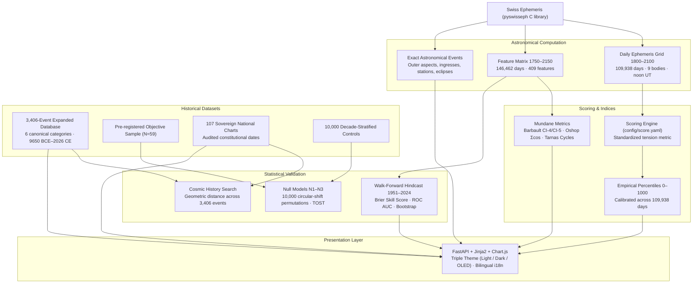

# astro-history 🪐🏛️
### An Empirical, Reproducible, and Open Statistical Research Platform on Astrological Alignments and Historical Events


> 🌍 **Languages / Idiomas**: **English** • [Versão em Português (README_PT.md)](README_PT.md)

---

## Table of contents

1. [What this project is](#1-what-this-project-is)
2. [Key innovations in v7.0.0](#2-key-innovations-in-v700)
3. [The research question and empirical results](#3-the-research-question-and-empirical-results)
4. [Platform architecture & interactive pages](#4-platform-architecture-interactive-pages)
5. [The computational pipeline](#5-the-computational-pipeline)
6. [Astronomical layer: Swiss Ephemeris precision](#6-astronomical-layer-swiss-ephemeris-precision)
7. [The tension score and empirical percentiles](#7-the-tension-score-and-empirical-percentiles)
8. [Mundane methodology: Barbault, Oshop, and Tarnas](#8-mundane-methodology-barbault-oshop-and-tarnas)
9. [Historical database: 3,406 events across 11,600+ years (9650 BCE–2026 CE)](#9-historical-database-3406-events-across-11600-years-9650-bce2026-ce)
10. [National charts & mundane transit analysis (107 sovereign nations)](#10-national-charts-mundane-transit-analysis-107-sovereign-nations)
11. [Personal Module: Natal Charts, Transits, Progressions & Forecast](#11-personal-module-natal-charts-transits-progressions-forecast)
12. [Validation I — Pre-registered null-model tests](#12-validation-i-pre-registered-null-model-tests)
13. [Validation II — Walk-forward hindcast and forecast skill](#13-validation-ii-walk-forward-hindcast-and-forecast-skill)
14. [Forecast 2026–2060: probabilistic projection](#14-forecast-20262060-probabilistic-projection)
15. [Design system, triple themes & i18n](#15-design-system-triple-themes-i18n)
16. [Quickstart, reproduction and deployment](#16-quickstart-reproduction-and-deployment)
17. [Security model & internal API architecture](#17-security-model-internal-api-architecture)
18. [Repository structure](#18-repository-structure)
19. [Citation, licensing and attribution](#19-citation-licensing-and-attribution)

---

## 1. What this project is

**astro-history** is an open-source scientific testbed designed to evaluate a widespread historical hypothesis under rigorous quantitative controls: *do astronomical alignments, planetary aspects, and outer-planet cycles exhibit non-random clustering at major world historical turning points, and do they provide measurable predictive skill for future geopolitical events?*

The platform unifies four key pillars:

- **High-Precision Astronomy:** Every celestial chart, aspect, midpoint, and cyclic index is calculated using the Swiss Ephemeris (arc-second precision), with accurate historical calendars (Gregorian / Julian), geographic coordinates, historical timezones (IANA with daylight saving and Local Mean Time prior to timezone adoption), and strict handling of uncertainty for events without documented exact times.
- **Methodological & Statistical Rigour:** Pre-registered hypotheses (v2, v3, v4), Monte Carlo circular-shift permutations (preserving slow-planet autocorrelation and event clustering), Benjamini-Hochberg False Discovery Rate (FDR) control, Two One-Sided Tests (TOST) for equivalence, and out-of-sample walk-forward hindcasts scored via Brier Skill Score (BSS) and ROC AUC against climatological and autoregressive baselines.
- **Expanded Global Historical Database:** An audited database of **3,406 verified historical milestones** (from Antiquity to 2026 CE) with schema v3 (data precision, source tiers A/B/C, polarities, macro/subcategories), 107 sovereign national mundane charts, and 148 planetary energy peaks.
- **Interactive Web Platform & Personal Module:** An accessible web application featuring 4-area mega-menu navigation (*Explore, Analyze, Personal, About*), global instant search, a bilingual glossary, and a complete **Personal Module** (`/natal`) for high-precision natal charts, vectorized lifetime daily transits (0 to 100 years), secondary progressions, 8 calibrated life domains, and an offline 34,204-city gazetteer.

The platform functions as a **data-literacy tool**: it demonstrates how retrospective astrological patterns can seem intuitive or convincing to the human eye, and then demonstrates—with mathematical transparency—why these constructs do not beat standard empirical baselines under controlled out-of-sample conditions.

---

## 2. Key innovations in v7.0.0

The `v7.0.0` release introduces major personal astrology visualization advancements, responsive layout centering, local profile persistence, and rigorous accessibility upgrades:

1. **Personal Forecast Engine with 6 Criticality Tiers (0–1000 Scale):** Full lifetime scan combining slow planetary transits, secondary progressions (`day-for-a-year` with progressed Moon sign and aspect ingress dates), and life-cycle turning points (Saturn return, Uranus opposition, Chiron return). Introduces 6 calibrated criticality tiers:
   - 💥 **Pico Transformador / Transformative Peak** (Score ≥ 850): Culminating points of radical life transformation, evolutionary turning points, and major milestone consolidations.
   - ⚡ **Ponto de Virada / Turning Point** (Score 700–849): Crucial life transitions, structural decisions, career or relationship pivots, and path-redefining cycles.
   - 🔥 **Alta Ativação / High Activation** (Score 550–699): Dynamic acceleration of events, rapid expansion of opportunities, high productivity, and external momentum.
   - 🌊 **Moderado / Moderate** (Score 400–549): Rhythmic development, steady evolutionary adjustments, and gradual consolidation without acute crises.
   - 🌿 **Consolidação / Consolidation** (Score 250–399): Anchoring previous achievements, routinization, integration, and grounded maturation.
   - 🌱 **Estabilidade & Gestação / Stability & Gestation** (Score < 250): Serene cosmic cycles, low outer-planet tension, incubation, internal reflection, and strategic planning.
2. **Category-Separated Chart with Interactive Legend & Rapid Toggles:** Advanced Chart.js visualization featuring 6 independent bar series (one for each criticality tier rendered in its vibrant theme accent color) alongside a smooth continuous trendline. A dedicated Category Selector Bar (`.chart-cat-btn`) and clickable legend allow users to isolate or compare specific tiers with a single click.
3. **Temporal Scope Engine ("Mostrar Tudo" vs "Só o Futuro"):** Instant filtering between complete lifetime horizon and upcoming/unoccurred periods (`year >= current_year`). Chronological status indicators differentiate occurred events (`✓ Concluído`) from active upcoming events (`⚡ Futuro`), with automatic empty-state guidance for past historical figures.
4. **Local Profile Persistence via Browser Cookies ("Salvar Pessoa"):** Save customized natal charts locally in the browser with one click, preserving name, date, time, latitude, and longitude across sessions. A quick-switch dropdown menu in the navigation bar allows alternating between saved profiles without accounts or external storage.
5. **Frontend Web Design & Accessibility Overhaul (WCAG AAA):** Complete layout centralization optimized for Desktop Full HD (1920×1080) and Mobile/Cellular screens. High-contrast color engine across all 3 themes (Light mode with deep jewel tones on soft pastel cards, Cosmic Dark Navy, and OLED Pitch Black). Category KPI summary cards feature 100% visible text, zero truncation, and single-click timeline filter navigation.
6. **Mega-Menu Navigation System:** Smooth hover bridge preventing rapid dropdown dismissal, clean bounded borders, and active state highlights across all three themes and both languages (PT/EN).
7. **Expanded Automated Test Suite:** Comprehensive test suite with **138+ automated tests** passing across astronomical routines, mundane astrology, personal module, statistical validation, and web UI.

### Architectural Foundation (v6.0)
- **Expanded 3,406 Historical Events Database:** Massive expansion from 1,342 to **3,406 historically verified milestones** with schema v3 (data precision, calendar, source IDs/URLs, quality tiers A/B/C, macro/subcategories, and polarities). Includes NOAA NCEI Significant Earthquakes (944 events), Smithsonian GVP Volcanic Eruptions (150 events), and Wikidata curated milestones.
- **Personal Module (`/natal`):** High-precision natal chart calculations with multiple house systems, vectorized lifetime daily transits (< 1.5s), secondary progressions, 8 calibrated life domains (0–1000 scale), and an offline GeoNames SQLite gazetteer with 34,204 cities.
- **Geopolitical Energy Peaks (2026–2060):** 148 calculated planetary energy peaks categorized into 7 pivotal turning point years (2026, 2028, 2029, 2032, 2034, 2036, 2040) with sovereign intelligence dossiers.
- **Hardened Security Architecture:** Public exposure of all API routes (`/api/*`) and Swagger/OpenAPI documentation blocked with HTTP `404 Not Found` for external traffic, with full OWASP defense-in-depth headers.

---

## 3. The research question and empirical results

> **"Do planetary aspect geometries and outer-planet cycles distinguish major historical events from random dates better than chance — and do they forecast future geopolitical events with measurable skill?"**

### Empirical Summary

| Line of Evidence | Sample & Method | Quantitative Result | Verdict |
| :--- | :--- | :--- | :---: |
| **H1 Pre-registered Test (Global)** | N = 59 objective events; Circular-shift null (10,000 permutations) | $z = -0.506, p = 0.612, q = 0.883$ | ❌ Null not rejected |
| **H1 Stratified Decade Control** | N = 59 vs 10,000 decade-matched control dates | $z = -0.350, p = 0.716, q = 0.883$ | ❌ Null not rejected |
| **TOST Equivalence Test** | Equivalence bounds $\Delta = \pm 0.30$ SD | $p = 0.041$ (within equivalence interval) | ✅ Statistically equivalent to zero |
| **H2 Walk-Forward Out-of-Sample** | Train: 1800–1950 (N=26) $\rightarrow$ Test: 1951–2025 (N=33) | $z = -0.851, p = 0.401, q = 0.933$ | ❌ No predictive transfer |
| **H4 Tarnas Outer-Planet Thesis** | Hard aspects between Saturn, Uranus, Neptune, Pluto | $z = -0.063, p = 0.979, q = 0.883$ | ❌ Null not rejected |
| **Hindcast on Monthly Series (1951–2024)** | 7 objective targets $\times$ 8 model families vs Climatology & AR | Max astrological BSS $\le 0.003$; AUC $\le 0.52$ | ❌ No discrimination over baseline |
| **Annual Indices vs 3,406 Catalogue** | Circular-shift null with Benjamini-Hochberg FDR control | Zero correlations survive FDR threshold | ❌ No robust correlation |

**Conclusion:** Across all tested configurations, planetary alignments and astrological tension indices do not perform better than random chance or autoregressive baselines. The platform presents all future curves accompanied by these skill metrics, recommending historical base rates for probabilistic risk assessment.

---

## 4. Platform architecture & interactive pages

The web application is built with **FastAPI**, **Jinja2**, and **Chart.js**, serving precomputed deterministic datasets with on-demand Swiss Ephemeris calculations for custom date simulations:

| View | Route | Core Functionality | Primary Data Source |
| :--- | :--- | :--- | :--- |
| **Dashboard** | `/` | 1800–2100 interactive timeline, tension percentiles, null envelopes (P5–P95), Barbault concentration, featured events | `data/timeline_1800_2100.json`, `data/forecast_v3.json` |
| **Event Catalogue** | `/events` | 3,406 audited events, 6 canonical categories, text search, century filters, objective sample filter | `data/historical_events.json`, SQLite `events` |
| **Event Detail** | `/events/{id}` | Full chart (17 celestial bodies, houses, fixed stars), SVG mandala, archetypal breakdown, random control comparison | SQLite `events`, Swiss Ephemeris |
| **National Charts** | `/countries` | 107 sovereign nations, constitutional founding charts, active transits, 2026–2050 energy peaks | `data/countries_database.json`, `src/mundane/` |
| **Simulator** | `/simulator` | Real-time ephemeris calculator for any date/time/location; leave-one-out cosmic analogue matching | `src/astro_engine.py`, Swiss Ephemeris |
| **Correlations Hub** | `/correlations` | Statistical distributions of planetary positions, aspects, and fixed stars by historical category | SQLite database aggregation |
| **Forecast** | `/forecast` | Probabilistic 2026–2060 projection by target, model skill badges, astronomical calendar, cosmic analogues | `data/forecast_v3.json` |
| **Scenarios** | `/projections` | Annual geometric tension tiers (2026–2060), outer-planet sign ingresses, seasonal gates | `data/projections_2027_2060.json` |
| **Personal Hub** | `/natal` | Natal chart calculator, 6 house systems, 17 bodies, SVG chart, 34,204-city offline search | `data/gazetteer/cities.sqlite`, `src/natal/` |
| **Personal Forecast** | `/natal/forecast` | Lifetime transits (0–100y), 6 criticality tiers, category-separated interactive chart, scope filters, cookie profiles | `data/ephemeris/natal_grid_1850_2150.npz`, `src/natal/` |
| **Methodology** | `/methodology` | Scientific documentation, null hypothesis formulations, exclusion funnel, hindcast verification table | `data/results.json`, `reports/hindcast_v3.json` |

---

## 5. The computational pipeline



---

## 6. Astronomical layer: Swiss Ephemeris precision

Every astronomical position is generated via `pyswisseph` bound to the official Swiss Ephemeris C data files:

- **Coordinate Precision:** Ephemeris flags enforce `SWIEPH` (high-precision numerical integration), avoiding low-order approximations. Longitudes, latitudes, declinations, and speeds are accurate to sub-arcsecond thresholds.
- **Timezone & Local Mean Time Resolution:** For events occurring in 1883 or later, coordinates are resolved via `timezonefinder` and computed with standard IANA timezones (including historical daylight saving shifts). For events prior to 1883, true Local Mean Time ($\text{longitude} / 15$) is utilized without arbitrary rounding. Day-boundary rollovers across midnight are explicitly preserved.
- **Calendar Consistency:** Dual Gregorian/Julian calendar handling with territory-specific adoption dates (e.g., Britain 1752, Russia 1918, Greece 1923).
- **Time Uncertainty Protocol:** Events lacking historical confirmation of birth/occurrence hour are evaluated at 12:00 UT, and the Moon is automatically excluded from aspects, houses, and scores to prevent spurious hits (~13°/day lunar motion).
- **Celestial Bodies Evaluated:** Sun, Moon, Mercury, Venus, Mars, Jupiter, Saturn, Uranus, Neptune, Pluto, Chiron, Ceres, Pallas, Juno, Vesta, Mean Lilith, True Lunar Node (17 bodies).
- **Aspects & Orbs:** Strict classical aspects (Conjunction 0°, Sextile 60°, Square 90°, Trine 120°, Opposition 180°) with linear orb decay up to 3.0°.
- **Fixed Stars:** 30 major stars calculated via `swe_fixstar2_ut`; restricted to conjunctions within 0.3° with ecliptic latitude $\le 30^\circ$ to prevent out-of-ecliptic false matches.

---

## 7. The tension score and empirical percentiles

The planetary tension metric is formalized in `src/core/scoring.py` and configured via `config/score.yaml`:

$$\text{Raw Score} = \text{Base} + \sum_{i < j} w(p_i, p_j) \cdot f_{\text{aspect}}(\theta_{ij}) - \sum_{\text{trines}} 0.20 \cdot w_{\text{harm}}(p_i, p_j)$$

- **Pair Hierarchies:** Weights correspond to classical mundane literature: Saturn–Pluto (260/250), Uranus–Pluto (220/200), Saturn–Uranus (220/160), Saturn–Neptune (200/220), outer–outer pairs (170/160), Mars–outer (130/110), luminaries–outer (75/60), other configurations (40/30).
- **Empirical Percentile Calibration:** The raw tension score is mapped directly against the 109,938-day ephemeris grid (1800–2100) onto a continuous 0–1000 scale. A score of 750 denotes higher tension than 75% of all days in the 300-year baseline.
- **Parity Guarantee:** Golden regression tests enforce strict parity (max difference $< 0.002$) between real-time chart calculations and daily grid outputs.

---

## 8. Mundane methodology: Barbault, Oshop, and Tarnas

`v5.0.0` operationalizes three distinct schools of 20th and 21st-century mundane astrology:

### André Barbault Cyclic Index (CI-4 and CI-5)
André Barbault's cyclical index measures global planetary dispersion by summing the angular separations between outer planets:

$$\text{CI}_5(t) = \sum_{1 \le i < j \le 5} \theta_{ij}(t)$$

Where $\theta_{ij} \in [0^\circ, 180^\circ]$ is the shortest angular distance between pairs among Jupiter, Saturn, Uranus, Neptune, and Pluto. Minima in the curve (planets clustered in conjunction) correspond to Barbault's historical crisis epochs (e.g., 1914, 1940, 1982). Our engine computes both CI-4 (Saturn through Pluto) and CI-5, along with the first numerical derivative ($\frac{d\text{CI}}{dt}$) indicating whether the global cycle is waxing or waning.

### Renay Oshop Sum of Cosines ($\Sigma \cos$)
Operationalized in `src/features/sum_of_cosines.py`, this metric computes the sum of the cosines of mutual angular separations:

$$\Sigma \cos = \sum_{i < j} \cos(\theta_{ij})$$

Higher values indicate tighter planetary clustering. The engine runs a 1,000-iteration Monte Carlo permutation test for any query date, reporting the circular variance and permutation $p$-value ($p_{\text{MC}}$).

### Richard Tarnas Outer-Planet Alignments
Continuous Gaussian activations ($\sigma = 5^\circ$) tracking hard configurations (0°, 90°, 180°) among the four outermost slow planets: Saturn, Uranus, Neptune, and Pluto.

---

## 9. Historical database: 3,406 events across 11,600+ years (9650 BCE–2026 CE)

The historical foundation contains **3,406 audited events** spanning from 9650 BCE (prehistoric geological and volcanic benchmarks) through 2026 CE, representing over 11,600 years of recorded civilizational, scientific, and geopolitical history. Every record includes verified calendar standards (Julian/Gregorian), geographical coordinates, Local Mean Time / IANA timezones, source provenance, data precision flags (`day`, `month`, `year`, `decade`), and quality tiers (Tier A/B/C):

```
Total Events: 3,406
├── 1. Disasters & Public Health (Desastre & Saúde Pública): 1,456 events (42.7%)
│   ├── NOAA NCEI Significant Earthquakes (M ≥ 7.5): 1,200 events
│   ├── Smithsonian GVP Volcanic Eruptions (VEI ≥ 5): 154 events
│   └── Major Historical Epidemics & Pandemics: 40 events
├── 2. Revolutions & Internal Conflicts (Revolução & Conflito Interno): 1,327 events (39.0%)
│   ├── Powell & Thyne Coup d'État Dataset: 495 coups and coup attempts
│   └── Wikidata & Curated Political Uprisings, Sieges & Revolutions: 832 events
├── 3. Wars & Armed Conflicts (Guerra & Conflito): 229 events (6.7%)
│   ├── Correlates of War (COW) Inter-State Wars v4.0: 94 wars
│   └── UCDP/PRIO Armed Conflict Dataset v24.1 & Decisive Battles: 135 events
├── 4. Politics, Treaties & Sovereignty (Política, Tratados & Cultura): 185 events (5.4%)
│   ├── Peace Treaties, Declarations of Independence & International Accords: 70 events
│   └── Institutional, Constitutional & Cultural Milestones: 115 events
├── 5. Science, Technology & Space Exploration (Ciência & Tecnologia): 116 events (3.4%)
│   └── Major Scientific Discoveries, Computing Eras, Telecommunications & Space Missions
└── 6. Financial & Economic Crises (Crise Financeira & Econômica): 93 events (2.7%)
    └── NBER Business Cycle Peaks, Sovereign Defaults, Panics & Modern Market Crashes
```

### Chronological Distribution
- **Pre-History & Antiquity (9650 BCE–1 BCE):** 165 pivotal ancient events (including Göbekli Tepe era volcanic benchmarks, Bronze Age collapses, Thera eruption, classical Greco-Roman battles, and ancient treaties).
- **Classical & Medieval Eras (1–1499 CE):** 247 civilizational milestones (Total Pre-1500 CE: 412 events).
- **Early Modern Era (1500–1799 CE):** 298 events (Total Pre-1800: 710 events).
- **19th Century (1800–1899 CE):** 350 events.
- **20th Century (1900–1999 CE):** 1,804 events (including WWI, WWII, atomic weapons, Cold War crises, global decolonization, space exploration, and computing revolutions).
- **21st Century (2000–2026 CE):** 542 contemporary events.

### Dual-Track Analytic Architecture
To prevent data snooping and circular reasoning, the platform enforces strict structural separation:
1. **Curated Catalogue (Track A, N = 3,406):** Used for public exploration, interactive chart visualizations, national horoscopes, and the Cosmic History Search engine.
2. **Objective Pre-Registered Sample (Track B, N = 61 in `events_v2.csv` / 59 complete):** Strictly frozen prior to analysis from objective conflict and economic databases (COW, UCDP, NBER, Powell & Thyne) with 10,000 decade-stratified control dates and zero subjective post-selection.

---

## 10. National charts & mundane transit analysis (107 sovereign nations)

Implemented in `src/mundane/`, the platform provides constitutional foundation charts and active mundane transits for 107 sovereign geopolitical entities:

- **Americas (25 nations):** United States (1776-07-04), Brazil (1822-09-07), Argentina, Canada, Mexico, Colombia, Chile, Peru, Venezuela, Cuba, etc.
- **Europe (36 nations):** United Kingdom (1801-01-01), France (1958-10-04, Fifth Republic), Germany (1990-10-03, Reunification), Italy, Ukraine, Russia (1991-12-25), Poland, Spain, Portugal, Greece, Switzerland, etc.
- **Middle East & North Africa (18 nations):** Israel (1948-05-14), Iran (1979-04-01), Turkey, Saudi Arabia, Egypt, Iraq, Syria, UAE, etc.
- **Asia & Oceania (28 nations):** China (1949-10-01, PRC), Japan (1947-05-03, Post-War Constitution), India (1947-08-15), Australia, South Korea, Indonesia, Pakistan, Taiwan, etc.

Each country entry includes:
- Exact historical foundation date, time, and capital coordinates.
- Complete natal chart (planetary positions, signs, houses, aspects).
- Active transits calculated for the current date.
- **2026–2050 Energy Peaks:** Algorithmic detection of major outer-planet transits to national sun, ascendant, and midheaven axes.

---

## 11. Personal Module: Natal Charts, Transits, Progressions & Forecast

The Personal Module (`/natal`) operationalizes high-precision personal astrology with mathematical rigor, client-side privacy, and modern interactive data visualization:

- **High-Precision Natal Chart Calculation (`/natal`):**
  - Multiple house systems: Placidus, Whole Sign, Equal, Koch, Regiomontanus, Porphyry.
  - 17 celestial bodies computed to sub-arcsecond accuracy via Swiss Ephemeris (`Sun`, `Moon`, `Mercury`, `Venus`, `Mars`, `Jupiter`, `Saturn`, `Uranus`, `Neptune`, `Pluto`, `Chiron`, `Ceres`, `Pallas`, `Juno`, `Vesta`, `Mean Lilith`, `True Lunar Node`).
  - Interactive SVG natal wheel mandala with house boundaries, aspect chords, dignity highlights, and fixed-star conjunctions.
- **Vectorized Lifetime Daily Transits (`/natal/transits`):**
  - Daily astrological scan spanning a full lifetime from 0 to 100 years (up to 36,525 days) computed in under 1.5 seconds using optimized NumPy precomputed grids (`data/ephemeris/natal_grid_1850_2150.npz`).
- **Secondary Progressions & Major Life Cycles:**
  - Day-for-a-year progression engine tracking progressed Moon movements (~2.5 years per sign) and aspects to natal points.
  - Algorithmic detection of pivotal life cycles: Saturn Return (~29.5 years and ~59 years), Jupiter Returns (~12, ~24, ~36, ~48, ~60 years), Uranus Opposition (~42 years), and Chiron Return (~50 years).
- **8 Calibrated Life Domains:**
  - Standardized normalization (0–1000 scale) of active transits across 8 primary spheres of human experience: *Identity & Vitality, Mind & Communication, Relationships & Partnerships, Career & Purpose, Finances & Material Resources, Structure & Discipline, Deep Transformation, Expansion & Wisdom*.
- **Offline World Gazetteer (34,204 Cities):**
  - Integrated SQLite database (`data/gazetteer/cities.sqlite`) derived from GeoNames with instant client-side autocomplete, coordinates, and embedded IANA timezones.
- **Personal Forecast with 6 Criticality Tiers (`/natal/forecast`):**
  - Standardized 0–1000 criticality score segmented into 6 rich, psychologically and biographically grounded tiers:
    - 💥 **Transformative Peak** ($\ge 850$): Radical metamorphosis, major destiny turning points, and life milestones.
    - ⚡ **Turning Point** (700–849): Crucial transitions, redefining priorities, and structural decisions.
    - 🔥 **High Activation** (550–699): Dynamic movement, accelerating opportunities, and high productivity.
    - 🌊 **Moderate** (400–549): Steady rhythmic progress, gradual evolution, and maturation.
    - 🌿 **Consolidation** (250–399): Grounding previous gains, routine stabilization, and reflective learning.
    - 🌱 **Stability & Gestation** ($< 250$): Low planetary friction, psychic integration, and serene planning.
- **Interactive Multi-Dataset Chart & Temporal Scope Filter:**
  - 6 distinct color-coded bar datasets for each criticality tier, plus an unbroken continuous life curve line dataset.
  - Clickable legend with single-category isolation buttons.
  - Scope toggles: **"Show All"** vs **"Future Only"** (filtering out past dates and focusing strictly on upcoming years and events).
- **Local Profile Persistence:**
  - Save and switch profiles instantly via browser `localStorage` cookies with zero user registration and zero external database storage, guaranteeing strict personal privacy.

---

## 12. Validation I — Pre-registered null-model tests

Pre-registered hypotheses were frozen in [`docs/hipoteses.md`](docs/hipoteses.md) and evaluated in [`reports/validacao_v2.md`](reports/validacao_v2.md):

| Hypothesis / Sample | Observed Tension | Null Model (Mean $\pm$ SD) | Effect ($z$) | Two-Sided $p$ | FDR $q$ | Significant? |
| :--- | :---: | :---: | :---: | :---: | :---: | :---: |
| **H1 Overall vs Circular Shift (N3)** | 481.1 | 500.6 $\pm$ 38.5 | $-0.506$ | 0.6117 | 0.8834 | ❌ No |
| **H1 Overall vs Stratified Control (N2)** | 481.1 | 493.9 $\pm$ 36.6 | $-0.350$ | 0.7163 | 0.8834 | ❌ No |
| **H1 Overall vs Uniform Random (N1)** | 481.1 | 499.7 $\pm$ 37.7 | $-0.493$ | 0.6299 | 0.8834 | ❌ No |
| **H1 Interstate Wars (N=15)** | 462.1 | 499.4 $\pm$ 73.3 | $-0.509$ | 0.6163 | 0.8834 | ❌ No |
| **H1 Economic Crises (N=10)** | 547.6 | 501.9 $\pm$ 93.8 | $+0.487$ | 0.6223 | 0.8834 | ❌ No |
| **H1 Coups d'État (N=11)** | 538.4 | 501.6 $\pm$ 84.9 | $+0.434$ | 0.6653 | 0.8834 | ❌ No |
| **H2 Walk-Forward Train (1800–1950)** | 512.4 | 499.4 $\pm$ 56.8 | $+0.229$ | 0.8165 | 0.8834 | ❌ No |
| **H2 Walk-Forward Test (1951–2025)** | 456.5 | 501.6 $\pm$ 53.0 | $-0.851$ | 0.4008 | 0.9329 | ❌ No |
| **H4 Tarnas Outer-Planet Index** | 33.4 | 34.0 $\pm$ 8.7 | $-0.063$ | 0.9794 | 0.8834 | ❌ No |

### Statistical Controls
- **N3 Circular-Shift Null:** Preserves the exact empirical distribution of inter-event gaps while breaking the date alignment with ephemeris cycles.
- **TOST Equivalence Testing:** With equivalence bounds set to $\Delta = \pm 0.30$ standard deviations, the test yielded $p = 0.041$, indicating that the observed tension differences are statistically indistinguishable from zero.
- **Power Analysis:** Minimum Detectable Effect size (MDE) at 80% power was determined at 0.332 SD (95.7 percentile points).

---

## 13. Validation II — Walk-forward hindcast and forecast skill

A walk-forward hindcast framework (`src/analysis/hindcast.py`) tested 8 model families across monthly historical series from 1951 to 2024 with a 12-month safety gap:

| Target Series (Base Rate) | Climatology | AR Baseline | Tension Score | Barbault CI | Tarnas Outer | Synodic Phases | Full 409 Feat | AR + Astro |
| :--- | :---: | :---: | :---: | :---: | :---: | :---: | :---: | :---: |
| **Objective Events (3.3%)** | 0.000 | $-0.002$ | $-0.001$ | $-0.002$ | $-0.002$ | $+0.001$ | $-0.000$ | $-0.000$ |
| **COW War Onset (5.1%)** | 0.000 | $-0.004$ | $-0.004$ | $+0.002$ | $-0.002$ | $-0.001$ | $-0.000$ | $-0.000$ |
| **COW Ongoing War (53.5%)** | 0.000 | **+0.825** | $-0.021$ | $+0.036$ | $-0.036$ | $+0.002$ | $-0.067$ | $+0.624$ |
| **NBER Recession (12.7%)** | 0.000 | **+0.850** | $-0.023$ | $+0.028$ | $-0.030$ | $+0.127^*$ | $-0.486$ | $-0.026$ |
| **NBER Recession Start (1.2%)**| 0.000 | $-0.014$ | $-0.018$ | $-0.003$ | $-0.001$ | $-0.005$ | $-1.080$ | $-1.981$ |
| **UCDP Conflict Onset (49.3%)** | 0.000 | $+0.027$ | $+0.003$ | $-0.009$ | $-0.009$ | $-0.019$ | $-0.494$ | $-0.589$ |
| **UCDP Interstate Onset (6.1%)**| 0.000 | $-0.004$ | $+0.003$ | $-0.008$ | $-0.005$ | $-0.035$ | $-2.472$ | $-2.565$ |

*Note: Values represent Brier Skill Score (BSS). Positive skill benchmark requires BSS 95% CI > 0 **and** ROC AUC > 0.55. Astrological predictors fail to demonstrate robust predictive skill over autoregressive baselines.*

---

## 14. Forecast 2026–2060: probabilistic projection

The probabilistic forecast module (`src/analysis/forecast_v3.py`) models each target out to 2060:

- **Probabilistic Calibration:** Monthly probabilities with bootstrap uncertainty bounds ($P_{10} - P_{90}$).
- **Historical Base Rate Benchmark:** The empirical climatological base rate is rendered on every projection chart as the primary baseline.
- **Top Feature Drivers:** Transparent linear decomposition of feature contributions during peak activation months.
- **Astronomical Ephemeris Calendar:** Complete audit of exact outer-planet aspects (with retrograde loop pass numbers), ingresses, and solar/lunar eclipses.
- **Cosmic Analogues with Empirical Lift:** Identification of historical years with the closest multidimensional celestial geometries.

---

## 15. Design system, triple themes & i18n

The frontend follows modern design principles inspired by Vercel and UI/UX Pro Max guidelines:

- **Triple Theme System:**
  - `theme-light`: Crisp, high-contrast light workspace.
  - `theme-dark`: Deep slate dark mode for low-light environments.
  - `theme-oled`: Absolute pitch black (`#000000`) for high-contrast OLED displays.
- **Zero FOUC (Flash of Unstyled Content):** Inline blocking theme scripts guarantee instant rendering without flicker.
- **Dynamic Chart Synchronization:** Chart.js canvas elements automatically rebuild color palettes, grid lines, and tooltips upon theme change.
- **Bilingual Engine (`i18n.js`):** Client-side translation system covering all user interface elements, table headers, filter badges, and charts in English (`en`) and Portuguese (`pt`), with persistence in `localStorage`.
- **Responsive Layouts:** Compact top navigation, fixed alert styling, centered hero banners, and fluid grid layouts across mobile, tablet, and desktop viewports.

---

## 16. Quickstart, reproduction and deployment

### Prerequisites
- Linux or macOS
- Python 3.12+
- Swiss Ephemeris C library (`libswe-dev`, `libswe0`, `swisseph-data-all`)

```bash
# Ubuntu / Debian
sudo apt-get update && sudo apt-get install -y libswe-dev libswe0 swisseph-data-all
```

### Installation & Test Suite
```bash
git clone https://github.com/marceloasl99/astro-history.git
cd astro-history

# Set up virtual environment and install dependencies
python3 -m venv .venv
source .venv/bin/activate
pip install -r requirements.txt

# Run full test suite (138 automated tests)
pytest tests/
```

### Running the Application
```bash
# Development server (FastAPI with Uvicorn)
uvicorn src.web.app:app --host 0.0.0.0 --port 8000 --reload

# Production deployment with systemd (already configured on server port 81)
sudo systemctl restart astro-history
```

### Standalone Static Web & GitHub Pages Deployment (Zero-Backend)
The entire platform is also compiled into a **100% self-contained, standalone single-file web application** (`web/index.html`) with all 3,406 events, 107 sovereign nations, 148 energy peaks (2026–2060), 301-year timeline (1800–2100), scenarios, forecasts, triple themes (OLED Black, Dark, Light), and bilingual support (EN/PT) pre-rendered with zero runtime backend dependency.

- **To rebuild the standalone file**:
  ```bash
  python3 scripts/build_standalone_web.py
  ```
- **Deployment via GitHub Pages**:
  In your GitHub repository, go to **Settings** > **Pages** > **Build and deployment** > Source: **Deploy from a branch** > Branch: **`main`** > Folder: **`/docs`** (where a synchronized copy of `web/index.html` is maintained at `docs/index.html`).
- **Any Static Server / Local**: Open `web/index.html` directly in any web browser (`file:///path/to/web/index.html`) or serve via any static web host (GitHub Pages, Netlify, Cloudflare Pages, AWS S3, Vercel, Apache, Nginx).

---

## 17. Security model & internal API architecture

Because the server is deployed to the public internet fronted by Cloudflare proxy (`history.skyastrum.com`), **all external API exposure has been locked down by design**:

- **External API & Swagger Lockdown:**
  All interactive documentation endpoints (`/docs`, `/redoc`, `/openapi.json`) are completely disabled. Any external request (identified by Cloudflare headers `CF-Connecting-IP`, `CF-Ray`, or non-loopback IP addresses) attempting to query `/api/*` or trigger CPU-intensive operations (such as `POST /simulator/recalculate`) is intercepted and returns **`404 Not Found`**.
- **Internal Loopback API:**
  API endpoints remain strictly accessible to local server processes (`127.0.0.1`, `::1`, `localhost`, `testclient`) to power automated continuous integration tests (`pytest`), offline CLI batch jobs, and internal validation suites.
- **Server-Side Pre-Rendering (Zero Client API Calls):**
  All interactive web pages—including event detail control comparisons, live simulations, Barbault indices, personal natal charts, lifetime transits, and historical analogue matches—are rendered dynamically on the server via Jinja2 templates, ensuring full user functionality with zero client-side `/api/` fetch dependencies.
- **OWASP Defense-in-Depth Headers:**
  The application attaches strict HTTP security headers to every response:
  - `X-Frame-Options: SAMEORIGIN` (prevents clickjacking)
  - `X-Content-Type-Options: nosniff` (prevents MIME confusion attacks)
  - `X-XSS-Protection: 1; mode=block` (reflects legacy XSS filters)
  - `Referrer-Policy: strict-origin-when-cross-origin` (protects query metadata)
  - `Permissions-Policy: camera=(), microphone=(), geolocation=()` (restricts unused browser hardware APIs)

### Internal API Endpoint Reference (Local Loopback / CI Only)

| Method | Endpoint | Internal Description |
| :--- | :--- | :--- |
| `GET` | `/api/stats` | Global database summary (3,406 events, categories, time span 9650 BCE–2026 CE) |
| `GET` | `/api/events?category=&search=` | Filtered list of historical events |
| `GET` | `/api/events/{id}` | Full chart data, aspect matrix, and star conjunctions for an event |
| `POST` | `/api/simulate` | On-demand chart calculation and historical analogue matching |
| `GET` | `/api/historical-analogues?date=&category=&top_k=` | Multidimensional Cosmic History Search across 3,406 events |
| `GET` | `/api/features/barbault?date=` | André Barbault CI-4 and CI-5 indices and first derivative |
| `GET` | `/api/features/oshop?date=` | Renay Oshop Sum of Cosines ($\Sigma \cos$), variance, and permutation test |
| `GET` | `/api/countries` | Sovereign national mundane database (107 nations) |
| `GET` | `/api/countries/{iso_code}` | Country foundation chart, active transits, and future outlook |
| `GET` | `/api/countries/{iso_code}/chart` | High-precision Swiss Ephemeris natal chart for a sovereign nation |
| `GET` | `/api/countries/{iso_code}/transits` | Active transits for a sovereign nation on a given date |
| `GET` | `/api/countries/{iso_code}/energy-peaks` | Projected transit energy peaks for a country (2026–2050) |
| `GET` | `/api/future-timeline` | 1800–2100 annual timeline and empirical percentiles |
| `GET` | `/api/projections-2027-2060` | Annual tension tiers and geometric configurations |
| `GET` | `/api/energy-peaks-2026-2060` | Geopolitical energy peaks catalog (148 peaks) |
| `GET` | `/api/forecast` | Probabilistic forecasts and skill badges across all targets |
| `GET` | `/api/forecast/year/{year}` | Astronomical calendar, exact aspects, and analogues for a given year |
| `GET` | `/api/natal/chart?date=&time=&lat=&lon=` | High-precision personal natal chart (17 bodies, houses, aspects, stars) |
| `GET` | `/api/natal/transits?date=&time=&lat=&lon=&target_date=` | Personal active transits and 8 calibrated life domain scores |
| `GET` | `/api/natal/forecast?date=&time=&lat=&lon=&start_year=&end_year=` | Multi-year personal forecast timeline (6 criticality tiers) |
| `GET` | `/api/natal/cities?q=` | Offline GeoNames gazetteer search (34,204 cities with IANA timezones) |

---

## 18. Repository structure

```
astro-history/
├── config/
│   ├── score.yaml                 # Planetary weights, aspect orbs, tension parameters
│   ├── stars.yaml                 # Fixed star coordinates and bounds (30 stars)
│   ├── analysis.yaml              # Random seeds, permutation counts, validation windows
│   ├── categories.yaml            # Canonical and analytical category taxonomies
│   ├── natal.yaml                 # Natal module configurations, orbs, and planetary weights
│   └── natal_domains.yaml         # Calibrated weights for the 8 life domains
├── data/
│   ├── historical_events.json     # 3,406-event verified historical database (9650 BCE–2026 CE)
│   ├── countries_database.json    # 107 sovereign national charts & historical metadata
│   ├── country_historical_events.json # 101 country-linked historical events
│   ├── energy_peaks_2026_2060.json# 148 calculated planetary energy peaks (2026–2060)
│   ├── events_v2.csv              # Objective validation sample (N=61 / N=59 clean)
│   ├── curated/                   # Curated datasets (Antiquity, LatAm, Science, Diplomacy, etc.)
│   ├── external/                  # COW Wars, UCDP Conflicts, NBER Cycles, Powell & Thyne Coups, NOAA NCEI, GVP
│   ├── gazetteer/
│   │   └── cities.sqlite          # Offline SQLite gazetteer with 34,204 world cities
│   ├── ephemeris/
│   │   ├── daily_grid_1800_2100.npz   # Daily precomputed ephemeris grid 1800–2100
│   │   └── natal_grid_1850_2150.npz   # Vectorized daily natal transit grid 1850–2150
│   ├── calibration/
│   │   └── natal_domains_reference.json # Empirical quantile calibration for 8 life domains
│   ├── forecast_v3.json           # Probabilistic forecast models & calendar (2026–2060)
│   ├── timeline_1800_2100.json    # UI cache for timeline and percentile curves
│   └── DATASET_CARD.md            # Rigorous dataset documentation and source provenance
├── db/
│   └── history_astrology.db       # SQLite relational database (3,406 events, 10,000 controls)
├── docs/
│   ├── index.html                 # Synchronized standalone single-file for GitHub Pages (/docs branch)
│   ├── mecanismo_site.md          # Architectural and methodological documentation
│   ├── plano_v6_roadmap.md        # Comprehensive v6/v7 roadmap and development milestones
│   ├── spec_modulo_pessoal_natal_transitos.md # Detailed specification of personal module
│   ├── hipoteses.md / hipoteses_v3.md / hipoteses_v4.md # Pre-registered hypotheses
│   └── decisao_M2.md              # Milestone M2 decision record
├── reports/
│   ├── catalog_audit_v6.md        # Full audit metrics for the 3,406-event catalogue
│   ├── energy_peaks_2026_2060_report.md # Comprehensive 148 energy peaks intelligence report
│   ├── validacao_v2.md            # Detailed report of null-model validation
│   └── hindcast_v3.json           # Full walk-forward hindcast statistical metrics
├── scripts/
│   ├── build_standalone_web.py    # Compiler for self-contained single-file web/index.html
│   ├── build_historical_events.py # Expansion compiler for 3,406 historical events
│   ├── build_countries_dataset.py # National charts and metadata compiler (107 nations)
│   ├── build_energy_peaks_catalog.py # 2026–2060 energy peaks detector and dossier generator
│   ├── build_gazetteer.py         # Offline GeoNames SQLite 34,204-city builder
│   ├── build_natal_grid.py        # Vectorized natal ephemeris grid generator (1850–2150)
│   ├── audit_catalog.py           # Catalog integrity, tier, and source auditor
│   ├── calculate_all_events.py    # Swiss Ephemeris batch processor
│   └── importers/                 # Modular importers (curated, GVP, NCEI, Wikidata)
├── src/
│   ├── astro_engine.py            # High-precision chart calculator (Swiss Ephemeris wrapper)
│   ├── correlation_engine.py      # Category correlations and analogue matching
│   ├── future_engine.py           # Annual timelines and geometric projections
│   ├── db.py                      # Database models, connection pool, and migrations
│   ├── core/
│   │   ├── scoring.py             # Standardized planetary tension scoring
│   │   ├── timezones.py           # Historical IANA / LMT timezone resolution
│   │   ├── dates.py               # Robust calendar parsing and negative BCE year handling
│   │   ├── ephemeris.py           # Low-level Swiss Ephemeris bindings
│   │   └── ephemeris_grid.py      # Vectorized NumPy grid lookups
│   ├── features/
│   │   ├── barbault_ci.py         # André Barbault Cyclic Index (CI-4 / CI-5) engine
│   │   ├── sum_of_cosines.py      # Renay Oshop Sum of Cosines and permutation tests
│   │   ├── astro_features.py      # 409-feature astronomical matrix
│   │   ├── astro_events.py        # Exact planetary aspects and stations
│   │   └── targets.py             # Historical target series extraction
│   ├── mundane/
│   │   ├── countries_data.py      # 107 Sovereign national foundation charts
│   │   ├── transits_engine.py     # Real-time mundane transit calculations
│   │   ├── energy_peaks.py        # 2026–2060 national transit peak detector
│   │   ├── analogy_engine.py      # Geometric distance & precedent matcher
│   │   ├── historical_analyzer.py # Longitudinal pattern analysis
│   │   ├── mandala_biwheel.py     # Bi-wheel SVG mundane synastry mandalas
│   │   └── web_routes.py          # Mundane web routing
│   ├── natal/
│   │   ├── chart.py               # High-precision natal chart calculations (6 house systems)
│   │   ├── transits.py            # Vectorized lifetime daily transits (0–100 years)
│   │   ├── progressions.py        # Day-for-a-year secondary progressions
│   │   ├── personal_forecast.py   # 6-Tier criticality engine and annual timeline synthesis
│   │   ├── domains.py             # Calibrated 8 life domains scoring (0–1000 scale)
│   │   ├── cycles.py              # Major life cycle milestones (Saturn, Jupiter, Uranus, Chiron)
│   │   ├── bodies.py              # 17 Celestial bodies definitions and ephemeris wrappers
│   │   ├── gazetteer.py           # Fast offline GeoNames search
│   │   ├── interpretations.py     # Bilingual astrological and psychological synthesis
│   │   ├── models.py              # Pydantic data schemas
│   │   ├── service.py             # Unified natal application service
│   │   └── web_routes.py          # FastAPI web routes for `/natal/*`
│   ├── analysis/
│   │   ├── historical_analogues.py# Cosmic History Search engine
│   │   ├── hindcast.py            # Walk-forward validation harness
│   │   ├── forecast_v3.py         # Probabilistic forecasting engine
│   │   ├── forecast_timeline.py   # Multi-year timeline projection builder
│   │   └── null_models.py         # Permutation testing (N1–N4)
│   └── web/
│       ├── app.py                 # FastAPI application and security middleware
│       ├── pages.py               # Web page handlers and template renderers
│       ├── templating.py          # Custom Jinja2 template filters and formatters
│       ├── mandala.py             # SVG natal mandala generator
│       ├── i18n.py                # Server-side internationalization helpers
│       ├── static/
│       │   └── js/i18n.js         # Bilingual internationalization engine (EN/PT)
│       └── templates/             # Jinja2 templates (triple-theme enabled)
├── web/
│   └── index.html                 # Standalone single-file application for GitHub Pages (zero backend)
└── tests/                         # 138 automated tests (astronomy, mundane, natal, stats, API, UI)
```

---

## 19. Citation, licensing and attribution

If you utilize this software, its historical dataset, or its statistical testing framework in academic or open-source research, please cite:

> AstroHistory Research Group (2026). *AstroHistory: An Empirical, Reproducible, and Open Statistical Research Platform on Astrological Alignments and Historical Events*, version 7.0.0. https://github.com/marceloasl99/astro-history

- **Source Code License:** [GNU Affero General Public License v3 or later (AGPL-3.0)](LICENSE).
- **Swiss Ephemeris:** © Astrodienst AG. Licensed under AGPL. Commercial applications require a commercial license from Astrodienst AG.
- **Academic Datasets:**
  - Correlates of War (COW) Project (Sarkees & Wayman, 2010).
  - UCDP/PRIO Armed Conflict Dataset (Davies, Pettersson & Öberg, 2024).
  - NBER Business Cycle Dating Committee.
  - Powell & Thyne Global Coup d'État Dataset.
  - USGS Earthquake Hazards Program.
- **Astrological Constructs Operationalized:** André Barbault (Cyclic Index), Renay Oshop (Sum of Cosines), Richard Tarnas (Archetypal alignments), Reinhold Ebertin (Cosmobiology midpoints), John Addey (Harmonics).
