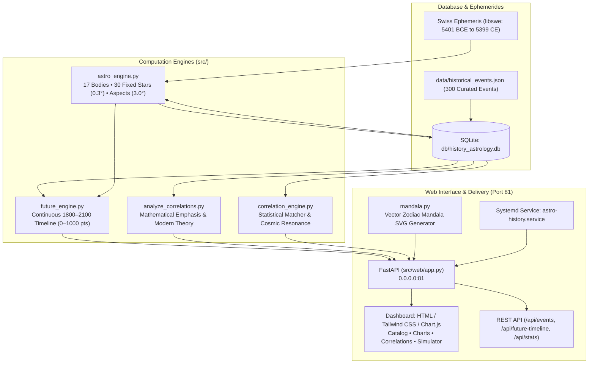

# astro-history 🪐🏛️
### Modern Astrology, Cosmological Calculations & Historical Correlation Engine for 300 Major World Events (1800–2100)


**astro-history** is an analytical, statistical, and prospective research platform grounded in **Modern and Mundane Astrology**. The system leverages the high-precision **Swiss Ephemeris (`pyswisseph`)** engine to compute the exact astronomical positions of **17 celestial bodies**, strict major aspects, and conjunctions with the **30 primary fixed stars** of the celestial sphere.

The platform analyzes a curated corpus of the **300 greatest turning points in human history** (from Antiquity to 2024), identifies recurring planetary archetypal signatures, quantifies historical friction using a **high-resolution 0 to 1000 Cosmic Tension Index**, and generates a **continuous 301-year timeline (1800 to 2100)** for retrospective validation and forward-looking scenario modeling.

---

## Table of Contents
1. [Overview & Philosophical Foundation](#1-overview--philosophical-foundation)
2. [System Architecture](#2-system-architecture)
3. [Astronomical Engine & Modern Astrology](#3-astronomical-engine--modern-astrology)
4. [High-Resolution Cosmic Tension Scale (0 to 1000 Points)](#4-high-resolution-cosmic-tension-scale-0-to-1000-points)
5. [The Curated Catalog of 300 Major Historical Events](#5-the-curated-catalog-of-300-major-historical-events)
6. [Correlation CLI & Analytical Engine](#6-correlation-cli--analytical-engine)
7. [Continuous Timeline & Prospective Simulator (1800–2100)](#7-continuous-timeline--prospective-simulator-18002100)
8. [Web Dashboard (Port 81) & REST API](#8-web-dashboard-port-81--rest-api)
9. [Installation, Dependencies & Systemd Service](#9-installation-dependencies--systemd-service)
10. [Automated Testing](#10-automated-testing)
11. [Repository Structure](#11-repository-structure)

---

## 1. Overview & Philosophical Foundation

Modern Astrology does not approach celestial phenomena as mechanical causal determinism, but rather as an **archetypal synchronistic order**, as articulated in the work of Carl G. Jung, Dane Rudhyar, and Richard Tarnas (*Cosmos and Psyche: Intimations of a New World View*).

The primary goals of this project are:
1. **Compute exact natal charts** for each historical event using verified dates, documented UTC times (or solar noon when time is unrecorded), and precise geographical coordinates (latitude and longitude).
2. **Associate a comprehensive historical consequence profile** with each of the 300 milestones.
3. **Calculate weighted astrological emphasis** across planets, signs, aspects, and fixed stars to quantitatively evaluate the resonance of each archetype.
4. **Drive a continuous prospective timeline (1800 to 2100)** with quadruple seasonal sampling (Equinoxes and Solstices), validating the model against the past and projecting generational transits into the 21st century.

---

## 2. System Architecture



---

## 3. Astronomical Engine & Modern Astrology

The astronomical engine is implemented in [`src/astro_engine.py`](file:///home/astro/src/astro_engine.py) using the Swiss Ephemeris C-library via `pyswisseph`:

### 3.1. 17 Celestial Bodies
- **Luminaries & Traditional Planets**: Sun, Moon, Mercury, Venus, Mars, Jupiter, Saturn.
- **Transpersonal / Generational Planets**: Uranus, Neptune, Pluto.
- **Major Asteroids**: Ceres, Pallas, Juno, Vesta.
- **Key Points & Centaur**: Chiron, Lilith (Mean Black Moon), True Lunar North Node.

### 3.2. Strict Major Aspects (Maximum 3.0° Orb)
Only the four primary Ptolemaic aspects fundamental to Modern Astrology are evaluated, constrained to tight orbs:
- **Conjunction ($0^\circ$)**: Archetypal fusion, initiation, and concentrated synthesis.
- **Opposition ($180^\circ$)**: Polarization, outward confrontation, culmination, and reflective awareness.
- **Square ($90^\circ$)**: Dynamic friction, crisis in action, structural tension, and breakthrough urgency.
- **Trine ($120^\circ$)**: Harmonious flow, creative facility, synthesis, and effortless integration.

### 3.3. The 30 Primary Fixed Stars (Strict 0.3° Orb)
Calculated with dynamic precession using `swe.fixstar2_ut`:
1. **Algol** (*Beta Persei*) – Medusa's Head / Cataclysm, raw cosmic fury, and severe crises.
2. **Sirius** (*Alpha Canis Majoris*) – The Dog Star / Regal prominence, brilliance, and leadership.
3. **Aldebaran** (*Alpha Tauri*) – Watcher of the East / Military courage, integrity, and decisive turns.
4. **Regulus** (*Alpha Leonis*) – Heart of the Lion / Sovereignty, executive power, and regime shifts.
5. **Antares** (*Alpha Scorpii*) – Heart of the Scorpion / Intense struggle, rupture, and obsession.
6. **Spica** (*Alpha Virginis*) – Ear of Wheat / Intellectual brilliance, scientific gifts, and cultural elevation.
7. **Vega** (*Alpha Lyrae*) – The Celestial Lyre / Refined eloquence, music, and transcendent innovation.
8. **Rigel** (*Beta Orionis*) – Foot of Orion / Rapid expansion, invention, and mechanical genius.
9. **Betelgeuse** (*Alpha Orionis*) – Shoulder of Orion / Explosive triumph, military vigor, and martial prominence.
10. **Bellatrix** (*Gamma Orionis*) – The Female Warrior / Tactical acumen, swift combat, and strategic agility.
11. **Capella** (*Alpha Aurigae*) – The Shepherd's Goat / Independent inquiry, curiosity, and rapid speed.
12. **Castor** & 13. **Pollux** (*Alpha & Beta Geminorum*) – The Heavenly Twins / Dualities, science, and narrative.
14. **Procyon** (*Alpha Canis Minoris*) – The Precursor / Sudden initiative and transition catalysts.
15. **Alphard** (*Alpha Hydrae*) – Heart of the Serpent / Covert intrigue, poisons, and hidden machinations.
16. **Arcturus** (*Alpha Boötis*) – Guardian of the Bear / Pioneering exploration and protective discovery.
17. **Menkar** (*Alpha Ceti*) – The Sea Monster / Collective unconscious surges, vulnerability, and systemic risks.
18. **Scheat** (*Beta Pegasi*) – The Maverick Mind / Intellectual disruption, paradigm shifts, and radical ideas.
19. **Fomalhaut** (*Alpha Piscis Austrini*) – Watcher of the South / Spiritual conviction and charismatic idealism.
20. **Altair** (*Alpha Aquilae*) – The Flying Eagle / Audacious ambition, speed, and aviation milestones.
21. **Deneb** (*Alpha Cygni*) – Tail of the Swan / Penetrating clarity, intellectual vision, and aesthetic mastery.
22. **Acrux** (*Alpha Crucis*) – The Southern Cross / Moral resolve and Southern Hemisphere historical destiny.
23. **Alphecca** (*Alpha Coronae Borealis*) – The Northern Crown / Honors, recognition, and artistic fruition.
24. **Zubenelgenubi** & 25. **Zubeneschamali** (*Alpha & Beta Librae*) – The Scales of Justice / Social contract and civic balance.
26. **Rasalhague** (*Alpha Ophiuchi*) – The Serpent Bearer / Medicine, toxicology, healing, and biological frontiers.
27. **Markab** (*Alpha Pegasi*) – The Saddle / Steadfast movement and energetic pioneerism.
28. **Vindemiatrix** (*Epsilon Virginis*) – The Grape Gatherer / Rigorous accounting, audit, and inevitable harvest.
29. **Polaris** (*Alpha Ursae Minoris*) – The North Star / Axis of steadfast orientation and navigational destiny.
30. **Alcyone** (*Eta Tauri*) – The Central Pleiad / Collective intuition, societal visions, and cultural tides.

---

## 4. High-Resolution Cosmic Tension Scale (0 to 1000 Points)

To eliminate premature saturation and preserve vivid dynamic contrast between peaceful baseline periods and epochal disruptions, the tension metric evaluates aspect proximity:

$$\text{Proximity} = \max\left(0, \frac{3.0^\circ - \text{Orb}}{3.0^\circ}\right)$$

### 4.1. Archetypal Weights
- **Tense Hard Aspects among Transpersonal Bodies (Pluto, Neptune, Uranus, Saturn)**: $170\text{ to }260\text{ pts} \times \text{Proximity}$.
- **Martian Hard Triggers to Outer Bodies**: $110\text{ to }130\text{ pts} \times \text{Proximity}$.
- **Luminaries (Sun/Moon) Hard Aspects to Outer Bodies**: $60\text{ to }75\text{ pts} \times \text{Proximity}$.
- **Violent / Disruptive Fixed Stars (Algol, Antares, Bellatrix, Scheat, Menkar)** within $0.3^\circ$: $+80\text{ to }+160\text{ pts}$.
- **Calibrated Contrast Curve**: Spans an organic spectrum from **$216$ to $990\text{ points}$** across the historical timeline.

### 4.2. Alert Tiers
| Score Range | Alert Tier | Cosmic & Geopolitical Nature | Representative Historical Examples |
| :--- | :--- | :--- | :--- |
| **0 – 349** | 🟢 **Stable / Quiet Sky** | Low systemic friction, institutional stability | 1815 (Post-Waterloo concert), 1991 (Cold War aftermath) |
| **350 – 549** | 🟡 **Moderate / Transition** | Normal societal churn, cultural fermentation | 2026 (Vernal Point shift), 1929 baseline background |
| **550 – 749** | 🟠 **High / Intense Tension** | Military mobilization, exchange rate shocks, acute crises | 1914 (Outbreak of WW1: 518 pts), 1939 (Invasion of Poland: 621 pts) |
| **750 – 1000** | 🔴 **Critical / Epochal Rupture** | World wars, revolutions, regime collapse, systemic turning points | 1969 (Apollo 11 / Cold War peak: 795 pts), 1989 (Fall of Berlin Wall: 990 pts), 2020 (Saturn-Pluto / Pandemic: 786 pts) |

### 4.3. Five Specialized Sub-Indices
1. **Global Rupture Index (0–1000)**: Overall structural volatility.
2. **War & Armed Conflict Risk Index (0–1000)**: Mars, Saturn, and Pluto stress aspects.
3. **Economic & Financial Crisis Index (0–1000)**: Pluto, Jupiter, Saturn, and Taurus/Scorpio axis tension.
4. **Scientific & Technological Disruption Index (0–1000)**: Uranus and Mercury innovation activations.
5. **Political & Social Transformation Index (0–1000)**: Jupiter, Saturn, and Uranus cardinal/fixed alignments.

---

## 5. The Curated Catalog of 300 Major Historical Events

The full dataset is stored in [`data/historical_events.json`](file:///home/astro/data/historical_events.json) and indexed in [`db/history_astrology.db`](file:///home/astro/db/history_astrology.db).

Each entry contains:
- `id`: Unique identifier from 1 to 300.
- `title`: Standard historical event title.
- `category`: One of six geopolitical domains:
  1. *Political Revolution* (96 events)
  2. *War & Conflict* (91 events)
  3. *Science & Technology* (58 events)
  4. *Economic Crisis* (25 events)
  5. *Cultural Transformation* (17 events)
  6. *Pandemic & Disaster* (13 events)
- `date`: Verified event date (ISO `YYYY-MM-DD`).
- `time`: Documented time or `"desconhecido"` (utilizing local solar noon).
- `city`, `country`, `latitude`, `longitude`: Exact geographical coordinates.
- `consequence`: Comprehensive historical paragraph outlining the concrete geopolitical, cultural, and technological outcomes.
- `chart`: Full astronomical record with all planetary longitudes, dignities, retrogrades, aspect geometries, and star alignments.

---

## 6. Correlation CLI & Analytical Engine

The command-line tool [`src/analyze_correlations.py`](file:///home/astro/src/analyze_correlations.py) provides auditing, mathematical scoring, and theoretical corroboration:

```bash
# Activate the virtual environment
source .venv/bin/activate

# 1. Audit a specific milestone (e.g., 1929 Wall Street Crash #93)
python src/analyze_correlations.py --event 93

# 2. Audit the Atomic Bombing of Hiroshima (#107)
python src/analyze_correlations.py --event 107

# 3. Audit the September 11 Attacks (#171)
python src/analyze_correlations.py --event 171

# 4. Analyze an entire historical category (e.g., Economic Crises)
python src/analyze_correlations.py --category "Crise Econômica"

# 5. Run a macro audit across all 300 events and export JSON
python src/analyze_correlations.py --export-json data/correlations_report.json
```

### Example Terminal Output:
```text
================================================================================
ANALYTICAL DIAGNOSIS: Wall Street Crash (Black Thursday) (#93)
Date: 1929-10-24 09:30 | Category: Crise Econômica
--------------------------------------------------------------------------------
★ EMPHASIZED PLANET: Pluto (Score: 23.5 pts)
★ EMPHASIZED SIGN:   Cancer (Cosmic Concentration: 3 bodies)
★ KEY ASPECT:        Moon Square Mars (Orb: 0.18°)
★ FIXED STAR:        Betelgeuse (Orb: 0.27°)
--------------------------------------------------------------------------------
MODERN ASTROLOGICAL CORROBORATION:
The event 'Wall Street Crash' manifests in textbook clarity the modern archetype
of Pluto. In the astrological framework of Richard Tarnas and Liz Greene, Pluto
governs subterranean financial undercurrents, cataclysmic debt collapse, and deep
structural catharsis. Activation in Cancer transmitted this financial implosion
directly into the domestic security, food lines, and survival foundations of millions...
================================================================================
```

---

## 7. Continuous Timeline & Prospective Simulator (1800–2100)

The prospective engine [`src/future_engine.py`](file:///home/astro/src/future_engine.py) computes a continuous **301-year trajectory (1800 to 2100)**:

1. **Quadruple Seasonal Sampling**: Evaluates celestial configurations four times per year across Vernal/Autumnal Equinoxes (March/September) and Summer/Winter Solstices (June/December), supplemented by real event timestamps.
2. **Integrated Past (1800–2025)**: Binds **238 real catalog milestones** directly to their target years, depicting the authentic historical tension shockwaves.
3. **Prospective Future (2026–2100)**: Simulates outer planetary cycles:
   - *2026*: Saturn conjunct Neptune at the Vernal Point ($0^\circ$ Aries) and Grand Air Trine (Uranus in Gemini $\triangle$ Pluto in Aquarius).
   - *2028 & 2035*: Saturn square Pluto cycles.
   - *2043*: Pluto ingress into Pisces.
   - *2080*: Pluto ingress into Aries.
4. **On-Disk Cache**: Persisted in [`data/timeline_1800_2100.json`](file:///home/astro/data/timeline_1800_2100.json) for sub-millisecond retrieval.

---

## 8. Web Dashboard (Port 81) & REST API

The FastAPI server binds to `0.0.0.0:81` and provides an interactive interface and JSON REST endpoints:
- **Server Address**: `http://localhost:81` or `http://<server-ip>:81`

### 8.1. Web Interface Views
- **`/` (Dashboard)**: Executive view with global KPIs, **Interactive 1800–2100 Cosmic Tension Chart**, category distributions, and iconic milestone cards.
- **`/events` (Catalog of 300 Events)**: Filterable and searchable catalog with instant text search, category pills, and tension badges.
- **`/events/{id}` (Event Detail & Natal Chart)**:
  - **Native SVG Zodiac Mandala** showing exact degrees, glyphs, and color-coded aspects.
  - Formatted tables of the 17 celestial bodies and retrogrades.
  - Conjunction tables with the **30 Fixed Stars (0.3° orb)**.
  - **Analytical Diagnosis Card** highlighting dominant archetypes and historical consequences.
- **`/correlations` (Correlation Hub)**: Macro statistical analysis of dominant signs, elements, and planets by historical category.
- **`/simulator` (Prospective Simulator)**:
  - Full Chart.js interactive graph with era filters (*1800–1899*, *1900–1999*, *2000–2025*, *2026–2100*, and *All*).
  - 301-year analytical table with links to historical events.
  - On-demand chart simulation engine for any custom date and coordinates.

### 8.2. REST API Specification
| Endpoint | Method | Description |
| :--- | :--- | :--- |
| `/api/stats` | `GET` | Summary statistics, category counts, element balances. |
| `/api/events` | `GET` | Complete list of 300 events (supports `?category=` and `?search=`). |
| `/api/events/{id}` | `GET` | Full astrological details and calculated chart for an event. |
| `/api/future-timeline`| `GET` | Continuous 301-year timeline (1800–2100) on the 0–1000 scale. |
| `/api/simulate` | `POST`| Computes on-demand chart and returns top historical archetypal matches. |

---

## 9. Installation, Dependencies & Systemd Service

### 9.1. System Requirements (Ubuntu 24.04 LTS / Debian)
Install compilation tools and Swiss Ephemeris libraries:
```bash
sudo apt-get update
sudo apt-get install -y build-essential python3-dev python3-venv git \
    libswisseph-dev swe-basic-data swe-standard-data
```

### 9.2. Python Virtual Environment Setup
```bash
git clone https://github.com/marceloasl99/astro-history.git
cd astro-history
python3 -m venv .venv
source .venv/bin/activate
pip install -r requirements.txt
```

### 9.3. Running the Web Application
```bash
# Using the startup script:
bash run.sh

# Or directly with Uvicorn:
uvicorn src.web.app:app --host 0.0.0.0 --port 81
```

### 9.4. Systemd Daemon Service Management
The dashboard can run as a background systemd service (`astro-history.service`):
```bash
sudo systemctl status astro-history.service
sudo systemctl restart astro-history.service
sudo journalctl -u astro-history.service -f
```

---

## 10. Automated Testing

The automated test suite runs via `pytest` and verifies all astronomical engines, orbs, databases, emphasis calculations, and web routes:

```bash
.venv/bin/pytest tests/
```

```text
============================= test session starts ==============================
platform linux -- Python 3.12.3, pytest-9.2.0, pluggy-1.7.0
rootdir: /home/astro
plugins: anyio-4.15.1
collected 13 items

tests/test_analyzer.py ...                                               [ 23%]
tests/test_api.py .                                                      [ 30%]
tests/test_astro_engine.py ....                                          [ 61%]
tests/test_correlations.py ..                                            [ 76%]
tests/test_future_engine.py ...                                          [100%]

============================== 13 passed in 0.95s ==============================
```

---

## 11. Repository Structure

```text
astro-history/
├── .gitignore                         # Git exclusion rules (.venv, caches, logs)
├── requirements.txt                   # Production Python dependencies
├── pytest.ini                         # Pytest test discovery configuration
├── run.sh                             # Fast launcher script on port 81
├── README.md                          # Comprehensive technical documentation
├── data/
│   ├── historical_events.json         # Curated dataset of 300 historical events
│   ├── timeline_1800_2100.json        # 301-year continuous timeline cache
│   └── correlations_report.json       # Macro correlation analysis export
├── db/
│   └── history_astrology.db           # SQLite database with pre-computed charts
├── src/
│   ├── __init__.py
│   ├── astro_engine.py                # Swiss Ephemeris engine (17 bodies, 30 stars, 0–1000)
│   ├── correlation_engine.py          # Similarity matcher and archetype resonance
│   ├── analyze_correlations.py        # CLI tool and theoretical corroboration engine
│   ├── future_engine.py               # Continuous prospective engine (1800 to 2100)
│   ├── db.py                          # SQLite database access layer
│   ├── populate_db.py                 # Batch database recalculation utility
│   └── web/
│       ├── __init__.py
│       ├── app.py                     # FastAPI application router on port 81
│       ├── mandala.py                 # Pure-SVG zodiac mandala generator
│       ├── static/                    # Static styling and web assets
│       └── templates/                 # Jinja2 templates (dashboard, events, simulator)
│           ├── base.html
│           ├── index.html
│           ├── events.html
│           ├── event_detail.html
│           ├── correlations.html
│           └── simulator.html
└── tests/
    ├── __init__.py
    ├── test_analyzer.py               # Tests for emphasis scoring and theory
    ├── test_api.py                    # Tests for FastAPI endpoints and HTML responses
    ├── test_astro_engine.py           # Tests for Swiss Ephemeris and aspect orbs
    ├── test_correlations.py           # Tests for archetype correlation matcher
    └── test_future_engine.py          # Tests for 0–1000 scale and 1800–2100 timeline
```

---

*Designed for research into Modern Mundane Astrology, Quantitative History, and Cosmological Synchronicity.*
