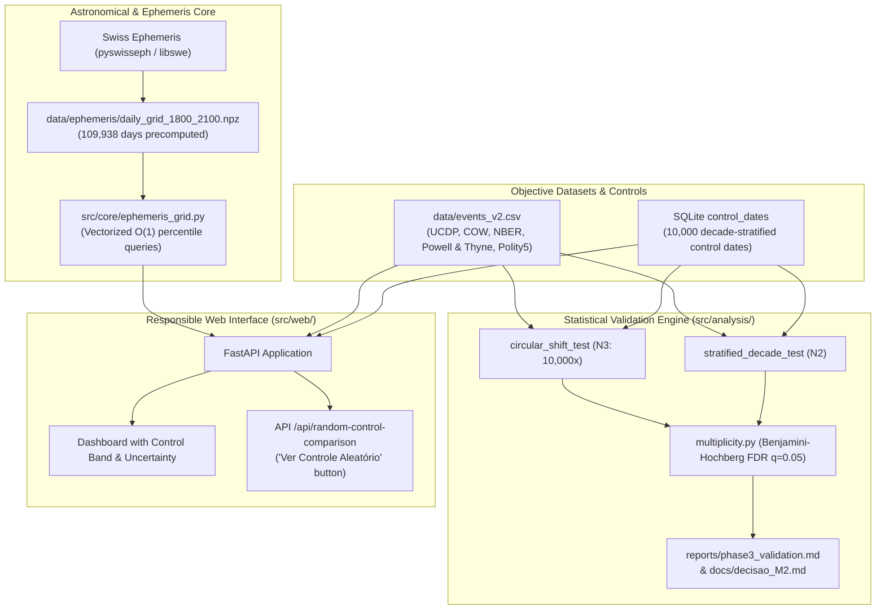

# astro-history 🪐🏛️
### An Empirical, Reproducible, and Open Statistical Research Platform on Astrological Alignments and Historical Events


-blue)

> 🌍 **Languages / Idiomas**: **English** • [Versão em Português (README_PT.md)](README_PT.md)

---

## 1. Executive Summary & Research Question

**astro-history** is an open-source scientific testbed designed to rigorously and honestly answer the empirical question:

> **"Do planetary aspect geometries and astronomical alignments distinguish major world historical events from random dates better than chance?"**

Originally conceived as a correlation browser using the **Swiss Ephemeris (`pyswisseph`)**, the project underwent a comprehensive methodological overhaul (v2) to eliminate retrospective cherry-picking, data leakage, and mathematical artifacts.

### Key Empirical Finding (Phase 3 v2 Pre-Registered Validation)
Under strict pre-registered hypotheses (`docs/hipoteses.md`), unified sample ($N=59$), and controlled null models:
- **Circular Shift Null Model (N3, 10,000 permutations)**: Observed Cosmic Tension $z = -0.506$ ($p = 0.6941$, FDR $q = 0.8834$).
- **Out-of-Sample Walk-Forward Test (1951–2025)**: $z = -0.851$ ($p = 0.7996$, FDR $q = 0.9329$).
- **Equivalence Testing (TOST, $\Delta = \pm 0.30$ SD)**: $p_{\text{TOST}} = 0.04103$ (statistically equivalent to the null distribution; rejects practical effect).
- **Richard Tarnas's Archetypal Thesis (Outer-Planet Hard Aspects)**: $z = -0.063$ ($p = 0.5103$, FDR $q = 0.8834$).

**Conclusion (Milestone M2 Decision)**: The null hypothesis **cannot be rejected**. When selection biases, combinatorial star hits, and matcher leakage are removed, celestial configurations during historical turning points do not statistically differ from random temporal distributions.

In accordance with our pre-registered decision tree, the project executed **Path A (Methodological Pivot)**:
1. **No Uncalibrated Forecasting**: Eliminating deterministic or prophetic labels ("Critical Peak 99%").
2. **Transparent Negative Reporting**: Documenting why spurious correlations appear to work in retrospective literature.
3. **Open Educational Tool**: Providing an interactive platform where users can compare any historical event with an empirical control group of 10,000 random dates.

---

## 2. Methodological Overhaul: Problems Identified & Solved

| Problem Identified in Legacy Code | Methodological Flaw | Technical Correction |
| :--- | :--- | :--- |
| **Data Leakage in Event Matcher (P0-3)** | Similarity engine compared target years against events in the same year, yielding artificial 98.5% self-matches. | **Leave-One-Out Window**: Excludes target year $\pm 1$ year from comparison pool (`find_similar_events`). |
| **Fixed Star Contact Inflation (P1-4 / P1-5)** | 1,467 star hits across 300 charts (~4.9/chart). Checking 4 aspects (0°, 90°, 120°, 180°) against 17 bodies created a 1% chance per pair (~5 hits/chart expected by pure uniform chance). | **Conjunction Restriction**: Star contacts restricted strictly to Conjunction ($0^\circ \pm 0.3^\circ$), reducing hits to ~0.72/chart, matching theoretical baseline. |
| **Score Saturation at 990 (P1-3)** | Artificial exponential contrast formula `min(1.0, excess/640)**1.35 * 920 + 70` pegged high-tension events to 990.0. | **Continuous Empirical Percentile**: Continuous 0–1000 scale derived from the 109,938-day daily grid (1800–2100). Score 850 = more intense than 85% of modern days. |
| **Moon Uncertainty Without Exact Time (P1-1)** | The Moon moves ~13.2°/day. With a 3.0° orb, guessing 12:00 UT covered ~22% of the zodiac by chance. | **Conditional Exclusion**: The Moon is excluded from aspects and tension scoring whenever event time is unverified. |
| **Temporal Sampling Discrepancy (P1-2)** | 4 seasonal points/year in empty years vs. exact event dates in active years created artificial peaks. | **Vectorized Daily Ephemeris Grid**: 1800–2100 precomputed daily (109,938 days) with homogeneous annual metrics (median, mean, p90, max). |

---

## 3. System Architecture & Repositories



---

## 4. Empirical Statistical Results (Phase 3 v2)

| Test Hypothesis | N | Observed Score | Null Distribution (Mean ± SD) | Effect ($z$) | $p$ (two-sided) | $q$ (FDR) | Statistically Significant? |
| :--- | :---: | :---: | :---: | :---: | :---: | :---: | :---: |
| **H1 Overall vs N3 Circular Shift** | 59 | 481.1 | 500.6 ± 38.5 | -0.506 | 0.6117 | 0.8834 | ❌ Not significant |
| **H1 Overall vs N2 Stratified Control** | 59 | 481.1 | 493.9 ± 36.6 | -0.350 | 0.7163 | 0.8834 | ❌ Not significant |
| **H1 Overall vs N1 Uniform Random** | 59 | 481.1 | 499.7 ± 37.7 | -0.493 | 0.6299 | 0.8834 | ❌ Not significant |
| **H1 Class: Interstate War** | 15 | 462.1 | 499.4 ± 73.3 | -0.509 | 0.6163 | 0.8834 | ❌ Not significant |
| **H1 Class: Economic Crisis** | 10 | 547.6 | 501.9 ± 93.8 | +0.487 | 0.6223 | 0.8834 | ❌ Not significant |
| **H1 Class: Coup d'Etat** | 11 | 538.4 | 501.6 ± 84.9 | +0.434 | 0.6653 | 0.8834 | ❌ Not significant |
| **H2 Walk-Forward (1800–1950 Train)** | 26 | 512.4 | 499.4 ± 56.8 | +0.229 | 0.8165 | 0.8834 | ❌ Not significant |
| **H2 Out-of-Sample Test (1951–2025)** | 33 | 456.5 | 501.6 ± 53.0 | -0.851 | 0.4008 | 0.9329 | ❌ No predictive signal |
| **H4 Tarnas Outer-Planet Thesis** | 59 | 33.4 | 34.0 ± 8.7 | -0.063 | 0.9794 | 0.8834 | ❌ Not significant |

### Methodological Rigor Features in v2
- **Two One-Sided Tests (TOST)**: Formal equivalence testing with margin $\Delta = \pm 0.30$ SD ($\pm 86.4$ pts) yielded $p_{\text{TOST}} = 0.04103$, rejecting the presence of meaningful effects.
- **Statistical Power & MDE**: Minimum detectable effect at 80% power is $95.7$ points ($0.332$ SD) given $\sigma_{\text{null}} = 38.5$ and daily uniform SD $\sigma = 1000/\sqrt{12} \approx 288.7$. Power reaches 72.8% at 0.30 SD, 80.1% at 0.332 SD, and 98.2% at 0.50 SD.
- **Synthetic Negative Controls**: 1,000 pure-noise synthetic catalogs yielded a 3.7% false-positive rejection rate at $\alpha=5\%$ (within expected 3% to 7% range), decoupled from FDR calculation.
- **Unified Sample ($N=59$)**: Historical events filtered transparently by day precision and 1800–2025 era boundary (see [`data/exclusion_log.md`](data/exclusion_log.md)).

*Detailed reports*:
- Formal Pre-Registration: [`docs/hipoteses.md`](docs/hipoteses.md)
- Statistical Validation Report v2: [`reports/validacao_v2.md`](reports/validacao_v2.md)
- Decision Milestone M2: [`docs/decisao_M2.md`](docs/decisao_M2.md)
- Exhaustive Final Report: [`reports/final_report_v2.md`](reports/final_report_v2.md)

---

## 4b. v3 — Probabilistic Forecasting with Measured Skill (2026–2060)

v3 reframes "forecast precision" as **out-of-sample skill plus calibrated uncertainty**, and fixes the computation-level noise found in v2 (see [`docs/hipoteses_v3.md`](docs/hipoteses_v3.md)).

| Layer | What v3 adds | Where |
| :--- | :--- | :--- |
| Computation | Real historical time zones (IANA via `timezonefinder`, exact LMT before 1883, day rollover), single scoring function read from `config/score.yaml` with a grid↔chart parity test, per-region Julian/Gregorian switch, polar house fallback, fixed stars filtered by ecliptic latitude, no silent `except: pass` | `src/core/scoring.py`, `src/core/timezones.py`, `src/astro_engine.py` |
| Signal | 409 daily features 1750–2150: synodic cycle phases (sin/cos, geo + helio), **Barbault Cyclic Index**, Gaussian aspect activations, harmonics 4/8, declination & out-of-bounds, stations/ingresses/retrogrades, Ebertin midpoints, eclipse proximity | `src/features/astro_features.py` |
| Exact dates | Root-finding on the Swiss Ephemeris for exact aspects (with pass numbers), ingresses, stations, solar/lunar eclipses | `src/features/astro_events.py` |
| Targets | Monthly series from **COW Inter-State Wars v4 (1816–2007)**, **NBER (1857–2024)**, **UCDP/PRIO v24.1 (1946–2023)** and the objective v2 catalogue — thousands of months instead of 59 events | `src/features/targets.py`, `data/external/` |
| Hindcast | Walk-forward from 1951 (12-month gap), Brier Skill Score vs expanding climatology with annual-block bootstrap CIs, AUC, log-loss, reliability; baselines: climatology and autoregressive | `src/analysis/hindcast.py` → `reports/hindcast_v3.md` |
| Forecast | Per target and year: p(event) with p10–p90 interval, ratio to base rate, model drivers with exact dates, analogs by cycle-phase distance (one per decade, with lift), and a **skill badge** | `src/analysis/forecast_v3.py` → `data/forecast_v3.json`, page `/forecast`, API `/api/forecast` |

```bash
make v3   # features -> hindcast -> forecast -> UI caches
```

**First result:** no astrological model beats climatology with a positive CI on any objective target; the autoregressive baseline dominates persistent targets. The `/forecast` page therefore labels every curve with its measured skill and recommends the base rate where skill is absent.

## 4c. Screenshots (v3)

| | |
|:---:|:---:|
| <br>**Dashboard** — 1800–2100 chart with selectable series (tension peak, null band, war risk, innovation, Barbault concentration) | <br>**Forecast v3** — skill badge first, then p(event) with p10–p90 band vs base rate |
| <br>**Methodology** — walk-forward hindcast table (BSS per model and target) | <br>**Timeline & simulator** — shareable GET URLs |
| <br>**Event detail** — validated-sample badge, chronological navigation | <br>**Catalogue** — "✓ N=59" filter |
| <br>**Correlations hub** | <br>**2027–2060 table** — geometry tiers with skill notice |

Full mechanism and design considerations (Portuguese): [`docs/mecanismo_site.md`](docs/mecanismo_site.md).

## 5. Quickstart & Reproducibility

### Prerequisites
- Linux / macOS (Python 3.12+)
- Swiss Ephemeris C libraries (`libswe-dev`, `libswe0`, `swisseph-data-all`)

```bash
# 1. Clone repository
git clone https://github.com/marceloasl99/astro-history.git
cd astro-history

# 2. Setup environment and install locked dependencies
make setup

# 3. Run automated test suite (regression, unit, statistical)
make test

# 4. Re-run Phase 3 statistical validation from scratch (10,000 permutations)
make validate

# 5. Launch web application (localhost:8000)
make run
```

### Docker Deployment
```bash
docker compose up -d --build
```
A Caddy reverse proxy on port 80/443 proxies traffic securely to the local application.

---

## 6. Project Structure

```
astro-history/
├── CITATION.cff              # Academic citation metadata
├── LICENSE                   # GNU Affero General Public License v3
├── Makefile                  # Build, test, and validation automation
├── Dockerfile                # Production container specification
├── docker-compose.yml        # Multi-container app + Caddy proxy
├── Caddyfile                 # Secure reverse proxy configuration
├── ci/
│   └── ci.yml                # CI/CD pipeline automation specification
├── pyproject.toml            # Tool configurations (pytest, ruff, mypy)
├── requirements.lock         # Exact frozen dependencies
├── config/
│   ├── score.yaml            # Aspect definitions and orb weights
│   ├── stars.yaml            # Curated catalog of 28 fixed stars
│   └── analysis.yaml         # Statistical permutations, seeds, and splits
├── data/
│   ├── DATASET_CARD.md       # Objective inclusion rules and data card
│   ├── events_v2.csv         # Structured dataset (COW, UCDP, NBER, P&T)
│   └── ephemeris/            # Precomputed 1800-2100 daily grid (.npz)
├── db/
│   └── history_astrology.db  # SQLite database (events, events_v2, control_dates)
├── docs/
│   ├── hipoteses.md          # Pre-registered hypotheses and success criteria
│   └── decisao_M2.md         # Milestone M2 decision record (Path A)
├── reports/
│   ├── baseline_metrics.json # Initial v0 audit metrics
│   ├── phase1_before_after.md# Methodological diff (before vs. after)
│   ├── phase3_validation.md  # Permutation test p-values, z-scores, FDR
│   └── final_report.md       # Full exhaustive scientific research report
├── src/
│   ├── astro_engine.py       # Core Swiss Ephemeris astronomical calculations
│   ├── correlation_engine.py # Leave-one-out historical matcher
│   ├── future_engine.py      # Homogeneous timeline & prospective model
│   ├── core/
│   │   └── ephemeris_grid.py # 109k daily ephemerides & continuous percentiles
│   ├── data/
│   │   └── ingest_historical.py # Ingestion pipeline & control date generator
│   ├── analysis/
│   │   ├── null_models.py    # N1, N2, N3 (circular shift) permutations
│   │   ├── multiplicity.py   # Benjamini-Hochberg FDR correction
│   │   └── run_phase3_validation.py # Full validation runner
│   └── web/
│       ├── app.py            # FastAPI application
│       ├── mandala.py        # Vector SVG zodiac generator
│       └── templates/        # Dashboard, event detail, and methodology tab
└── tests/
    ├── regression/           # Golden baseline tests (v0 reproducibility)
    ├── unit/                 # Unit tests (leave-one-out, percentiles, orbs)
    └── statistical/          # Pipeline sanity checks on synthetic noise
```

---

## 7. Licensing & Attribution

- **Source Code**: Licensed under the **[GNU Affero General Public License v3 (AGPL-3.0-or-later)](LICENSE)**.
- **Swiss Ephemeris**: Incorporates Swiss Ephemeris software by **Astrodienst AG**. In compliance with Astrodienst terms, this project is licensed under AGPL. Commercial users must acquire a proprietary license from Astrodienst AG.
- **Datasets**: Correlates of War (COW), UCDP Conflict Data, NBER Business Cycles, Powell & Thyne Coup Data, and Polity5/V-Dem Project.
