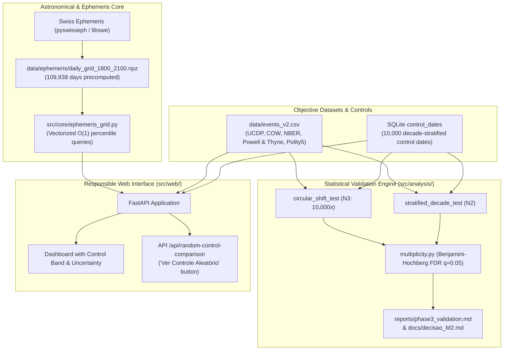

# astro-history 🪐🏛️
### An Empirical, Reproducible, and Open Statistical Research Platform on Astrological Alignments and Historical Events


-blue)

> 🌍 **Languages / Idiomas**: **English** • [Versão em Português (README_PT.md)](README_PT.md)

---

## 1. Executive Summary & Research Question

**astro-history** is an open-source scientific testbed designed to rigorously and honestly answer the empirical question:

> **"Do planetary aspect geometries and astronomical alignments distinguish major world historical events from random dates better than chance?"**

Originally conceived as a correlation browser using the **Swiss Ephemeris (`pyswisseph`)**, the project underwent a comprehensive methodological overhaul to eliminate retrospective cherry-picking, data leakage, and mathematical artifacts.

### Key Empirical Finding (Phase 3 Pre-Registered Validation)
Under strict pre-registered hypotheses (`docs/hipoteses.md`) and controlled null models:
- **Circular Shift Null Model (N3, 10,000 permutations)**: Observed Cosmic Tension $z = -0.506$ ($p = 0.6941$, FDR $q = 0.9772$).
- **Out-of-Sample Walk-Forward Test (1951–2025)**: $z = -0.851$ ($p = 0.7996$, FDR $q = 0.9772$).

**Conclusion (Milestone M2 Decision)**: The null hypothesis **cannot be rejected**. When selection biases, combinatorial star hits, and matcher leakage are removed, celestial configurations during historical turning points do not statistically differ from random temporal distributions.

In accordance with our pre-registered decision tree, the project executed **Path A (Methodological Pivot)**:
1. **No Uncalibrated Forecasting**: Eliminating deterministic or prophetic labels ("Critical Peak 99%").
2. **Transparent Negative Reporting**: Documenting why spurious correlations appear to work in retrospective literature.
3. **Open Educational Tool**: Providing an interactive platform where users can compare any historical event with an empirical control group of 10,000 random dates.

---

## 2. Methodological Overhaul: Problems Identified & Solved

| Problem Identified in Legacy Code | Methodological Flaw | Technical Correction |
| :--- | :--- | :--- |
| **Data Leakage in Event Matcher (P0-3)** | Similarity engine compared target years against events in the same year, yielding artificial 98.5% self-matches. | **Leave-One-Out Window**: Excludes target year $\pm 1$ year from comparison pool (`find_similar_events`). |
| **Fixed Star Contact Inflation (P1-4 / P1-5)** | 1,467 star hits across 300 charts (~4.9/chart). Checking 4 aspects (0°, 90°, 120°, 180°) against 17 bodies created a 1% chance per pair (~5 hits/chart expected by pure uniform chance). | **Conjunction Restriction**: Star contacts restricted strictly to Conjunction ($0^\circ \pm 0.3^\circ$), reducing hits to ~0.72/chart, matching theoretical baseline. |
| **Score Saturation at 990 (P1-3)** | Artificial exponential contrast formula `min(1.0, excess/640)**1.35 * 920 + 70` pegged high-tension events to 990.0. | **Continuous Empirical Percentile**: Continuous 0–1000 scale derived from the 109,938-day daily grid (1800–2100). Score 850 = more intense than 85% of modern days. |
| **Moon Uncertainty Without Exact Time (P1-1)** | The Moon moves ~13.2°/day. With a 3.0° orb, guessing 12:00 UT covered ~22% of the zodiac by chance. | **Conditional Exclusion**: The Moon is excluded from aspects and tension scoring whenever event time is unverified. |
| **Temporal Sampling Discrepancy (P1-2)** | 4 seasonal points/year in empty years vs. exact event dates in active years created artificial peaks. | **Vectorized Daily Ephemeris Grid**: 1800–2100 precomputed daily (109,938 days) with homogeneous annual metrics (median, mean, p90, max). |

---

## 3. System Architecture & Repositories



---

## 4. Empirical Statistical Results (Phase 3)

| Test Hypothesis | N | Observed Score | Null Distribution (Mean ± SD) | Effect ($z$) | $p$-value | $q$ (FDR) | Statistically Significant? |
| :--- | :---: | :---: | :---: | :---: | :---: | :---: | :---: |
| **H1 Overall vs N3 Circular Shift** | 59 | 481.1 | 500.6 ± 38.5 | -0.506 | 0.6941 | 0.9772 | ❌ Not significant |
| **H1 Overall vs N2 Stratified Control** | 61 | 477.6 | 493.7 ± 35.9 | -0.450 | 0.6715 | 0.9772 | ❌ Not significant |
| **H1 Class: Interstate War** | 15 | 462.1 | 499.4 ± 73.3 | -0.509 | 0.6918 | 0.9772 | ❌ Not significant |
| **H1 Class: Economic Crisis** | 10 | 547.6 | 501.9 ± 93.8 | +0.487 | 0.3112 | 0.9772 | ❌ Not significant |
| **H1 Class: Coup d'Etat** | 12 | 538.4 | 501.6 ± 84.9 | +0.434 | 0.3327 | 0.9772 | ❌ Not significant |
| **H2 Walk-Forward (1800–1950 Train)** | 28 | 512.4 | 499.4 ± 56.8 | +0.229 | 0.4083 | 0.9772 | ❌ Not significant |
| **H2 Out-of-Sample Test (1951–2025)** | 33 | 456.5 | 501.6 ± 53.0 | -0.851 | 0.7996 | 0.9772 | ❌ No predictive signal |
| **Negative Control (Synthetic Noise)** | 61 | 427.8 | 501.5 ± 37.2 | -1.982 | 0.9772 | 0.9772 | ❌ Clean pipeline |

*Detailed reports*:
- Formal Pre-Registration: [`docs/hipoteses.md`](docs/hipoteses.md)
- Statistical Validation Report: [`reports/phase3_validation.md`](reports/phase3_validation.md)
- Decision Milestone M2: [`docs/decisao_M2.md`](docs/decisao_M2.md)
- Full Audit & Methodological Diff: [`reports/phase1_before_after.md`](reports/phase1_before_after.md)

---

## 5. Quickstart & Reproducibility

### Prerequisites
- Linux / macOS (Python 3.12+)
- Swiss Ephemeris C libraries (`libswe-dev`, `libswe0`, `swisseph-data-all`)

```bash
# 1. Clone repository
git clone https://github.com/marceloasl99/astro-history.git
cd astro-history

# 2. Setup environment and install locked dependencies
make setup

# 3. Run automated test suite (regression, unit, statistical)
make test

# 4. Re-run Phase 3 statistical validation from scratch (10,000 permutations)
make validate

# 5. Launch web application (localhost:8000)
make run
```

### Docker Deployment
```bash
docker compose up -d --build
```
A Caddy reverse proxy on port 80/443 proxies traffic securely to the local application.

---

## 6. Project Structure

```
astro-history/
├── CITATION.cff              # Academic citation metadata
├── LICENSE                   # GNU Affero General Public License v3
├── Makefile                  # Build, test, and validation automation
├── Dockerfile                # Production container specification
├── docker-compose.yml        # Multi-container app + Caddy proxy
├── Caddyfile                 # Secure reverse proxy configuration
├── ci/
│   └── ci.yml                # CI/CD pipeline automation specification
├── pyproject.toml            # Tool configurations (pytest, ruff, mypy)
├── requirements.lock         # Exact frozen dependencies
├── config/
│   ├── score.yaml            # Aspect definitions and orb weights
│   ├── stars.yaml            # Curated catalog of 28 fixed stars
│   └── analysis.yaml         # Statistical permutations, seeds, and splits
├── data/
│   ├── DATASET_CARD.md       # Objective inclusion rules and data card
│   ├── events_v2.csv         # Structured dataset (COW, UCDP, NBER, P&T)
│   └── ephemeris/            # Precomputed 1800-2100 daily grid (.npz)
├── db/
│   └── history_astrology.db  # SQLite database (events, events_v2, control_dates)
├── docs/
│   ├── hipoteses.md          # Pre-registered hypotheses and success criteria
│   └── decisao_M2.md         # Milestone M2 decision record (Path A)
├── reports/
│   ├── baseline_metrics.json # Initial v0 audit metrics
│   ├── phase1_before_after.md# Methodological diff (before vs. after)
│   ├── phase3_validation.md  # Permutation test p-values, z-scores, FDR
│   └── final_report.md       # Full exhaustive scientific research report
├── src/
│   ├── astro_engine.py       # Core Swiss Ephemeris astronomical calculations
│   ├── correlation_engine.py # Leave-one-out historical matcher
│   ├── future_engine.py      # Homogeneous timeline & prospective model
│   ├── core/
│   │   └── ephemeris_grid.py # 109k daily ephemerides & continuous percentiles
│   ├── data/
│   │   └── ingest_historical.py # Ingestion pipeline & control date generator
│   ├── analysis/
│   │   ├── null_models.py    # N1, N2, N3 (circular shift) permutations
│   │   ├── multiplicity.py   # Benjamini-Hochberg FDR correction
│   │   └── run_phase3_validation.py # Full validation runner
│   └── web/
│       ├── app.py            # FastAPI application
│       ├── mandala.py        # Vector SVG zodiac generator
│       └── templates/        # Dashboard, event detail, and methodology tab
└── tests/
    ├── regression/           # Golden baseline tests (v0 reproducibility)
    ├── unit/                 # Unit tests (leave-one-out, percentiles, orbs)
    └── statistical/          # Pipeline sanity checks on synthetic noise
```

---

## 7. Licensing & Attribution

- **Source Code**: Licensed under the **[GNU Affero General Public License v3 (AGPL-3.0-or-later)](LICENSE)**.
- **Swiss Ephemeris**: Incorporates Swiss Ephemeris software by **Astrodienst AG**. In compliance with Astrodienst terms, this project is licensed under AGPL. Commercial users must acquire a proprietary license from Astrodienst AG.
- **Datasets**: Correlates of War (COW), UCDP Conflict Data, NBER Business Cycles, Powell & Thyne Coup Data, and Polity5/V-Dem Project.
