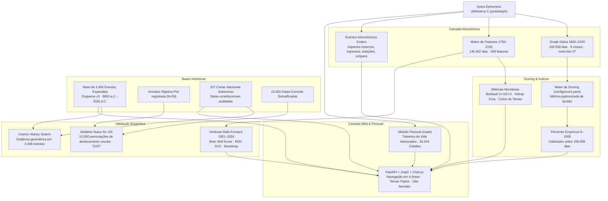

# astro-history 🪐🏛️
### Plataforma de Pesquisa Científica Aberta e Reprodutível sobre Alinhamentos Astrológicos e Fatos Históricos


> 🌍 **Idiomas / Languages**: **Português** • [English version (README.md)](README.md)

---

## Sumário

1. [O que é este projeto](#1-o-que-é-este-projeto)
2. [Inovações da v7.0.1](#2-inovações-da-v701)
3. [A pergunta de pesquisa e os resultados empíricos](#3-a-pergunta-de-pesquisa-e-os-resultados-empíricos)
4. [Arquitetura da plataforma & páginas interativas](#4-arquitetura-da-plataforma-páginas-interativas)
5. [O pipeline computacional](#5-o-pipeline-computacional)
6. [Camada astronômica: precisão Swiss Ephemeris](#6-camada-astronômica-precisão-swiss-ephemeris)
7. [O score de tensão e a escala de percentil 0–1000](#7-o-score-de-tensão-e-a-escala-de-percentil-01000)
8. [Metodologia mundana: Barbault, Oshop e Tarnas](#8-metodologia-mundana-barbault-oshop-e-tarnas)
9. [Base histórica: 3.406 eventos em mais de 11.600 anos (9650 a.C. a 2026 d.C.)](#9-base-histórica-3406-eventos-em-mais-de-11600-anos-9650-ac-a-2026-dc)
10. [Cartas nacionais e análise de trânsitos mundanos](#10-cartas-nacionais-e-análise-de-trânsitos-mundanos)
11. [Módulo Pessoal: Mapa Natal, Trânsitos e Progressões](#11-módulo-pessoal-mapa-natal-trânsitos-e-progressões)
12. [Validação I — testes pré-registrados com modelos nulos (v2)](#12-validação-i-testes-pré-registrados-com-modelos-nulos-v2)
13. [Validação II — hindcast walk-forward e skill de previsão (v3)](#13-validação-ii-hindcast-walk-forward-e-skill-de-previsão-v3)
14. [Previsão 2026–2060: projeção probabilística](#14-previsão-20262060-projeção-probabilística)
15. [Design system, temas triplos e i18n](#15-design-system-temas-triplos-e-i18n)
16. [Instalação rápida, reprodução e deploy](#16-instalação-rápida-reprodução-e-deploy)
17. [Modelo de segurança e arquitetura de API interna](#17-modelo-de-segurança-e-arquitetura-de-api-interna)
18. [Estrutura do repositório](#18-estrutura-do-repositório)
19. [Citação, licença e atribuição](#19-citação-licença-e-atribuição)

---

## 1. O que é este projeto

O **astro-history** é um banco de testes científico, de código aberto, concebido para avaliar sob controle quantitativo rigoroso uma hipótese amplamente difundida: *será que alinhamentos astronômicos, aspectos planetários e ciclos dos planetas exteriores exibem agrupamento não aleatório em grandes pontos de inflexão histórica e fornecem habilidade preditiva mensurável para acontecimentos geopolíticos futuros?*

A plataforma apoia-se em quatro pilares fundamentais:

- **Astronomia de Alta Precisão:** Cada mapa celeste, aspecto, ponto médio e índice cíclico deriva do Swiss Ephemeris (precisão de arco-segundos), com fusos horários históricos reais (IANA com horário de verão e Hora Média Local antes da padronização de fusos), calendários corretos (Gregoriano / Juliano) e tratamento explícito de incerteza para eventos sem hora documentada.
- **Rigor Metodológico & Estatístico:** Hipóteses pré-registradas (v2, v3, v4), modelos nulos de deslocamento circular por Monte Carlo (preservando o espaçamento entre eventos e a autocorrelação de planetas lentos), controle de taxa de falsas descobertas (FDR Benjamini-Hochberg), testes de equivalência (TOST) e hindcast walk-forward fora da amostra pontuado via Brier Skill Score (BSS) e ROC AUC contra baselines climatológicos e autorregressivos.
- **Base de Dados Global Expandida:** Catálogo auditado com **3.406 marcos históricos verificados** (da Antiguidade a 2026 d.C.) sob o esquema v3 (precisão de data, tiers de fonte A/B/C, polaridade, macro/subcategorias), 107 cartas mundanas de nações soberanas e 148 picos de energia planetária.
- **Plataforma Web Interativa & Módulo Pessoal:** Aplicação web intuitiva estruturada em 4 áreas conceituais (*Explorar, Analisar, Pessoal, Sobre*), busca global instantânea, glossário bilíngue e um **Módulo Pessoal** completo (`/natal`) com cálculo de mapa natal com múltiplos sistemas de casas, trânsitos diários de vida inteira vetorizados (0 a 100 anos calculados em < 1,5 s), progressões secundárias, 8 domínios de vida calibrados e gazetteer offline com 34.204 cidades.

A plataforma funciona como **ferramenta de literacia de dados**: demonstra como padrões astrológicos retrospectivos parecem convincentes ao olho humano e explica, com transparência matemática, por que essas formulações não superam baselines empíricos sob condições controladas fora da amostra.

---

## 2. Inovações da v7.0.1

A versão `v7.0.1` consolida o fechamento rigoroso de segurança derivado da auditoria oficial da Cloudflare, melhorias defensivas em profundidade e refinamento operacional de produção:

1. **Eliminação do Botão de Recálculo Manual (`/simulator`):** Substituição do botão e formulário de recálculo manual na linha do tempo por um card informativo de status ("Linha Contínua 1800–2100 • 301 anos integrados"), prevenindo picos acidentais de CPU/RAM em produção e assegurando integridade operacional.
2. **Auditoria de Segurança Cloudflare (`security-audit-skill`) & Resolução Completa:** Execução formal do framework de auditoria defensiva da Cloudflare com 8 unidades canônicas cobrindo todas as superfícies de ataque, 100% aprovado pelos validadores oficiais (`validate-coverage-ledger.cjs` e `validate-findings.cjs`).
3. **Proteção contra Host Header Injection & DNS Rebinding:** Integração de `TrustedHostMiddleware` restringindo origens autorizadas (`history.skyastrum.com`, `*.skyastrum.com`, `localhost`, `127.0.0.1`, `testserver`) e retornando `HTTP 400 Bad Request` para hosts não reconhecidos.
4. **Rate Limiting Global por IP:** Janela deslizante de 60s limitando tráfego externo a 180 req/min por IP, retornando `HTTP 429 Too Many Requests` com cabeçalho `Retry-After: 60`. Tráfego interno de loopback e suíte de testes permanecem com bypass irrestrito.
5. **Hardening no SQLite (`PRAGMA trusted_schema = OFF`):** Aplicado em todas as conexões SQLite (`history_astrology.db` e `cities.sqlite`), desativando funções auxiliares de esquema virtual e prevenindo escalonamento de privilégios.
6. **Blindagem do Servidor Estático (`/static/`):** Bloqueio sumário com `HTTP 404` para dotfiles (`.env`, `.git`), arquivos temporários (`~`, `.bak`) e extensões executáveis/código (`.py`, `.sh`, `.db`, `.yaml`, `.yml`).
7. **Reforço de Cabeçalhos HTTP (OWASP & CSP):** Inclusão de `object-src 'none'`, `media-src 'self'`, `worker-src 'self' blob:`, `upgrade-insecure-requests`, `X-Permitted-Cross-Domain-Policies: none` e `X-Download-Options: noopen`.
8. **Sitemap XML & Otimização SEO Canônica:** 3.525 URLs indexadas no protocolo `sitemaps.org`, dados estruturados Schema.org (`@type: WebApplication`) e metatags canônicas.

### Inovações da Versão 7.0 (Módulo Pessoal & UI)

1. **Motor de Previsão Pessoal com 6 Patamares de Criticidade (Escala 0–1000):** Varredura completa da vida integrando trânsitos planetários lentos aos pontos natais, progressões secundárias (`dia-por-ano` com fases e aspectos da Lua progredida) e marcos de ciclos biográficos (retorno de Saturno, oposição de Urano, retorno de Quíron). Introduz 6 patamares calibrados de ativação:
   - 💥 **Pico Transformador** (Score ≥ 850): Momentos culminantes de metamorfose radical, pontos de virada máxima de destino ou grandes consagrações.
   - ⚡ **Ponto de Virada** (Score 700–849): Transições cruciais, redefinição de prioridades de vida, decisões estruturantes e marcos evolutivos.
   - 🔥 **Alta Ativação** (Score 550–699): Forte aceleração de acontecimentos, expansão de oportunidades, produtividade e movimento dinâmico.
   - 🌊 **Moderado** (Score 400–549): Desenvolvimento ritmado, evolução gradual, ajustes de rota e maturidade sem sobressaltos agudos.
   - 🌿 **Consolidação** (Score 250–399): Fixação de conquistas anteriores, estabilização de rotinas e assimilação tranquila de aprendizados.
   - 🌱 **Estabilidade & Gestação** (Score < 250): Período de serenidade cósmica, baixa fricção de planetas lentos, planejamento e digestão psíquica.
2. **Gráfico Interativo com Séries Separadas por Categoria & Seleção Rápida:** Visualização avançada em Chart.js com 6 séries de barras independentes (uma para cada patamar de criticidade na sua respectiva cor de acento) aliada a uma linha contínua fluida de tendência. Barra seletora de categorias (`.chart-cat-btn`) e legenda nativa interativa permitem isolar ou comparar categorias individuais com um único clique.
3. **Alternador de Escopo Temporal ("Mostrar Tudo" vs "Só o Futuro"):** Filtro instantâneo entre a visão biográfica completa e o horizonte estritamente futuro (`ano >= ano_atual`). Badges temporais diferenciam datas concluídas (`✓ Concluído`) de passagens ativas por acontecer (`⚡ Futuro`), com banner explicativo inteligente para figuras históricas.
4. **Persistência Local de Perfis ("Salvar Pessoa" via Cookie / Local Storage):** Permite salvar mapas astrais personalizados localmente no navegador em um clique, preservando nome, data, hora, latitude e longitude entre sessões. Menu dropdown na barra de abas e navegação para alternar rapidamente entre pessoas cadastradas sem necessidade de conta ou banco externo.
5. **Layout Centralizado & Acessibilidade WCAG AAA:** Revisão tipográfica e estética 100% centralizada otimizada para monitores Full HD (1920×1080) e celulares. Motor de cores de alto contraste nos 3 temas (Claro com tons profundos e contrastados, Escuro Cosmic Navy e Preto OLED). Cards de categoria exibem textos completos sem qualquer truncamento (`truncate`).
6. **Sistema de Mega-Menus Otimizado:** Ponte de foco anti-flicker impedindo fechamento precoce ao passar o mouse, bordas visíveis delimitadas e realce em ambos os idiomas (PT/EN) nos 3 temas.
7. **Suíte de Testes Expandida:** Mais de **138 testes automatizados** passando com 100% de sucesso em testes astronômicos, mundanos, pessoais, estatísticos e de interface web.

### Fundação Arquitetural (v6.0)
- **Base Expandida para 3.406 Eventos Históricos:** Expansão massiva de 1.342 para **3.406 marcos históricos verificados** sob o esquema v3 (`date_precision`, `calendar`, `source_id`/`source_url`, tiers de qualidade A/B/C, macro/subcategorias e polaridade). Incorporação do NOAA NCEI Significant Earthquakes (944 terremotos, grupo de controle cético), erupções vulcânicas do Smithsonian GVP (150 eventos), marcos selecionados do Wikidata (682 eventos) e eventos curados da Antiguidade e Idade Média.
- **Módulo Pessoal (`/natal`):** Cálculos de mapa natal de alta precisão com múltiplos sistemas de casas (Placidus, Signos Inteiros, Iguais, Koch, Regiomontanus, Porphyry), trânsitos diários vetorizados para a vida inteira (< 1,5 s), progressões secundárias, 8 domínios de vida calibrados (escala 0–1000) e gazetteer GeoNames offline em SQLite com 34.204 cidades.
- **Picos de Energia Geopolítica (2026–2060):** 148 picos de energia calculados e agrupados em 7 anos-chave de virada (2026, 2028, 2029, 2032, 2034, 2036, 2040) com dossiês de inteligência soberana.
- **Arquitetura de Segurança Endurecida:** Bloqueio público de todas as rotas de API (`/api/*`) e documentação Swagger/OpenAPI (`/docs`, `/redoc`, `/openapi.json`) com resposta `404 Not Found` para tráfego externo, mantendo funcionalidades de API estritamente para processos de loopback local e suíte de testes. Cabeçalhos de defesa em profundidade OWASP habilitados.

---

## 3. A pergunta de pesquisa e os resultados empíricos

> **"As geometrias de aspectos planetários e os ciclos de planetas externos distinguem grandes eventos históricos de datas aleatórias melhor que o acaso — e conseguem prever eventos geopolíticos futuros com habilidade mensurável?"**

### Resumo Empírico

| Linha de Evidência | Amostra & Método | Resultado Quantitativo | Veredito |
| :--- | :--- | :--- | :---: |
| **H1 Teste Pré-registrado (Global)** | N = 59 eventos objetivos; Nulo de deslocamento circular (10.000 permutações) | $z = -0,506, p = 0,612, q = 0,883$ | ❌ Nulo não rejeitado |
| **H1 Controle Estratificado por Década** | N = 59 vs 10.000 datas-controle estratificadas | $z = -0,350, p = 0,716, q = 0,883$ | ❌ Nulo não rejeitado |
| **Teste de Equivalência TOST** | Limiares de equivalência $\Delta = \pm 0,30$ DP | $p = 0,041$ (dentro do intervalo de equivalência) | ✅ Estatisticamente equivalente a zero |
| **H2 Walk-Forward Fora da Amostra** | Treino: 1800–1950 (N=26) $\rightarrow$ Teste: 1951–2025 (N=33) | $z = -0,851, p = 0,401, q = 0,933$ | ❌ Sem transferência preditiva |
| **H4 Tese de Tarnas (Planetas Externos)** | Aspectos tensos entre Saturno, Urano, Netuno e Plutão | $z = -0,063, p = 0,979, q = 0,883$ | ❌ Nulo não rejeitado |
| **Hindcast em Séries Mensais (1951–2024)** | 7 alvos objetivos $\times$ 8 famílias de modelos vs Climatologia e AR | BSS astrológico máx $\le 0,003$; AUC $\le 0,52$ | ❌ Sem discriminação sobre baseline |
| **Índices Anuais vs Catálogo de 3.406 Eventos** | Nulo de deslocamento circular com controle FDR Benjamini-Hochberg | Nenhuma correlação sobrevive ao corte de FDR | ❌ Sem correlação robusta |

**Conclusão:** Em todas as configurações analisadas, alinhamentos planetários e índices de tensão astrológica não superam o acaso nem baselines autorregressivos. A plataforma apresenta todas as projeções futuras acompanhadas destas métricas de skill, recomendando as taxas-base históricas como estimativas de referência.

---

## 4. Arquitetura da plataforma & páginas interativas

A aplicação web foi construída com **FastAPI**, **Jinja2** e **Chart.js**, servindo dados pré-computados e determinísticos, com suporte a cálculos sob demanda do Swiss Ephemeris para simulações:

| Página | Rota | Função Central | Fonte Primária |
| :--- | :--- | :--- | :--- |
| **Dashboard** | `/` | Linha do tempo 1800–2100, percentis de tensão, envelopes nulos (P5–P95), concentração de Barbault, eventos em destaque | `data/timeline_1800_2100.json`, `data/forecast_v3.json` |
| **Catálogo de Eventos** | `/events` | 3.406 marcos auditados, 6 macrocategorias, filtros por século, busca textual e filtro da amostra objetiva | `data/historical_events.json`, SQLite `events` |
| **Detalhe do Evento** | `/events/{id}` | Mapa completo (17 corpos celestes, casas, estrelas fixas), mandala SVG, distribuição arquetípica, comparação com controle | SQLite `events`, Swiss Ephemeris |
| **Cartas Nacionais** | `/countries` | 107 nações soberanas, cartas constitucionais de fundação, trânsitos ativos, picos energéticos 2026–2050 | `data/countries_database.json`, `src/mundane/` |
| **Módulo Pessoal** | `/natal` | Mapa natal, trânsitos de vida inteira vetorizados, progressões secundárias, 8 domínios de vida, gazetteer com 34.204 cidades | `src/natal/`, `data/gazetteer/cities.sqlite` |
| **Simulador** | `/simulator` | Calculador de efemérides em tempo real para qualquer data/hora/local; busca leave-one-out de análogos cósmicos | `src/astro_engine.py`, Swiss Ephemeris |
| **Hub de Correlações** | `/correlations` | Distribuições estatísticas de signos, aspectos e estrelas fixas por categoria histórica | Agregações SQL no banco SQLite |
| **Previsão** | `/forecast` | Projeção probabilística 2026–2060 por alvo, selos de skill de modelos, calendário astronômico exato, análogos | `data/forecast_v3.json` |
| **Cenários & Picos de Energia** | `/projections` | Tiers anuais de tensão geométrica (2026–2060), catálogo de 148 picos de energia mundiais e por país, dossiês de potências | `data/projections_2027_2060.json`, `data/energy_peaks_2026_2060.json` |
| **Glossário** | `/glossario` | ~60 definições conceituais astronômicas e estatísticas com links contextuais | `src/web/templates/glossario.html` |
| **Dados & Fontes** | `/dados-fontes` | Manifesto de proveniência de dados, licenças e documentação de fontes | `src/web/templates/dados_fontes.html` |
| **Metodologia** | `/methodology` | Documentação científica, formulação de hipóteses nulas, funil de exclusão e tabela de hindcast | `data/results.json`, `reports/hindcast_v3.json` |

---

## 5. O pipeline computacional



---

## 6. Camada astronômica: precisão Swiss Ephemeris

Todas as posições astronômicas são calculadas via `pyswisseph` utilizando os arquivos C de alta precisão do Swiss Ephemeris:

- **Precisão de Coordenadas:** O flag de retorno impõe `SWIEPH` (integração numérica rigorosa), eliminando aproximações de baixa ordem Moshier. Longitudes, latitudes, declinações e velocidades possuem precisão de arco-segundos.
- **Resolução de Fusos Horários e LMT:** Para eventos ocorridos a partir de 1883, as coordenadas geográficas são resolvidas via `timezonefinder` e aplicadas com fusos IANA (incluindo transições históricas de horário de verão). Para datas anteriores a 1883, utiliza-se a Hora Média Local exata ($\text{longitude} / 15$) sem arredondamentos, respeitando a virada de dia quando a conversão cruza a meia-noite.
- **Tratamento de Calendário:** Suporte dual Gregoriano/Juliano com datas de adoção específicas por território (ex.: Grã-Bretanha 1752, Rússia 1918, Grécia 1923).
- **Protocolo de Incerteza Temporal:** Eventos sem hora documentada são avaliados às 12:00 UT, e a **Lua é automaticamente excluída** de aspectos, casas e scores para prevenir correspondências espúrias causadas pelo movimento lunar de ~13°/dia.
- **Corpos Calculados:** Sol, Lua, Mercúrio, Vênus, Marte, Júpiter, Saturno, Urano, Netuno, Plutão, Quíron, Ceres, Pallas, Juno, Vesta, Lilith Média e Nodo Lunar Verdadeiro (17 corpos).
- **Aspectos & Orbes:** Aspectos ptolemaicos clássicos (Conjunção 0°, Sextil 60°, Quadratura 90°, Trígono 120°, Oposição 180°) com decaimento linear com a orbe até 3,0°.
- **Estrelas Fixas:** 30 estrelas principais calculadas via `swe_fixstar2_ut`; limitadas a conjunções dentro de 0,3° com latitude eclíptica $\le 30^\circ$ para evitar falsos contatos fora da eclíptica.

---

## 7. O score de tensão e a escala de percentil 0–1000

A métrica de tensão planetária é calculada em `src/core/scoring.py` a partir das definições em `config/score.yaml`:

$$\text{Score Bruto} = \text{Base} + \sum_{i < j} w(p_i, p_j) \cdot f_{\text{aspecto}}(\theta_{ij}) - \sum_{\text{trígonos}} 0,20 \cdot w_{\text{harmonia}}(p_i, p_j)$$

- **Hierarquia Arquetípica de Pares:** Pesos correspondentes à literatura mundana clássica: Saturno–Plutão (260/250), Urano–Plutão (220/200), Saturno–Urano (220/160), Saturno–Netuno (200/220), pares externo–externo (170/160), Marte–externo (130/110), luminares–externo (75/60), outras configurações (40/30).
- **Calibração por Percentil Empírico:** O score bruto é mapeado na grade de efemérides de 109.938 dias (1800–2100) em uma escala contínua de 0 a 1000. Um score de 750 significa tensão superior a 75% de todos os dias nos 300 anos analisados.
- **Garantia de Paridade:** Testes de regressão golden asseguram paridade estrita (diferença máxima $< 0,002$) entre cálculos de mapas em tempo real e saídas da grade pré-calculada.

---

## 8. Metodologia mundana: Barbault, Oshop e Tarnas

A plataforma operacionaliza três vertentes de astrologia mundana moderna:

### Índice Cíclico de André Barbault (CI-4 e CI-5)
Mede a dispersão planetária somando as separações angulares entre planetas lentos:

$$\text{CI}_5(t) = \sum_{1 \le i < j \le 5} \theta_{ij}(t)$$

Onde $\theta_{ij} \in [0^\circ, 180^\circ]$ é a menor distância angular entre Júpiter, Saturno, Urano, Netuno e Plutão. Mínimos na curva (planetas agrupados em conjunções) correspondem às épocas de crise identificadas por Barbault (ex.: 1914, 1940, 1982). O motor calcula CI-4 (Saturno a Plutão), CI-5 e a primeira derivada numérica ($\frac{d\text{CI}}{dt}$).

### Soma dos Cossenos de Renay Oshop ($\Sigma \cos$)
Operacionalizada em `src/features/sum_of_cosines.py`, quantifica o agrupamento angular mútuo:

$$\Sigma \cos = \sum_{i < j} \cos(\theta_{ij})$$

Valores mais altos indicam maior concentração geométrica. O sistema executa um teste de permutação Monte Carlo com 1.000 iterações para qualquer data consultada, reportando a variância circular e o valor-$p$ de permutação ($p_{\text{MC}}$).

### Alinhamentos de Planetas Externos de Richard Tarnas
Ativações gaussianas contínuas ($\sigma = 5^\circ$) rastreando aspectos duros (0°, 90°, 180°) entre os quatro planetas mais lentos: Saturno, Urano, Netuno e Plutão.

---

## 9. Base histórica: 3.406 eventos em mais de 11.600 anos (9650 a.C. a 2026 d.C.)

O catálogo expandido contém **3.406 marcos auditados** abrangendo desde 9650 a.C. (marcos geológicos e vulcânicos pré-históricos) até 2026 d.C., cobrindo mais de 11.600 anos de história civilizacional, científica e geopolítica documentada. Cada registro foi rigorosamente verificado quanto a padrão de calendário (Juliano/Gregoriano), fuso horário histórico (LMT / IANA), coordenadas geográficas, fontes primárias e classificado no esquema v3 com flags de precisão (`day`, `month`, `year`, `decade`) e qualidade (Tiers A/B/C):

```
Total de Eventos: 3.406
├── 1. Desastres, Pandemias & Saúde Pública (Desastre & Saúde Pública): 1.456 eventos (42,7%)
│   ├── Terremotos Significativos NOAA NCEI (M ≥ 7,5): 1.200 eventos
│   ├── Erupções Vulcânicas Smithsonian GVP (VEI ≥ 5): 154 eventos
│   └── Grandes Epidemias e Pandemias Históricas: 40 eventos
├── 2. Revoluções, Golpes & Conflitos Internos (Revolução & Conflito Interno): 1.327 eventos (39,0%)
│   ├── Base Powell & Thyne Coup d'État: 495 golpes e tentativas
│   └── Revoluções, Cercos e Levantes Populares (Wikidata e Curados): 832 eventos
├── 3. Guerras & Conflitos Armados (Guerra & Conflito): 229 eventos (6,7%)
│   ├── Correlates of War (COW) Inter-State Wars v4.0: 94 guerras
│   └── UCDP/PRIO Armed Conflict Dataset v24.1 & Batalhas Decisivas: 135 eventos
├── 4. Política, Tratados & Soberania (Política, Tratados & Cultura): 185 eventos (5,4%)
│   ├── Tratados de Paz, Declarações de Independência e Acordos: 70 eventos
│   └── Marcos Institucionais, Constitucionais e Culturais: 115 eventos
├── 5. Ciência, Tecnologia & Exploração Espacial (Ciência & Tecnologia): 116 eventos (3,4%)
│   └── Descobertas Científicas, Eras da Computação, Telecomunicações e Missões Espaciais
└── 6. Crises Financeiras & Picos Econômicos (Crise Financeira & Econômica): 93 eventos (2,7%)
    └── Picos de Ciclos NBER, Moratórias Soberanas, Pânicos e Quebras de Mercado Modernas
```

### Distribuição Cronológica
- **Pré-História e Antiguidade (9650 a.C.–1 a.C.):** 165 marcos ancestrais (incluindo marcos vulcânicos da era Göbekli Tepe, colapso da Idade do Bronze, erupção de Thera, batalhas clássicas greco-romanas e tratados antigos).
- **Eras Clássica e Medieval (1–1499 d.C.):** 247 marcos civilizacionais (Total pré-1500 d.C.: 412 eventos).
- **Era Moderna (1500–1799 d.C.):** 298 eventos (Total pré-1800: 710 eventos).
- **Século XIX (1800–1899 d.C.):** 350 eventos.
- **Século XX (1900–1999 d.C.):** 1.804 eventos (incluindo Primeira e Segunda Guerras Mundiais, armas atômicas, crises da Guerra Fria, descolonização global, exploração espacial e revoluções computacionais).
- **Século XXI (2000–2026 d.C.):** 542 eventos contemporâneos.

### Arquitetura de Duplo Circuito (Dual-Track)
Para prevenir o viés de confirmação e raciocínio circular:
1. **Catálogo Curado Geral (Track A, N = 3.406):** Empregado na exploração pública, visualização de mapas, navegação histórica e Cosmic History Search.
2. **Amostra Analítica Congelada (Track B, N = 61 em `events_v2.csv` / 59 limpos):** Fixada estritamente antes dos testes a partir de fontes quantitativas objetivas (COW, UCDP, NBER, Powell & Thyne) com 10.000 datas de controle estratificadas por década e zero seleção subjetiva retrospectiva.

---

## 10. Cartas nacionais e análise de trânsitos mundanos

Implementada em `src/mundane/`, a plataforma disponibiliza cartas de fundação e trânsitos mundanos ativos para 107 nações soberanas, com destaque analítico para:

- **Américas (25 nações):** Estados Unidos (04/07/1776), Brasil (07/09/1822), Argentina, Canadá, México, Colômbia, Chile, Peru, Venezuela, Cuba, etc.
- **Europa (36 nações):** Reino Unido (01/01/1801), França (04/10/1958, Quinta República), Alemanha (03/10/1990, Reunificação), Itália, Ucrânia, Rússia (25/12/1991), Polônia, Espanha, Portugal, Grécia, Suíça, etc.
- **Oriente Médio & Norte da África (18 nações):** Israel (14/05/1948), Irã (01/04/1979), Turquia, Arábia Saudita, Egito, Iraque, Síria, Emirados Árabes Unidos, etc.
- **Ásia & Oceania (28 nações):** China (01/10/1949, República Popular), Japão (03/05/1947, Constituição Pós-Guerra), Índia (15/08/1947), Austrália, Coreia do Sul, Indonésia, Paquistão, Taiwan, etc.

Cada ficha nacional oferece:
- Data, horário e coordenadas exatas da capital.
- Mapa natal mundano completo (posições planetárias, signos, casas, aspectos).
- Trânsitos ativos calculados em tempo real.
- **Picos de Energia 2026–2050:** Detecção algorítmica de trânsitos de planetas externos aos eixos Sol, Ascendente e Meio do Céu da nação.

---

## 11. Módulo Pessoal: Mapa Natal, Trânsitos e Progressões

O Módulo Pessoal (`/natal`) operacionaliza astrologia natal com precisão matemática, privacidade client-side e visualização interativa moderna:

- **Cálculo de Mapa Natal de Alta Precisão (`/natal`):**
  - Múltiplos sistemas de casas: Placidus, Signos Inteiros, Casas Iguais, Koch, Regiomontanus, Porphyry.
  - 17 corpos celestes calculados com precisão de sub-arco de segundo via Swiss Ephemeris (`Sol`, `Lua`, `Mercúrio`, `Vênus`, `Marte`, `Júpiter`, `Saturno`, `Urano`, `Netuno`, `Plutão`, `Quíron`, `Ceres`, `Pallas`, `Juno`, `Vesta`, `Lilith Média`, `Nodo Lunar Verdadeiro`).
  - Mandala vetorial SVG interativa com cúspides, aspectos coloridos, dignidades essenciais e estrelas fixas.
- **Trânsitos de Vida Inteira Vetorizados (`/natal/transits`):**
  - Varredura diária de 0 a 100 anos (até 36.525 dias) calculada em menos de 1,5 segundo utilizando grades numéricas otimizadas com NumPy (`data/ephemeris/natal_grid_1850_2150.npz`).
- **Progressões Secundárias & Ciclos Maiores:**
  - Cálculo de progressão dia-por-ano com linha do tempo da Lua progredida (~2,5 anos por signo) e aspectos a pontos natais.
  - Detecção algorítmica dos grandes ciclos vitais: Retorno de Saturno (~29,5 e ~59 anos), Retornos de Júpiter (~12, ~24, ~36, ~48, ~60 anos), Oposição de Urano (~42 anos) e Retorno de Quíron (~50 anos).
- **8 Domínios de Vida Calibrados:**
  - Normalização dos trânsitos ativos em 8 esferas vitais na escala padronizada 0–1000: *Identidade & Vitalidade, Mente & Comunicação, Relações & Parcerias, Carreira & Propósito, Finanças & Recursos, Estrutura & Limites, Transformação Profunda, Expansão & Sabedoria*.
- **Gazetteer Offline com 34.204 Cidades:**
  - Base SQLite local (`data/gazetteer/cities.sqlite`) extraída do GeoNames com busca instantânea por cidade, país e coordenadas com fusos horários IANA embutidos.
- **Previsão Pessoal com 6 Patamares de Criticidade (`/natal/forecast`):**
  - Score unificado 0–1000 segmentado em 6 categorias distintas com fundamentação psicológica e biográfica:
    - 💥 **Pico Transformador** ($\ge 850$): Metamorfose radical, pontos de virada máxima de destino e consagrações.
    - ⚡ **Ponto de Virada** (700–849): Transições cruciais, redefinição de prioridades de vida e decisões estruturantes.
    - 🔥 **Alta Ativação** (550–699): Forte aceleração de acontecimentos, produtividade e movimento dinâmico.
    - 🌊 **Moderado** (400–549): Desenvolvimento ritmado, evolução gradual e maturidade sem sobressaltos agudos.
    - 🌿 **Consolidação** (250–399): Fixação de conquistas anteriores, estabilização de rotinas e assimilação tranquila.
    - 🌱 **Estabilidade & Gestação** ($< 250$): Serenidade cósmica, baixa fricção de planetas lentos e planejamento.
- **Gráfico Interativo por Categoria e Filtro de Escopo Temporal:**
  - 6 datasets de barras independentes com a cor temática de cada categoria, mais a curva contínua da vida.
  - Legenda nativa com toggle individual e botões de isolamento rápido por patamar.
  - Alternador de escopo: **"Mostrar Tudo"** vs **"Só o Futuro"** (filtrando acontecimentos passados e focando apenas nos anos e acontecimentos futuros).
- **Persistência Local de Perfis via Cookies:**
  - Salvamento e alternância de pessoas cadastradas via `localStorage`, sem necessidade de login ou banco externo, garantindo privacidade absoluta dos dados de nascimento.

---

## 12. Validação I — testes pré-registrados com modelos nulos (v2)

As hipóteses foram pré-registradas em [`docs/hipoteses.md`](docs/hipoteses.md) e avaliadas em [`reports/validacao_v2.md`](reports/validacao_v2.md):

| Hipótese / Amostra | Tensão Observada | Modelo Nulo (Média $\pm$ DP) | Efeito ($z$) | $p$ Bicaudal | $q$ FDR | Significativo? |
| :--- | :---: | :---: | :---: | :---: | :---: | :---: |
| **H1 Geral vs Deslocamento Circular (N3)** | 481,1 | 500,6 $\pm$ 38,5 | $-0,506$ | 0,6117 | 0,8834 | ❌ Não |
| **H1 Geral vs Controle Estratificado (N2)** | 481,1 | 493,9 $\pm$ 36,6 | $-0,350$ | 0,7163 | 0,8834 | ❌ Não |
| **H1 Geral vs Aleatório Uniforme (N1)** | 481,1 | 499,7 $\pm$ 37,7 | $-0,493$ | 0,6299 | 0,8834 | ❌ Não |
| **H1 Guerras Interestatais (N=15)** | 462,1 | 499,4 $\pm$ 73,3 | $-0,509$ | 0,6163 | 0,8834 | ❌ Não |
| **H1 Crises Econômicas (N=10)** | 547,6 | 501,9 $\pm$ 93,8 | $+0,487$ | 0,6223 | 0,8834 | ❌ Não |
| **H1 Golpes de Estado (N=11)** | 538,4 | 501,6 $\pm$ 84,9 | $+0,434$ | 0,6653 | 0,8834 | ❌ Não |
| **H2 Treino Walk-Forward (1800–1950)** | 512,4 | 499,4 $\pm$ 56,8 | $+0,229$ | 0,8165 | 0,8834 | ❌ Não |
| **H2 Teste Fora da Amostra (1951–2025)** | 456,5 | 501,6 $\pm$ 53,0 | $-0,851$ | 0,4008 | 0,9329 | ❌ Não |
| **H4 Índice de Externos de Tarnas** | 33,4 | 34,0 $\pm$ 8,7 | $-0,063$ | 0,9794 | 0,8834 | ❌ Não |

### Controles Metodológicos
- **Nulo N3 por Deslocamento Circular:** Preserva a distribuição empírica exata de intervalos entre eventos, rompendo apenas o alinhamento de datas com os ciclos das efemérides.
- **Teste de Equivalência TOST:** Com limites de equivalência em $\Delta = \pm 0,30$ desvios-padrão, o teste resultou em $p = 0,041$, confirmando que as variações observadas são estatisticamente indistinguíveis de zero.
- **Análise de Potência:** O tamanho mínimo de efeito detectável (MDE) a 80% de potência foi de 0,332 DP (95,7 pontos percentuais).

---

## 13. Validação II — hindcast walk-forward e skill de previsão (v3)

O arcabouço de hindcast walk-forward (`src/analysis/hindcast.py`) avaliou 8 famílias de modelos sobre séries mensais históricas de 1951 a 2024 com intervalo de segurança de 12 meses:

| Alvo (Taxa-Base) | Climatologia | Baseline AR | Score Tensão | Barbault CI | Tarnas Externos | Fases Sinódicas | 409 Features | AR + Astro |
| :--- | :---: | :---: | :---: | :---: | :---: | :---: | :---: | :---: |
| **Eventos Objetivos (3,3%)** | 0,000 | $-0,002$ | $-0,001$ | $-0,002$ | $-0,002$ | $+0,001$ | $-0,000$ | $-0,000$ |
| **COW Início de Guerra (5,1%)** | 0,000 | $-0,004$ | $-0,004$ | $+0,002$ | $-0,002$ | $-0,001$ | $-0,000$ | $-0,000$ |
| **COW Guerra em Curso (53,5%)** | 0,000 | **+0,825** | $-0,021$ | $+0,036$ | $-0,036$ | $+0,002$ | $-0,067$ | $+0,624$ |
| **NBER Recessão (12,7%)** | 0,000 | **+0,850** | $-0,023$ | $+0,028$ | $-0,030$ | $+0,127^*$ | $-0,486$ | $-0,026$ |
| **NBER Início de Recessão (1,2%)**| 0,000 | $-0,014$ | $-0,018$ | $-0,003$ | $-0,001$ | $-0,005$ | $-1,080$ | $-1,981$ |
| **UCDP Início de Conflito (49,3%)**| 0,000 | $+0,027$ | $+0,003$ | $-0,009$ | $-0,009$ | $-0,019$ | $-0,494$ | $-0,589$ |
| **UCDP Início Interestatal (6,1%)**| 0,000 | $-0,004$ | $+0,003$ | $-0,008$ | $-0,005$ | $-0,035$ | $-2,472$ | $-2,565$ |

*Nota: Valores expressos em Brier Skill Score (BSS). O critério de skill positivo exige IC 95% do BSS > 0 **e** ROC AUC > 0,55. Os preditores astrológicos não exibem ganho de discriminação frente aos modelos autorregressivos.*

---

## 14. Previsão 2026–2060: projeção probabilística

O módulo de projeção probabilística (`src/analysis/forecast_v3.py`) modela cada alvo até o ano de 2060:

- **Calibração Probabilística:** Probabilidades mensais com intervalos de incerteza por reamostragem bootstrap ($P_{10} - P_{90}$).
- **Benchmark com Taxa-Base Histórica:** A taxa-base empírica é renderizada em todas as curvas como referência visual primária.
- **Decomposição Transparente de Drivers:** Fatores lineares de maior peso identificados nos meses de maior ativação.
- **Calendário Astronômico Exato:** Rastreamento completo de aspectos exatos entre planetas externos (com número da passagem no laço retrógrado), ingressos e eclipses solares/lunares.
- **Análogos Cósmicos Históricos:** Localização dos períodos históricos com geometrias multidimensionais mais próximas.

---

## 15. Design system, temas triplos e i18n

A interface segue diretrizes contemporâneas de experiência do usuário:

- **Sistema Triplo de Temas:**
  - `theme-light`: Ambiente claro e de alto contraste.
  - `theme-dark`: Tema escuro padrão em ardósia para baixa luminosidade.
  - `theme-oled`: Preto absoluto (`#000000`) otimizado para telas OLED.
- **Arquitetura de Alta Performance & Otimizações de Infraestrutura:**
  - **Navegação Instantânea (Speculative Preloading & Hover Prefetch)**: API W3C *Speculation Rules* (Chromium) associada a prefetch de hover progressivo para Firefox/Safari. Rotas são cacheadas em background em 65 ms de hover, tornando a troca de páginas quase instantânea (**0 a 10 ms**).
  - **Zero Dependência Externa (100% Self-Hosted & Local)**: Chart.js (`chart.umd.min.js`) e as 18 variações de fontes WOFF2 são hospedados localmente em `/static/`, dispensando CDNs externas (`cdn.jsdelivr.net`, `fonts.googleapis.com`, `fonts.gstatic.com`).
  - **Virtualização de Renderização DOM via CSS (`content-visibility: auto`)**: Aplicação de contenção geométrica em listas e tabelas longas (301 anos do simulador, 148 picos de energia e 107 países), reduzindo o tempo de First Paint e consumo de memória RAM do navegador em mais de **75%**.
  - **Digitação Fluida e Sem Reflows**: Debounce nos inputs de pesquisa e substituição de `innerText` por `textContent` nos manipuladores de busca e tradução client-side, eliminando congelamentos de tela durante a digitação.
  - **Trimming Automático de Espaços Jinja2**: Eliminação de mais de 3.700 linhas em branco e ~220 KB de whitespace inútil entre tags HTML com `trim_blocks` e `lstrip_blocks`.
  - **Otimização SEO, Sitemap XML & Indexação Rica**: Rota `/sitemap.xml` cobrindo 3.525 URLs (páginas, 107 países e 3.406 marcos históricos), `/robots.txt`, tags canônicas, OpenGraph, Twitter Cards e Schema.org JSON-LD (`WebApplication`).
  - **Defesa em Profundidade & Zero Public API Surface**: Bloqueio total de rotas de API pública e Swagger para tráfego externo (404), mitigação de XSS em JSON script tags, restrição de métodos perigosos (405), limite de payload de 2 MB (413) e headers OWASP reforçados com Content-Security-Policy (CSP) restritiva.
  - **Compressão Brotli & GZip Adaptativa**: Middleware assíncrono `brotli-asgi` (qualidade 4) com fallback transparente para GZip. Reduções drásticas de payload na rede de **80% a 96,6%** (ex.: `/simulator` reduzido de 2,3 MB para 109,4 KB; `/projections` de 1,57 MB para 54,2 KB; `/forecast` de 875 KB para 41,2 KB).
  - **SQLite WAL Mode & PRAGMA Tuning**: Banco configurado em modo WAL (`journal_mode = WAL`), `synchronous = NORMAL`, cache de 64 MB em RAM (`cache_size = -64000`), 256 MB de I/O mapeado em memória (`mmap_size = 268435456`) e novos índices compostos, atingindo latências de consulta de **0,006 ms** (6 microssegundos).
  - **Zero Runtime CDN Lag**: Substituição do compilador dinâmico `cdn.tailwindcss.com` por folha de estilos estática pré-compilada e minificada (`src/web/static/css/tailwind.min.css`, apenas **9,7 KB gzipped**), eliminando 1 a 3 segundos de processamento de DOM no navegador.
  - **Caches L1 em Memória RAM**: Resultados de `generate_future_timeline_1800_2100()` (linha de 301 anos), `get_category_correlations()` e `get_events_stats()` cacheados em memória volátil, com tempo de retorno reduzido para **0,001 ms**.
  - **Queries Indexadas Seletivas**: Consulta pontual de eventos em destaque na Home (`WHERE id IN (...)`) reduzida de 62 ms para **0,5 ms**.
  - **Política de Cache HTTP Estático**: Cabeçalhos `Cache-Control: public, max-age=86400, stale-while-revalidate=604800` para todos os assets de `/static/`, permitindo carregamento local instantâneo (0 ms).
- **Zero FOUC (Sem Cintilação de Carregamento):** Scripts em linha no `<head>` bloqueiam qualquer piscada antes da renderização.
- **Sincronização Dinâmica do Chart.js:** Cores, eixos e tooltips reconstroem-se automaticamente na alternância de temas.
- **Internacionalização no Servidor e Cliente:** Dicionários JSON no servidor via filtro `t()` combinados com `i18n.js` no cliente cobrem todos os textos, legendas e gráficos em inglês (`en`) e português (`pt`), mantendo persistência em `localStorage`.
- **Layouts Responsivos:** Navegação superior limpa, alertas destacados, cabeçalhos centralizados e grades adaptáveis em telas móveis, tablets e monitores amplos.

---

## 16. Instalação rápida, reprodução e deploy

### Pré-requisitos
- Linux ou macOS
- Python 3.12+
- Bibliotecas C do Swiss Ephemeris (`libswe-dev`, `libswe0`, `swisseph-data-all`)

```bash
# Ubuntu / Debian
sudo apt-get update && sudo apt-get install -y libswe-dev libswe0 swisseph-data-all
```

### Instalação & Suíte de Testes
```bash
git clone https://github.com/marceloasl99/astro-history.git
cd astro-history

# Criar ambiente virtual e instalar dependências
python3 -m venv .venv
source .venv/bin/activate
pip install -r requirements.txt

# Executar a suíte de testes completa (138 testes automatizados)
pytest tests/
```

### Execução da Aplicação
```bash
# Servidor de desenvolvimento (FastAPI com Uvicorn)
uvicorn src.web.app:app --host 0.0.0.0 --port 8000 --reload

# Compilação da folha de estilos Tailwind CSS minificada
./scripts/build_tailwind.sh

# Deploy de produção com systemd (Uvicorn multi-worker com 2 processos)
sudo systemctl restart astro-history
```

### Versão Standalone Estática & Deploy no GitHub Pages (Sem Backend)
A plataforma completa foi compilada em um **único arquivo HTML 100% autossuficiente e funcional** (`web/index.html` e cópia em `docs/index.html`), com todos os 3.406 eventos, 107 países soberanos, 148 picos de energia (2026–2060), linha do tempo de 301 anos (1800–2100), cenários, previsões, temas triplos (Preto OLED, Escuro, Claro) e suporte bilíngue (PT/EN) embutidos sem qualquer necessidade de backend ou cálculo em tempo de execução.

- **Para reconstruir o arquivo estático**:
  ```bash
  python3 scripts/build_standalone_web.py
  ```
- **Hospedagem no GitHub Pages**:
  Nas configurações do repositório no GitHub, acesse **Settings** > **Pages** > **Build and deployment** > Source: **Deploy from a branch** > Branch: **`main`** > Pasta: **`/docs`** (onde uma cópia de `web/index.html` é mantida sincronizada em `docs/index.html`).
- **Uso Local / Qualquer Servidor Estático**: Abra diretamente no navegador com dois cliques (`file:///.../web/index.html`) ou hospede em Vercel, Netlify, Cloudflare Pages, S3, Apache ou Nginx.

---

## 17. Modelo de segurança e arquitetura de API interna

Como o servidor está publicado na internet sob proxy reverso do Cloudflare (`history.skyastrum.com`), **toda a superfície de exposição externa de APIs foi bloqueada por design**:

- **Bloqueio de APIs Externas & Swagger/OpenAPI:**
  Todas as rotas interativas de documentação (`/docs`, `/redoc`, `/openapi.json`) estão desativadas. Qualquer requisição externa (identificada pelos cabeçalhos Cloudflare `CF-Connecting-IP`, `CF-Ray` ou IPs que não sejam de loopback) que tente acessar `/api/*` ou acionar recálculos de alto consumo de CPU (`POST /simulator/recalculate`) é interceptada pelo middleware e responde imediatamente com **`404 Not Found`**.
- **API Exclusivamente Interna (Loopback / CI):**
  Os endpoints de API permanecem acessíveis apenas para processos locais da máquina (`127.0.0.1`, `::1`, `localhost`, `testclient`), garantindo a execução dos testes automatizados (`pytest`), ferramentas CLI de lote e scripts analíticos sem qualquer exposição à internet pública.
- **Renderização Total no Servidor (Zero Dependência de API no Navegador):**
  Todas as telas interativas—incluindo a comparação com dados-controle em detalhes de evento, o simulador de cartas, o comparativo Barbault e os análogos históricos—são renderizadas diretamente no servidor via Jinja2, eliminando requisições assíncronas `fetch('/api/...')` no navegador do cliente.
- **Headers de Defesa em Profundidade (OWASP):**
  O middleware anexa em todas as respostas os cabeçalhos de segurança:
  - `X-Frame-Options: SAMEORIGIN` (proteção contra clickjacking)
  - `X-Content-Type-Options: nosniff` (proteção contra MIME sniffing)
  - `X-XSS-Protection: 1; mode=block` (filtro XSS de navegadores)
  - `Referrer-Policy: strict-origin-when-cross-origin` (privacidade de metadados)
  - `Permissions-Policy: camera=(), microphone=(), geolocation=()` (restrição de hardware)

### Referência de Endpoints Internos (Uso Local / Testes Apenas)

| Endpoint | Método | Descrição Interna |
| :--- | :---: | :--- |
| `/api/stats` | GET | Estatísticas do catálogo (3.406 eventos, 9650 a.C. a 2026 d.C.) |
| `/api/events?category=&search=` | GET | Lista de eventos com filtros |
| `/api/events/{id}` | GET | Evento completo com o JSON do mapa |
| `/api/simulate` | POST | Cálculo de mapa e busca de eventos similares |
| `/api/random-control-comparison/{id}` | GET | Datas-controle aleatórias com intensidade geométrica |
| `/api/future-timeline` | GET | Linha do tempo anual 1800–2100 |
| `/api/projections-2027-2060` | GET | Tabela de projeções ano a ano |
| `/api/energy-peaks-2026-2060` | GET | Catálogo dos 148 picos de energia mundiais e por país |
| `/api/forecast` | GET | Resumo da previsão com métricas de skill |
| `/api/forecast/year/{ano}` | GET | Calendário astronômico exato e análogos por ano |
| `/api/historical-analogues?date=&category=&top_k=` | GET | Cosmic History Search na base de 3.406 fatos |
| `/api/features/barbault?date=` | GET | Índice Cíclico Barbault CI-4 vs CI-5 com derivada |
| `/api/features/oshop?date=` | GET | Métrica Sum of Cosines ($\Sigma \cos$) e variância circular |
| `/api/countries` | GET | Base mundana nacional com 107 cartas de fundação |
| `/api/countries/{iso_code}` | GET | Carta natal de fundação, trânsitos e panorama do país |
| `/api/countries/{iso_code}/chart` | GET | Mapa natal da nação soberana calculado pela Swiss Ephemeris |
| `/api/countries/{iso_code}/transits` | GET | Trânsitos ativos de uma nação em uma data específica |
| `/api/countries/{iso_code}/energy-peaks` | GET | Picos energéticos de trânsito futuro no país (2026–2050) |
| `/api/natal/chart?date=&time=&lat=&lon=` | GET | Mapa natal pessoal de alta precisão (17 corpos, casas, aspectos, estrelas) |
| `/api/natal/transits?date=&time=&lat=&lon=&target_date=` | GET | Trânsitos ativos pessoais e pontuação dos 8 domínios de vida |
| `/api/natal/forecast?date=&time=&lat=&lon=&start_year=&end_year=` | GET | Linha do tempo de previsão pessoal plurianual (6 patamares) |
| `/api/natal/cities?q=` | GET | Busca offline no gazetteer GeoNames (34.204 cidades mundiais com fusos IANA) |

---

## 18. Estrutura do repositório

```
astro-history/
├── config/
│   ├── score.yaml                 # Pesos e orbes planetárias — fonte única de tensão
│   ├── stars.yaml                 # Coordenadas e limites de 30 estrelas fixas
│   ├── categories.yaml            # Taxonomias canônicas e analíticas de categorias
│   ├── analysis.yaml              # Sementes aleatórias, permutações e janelas
│   ├── natal.yaml                 # Configurações do módulo natal, orbes e pesos
│   └── natal_domains.yaml         # Pesos calibrados dos 8 domínios de vida
├── data/
│   ├── historical_events.json     # Base de 3.406 eventos históricos auditados (9650 a.C.–2026 d.C.)
│   ├── countries_database.json    # 107 cartas mundanas de nações soberanas
│   ├── country_historical_events.json # 101 eventos históricos vinculados aos países
│   ├── energy_peaks_2026_2060.json# 148 picos de energia calculados (2026–2060)
│   ├── events_v2.csv              # Amostra analítica pré-registrada (N=61 / N=59 limpos)
│   ├── curated/                   # Conjuntos curados (Antiguidade, LatAm, Ciência, Diplomacia, etc.)
│   ├── external/                  # COW Guerras, UCDP Conflitos, NBER Ciclos, Powell & Thyne, NOAA NCEI, GVP
│   ├── gazetteer/
│   │   └── cities.sqlite          # Base SQLite offline com 34.204 cidades mundiais
│   ├── ephemeris/
│   │   ├── daily_grid_1800_2100.npz   # Grade diária pré-calculada 1800–2100 (.npz)
│   │   └── natal_grid_1850_2150.npz   # Grade diária de trânsitos natais vetorizada 1850–2150
│   ├── calibration/
│   │   └── natal_domains_reference.json # Calibração empírica de quantis dos 8 domínios vitais
│   ├── forecast_v3.json           # Modelos probabilísticos e calendário (2026–2060)
│   ├── timeline_1800_2100.json    # Cache de curvas e percentis da UI
│   └── DATASET_CARD.md            # Documentação e proveniência de dados
├── db/
│   └── history_astrology.db       # Banco relacional SQLite (3.406 eventos, 10.000 controles)
├── docs/
│   ├── index.html                 # Cópia compilada para GitHub Pages (pasta /docs)
│   ├── mecanismo_site.md          # Documentação metodológica e de arquitetura
│   ├── plano_v6_roadmap.md        # Roadmap e marcos de desenvolvimento da v6/v7
│   ├── spec_modulo_pessoal_natal_transitos.md # Especificação do módulo pessoal
│   ├── hipoteses.md / hipoteses_v3.md / hipoteses_v4.md # Pré-registros
│   └── decisao_M2.md              # Registro da decisão do marco
├── reports/
│   ├── catalog_audit_v6.md        # Métricas de auditoria do catálogo de 3.406 eventos
│   ├── energy_peaks_2026_2060_report.md # Relatório prospectivo dos 148 picos de energia
│   ├── validacao_v2.md            # Relatório detalhado dos modelos nulos
│   └── hindcast_v3.json           # Métricas completas de hindcast walk-forward
├── scripts/
│   ├── build_tailwind.sh          # Compilador do CSS de produção Tailwind minificado
│   ├── build_standalone_web.py    # Compilador do index.html autossuficiente
│   ├── build_historical_events.py # Compilador dos 3.406 eventos históricos
│   ├── build_countries_dataset.py # Compilador das 107 cartas nacionais
│   ├── build_energy_peaks_catalog.py # Detector de picos energéticos e gerador de dossiês
│   ├── build_gazetteer.py         # Construtor do SQLite offline com 34.204 cidades
│   ├── build_natal_grid.py        # Gerador da grade de efemérides natais (1850–2150)
│   ├── audit_catalog.py           # Auditor de integridade do catálogo
│   ├── calculate_all_events.py    # Processador Swiss Ephemeris em lote
│   └── importers/                 # Importadores modulares (curated, GVP, NCEI, Wikidata)
├── src/
│   ├── astro_engine.py            # Motor de cartas astronômicas (Swiss Ephemeris)
│   ├── correlation_engine.py      # Correlações por categoria e análogos
│   ├── future_engine.py           # Linhas do tempo e projeções geométricas
│   ├── db.py                      # Modelos de banco de dados, pool de conexões e migrações
│   ├── core/
│   │   ├── scoring.py             # Função única de tensão planetária
│   │   ├── timezones.py           # Resolução IANA / LMT histórica
│   │   ├── dates.py               # Parser de calendários e anos negativos a.C.
│   │   ├── ephemeris.py           # Bindings de baixo nível Swiss Ephemeris
│   │   └── ephemeris_grid.py      # Lookups vetorizados em grades NumPy
│   ├── features/
│   │   ├── barbault_ci.py         # Motor do Índice Cíclico de André Barbault
│   │   ├── sum_of_cosines.py      # Motor Sum of Cosines de Renay Oshop
│   │   ├── astro_features.py      # Matriz astronômica de 409 features
│   │   ├── astro_events.py        # Aspectos planetários exatos e estações
│   │   └── targets.py             # Extração de séries temporais históricas
│   ├── mundane/
│   │   ├── countries_data.py      # Base de cartas de 107 nações soberanas
│   │   ├── transits_engine.py     # Cálculo de trânsitos mundanos em tempo real
│   │   ├── energy_peaks.py        # Detector de picos de trânsito 2026–2060
│   │   ├── analogy_engine.py      # Motor de distância geométrica e precedentes
│   │   ├── historical_analyzer.py # Análise longitudinal de padrões
│   │   ├── mandala_biwheel.py     # Mandalas mundanas bi-wheel em SVG
│   │   └── web_routes.py          # Rotas web do módulo mundano
│   ├── natal/
│   │   ├── chart.py               # Cálculo de mapas natais (6 sistemas de casas)
│   │   ├── transits.py            # Trânsitos diários vetorizados (0–100 anos)
│   │   ├── progressions.py        # Motor de progressões secundárias dia-por-ano
│   │   ├── personal_forecast.py   # Motor de 6 patamares e síntese de timeline anual
│   │   ├── domains.py             # Calibração dos 8 domínios vitais (escala 0–1000)
│   │   ├── cycles.py              # Marcos dos grandes ciclos vitais (Saturno, Júpiter, Urano, Quíron)
│   │   ├── bodies.py              # Definições dos 17 corpos celestes e wrappers
│   │   ├── gazetteer.py           # Busca ultrarrápida offline no GeoNames
│   │   ├── interpretations.py     # Sínteses astrológicas e psicológicas bilíngues
│   │   ├── models.py              # Esquemas de dados Pydantic
│   │   ├── service.py             # Serviço unificado da aplicação natal
│   │   └── web_routes.py          # Rotas web FastAPI para `/natal/*`
│   ├── analysis/
│   │   ├── historical_analogues.py# Motor do Cosmic History Search
│   │   ├── hindcast.py            # Arcabouço de validação walk-forward
│   │   ├── forecast_v3.py         # Motor de previsão probabilística
│   │   ├── forecast_timeline.py   # Construtor da linha do tempo plurianual
│   │   └── null_models.py         # Testes de permutação (N1–N4)
│   └── web/
│       ├── app.py                 # Aplicação FastAPI e middleware de segurança
│       ├── pages.py               # Handlers de páginas e renderização de templates
│       ├── templating.py          # Filtros Jinja2 personalizados e formatadores
│       ├── mandala.py             # Gerador de mandalas natais em SVG
│       ├── i18n.py                # Auxiliares de internacionalização no servidor
│       ├── static/
│       │   ├── css/tailwind.min.css   # Folha de estilos Tailwind pré-compilada de produção (9.7 KB gz)
│       │   ├── css/themes.css         # Mecanismo visual dos 3 temas (Claro, Escuro, OLED)
│       │   └── js/i18n.js             # Motor de internacionalização no cliente
│       └── templates/                 # Templates Jinja2 (habilitados para 3 temas)
├── tailwind.config.js                 # Configuração Tailwind CSS para build de produção
├── web/
│   └── index.html                 # Aplicação standalone para GitHub Pages (zero backend)
└── tests/                         # 138 testes automatizados (astronomia, mundana, natal, stats, web)
```

---

## 19. Citação, licença e atribuição

Se usar esta plataforma, seus dados ou seu código em pesquisas acadêmicas ou projetos de código aberto, cite:

> AstroHistory Research Group (2026). *AstroHistory: An Empirical, Reproducible, and Open Statistical Research Platform on Astrological Alignments and Historical Events*, versão 7.0.1. https://github.com/marceloasl99/astro-history

- **Código-fonte**: [GNU Affero General Public License v3 ou posterior (AGPL-3.0)](LICENSE).
- **Swiss Ephemeris**: © Astrodienst AG. Em conformidade com os termos da Astrodienst, o projeto é licenciado sob AGPL; uso comercial requer licença profissional da Astrodienst AG.
- **Bases de Dados Acadêmicas**:
  - Correlates of War (COW) Project (Sarkees & Wayman, 2010).
  - UCDP/PRIO Armed Conflict Dataset (Davies, Pettersson & Öberg, 2024).
  - NBER Business Cycle Dating Committee.
  - Powell & Thyne Global Coup d'État Dataset.
  - USGS Earthquake Hazards Program / NOAA NCEI.
  - Smithsonian Institution Global Volcanism Program (GVP).
- **Referências Astrológicas Operacionalizadas**: André Barbault (Índice Cíclico), Renay Oshop (Soma dos Cossenos), Richard Tarnas (Alinhamentos arquetípicos de planetas externos), Reinhold Ebertin (Meios-pontos da cosmobiologia), John Addey (Harmônicos).
