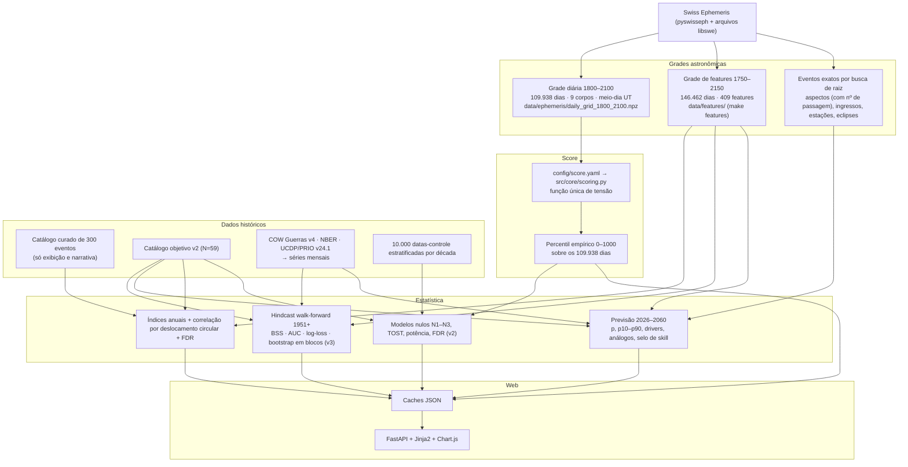

# astro-history 🪐🏛️
### Plataforma de Pesquisa Científica Aberta e Reprodutível sobre Alinhamentos Astrológicos e Fatos Históricos


> 🌍 **Idiomas / Languages**: **Português** • [English version (README.md)](README.md)

---

## Sumário

1. [O que é este projeto](#1-o-que-é-este-projeto)
2. [A pergunta de pesquisa e a resposta honesta](#2-a-pergunta-de-pesquisa-e-a-resposta-honesta)
3. [Como o site funciona, página por página](#3-como-o-site-funciona-página-por-página)
4. [O pipeline computacional](#4-o-pipeline-computacional)
5. [Camada astronômica: o que é calculado e como](#5-camada-astronômica-o-que-é-calculado-e-como)
6. [O score de tensão e a escala de percentil 0–1000](#6-o-score-de-tensão-e-a-escala-de-percentil-01000)
7. [Índices anuais do Dashboard e correlação com a história](#7-índices-anuais-do-dashboard-e-correlação-com-a-história)
8. [Matriz de features v3: a astrologia mundana moderna operacionalizada](#8-matriz-de-features-v3-a-astrologia-mundana-moderna-operacionalizada)
9. [Alvos históricos e fontes de dados](#9-alvos-históricos-e-fontes-de-dados)
10. [Validação I — testes pré-registrados com modelos nulos (v2)](#10-validação-i--testes-pré-registrados-com-modelos-nulos-v2)
11. [Validação II — hindcast walk-forward e skill de previsão (v3)](#11-validação-ii--hindcast-walk-forward-e-skill-de-previsão-v3)
12. [Previsão 2026–2060: o que os números significam](#12-previsão-20262060-o-que-os-números-significam)
13. [Decisões de projeto e suas justificativas](#13-decisões-de-projeto-e-suas-justificativas)
14. [Capturas de tela](#14-capturas-de-tela)
15. [Instalação, reprodução e deploy](#15-instalação-reprodução-e-deploy)
16. [API HTTP](#16-api-http)
17. [Estrutura do repositório](#17-estrutura-do-repositório)
18. [Limitações conhecidas e roadmap](#18-limitações-conhecidas-e-roadmap)
19. [Citação, licença e atribuição](#19-citação-licença-e-atribuição)

---

## 1. O que é este projeto

O **astro-history** é um banco de testes científico, de código aberto, que submete a medição controlada uma afirmação popular: a de que a geometria do céu (aspectos planetários, ciclos dos planetas externos, estrelas fixas, eclipses) é sistematicamente diferente nos momentos em que grandes eventos históricos acontecem — e que, portanto, essa geometria pode antecipar pontos de virada futuros.

O projeto faz três coisas ao mesmo tempo:

- **Calcula o céu com precisão.** Cada mapa, índice e feature deriva do Swiss Ephemeris (precisão de arco-segundos), com fusos horários históricos reais, tratamento correto de calendário e tratamento explícito de eventos sem hora conhecida.
- **Testa a afirmação com as ferramentas da ciência de previsão.** Hipóteses pré-registradas, modelos nulos por permutação que preservam o agrupamento temporal, controle de taxa de falsas descobertas, teste de equivalência, análise de potência e — desde a v3 — um hindcast walk-forward que mede o skill de previsão fora da amostra contra a climatologia e um baseline autorregressivo.
- **Publica tudo como plataforma web interativa**, onde qualquer visitante pode inspecionar o mapa de qualquer um dos 300 eventos históricos, compará-lo com 10.000 datas-controle aleatórias, simular qualquer data e ler uma previsão probabilística para 2026–2060 rotulada com o skill que ela de fato obteve no backtesting.

A plataforma foi deliberadamente construída como **ferramenta de literacia de dados**: mostra como um padrão retrospectivo conhecido pode parecer convincente e depois explica, com números, por que ele não sobrevive a testes controlados.

---

## 2. A pergunta de pesquisa e a resposta honesta

> **"As geometrias de aspectos planetários e os alinhamentos astronômicos distinguem grandes eventos históricos de datas aleatórias melhor que o acaso — e conseguem prever eventos futuros com skill mensurável?"**

**Resposta após v2 e v3 (outubro de 2026): não, com nenhum construto testado até agora.**

| Linha de evidência | Método | Resultado |
| :--- | :--- | :--- |
| Teste pré-registrado, N = 59 eventos objetivos (v2) | Nulo de deslocamento circular (10.000 permutações), nulo estratificado por década, nulo uniforme, FDR | z = −0,51, p = 0,69, q = 0,88 — nulo não rejeitado |
| Teste de equivalência (v2) | TOST com Δ = ±0,30 DP | p = 0,041 — o efeito observado é *estatisticamente equivalente a zero* |
| Fora da amostra 1951–2025 com limiares fixados em 1800–1950 (v2) | Walk-forward | z = −0,85, p = 0,80 — sem sinal preditivo |
| Tese de Tarnas dos planetas externos (v2) | Aspectos duros entre Saturno, Urano, Netuno e Plutão | z = −0,06, p = 0,98 |
| Hindcast walk-forward em séries mensais objetivas, 1951–2024 (v3) | Brier Skill Score vs climatologia, AUC, log-loss, 7 alvos × 8 modelos | Nenhum modelo astrológico supera a taxa-base com IC positivo **e** discriminação real (AUC > 0,55) |
| Índices anuais vs catálogo de 300 e amostra v2 (v3) | Nulo de deslocamento circular sobre médias anuais, Benjamini-Hochberg | Nenhuma correlação sobrevive ao FDR; nenhuma na amostra objetiva |

O que isso significa para o site: as páginas de previsão mostram cada curva **junto com o skill medido** e, quando não há skill, dizem isso e recomendam a taxa-base histórica como a estimativa mais precisa disponível. Nada no site é apresentado como previsão de risco.

---

## 3. Como o site funciona, página por página

| Página | URL | O que mostra | De onde vêm os números |
| :--- | :--- | :--- | :--- |
| **Dashboard** | `/` | Gráfico 1800–2100 com cinco séries selecionáveis (pico de tensão, faixa nula P5–P95, risco bélico, inovação, concentração Barbault), painel de correlação de cada série com a história, card de skill da previsão, distribuições por categoria e signo solar, eventos em destaque | `data/timeline_1800_2100.json`, `data/annual_indices.json`, `data/forecast_v3.json` |
| **Catálogo** | `/events` | 300 eventos históricos com filtros por categoria, busca textual e filtro "✓ N=59" para os eventos que pertencem à amostra objetiva validada | SQLite `events` e `events_v2` |
| **Detalhe do evento** | `/events/{id}` | Mapa completo (17 corpos, aspectos estritos, contatos com estrelas fixas, casas quando a hora é conhecida), mandala SVG, ênfase arquetípica, botão "comparar com data-controle aleatória", anterior/próximo cronológico | `chart_json` por evento; `/api/random-control-comparison` |
| **Hub de correlações** | `/correlations` | Frequência de signos, aspectos e estrelas fixas por categoria histórica | Agregação SQL sobre `planet_positions`, `event_aspects`, `event_star_aspects` |
| **Metodologia** | `/methodology` | Resultados dos modelos nulos v2, funil de exclusão 300 → 61 → 59 e tabela do hindcast v3 | `data/results.json`, `reports/hindcast_v3.json` |
| **Previsão v3** | `/forecast` | Por alvo: selo de skill, probabilidade por ano com banda p10–p90 vs taxa-base, perfil mensal, drivers do modelo, calendário astronômico exato (aspectos, ingressos, eclipses) e análogos históricos com lift | `data/forecast_v3.json` |
| **Cenários 2027–2060** | `/projections` | Tabela ano a ano do índice legado (tiers de percentil), portais sazonais, signos dos externos e precedente geométrico mais próximo — com aviso de que os tiers descrevem geometria, não risco | `data/projections_2027_2060.json` |
| **Linha do tempo e simulador** | `/simulator` | Tabela completa 1800–2100 e formulário para calcular o mapa de qualquer data/hora/lugar; o resultado fica numa URL GET compartilhável | Swiss Ephemeris em tempo real + matcher leave-one-out |

O servidor é uma aplicação FastAPI que renderiza templates Jinja2 com Tailwind e Chart.js. Ele **lê caches JSON pré-computados**; o único cálculo de efemérides por requisição é o do simulador.

---

## 4. O pipeline computacional



`make v3` executa a cadeia inteira: `features → hindcast → forecast → timeline`.

---

## 5. Camada astronômica: o que é calculado e como

| Item | Implementação | Por que importa |
| :--- | :--- | :--- |
| **Efemérides** | `pyswisseph` com os arquivos `seas/sepl/semo`; o flag de retorno é verificado como `SWIEPH`, não o modo aproximado Moshier | Posições com precisão de arco-segundos em 1750–2150 |
| **Instante do evento** | `resolve_event_instant()`: para anos ≥ 1883, a zona IANA da latitude/longitude do evento é resolvida com `timezonefinder` e aplicada com `zoneinfo` (horário de verão histórico incluído); antes de 1883, Hora Média Local exata (longitude / 15, sem arredondar). A data civil muda quando a conversão cruza a meia-noite | Até a v2 o deslocamento era `round(longitude / 15)`, errado em até 3 h e sem cruzar o limite do dia — o bastante para mover a Lua 1,5° e trocar o Ascendente |
| **Calendário** | Gregoriano a partir de 1582-10-15 por padrão; `calendar_region` (britain = 1752, russia = 1918, greece = 1923, japan = 1873, …) ou `calendar` explícito | Datas registradas em "estilo antigo" seriam deslocadas em 10–13 dias |
| **Hora desconhecida** | 82 dos 300 eventos do catálogo não têm hora documentada. São calculados às 12:00 UT e a **Lua é excluída** dos aspectos e do score | A Lua anda ~13°/dia; com orbe de 3°, um meio-dia chutado cobriria 22 % do zodíaco ao acaso |
| **Corpos** | Sol, Lua, Mercúrio–Plutão, Ceres, Pallas, Juno, Vesta, Quíron, Lilith média, Nodo verdadeiro (17) | Conjunto clássico da astrologia moderna; só os 9 corpos centrais entram no score |
| **Aspectos** | Conjunção 0°, quadratura 90°, trígono 120°, oposição 180°, orbe 3,0°, decaimento linear com a orbe; definições lidas de `config/score.yaml` | Orbes estritas minimizam acertos aleatórios; as orbes largas de Tarnas são testadas à parte na v3 por features contínuas |
| **Estrelas fixas** | 30 estrelas via `swe_fixstar2_ut`; só **conjunções** dentro de 0,3° contam, e só se a latitude eclíptica da estrela for ≤ 30° | Checar 4 aspectos × 17 corpos × 30 estrelas gerava ~5 contatos espúrios por mapa; Vega (62°) ou Polaris (66°) nunca estão de fato "sobre" um planeta |
| **Casas** | Placidus; acima do círculo polar, fallback para Porphyry e depois Signos Inteiros | Placidus é indefinido acima de ~66° de latitude |
| **Datas exatas** | `src/features/astro_events.py` localiza trocas de sinal numa varredura diária e refina com o método de Brent sobre a efeméride; devolve data e hora UT, nº da passagem no laço retrógrado, aplicativo/separativo, tipo e ponto de máximo dos eclipses | Conferido contra efemérides publicadas: Saturno ☌ Netuno 20/02/2026 16:54 UT, Saturno ☌ Plutão 12/01/2020, eclipse solar total 08/04/2024 |

---

## 6. O score de tensão e a escala de percentil 0–1000

A linha vermelha do dashboard e todo número de "tensão" do site vêm de uma única função, `raw_tension_from_longitudes()` em `src/core/scoring.py`, cujos parâmetros ficam em `config/score.yaml`:

- **Classes de par** codificam a hierarquia arquetípica da astrologia moderna: Saturno–Plutão (duro 260 / conjunção 250), Urano–Plutão (220 / 200), Saturno–Urano (220 / 160), Saturno–Netuno (200 / 220), outros pares externo–externo (170 / 160), Marte com externo (130 / 110), luminar com externo (75 / 60), demais (40 / 30).
- Aspectos duros (90°, 180°) e conjunções somam o peso da classe vezes o fator linear de orbe `(3 − orbe) / 3`; trígonos subtraem 20 % de um peso de harmonia (35 externo–externo, 15 nos demais). Base 60.
- A **grade diária** (1800–2100, meio-dia UT, 9 corpos) e cada **carta de evento** chamam a mesma função. Um teste de paridade garante que a mesma data dá o mesmo score pelos dois caminhos (diferença máxima 0,002, ruído de float32). Até a v3, o caminho da carta somava aspectos de 17 corpos e consultava o resultado numa tabela de percentil de 9 corpos, inflando o percentil exibido.
- O score bruto é convertido em **percentil empírico** sobre os 109.938 dias: 850 significa "mais intenso que 85 % de todos os dias entre 1800 e 2100". Não há piso nem teto artificiais (a v1 saturava em 990).
- O **pico anual** mostrado no gráfico é o dia de score máximo dentro do ano, tirado da grade — não o máximo de quatro datas sazonais, como na v2.

**Importante:** esses pesos são a *codificação de uma hipótese*, não valores ajustados aos dados. Por isso o índice é testado, não assumido, e por isso a v3 o substitui por modelos aprendidos para a previsão.

---

## 7. Índices anuais do Dashboard e correlação com a história

Três séries adicionais são derivadas da grade de features (`src/analysis/annual_indices.py`) como percentil (0–1000) da média anual em 1800–2100:

| Série | Cor | Definição |
| :--- | :--- | :--- |
| **Risco Bélico** | âmbar | Ativação gaussiana média de quadraturas e oposições entre Júpiter, Saturno, Urano, Netuno e Plutão |
| **Inovação Científica** | azul | Ativação média de trígonos e sextis entre os 9 corpos |
| **Concentração Planetária (Barbault)** | roxo | 1800° menos o Índice Cíclico de Barbault (soma das 10 separações angulares entre os externos). Alto = externos agrupados. Barbault associou os mínimos do índice a 1914–18, 1939–45 e 1982–83 |

Cada série é correlacionada com a história por **deslocamento circular dos anos** (10.000 permutações): a média do índice nos anos com evento é comparada com sua distribuição nula, preservando o agrupamento temporal dos eventos e a autocorrelação dos planetas lentos. O painel reporta z, p bicaudal, q de Benjamini-Hochberg e o lift do quartil superior, para cada uma das seis categorias do catálogo, o catálogo inteiro e a amostra objetiva v2.

Resultado atual: alguns p < 0,05 nominais no catálogo *curado* (por exemplo, anos de evento têm risco bélico *menor*, z = −2,2) que não sobrevivem ao FDR, e **nada na amostra objetiva** (|z| < 0,9). O painel marca resultados nominais em âmbar e os significativos após FDR em verde, e explica o viés de seleção do catálogo curado.

---

## 8. Matriz de features v3: a astrologia mundana moderna operacionalizada

`src/features/astro_features.py` calcula **409 features diárias** de 1750 a 2150 (146.462 dias, ~20 s), agregadas por mês (média; mais o máximo mensal das ativações):

| Família | Conteúdo | Justificativa |
| :--- | :--- | :--- |
| Fases dos ciclos sinódicos | seno/cosseno (1º e 2º harmônico) do ângulo de cada um dos 10 pares de externos, geocêntrico **e** heliocêntrico | A variável contínua elimina a escolha de orbe e permite estatística circular; fases heliocêntricas não têm laço retrógrado |
| Índice de Barbault | geocêntrico e heliocêntrico | O índice preditivo canônico da astrologia mundana do século XX |
| Ativação de aspectos | kernel gaussiano para 36 pares × 5 ângulos (0, 60, 90, 120, 180); σ = 5° externo–externo, 4° com Júpiter, 2° nos demais | Substitui o corte binário "dentro/fora da orbe" e cobre as orbes largas que Tarnas de fato usa |
| Harmônicos | comprimento do vetor resultante nos harmônicos 4 e 8 (externos; todos os corpos) | Concentração harmônica de Addey |
| Declinação | declinação de 8 corpos; fora-de-limites de Mercúrio, Vênus e Marte | Uma dimensão inteira ignorada pela análise só por longitude |
| Movimento | retrogradação, estações, ingressos, signos cardinais, posição zodiacal (sen/cos) dos externos | Marcadores mundanos padrão |
| Meios-pontos | Marte/Saturno, Saturno/Plutão, Urano/Plutão, Saturno/Netuno, Saturno/Urano ativados por Sol, Marte e Júpiter no eixo de 90° | Cosmobiologia de Ebertin |
| Eclipses | dias até o eclipse solar/lunar mais próximo; janelas de ±15 dias | Eventos astronômicos exatos e localizáveis |
| Legado | o índice de `score.yaml` | Para que o índice v2 seja comparado aos demais em pé de igualdade |

---

## 9. Alvos históricos e fontes de dados

| Fonte | Cobertura | Séries mensais derivadas | Arquivo |
| :--- | :--- | :--- | :--- |
| **Catálogo objetivo v2** (UCDP, COW, NBER, Powell & Thyne, Polity5) | 1800–2025, 61 eventos com precisão diária, 59 na janela analítica | qualquer evento; por classe (guerra interestatal, conflito armado, recessão, pandemia, golpe, mudança de regime) | `data/events_v2.csv`, SQLite `events_v2` |
| **COW Inter-State War Data v4.0** | 1816–2007, 95 guerras | início de guerra (binário e contagem), guerra em curso, log de mortes em batalha | `data/external/Inter-StateWarData_v4.0.csv` |
| **NBER, datas dos ciclos econômicos** | 1857–2024 | mês em recessão (578 meses), início de recessão (34) | `data/external/business_cycle_dates.json` |
| **UCDP/PRIO Armed Conflict Dataset v24.1** | 1946–2023 | início de episódio de conflito (414 meses), início interestatal, conflitos com ≥ 1.000 mortes | `data/external/UcdpPrioConflict_v24_1.csv` |
| Catálogo curado de 300 eventos | 44 a.C.–2024 | **não usado no treino** — exibição, narrativa e painel de correlação apenas (marcado como enviesado por seleção) | `data/historical_events.json`, SQLite `events` |
| 10.000 datas-controle | 1800–2025, estratificadas por década | comparações com controle aleatório e nulo N2 | SQLite `control_dates` |

Por que séries mensais: com 59 eventos o efeito mínimo detectável a 80 % de potência era 0,33 DP; milhares de meses dão a potência estatística que um resultado nulo precisa para ter significado. Por que o catálogo curado fica fora do treino: foi montado em retrospecto e sua mistura de categorias (96 revoluções, 91 guerras em 300) seria aprendida como prior.

---

## 10. Validação I — testes pré-registrados com modelos nulos (v2)

As hipóteses foram fixadas previamente em [`docs/hipoteses.md`](docs/hipoteses.md); a árvore de decisão e seu desfecho estão em [`docs/decisao_M2.md`](docs/decisao_M2.md).

| Hipótese testada | N | Score observado | Distribuição nula (média ± DP) | Efeito ($z$) | $p$ (bicaudal) | $q$ (FDR) | Significativo? |
| :--- | :---: | :---: | :---: | :---: | :---: | :---: | :---: |
| **H1 Geral vs N3 Deslocamento Circular** | 59 | 481,1 | 500,6 ± 38,5 | −0,506 | 0,6117 | 0,8834 | ❌ |
| **H1 Geral vs N2 Controle Estratificado** | 59 | 481,1 | 493,9 ± 36,6 | −0,350 | 0,7163 | 0,8834 | ❌ |
| **H1 Geral vs N1 Aleatório Uniforme** | 59 | 481,1 | 499,7 ± 37,7 | −0,493 | 0,6299 | 0,8834 | ❌ |
| **H1 Classe: Guerra Interestatal** | 15 | 462,1 | 499,4 ± 73,3 | −0,509 | 0,6163 | 0,8834 | ❌ |
| **H1 Classe: Crise Econômica** | 10 | 547,6 | 501,9 ± 93,8 | +0,487 | 0,6223 | 0,8834 | ❌ |
| **H1 Classe: Golpe de Estado** | 11 | 538,4 | 501,6 ± 84,9 | +0,434 | 0,6653 | 0,8834 | ❌ |
| **H2 Walk-Forward (treino 1800–1950)** | 26 | 512,4 | 499,4 ± 56,8 | +0,229 | 0,8165 | 0,8834 | ❌ |
| **H2 Teste fora da amostra (1951–2025)** | 33 | 456,5 | 501,6 ± 53,0 | −0,851 | 0,4008 | 0,9329 | ❌ |
| **H4 Tese de Tarnas (planetas externos)** | 59 | 33,4 | 34,0 ± 8,7 | −0,063 | 0,9794 | 0,8834 | ❌ |

Análises de apoio: **equivalência TOST** (Δ = ±0,30 DP, p = 0,041: o efeito é estatisticamente equivalente a zero); **potência** (MDE 95,7 pontos = 0,332 DP a 80 %); **controles negativos sintéticos** (1.000 catálogos de ruído puro → 3,7 % de falsos positivos a α = 5 %); **estabilidade de orbe** (1°, 2°, 3°). Modelos nulos: N1 datas uniformes, N2 datas-controle estratificadas por década, N3 deslocamento circular do vetor inteiro de eventos (preserva o espaçamento entre eventos e a autocorrelação dos planetas lentos).

As correções metodológicas que tornaram esses testes válidos estão em [`reports/phase1_before_after.md`](reports/phase1_before_after.md): matcher leave-one-out (sem auto-combinação), estrelas fixas só por conjunção, percentil contínuo em vez de teto em 990, Lua excluída sem hora, amostragem diária homogênea.

---

## 11. Validação II — hindcast walk-forward e skill de previsão (v3)

Pré-registro: [`docs/hipoteses_v3.md`](docs/hipoteses_v3.md). Tabelas completas: [`reports/hindcast_v3.md`](reports/hindcast_v3.md).

**Protocolo** (`src/analysis/hindcast.py`): para cada alvo e cada ano de teste *t* de 1951 até o fim da cobertura do alvo, cada modelo é ajustado só com meses de anos ≤ *t* − 1 com intervalo de segurança de 12 meses, e prevê os 12 meses de *t*. As previsões acumuladas são pontuadas com o **Brier Skill Score** contra a climatologia expansiva (IC 95 % por bootstrap em blocos anuais), **AUC**, log-loss e curvas de confiabilidade. Os modelos são regressões logísticas L2 sobre features padronizadas, com a regularização escolhida por validação temporal interna nos últimos 20 % de cada janela de treino.

| Alvo (taxa-base) | climatologia | **baseline AR** | índice legado | Barbault | Tarnas externos | fases externas | 409 features | AR + astro |
| :--- | ---: | ---: | ---: | ---: | ---: | ---: | ---: | ---: |
| v2 qualquer evento (3,3 %) | 0 | −0,002 | −0,001 | −0,002 | −0,002 | +0,001 | −0,000 | −0,000 |
| COW início de guerra (5,1 %) | 0 | −0,004 | −0,004 | +0,002 | −0,002 | −0,001 | −0,000 | −0,000 |
| COW guerra em curso (53,5 %) | 0 | **+0,825** | −0,021 | +0,036 | −0,036 | +0,002 | −0,067 | +0,624 |
| NBER recessão (12,7 %) | 0 | **+0,850** | −0,023 | +0,028 | −0,030 | +0,127* | −0,486 | −0,026 |
| NBER início de recessão (1,2 %) | 0 | −0,014 | −0,018 | −0,003 | −0,001 | −0,005 | −1,080 | −1,981 |
| UCDP início de episódio (49,3 %) | 0 | +0,027 | +0,003 | −0,009 | −0,009 | −0,019 | −0,494 | −0,589 |
| UCDP início interestatal (6,1 %) | 0 | −0,004 | +0,003 | −0,008 | −0,005 | −0,035 | −2,472 | −2,565 |

Valores são BSS (maior é melhor; 0 = igual à taxa-base). \* IC [+0,003; +0,247], mas AUC = 0,40: o ganho de Brier vem de calibração/variância, não de discriminação, e com 35 comparações um IC marginal é esperado ao acaso — tratado como **não confirmado**.

**Regra de veredito usada pelo site:** "skill positivo" exige IC do BSS inteiramente acima de zero **e** AUC > 0,55. Nenhum modelo astrológico a cumpre em nenhum alvo. O baseline autorregressivo (o passado recente do próprio alvo) domina os alvos persistentes, e as features astrológicas não acrescentam nada a ele.

---

## 12. Previsão 2026–2060: o que os números significam

`src/analysis/forecast_v3.py` produz, para cada alvo, o melhor modelo astrológico do hindcast ajustado em toda a cobertura e, para cada ano de 2026 a 2060:

- **p média** — probabilidade mensal média do evento; **p10–p90** — intervalo por bootstrap em blocos anuais (60 reajustes); **× taxa-base** — o quanto o modelo se afasta da climatologia.
- **Drivers** — as features com maior contribuição linear positiva no mês de pico, com rótulos legíveis ("Fase do ciclo Saturno–Plutão", "Índice Cíclico de Barbault", "Saturno □ Netuno (ativação)").
- **Calendário exato** — todo aspecto exato entre planetas lentos (com nº da passagem no laço retrógrado), todo ingresso e todo eclipse daquele ano, com data e hora UT.
- **Análogos** — os meses históricos mais próximos no espaço padronizado das fases dos 10 ciclos externos, no máximo um por década (isso remove a "confusão de época" do matcher por signo, em que Plutão passando 12–30 anos num signo fazia todos os análogos serem a mesma geração), com os eventos do catálogo ao redor e um lift contra a taxa-base.
- **Selo de skill** — BSS do hindcast, IC, AUC e veredito, exibidos *antes* do gráfico. Quando o veredito não é "skill positivo", um aviso diz que a linha tracejada da taxa-base é a estimativa recomendada e que a curva do modelo é mostrada por transparência.

---

## 13. Decisões de projeto e suas justificativas

| Decisão | Justificativa |
| :--- | :--- |
| Uma função de score lida de YAML, com teste de paridade grade ↔ carta | Duas fórmulas divergentes na v2 inflavam os percentis exibidos; uma fonte única torna cada número do site rastreável a um arquivo de configuração |
| Fusos reais em vez de `round(longitude/15)` | Erros de 1–3 h movem a Lua e todas as cúspides; o limite do dia nunca era cruzado |
| Excluir a Lua sem hora documentada em vez de chutar meio-dia | Tratar a incerteza com honestidade é melhor que 22 % de acertos aleatórios |
| Alvos mensais objetivos em vez de 59 eventos | Potência estatística; remoção da seleção em retrospecto |
| Walk-forward com gap, baselines de climatologia **e** AR | Eventos se agrupam (guerras causam guerras); um modelo precisa vencer o passado do próprio alvo, não só datas aleatórias |
| Deslocamento circular como nulo principal | É o único nulo que preserva ao mesmo tempo o espaçamento dos eventos e a deriva lenta dos externos que faz qualquer época "parecer especial" |
| FDR em toda família de testes e regra de veredito combinando IC e AUC | 35 comparações garantem alguns acertos nominais; a regra impede que um artefato de calibração seja vendido como skill |
| Selo de skill antes de qualquer curva; taxa-base recomendada sem skill | "Precisão de uma previsão" é uma propriedade que precisa ser medida, e o usuário recebe a medição primeiro |
| Catálogo curado mantido só para exibição | É o que torna o site legível, mas é enviesado por seleção e não pode treinar nem validar nada |
| Caches versionados, grade de features ignorada | O site sobe sem recálculo; a grade de 18 MB se reconstrói em 20 s |

Uma narrativa mais longa do mecanismo e de cada consideração está em [`docs/mecanismo_site.md`](docs/mecanismo_site.md).

---

## 14. Capturas de tela

| | |
|:---:|:---:|
| <br>**Dashboard** — gráfico 1800–2100 com séries selecionáveis e legenda interativa | <br>**Previsão v3** — selo de skill antes da curva; p(evento) com banda p10–p90 vs taxa-base |
| <br>**Metodologia** — tabela do hindcast walk-forward | <br>**Linha do tempo e simulador** — URLs compartilháveis |
| <br>**Detalhe do evento** — selo da amostra validada, navegação cronológica | <br>**Catálogo** — filtro "✓ N=59" |
| <br>**Hub de correlações** | <br>**Tabela 2027–2060** — tiers de geometria com aviso de skill |

---

## 15. Instalação, reprodução e deploy

### Pré-requisitos
- Linux / macOS, Python 3.12+
- Biblioteca C e arquivos de dados do Swiss Ephemeris (`libswe-dev`, `libswe0`, `swisseph-data-all` no Debian/Ubuntu); o código os procura em `/usr/share/libswe/ephe`, `/usr/share/swisseph` ou `/usr/local/share/swisseph`

### Instalar e testar
```bash
git clone https://github.com/marceloasl99/astro-history.git
cd astro-history
make setup          # venv + dependências travadas (numpy, scipy, scikit-learn, timezonefinder, PyYAML, FastAPI…)
make test           # 45 testes: regressão golden, paridade grade↔carta, fusos, datas exatas, alvos, API
```

### Reproduzir a estatística
```bash
make validate       # v2: modelos nulos N1–N3 com 10.000 permutações, TOST, potência → data/results.json, reports/validacao_v2.md
make features       # v3: grade diária de 409 features 1750–2150 (~20 s)
make hindcast       # v3: hindcast walk-forward, todos os alvos (~15 min) → reports/hindcast_v3.{json,md}
make forecast       # v3: previsão 2026–2060 → data/forecast_v3.json (+ cache do calendário exato)
make timeline       # caches da UI: linha do tempo e projeções (pico diário real, índices anuais)
make v3             # todos os passos v3 acima, em ordem
```

### Rodar o site
```bash
make run            # http://127.0.0.1:8000
# ou
docker compose up -d --build   # app + proxy reverso Caddy em 80/443
```

Tudo é determinístico (sementes fixas em `config/analysis.yaml` e nos scripts); reexecutar a cadeia reproduz os caches JSON versionados.

---

## 16. API HTTP

| Endpoint | Método | Descrição |
| :--- | :---: | :--- |
| `/api/stats` | GET | Estatísticas do catálogo |
| `/api/events?category=&search=` | GET | Lista de eventos com filtros |
| `/api/events/{id}` | GET | Evento completo com o JSON do mapa |
| `/api/simulate` | POST | Mapa + eventos similares para um corpo JSON `{title, date, time, city, country, latitude, longitude}` (validado; 422 em entrada inválida) |
| `/api/random-control-comparison/{id}` | GET | Datas-controle aleatórias com intensidade geométrica ≥ à do evento |
| `/api/future-timeline` | GET | Linha do tempo anual 1800–2100 |
| `/api/projections-2027-2060` | GET | Tabela de projeções ano a ano |
| `/api/forecast` | GET | Resumo da previsão (todos os alvos, sem calendário/análogos) |
| `/api/forecast?target=cow_war_onset` | GET | Um alvo: skill, taxa-base, probabilidades por ano, drivers |
| `/api/forecast/year/{ano}` | GET | Calendário exato, análogos e a linha de cada alvo para um ano (2026–2060) |

---

## 17. Estrutura do repositório

```
astro-history/
├── config/
│   ├── score.yaml                 # Orbes e pesos por par — fonte única do score de tensão
│   ├── stars.yaml                 # 30 estrelas fixas
│   └── analysis.yaml              # Permutações, sementes, janelas de treino/teste
├── data/
│   ├── events_v2.csv              # Catálogo objetivo (COW, UCDP, NBER, Powell & Thyne, Polity5)
│   ├── historical_events.json     # Catálogo curado de 300 eventos (só exibição)
│   ├── external/                  # COW Guerras v4, datas NBER, UCDP/PRIO v24.1 (+ README com fontes)
│   ├── ephemeris/                 # Grade diária 1800–2100 (.npz)
│   ├── features/                  # Grade de 409 features 1750–2150 (ignorada no git; make features)
│   ├── results.json               # Resultados dos modelos nulos v2
│   ├── annual_indices.json        # Séries do dashboard + correlação com a história
│   ├── forecast_v3.json           # Previsão 2026–2060
│   ├── astro_calendar_2026_2060.json  # Aspectos exatos, ingressos, eclipses
│   ├── timeline_1800_2100.json / projections_2027_2060.json   # caches da UI
│   ├── DATASET_CARD.md / exclusion_log.md
├── db/history_astrology.db        # SQLite: events, planet_positions, event_aspects, event_star_aspects, events_v2, control_dates
├── docs/
│   ├── hipoteses.md / hipoteses_v3.md     # Pré-registros
│   ├── decisao_M2.md              # Registro da decisão do marco
│   ├── mecanismo_site.md          # Mecanismo e considerações de projeto
│   └── screenshots/
├── reports/                       # validacao_v2.md, phase3_validation.md, hindcast_v3.md, final_report_v2.md, …
├── src/
│   ├── astro_engine.py            # Mapas: corpos, aspectos, estrelas fixas, casas, resolução do instante
│   ├── correlation_engine.py      # Correlações por categoria e matcher leave-one-out
│   ├── future_engine.py           # Linha do tempo anual e projeções
│   ├── core/
│   │   ├── scoring.py             # Função única de tensão (lê score.yaml)
│   │   ├── timezones.py           # Conversão IANA / LMT com virada de dia
│   │   └── ephemeris_grid.py      # Grade diária e percentis empíricos
│   ├── features/
│   │   ├── astro_features.py      # 409 features diárias, agregação mensal
│   │   ├── astro_events.py        # Aspectos exatos, ingressos, estações, eclipses
│   │   └── targets.py             # Séries mensais de alvos a partir das fontes históricas
│   ├── analysis/
│   │   ├── null_models.py / multiplicity.py / run_phase3_validation.py   # v2
│   │   ├── hindcast.py            # Medição de skill walk-forward
│   │   ├── forecast_v3.py         # Previsão, drivers, análogos, selo de skill
│   │   └── annual_indices.py      # Séries do dashboard e correlação com a história
│   ├── data/ingest_historical.py  # Ingestão v2 e datas-controle
│   └── web/                       # App FastAPI, mandala SVG, templates Jinja2
├── tests/                         # regression/, unit/, statistical/, test_api.py …
├── Makefile · Dockerfile · docker-compose.yml · Caddyfile · ci/ci.yml
└── CITATION.cff · LICENSE · requirements.txt · requirements.lock
```

---

## 18. Limitações conhecidas e roadmap

**Limitações**
- As features são diárias ao meio-dia UT; a Lua fica fora da matriz de features e dos mapas sem hora documentada (82 de 300).
- O COW Militarized Interstate Disputes (~2.400 disputas) e a lista de golpes de Powell & Thyne não estão integrados (sem URL de download direto); os loaders os aceitam assim que os arquivos forem colocados em `data/external/`.
- Ainda não há mapas nacionais nem previsão por país.
- O baseline autorregressivo captura parte do agrupamento temporal; um baseline de processo pontual (Hawkes) não foi implementado.
- O Tailwind é carregado de CDN.

**Roadmap**
1. Integrar COW MID e dados de golpes; adicionar séries de volatilidade financeira.
2. Mapas nacionais (mapas de ingresso de Áries nas capitais, trânsitos a mapas natais nacionais) com hindcast por país — a única linha restante que poderia mudar o veredito de skill.
3. Grade horária para Lua e Mercúrio; intervalos de incerteza para eventos sem hora.
4. Baseline de Hawkes e surrogates de fase aleatória (IAAFT).

---

## 19. Citação, licença e atribuição

Se usar esta plataforma, seus dados ou seu código de modelos nulos, cite (ver [`CITATION.cff`](CITATION.cff)):

> AstroHistory Research Group (2026). *AstroHistory: An Empirical, Reproducible, and Open Statistical Investigation into Astrological Alignments and Historical Events*, versão 3.0.0. https://github.com/marceloasl99/astro-history

- **Código-fonte**: [GNU Affero General Public License v3 ou posterior](LICENSE).
- **Swiss Ephemeris**: © Astrodienst AG. Em conformidade com os termos da Astrodienst, o projeto é licenciado sob AGPL; uso comercial exige licença profissional da Astrodienst AG.
- **Bases de dados**: Correlates of War (Sarkees & Wayman, 2010), UCDP/PRIO Armed Conflict Dataset (Davies, Pettersson & Öberg, 2024; Gleditsch et al., 2002), NBER Business Cycle Dating Committee, dados de golpes de Powell & Thyne, Polity5. Redistribuídas sem alteração para reprodutibilidade, sob os termos acadêmicos de cada fonte — ver [`data/external/README.md`](data/external/README.md).
- **Referências astrológicas** operacionalizadas no conjunto de features: André Barbault (índice cíclico), Richard Tarnas (ciclos dos planetas externos), Reinhold Ebertin (meios-pontos), John Addey (harmônicos).
